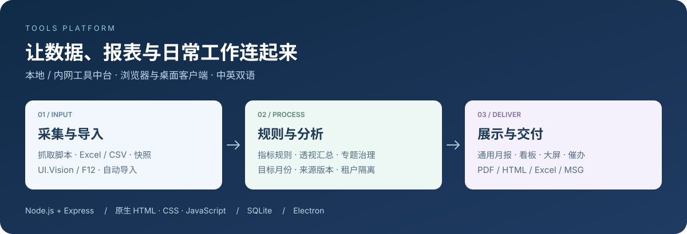

# Tools Platform

**从数据采集、指标分析，到月报交付与日常协作的本地 / 内网工具中台。**

[下载安装](https://github.com/fanxiaolongx-max/privacy-policy/releases) · [完整使用指南](tools-platform/README.md) · [技术架构](#技术架构与关键技术栈) · [通用月报编辑器](tools-platform/docs/monthly-designer.md) · [快速启动](#快速启动)



## 界面预览

### 通用月报编辑器

左侧找数据，中间编辑月报，右侧配置组件。支持数据透视、图表、指标引用、跨月模板复用与多格式导出。


*真实编辑器界面，使用虚构的团队与演示数据；具体功能见[月报编辑器指南](tools-platform/docs/monthly-designer.md)。*

### 首次启动快速上手

按需导入默认脚本与指标规则，再根据业务调整。


[查看默认快速上手包与导入说明 →](tools-platform/README.md#默认快速上手包)

## 能做什么

| 工作场景 | 主要能力 | 阅读入口 |
| --- | --- | --- |
| 数据采集与导入 | UI.Vision / F12 脚本库、网站适配、Excel / CSV 导入、自动导入 | [采集](tools-platform/README.md#21-自动化数据抓取与-uivf12-ai-网站适配器) · [指标规则](tools-platform/README.md#22-sla-数据合控与指标规则引擎) |
| 月报与看板 | 通用月报、数据透视、图表、动态指标、模板复用、运营大屏 | [月报编辑器](tools-platform/docs/monthly-designer.md) · [报表能力](tools-platform/README.md#23-报表看板月报工作区与运营大屏) |
| 交付与跟进 | PDF / HTML / Excel / 图片 / MSG 导出、一键催办、名称映射 | [催办与导出](tools-platform/README.md#24-一键精准催办与导出) |
| 专项治理与协作 | 会议考勤、花名册、专题分析、部门奖惩、正向激励、PR / FRT、需求与问卷 | [专项工具链](tools-platform/README.md#26-专项治理工具链) |
| 业务核验与学习 | 采购订单核验、供应商报价比对、考题金库、阿拉伯语互动学习 | [专项工具链](tools-platform/README.md#26-专项治理工具链) · [题库助手](tools-platform/docs/f12-exam-ai.md) |
| 内容制作 | 胶片设计、PPT 素材库、光影大厅与多媒体工具 | [胶片与素材](tools-platform/README.md#25-胶片设计与-ppt-素材库) · [多媒体](tools-platform/README.md#210-光影大厅-tools-cinema-与多媒体生态) |
| AI 与桌面伴侣 | Dragon Claw 智能体、知识检索、历史会话、2D / 3D 图谱、桌面宠物与客服 | [智能体](tools-platform/README.md#29-dragon-claw-智能体与-2d3d-双视图知识图谱) · [桌面宠物](tools-platform/README.md#211-桌面宠物伴侣-哈基米-hajimi-companion-与智能客服) |
| 工具扩展 | 自定义 HTML 工具、内置工具、工具市场与离线导出 | [工具市场](tools-platform/README.md#28-自定义工具与多源工具市场生态) |
| 平台管理 | 多租户隔离、授权、备份恢复、日志、服务监控与数据迁移 | [存储](tools-platform/README.md#4-数据存储启动自愈与迁移治理) · [备份](tools-platform/README.md#5-备份恢复与远端主站同步) |

## 选择使用方式

| 方式 | 适合场景 | 获取与说明 |
| --- | --- | --- |
| 浏览器 / 内网部署 | 团队共享数据与工具，通过浏览器访问 | [快速启动](#快速启动) · [部署指南](tools-platform/README.md#12-多系统部署windows-客户端与新手配置指引) |
| Windows 客户端 | 本机运行；安装版或免安装绿色版 | [下载发行版](https://github.com/fanxiaolongx-max/privacy-policy/releases) · [客户端说明](tools-platform/README.md#123-桌面客户端指引-windows-安装版绿色版-vs-macos-签名公证版) |
| macOS 客户端 | 本机运行；DMG / ZIP，arm64 / x64 构建 | [下载发行版](https://github.com/fanxiaolongx-max/privacy-policy/releases) · [构建与验收](tools-platform/docs/macos-desktop-release.md) |
| iOS / KMP 工程 | 移动端开发与外部指标接入 | [移动端工程](tools-platform/iosapp/) · [接口说明](tools-platform/iosapp/external-metrics-api.md) |

## 快速启动

> [!IMPORTANT]
> **华为内网环境部署必读**：  
> 如果在**华为内网环境**进行源码安装与拉取依赖，执行 `npm install` 前**必须先切换为华为内部 npm 镜像源**，否则公共 npm 源将无法访问或连接超时：
> ```powershell
> # 1. 切换至华为内网镜像源
> npm config set registry http://mirrors.tools.huawei.com/npm/
> 
> # 2. 验证当前镜像源配置
> npm config get registry
> # 正确输出应为: http://mirrors.tools.huawei.com/npm/
> ```

在仓库根目录执行：

```bash
cd tools-platform/backend
npm install
npm run doctor
npm start
```

打开 **http://localhost:3030**。运行环境、登录初始化、PM2 与桌面打包步骤见[完整部署指南](tools-platform/README.md#12-多系统部署windows-客户端与新手配置指引)。

## 技术架构与关键技术栈


### 关键开发技术点 (Key Engineering Highlights)

- **前端架构（原生轻量 · 零打包构建 · 多页面解耦）**：
  - **纯原生核心栈**：采用纯原生 **Vanilla JavaScript (ES6+)** 与语义化 HTML5，**无 Vue / React 等重型框架依赖**，无虚拟 DOM 运行时负担。
  - **零编译构建 (Zero-Build / No-Bundler)**：无需 Webpack、Vite 或 Babel 打包步骤，代码改动后浏览器与桌面客户端刷新即生效，拥有极佳的调试敏捷度与毫秒级首屏加载性能。
  - **多页面架构 (MPA)**：`frontend/pages/*.html` 独立解耦加载，各功能页面按需引入业务脚本，避免单页应用内存膨胀。
  - **现代纯 CSS3 视觉体系**：全局 CSS 变量（`CSS Variables`）、毛玻璃拟态（`Glassmorphism`）、Flexbox / Grid 响应式栅格，原生深度适配深色暗黑模式（`Dark Mode`）。
  - **领域驱动模块分层**：
    - `js/sla/`：SLA 数据合控、指标预警呼吸灯、渐进式按需分页（`<1ms` 切片渲染）、原生矢量羽毛漂浮加载动效。
    - `js/uivf12/`：UI.Vision 宏与控制台脚本 AST / 正则双向同步生成工作台。
    - `js/monthly-designer/`：通用月报拖拽设计器、跨月模板复用与导出。
    - `js/shared/`：API 统一请求网关（含 SQLite/JSON 模式切换与来源元数据追踪）、`ToolsI18n` 中英双语引擎、全局启动屏（`ToolsStartup`）。
  - **轻量专业库生态**：按需集成 Apache ECharts 5（趋势图表）、SheetJS / ExcelJS（多表导入导出）、html2canvas & jsPDF（报告导出）、LocalForage（大文件离线存储）。

- **后端架构（模块化服务 · 智能计算引擎 · 开机自愈）**：
  - **Node.js + Express**：模块化分层，业务路由与仓储层清晰解耦（`/routes` + `/models`），具备统一异常容灾拦截与响应包装。
  - **双模读源引擎 (Dual-Source Engine)**：**SQLite 3** 关系型核心引擎（开启 WAL 模式高并发保护）与 **JSON 本地文件降级存储**无缝协同，支持运行时自动探测与平滑降级。
  - **系统韧性与自愈体系**：内置开机自检 Doctor、存储就绪守卫（`ensureReady`）以及存量脚本/数据的自动纠偏与修复机制。
  - **租户物理隔离**：多租户物理分目录沙箱隔离（`data/tenants/<tenantId>/`），数据纯本地/内网私有驻留，严禁外发。

- **跨端宿主与交付（桌面客户端 + 浏览器内网部署）**：
  - **Electron 28 桌面应用**：主进程（Main）与渲染进程（Renderer）通过 Preload 脚本安全隔离，支持系统托盘驻留与快捷操作。
  - **全平台发行包矩阵**：
    - **macOS**：Apple Developer 证书权威签名与公证，同时发布 `arm64`（Apple Silicon）与 `x64`（Intel）双架构 DMG 安装镜像与 ZIP 更新包。
    - **Windows**：NSIS 规范安装包与免安装单文件便携绿色版（Portable）。
  - **移动端与扩展工程**：Kotlin Multiplatform (KMP) / iOS 原生 Xcode 工程生态。

- **工程质量保证**：
  - 接入 Node.js 原生测试体系（`node --test`），全量覆盖 **65+ 项**核心业务规则、宏生成、快照分页与界面交互自动化测试用例（测试通过率 100%）。

| 层级 | 核心实现 | 架构特征 |
| --- | --- | --- |
| 前端 | 原生 HTML5 / CSS3 / Vanilla JavaScript | 零打包构建 (No-Build)、多页面解耦 (MPA)、暗黑模式适配 |
| 后端 | Node.js + Express REST API | 路由与仓储分层解耦、WAL 高并发、开机自愈检查 (Doctor) |
| 数据存储 | SQLite 3 关系型核心 + JSON 文件降级 | 双模读源引擎、按租户物理目录沙箱隔离 |
| 桌面端 | Electron 28 (Main / Preload 隔离) | macOS (签名公证 DMG/ZIP 双架构) · Windows (安装版/便携版) |
| 移动端 | Kotlin Multiplatform (KMP) / iOS | 跨平台共享核心模型，原生 UI 查看 |

源码、运行数据、备份和客户端持久化目录的详细说明见[目录结构](tools-platform/README.md#10-目录结构详解)与[客户端文件目录](tools-platform/README.md#124-桌面客户端本地生成文件与目录全景字典-windows-vs-macos)。

## 文档导航

| 想了解什么 | 文档 |
| --- | --- |
| 全部功能、数据流、架构与部署 | [工程 README](tools-platform/README.md) |
| 月报编辑、数据来源、模板与导出 | [通用月报编辑器指南](tools-platform/docs/monthly-designer.md) |
| 页面地址与 API 路由 | [页面入口](tools-platform/README.md#7-常用页面入口清单) · [API 全景](tools-platform/README.md#8-主要-api-路由全景表) |
| 外部系统接入指标 | [外部指标 API](tools-platform/docs/external-metrics-api.md) |
| macOS 构建、签名与验收 | [macOS 发布文档](tools-platform/docs/macos-desktop-release.md) |
| 题库与口语学习 | [题库助手](tools-platform/docs/f12-exam-ai.md) · [埃及口语课堂](tools-platform/docs/egyptian-classroom.md) |
| 中英双语功能介绍 | [能力概览](tools-platform/docs/tools-platform-feature-overview-bilingual.html) |
| 开发约定 | [项目 AGENTS.md](tools-platform/AGENTS.md) |

首页用于快速了解项目；功能细节与运维资料统一保留在工程文档中。
