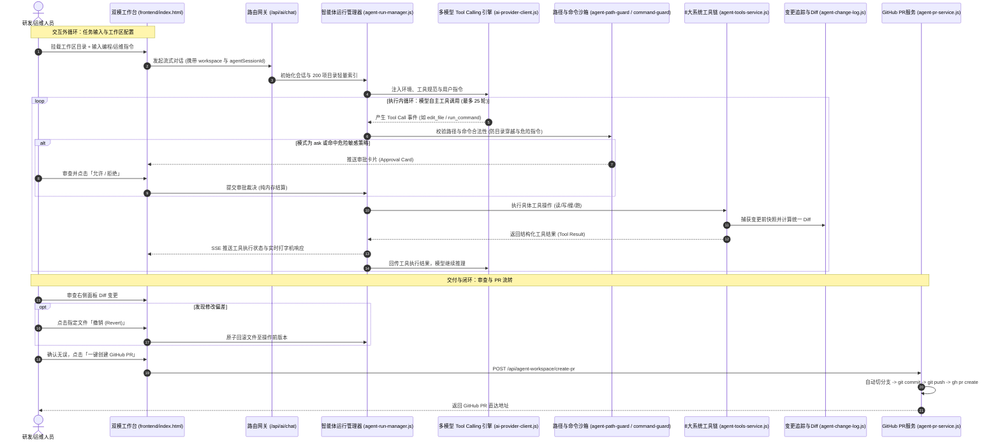
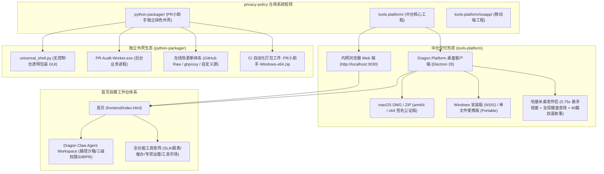

# Dragon Platform

**面向数据采集、SLA 合控、月报交付、Agent Workspace 智能体协同与日常治理的本地 / 内网工具中台矩阵。**

[下载安装](https://github.com/fanxiaolongx-max/privacy-policy/releases) · [完整使用指南](tools-platform/README.md) · [Dragon Claw 智能体](#-核心亮点dragon-claw-全能智能体与-agent-workspace) · [技术架构](#技术架构与关键技术栈) · [通用月报编辑器](tools-platform/docs/monthly-designer.md) · [快速启动](#快速启动)


---

## 🌟 核心亮点：Dragon Claw 全能智能体与 Agent Workspace

首页全新集成了具备真实代码编写、调试与环境调度能力的 **Dragon Claw Agent Workspace**。它突破了传统只读聊天机器人的局限，将大模型意图推断与本地工程文件系统、Git 工作流及终端执行深度贯通，成为研发运维人员的“智能结对编程副驾驶”。


### 💡 核心设计思路 (Design Philosophy)

1. **从“只读问答”到“工程闭环”**：
   传统运维 AI 往往只是被动回答知识库文本，遇到代码缺陷或配置错漏仍需人工复制粘贴、反复调试。Dragon Claw 突破性地接入生产级 **Tool Calling (Function Calling)** 协议，赋予智能体**看代码、搜工程、改文件、跑命令验证、提交 PR** 的自主闭环能力。
2. **“双模工作台”一体化融合而非割裂**：
   研发与运维在日常工作中，既需要一键直达、直观高效的可视化工具矩阵（SLA 合控、月报工作区、一键催办等），又需要自如应对复杂工程的对话式 Agent。平台首创“双模工作台”，通过 `Mode A (Agent 协同)` 与 `Mode B (工具矩阵)` 随时无缝切换，两者相互透传数据上下文。
3. **安全防线第一原则 (Security by Design)**：
   绝不在本地执行不可控的黑盒脚本。Dragon Claw 构建了严格的 **`agent-path-guard` 路径沙箱守卫**（严禁遍历越权）、**三级权限审批机制**（`ask` / `auto` / `full`）、**命令安全防火墙**（危险命令拦截、密码/令牌自动脱敏）与**内存态审批隔离**，确保在企业内网安全放心运行。

---

### 🚀 八大核心功能亮点 (Key Highlights)

| 核心亮点 | 能力描述 | 价值体现 |
| :--- | :--- | :--- |
| **① 全能智能体人设 (`dragon-claw-home`)** | 首页不受限于单一业务，具备跨语言架构、数据科学、前端开发与系统排障的通用全能专家能力。 | 既是中台的“超级向导”，又是本地全栈“编程助手”。 |
| **② 统一多模型 Tool Calling 引擎** | 原生抽象接入 **Google Gemini 2.5 / Pro、Anthropic Claude 3.5 Sonnet、OpenAI、MiniMax** 等各大主流大模型，支持流式工具派发与思考签名。 | 不依赖单一厂商，支持故障自动熔断降级 (Failover)。 |
| **③ 本地工程沙箱 (`workspace-panel.js`)** | 智能路径联想（支持 `~` 用户目录与绝对路径 Tab 补全），严格受限于挂载根目录，自动过滤 `.git`、`node_modules` 等无关噪点。 | 上下文更纯净，从源头上杜绝越权访问外部敏感目录。 |
| **④ 8 大生产级工具链调度全集** | 内置目录列举 (`list_directory`)、带行号分段长读 (`read_file`)、正则秒级检索 (`search`)、原子写 (`write_file`)、精确块级替换 (`edit_file`)、安全删除/重命名与超时受控终端命令 (`run_command`)。 | 精准高效完成代码修改，大文件与大输出自动截断保护。 |
| **⑤ 三级安全权限模式 (Permission Modes)** | **`ask` (逐项审批)**：写操作与命令强制弹窗确认；<br/>**`auto` (智能放行)**：自动读写，破坏性操作仍需审批；<br/>**`full` (完全自治)**：全自动执行；非管理员自动锁定为只读保护。 | 自由把控智能体自治度，严防意外误删或破坏性执行。 |
| **⑥ 实时 Token 预算仪表盘** | 动态计算并直观以多色度量环呈现：**对话消息 (Messages)**、**200项目录树 (Directory)**、**系统提示词 (System)**、**工具定义 (Tools)** 以及 **剩余可用额度 (Free Space)**。 | 一目了然掌握模型上下文消耗水位，彻底告别超限截断。 |
| **⑦ 差异审查与文件单点回滚 (Revert)** | 记录每次工具写操作的前后文件快照；前端可直观查看绿红高亮的代码变更 Diff，并内置外部冲突检测与单文件一键原子撤销。 | 随时审查智能体修改细节，改错一秒无损回滚。 |
| **⑧ 一键自动化创建 GitHub Pull Request** | 深度集成 Git 与 GitHub CLI (`gh`)；修改验证通过后，在面板中输入分支名，即可全自动完成分支创建、暂存、提交、推送并调起 `gh pr create` 发起 PR。 | 从对话排障到代码评审交付实现真正的流水线贯通。 |

---

### 📖 极简实用指导：6 步玩转 Agent Workspace

```text
[打开首页] ──> [选择模型] ──> [挂载本地工程] ──> [自然语言下达任务] ──> [审查 Diff 验证] ──> [一键发起 PR]
```

1. **第一步：启动主页并选择模型**  
   打开平台首页，Dragon Claw 默认就绪；在对话框底部可按需切换模型（如默认 `Aragon`，或切换为 Gemini、Claude 等模型方案）。
2. **第二步：挂载本地工程目录**  
   点击对话框上方或右侧的「**工作区**」按钮，在输入框中键入本地项目路径（例如 `~/projects/my-repo`），支持键盘上下键选择与 Tab 智能补全。
3. **第三步：设置安全权限模式**  
   在右侧工作区面板顶部选择权限：
   - **日常推荐 `auto` (帮我批准)**：普通读写自动执行，当触发删除文件或执行命令时弹窗确认；
   - **严谨审计选 `ask` (请求批准)**：任何文件修改与终端调用均需手动点击“允许”。
4. **第四步：自然语言下发任务**  
   在输入框中直接输入任务，例如：
   > *“检查当前项目中是否存在未处理的 SQL 异常，帮我修复它并运行自动化测试”*  
   > *“把 README 中的接口列表补充完整，并对比现有 routes/ 目录保持一致”*  
   > *“编写一个 Python 脚本用于离线比对两份采购 Excel，并保存到 scripts/ 目录”*
5. **第五步：审查 Diff 与单文件撤销**  
   智能体执行完成后，右侧面板会实时列出改动文件列表。点击「**差异**」可展开查看精确的文本 Diff；如不符合预期，点击「**撤销**」即可原子还原文件。
6. **第六步：一键发起 GitHub Pull Request**  
   在右侧面板底部点击「**创建 PR**」，输入功能分支名与标题，系统自动执行 Git 暂存、提交并推送到远端，调起 `gh pr create` 生成可审查的 PR 链接。

---

### 🏛️ 双循环执行架构与安全流转机制



---

## 界面与工作台预览

### 1. 通用月报编辑器

左侧找数据，中间编辑月报，右侧配置组件。支持数据透视、图表、指标引用、跨月模板复用与多格式导出。


*真实编辑器界面，使用虚构的团队与演示数据；具体功能见[月报编辑器指南](tools-platform/docs/monthly-designer.md)。*

### 2. 首次启动快速上手

按需导入默认脚本与指标规则，再根据业务调整。


[查看默认快速上手包与导入说明 →](tools-platform/README.md#默认快速上手包)

---

## 矩阵子系统拓扑

整个仓库由中台核心服务、桌面端宿主、Python 独立抽查外壳以及移动端工程共同组成：



---

## 能做什么

| 工作场景 | 主要能力 | 阅读入口 |
| --- | --- | --- |
| 协同编程与智能体 | Dragon Claw Agent Workspace、本地目录补全、权限守卫 (ask/auto/full)、Token仪表盘、Diff审查、GitHub PR 自动化 | [Agent Workspace](#-核心亮点dragon-claw-全能智能体与-agent-workspace) |
| 数据采集与导入 | UI.Vision / F12 脚本库、网站适配、Excel / CSV 导入、自动导入 | [采集](tools-platform/README.md#21-自动化数据抓取与-uivf12-ai-网站适配器) · [指标规则](tools-platform/README.md#22-sla-数据合控与指标规则引擎) |
| 月报与看板 | 通用月报设计器、数据透视、图表、动态指标、模板复用、运营大屏 | [月报编辑器](tools-platform/docs/monthly-designer.md) · [报表能力](tools-platform/README.md#23-报表看板月报工作区与运营大屏) |
| 交付与跟进 | PDF / HTML / Excel / 图片 / MSG 导出、一键催办、网络别名映射 | [催办与导出](tools-platform/README.md#24-一键精准催办与导出) |
| 专项治理与协作 | 会议考勤、花名册、夜间值班表、专题分析、部门奖惩、正向激励、PR / FRT、需求与问卷 | [专项工具链](tools-platform/README.md#26-专项治理工具链) |
| 业务核验与学习 | 采购订单核验、供应商报价比对、考题金库、阿拉伯语互动学习 | [专项工具链](tools-platform/README.md#26-专项治理工具链) · [题库助手](tools-platform/docs/f12-exam-ai.md) |
| Python 独立抽查 | PR小助手绿色版、无控制台双进程架构、Web端脚本编辑比对 (`/python-updater.html`)、在线热更新 | [Python生态](tools-platform/README.md#212-python-脚本热更新与-pr-小助手独立生态-python-packager) · [外壳文档](python-packager/README.md) |
| 内容制作 | 胶片设计、PPT 素材库、光影大厅与多媒体工具 | [胶片与素材](tools-platform/README.md#25-胶片设计与-ppt-素材库) · [多媒体](tools-platform/README.md#210-光影大厅-tools-cinema-与多媒体生态) |
| AI 与桌面伴侣 | 多模型切换 (Aragon/Gemini/Claude/MiniMax)、2D/3D知识图谱、0.75x哈基米桌宠伴侣、古埃及双语故事与防遮挡客服 | [智能体](tools-platform/README.md#29-dragon-claw-智能体agent-workspace-协同工作区与-2d3d-双视图知识图谱) · [桌面宠物](tools-platform/README.md#211-桌面宠物伴侣-哈基米-hajimi-companion-与智能客服) |
| 工具扩展 | 自定义 HTML 工具、内置工具、多源市场源与离线导出 | [工具市场](tools-platform/README.md#28-自定义工具与多源工具市场生态) |
| 平台管理与授权 | 多租户物理隔离、双轨非对称 License 验签、离线激活、备份恢复、服务监控与存储迁移 | [授权](tools-platform/README.md#3-安全授权与双轨-license-体系) · [存储](tools-platform/README.md#4-数据存储启动自愈与迁移治理) · [备份](tools-platform/README.md#5-备份恢复与远端主站同步) |

## 选择使用方式

| 方式 | 适合场景 | 获取与说明 |
| --- | --- | --- |
| 浏览器 / 内网部署 | 团队共享数据与工具，通过浏览器访问主页双模工作台 | [快速启动](#快速启动) · [部署指南](tools-platform/README.md#12-多系统部署桌面客户端与新手配置指引) |
| Windows 桌面端 (Dragon Platform) | 本机运行；NSIS 安装版或免安装单文件便携绿色版 (Portable) | [下载发行版](https://github.com/fanxiaolongx-max/privacy-policy/releases) · [客户端说明](tools-platform/README.md#123-桌面客户端指引-windows-安装版绿色版-vs-macos-签名公证版) |
| macOS 桌面端 (Dragon Platform) | 本机运行；Apple 权威签名公证 DMG / ZIP，arm64 / x64 双架构构建 | [下载发行版](https://github.com/fanxiaolongx-max/privacy-policy/releases) · [构建与验收](tools-platform/docs/macos-desktop-release.md) |
| Python 独立抽查外壳 (PR小助手) | 轻量纯净、无控制台黑窗、免配置 Python 环境的 Windows 绿色抽查工具，支持在线脚本热更新 | [下载 PR小助手-Windows-x64.zip](https://github.com/fanxiaolongx-max/privacy-policy/releases) · [外壳文档](python-packager/README.md) |
| iOS / KMP 移动工程 | 移动端开发与外部指标只读接入 | [移动端工程](tools-platform/iosapp/) · [接口说明](tools-platform/iosapp/external-metrics-api.md) |

## 快速启动

> [!IMPORTANT]
> **华为内网环境部署必读**：  
> 如果在**华为内网环境**进行源码安装与拉取依赖，执行 `npm install` 前**必须先切换为华为内部 npm 镜像源**，否则公共 npm 源将无法访问或连接超时：
> ```powershell
> # 1. 切换至华为内网镜像源
> npm config set registry http://mirrors.tools.huawei.com/npm/
> 
> # 2. 验证当前镜像源配置
> npm config get registry
> # 正确输出应为: http://mirrors.tools.huawei.com/npm/
> ```

在仓库根目录执行：

```bash
cd tools-platform/backend
npm install
npm run doctor
npm start
```

打开 **http://localhost:3030**。运行环境、登录初始化、PM2 与桌面打包步骤见[完整部署指南](tools-platform/README.md#12-多系统部署桌面客户端与新手配置指引)。

## 技术架构与关键技术栈


### 关键开发技术点 (Key Engineering Highlights)

- **前端架构（原生轻量 · 零打包构建 · 多页面解耦 · 双模工作台）**：
  - **纯原生核心栈**：采用纯原生 **Vanilla JavaScript (ES6+)** 与语义化 HTML5，**无 Vue / React 等重型框架依赖**，无虚拟 DOM 运行时负担。
  - **零编译构建 (Zero-Build / No-Bundler)**：无需 Webpack、Vite 或 Babel 打包步骤，代码改动后浏览器与桌面客户端刷新即生效，拥有极佳的调试敏捷度与毫秒级首屏加载性能。
  - **多页面架构 (MPA) 与双模画布**：`frontend/pages/*.html` 独立解耦加载；首页原生融合 Dragon Claw 协同模式与全功能工具矩阵，支持 `/` 快捷键与拼音首字母检索。
  - **现代纯 CSS3 视觉体系**：全局 CSS 变量（`CSS Variables`）、毛玻璃拟态（`Glassmorphism`）、Flexbox / Grid 响应式栅格，原生深度适配深色暗黑模式（`Dark Mode`）。
  - **领域驱动模块分层**：
    - `js/sla/`：SLA 数据合控、指标预警呼吸灯、渐进式按需分页（`<1ms` 切片渲染）、原生矢量羽毛漂浮加载动效。
    - `js/uivf12/`：UI.Vision 宏与控制台脚本 AST / 正则双向同步生成工作台。
    - `js/monthly-designer/`：通用月报拖拽设计器、跨月模板复用与导出。
    - `js/home/workspace-panel.js`：Dragon Claw Agent 本地工程工作区面板、路径补全、权限防护与 PR 自动化。
    - `js/home/dragon-claw.js`：全能智能体主交互、工具推荐轮播、灵感卡片与流式渲染。
    - `js/shared/`：API 统一请求网关（含 SQLite/JSON 模式切换与来源元数据追踪）、`ToolsI18n` 中英双语引擎、全局启动屏（`ToolsStartup`）。
  - **轻量专业库生态**：按需集成 Apache ECharts 5（趋势图表）、SheetJS / ExcelJS（多表导入导出）、html2canvas & jsPDF（报告导出）、LocalForage（大文件离线存储）。

- **后端架构（模块化服务 · 智能计算引擎 · 开机自愈）**：
  - **Node.js + Express**：模块化分层，业务路由与仓储层清晰解耦（`/routes` + `/models`），具备统一异常容灾拦截与响应包装。
  - **双模读源引擎 (Dual-Source Engine)**：**SQLite 3** 关系型核心引擎（开启 WAL 模式高并发保护）与 **JSON 本地文件降级存储**无缝协同，支持运行时自动探测与平滑降级。
  - **系统韧性与自愈体系**：内置开机自检 Doctor、存储就绪守卫（`ensureReady`）以及存量脚本/数据的自动纠偏与修复机制。
  - **租户物理隔离**：多租户物理分目录沙箱隔离（`data/tenants/<tenantId>/`），数据纯本地/内网私有驻留，严禁外发。

- **跨端宿主与交付（桌面客户端 + 独立 Python 外壳 + 移动端）**：
  - **Electron 28 桌面应用 (Dragon Platform)**：主进程（Main）与渲染进程（Renderer）通过 Preload 脚本安全隔离，支持系统托盘驻留、开机自启与快捷操作。
  - **全平台发行包矩阵**：
    - **macOS**：Apple Developer 证书权威签名与公证，同时发布 `arm64`（Apple Silicon）与 `x64`（Intel）双架构 DMG 安装镜像与 ZIP 更新包。
    - **Windows**：NSIS 规范安装包与免安装单文件便携绿色版（Portable）。
  - **Python 独立外壳 (PR小助手)**：无控制台双进程架构（`universal_shell.py` + `PR-Audit-Worker.exe`），内置终端与动态在线热更新。
  - **移动端与扩展工程**：Kotlin Multiplatform (KMP) / iOS 原生 Xcode 工程生态。

- **工程质量保证**：
  - 接入 Node.js 原生测试体系（`node --test`），全量覆盖 **166 个测试套件文件、1,090+ 项**全链路业务规则、SLA 合控、宏生成、快照比对、多端打包、桌宠动效与生命周期等自动化测试用例（自动化测试通过率 100%）。

| 层级 | 核心实现 | 架构特征 |
| --- | --- | --- |
| 前端 | 原生 HTML5 / CSS3 / Vanilla JavaScript | 零打包构建 (No-Build)、双模工作台、多页面解耦 (MPA)、暗黑模式适配 |
| 后端 | Node.js + Express REST API (40+ 路由) | 路由与仓储分层解耦、WAL 高并发、开机自愈检查 (Doctor) |
| 数据存储 | SQLite 3 关系型核心 + JSON 文件降级 | 双模读源引擎、按租户物理目录沙箱隔离 |
| 桌面端 | Electron 28 (Main / Preload 隔离) | Dragon Platform macOS (签名公证 DMG/ZIP 双架构) · Windows (安装版/便携版) |
| Python 外壳 | 无控制台双进程 GUI + 在线热更新 | PR小助手-Windows-x64.zip 独立绿色版，秒级脚本在线热更新 |
| 移动端 | Kotlin Multiplatform (KMP) / iOS | 跨平台共享核心模型，原生 UI 查看 |

源码、运行数据、备份和客户端持久化目录的详细说明见[目录结构](tools-platform/README.md#10-目录结构详解)与[客户端文件目录](tools-platform/README.md#124-桌面客户端本地生成文件与目录全景字典-windows-vs-macos)。

## 文档导航

| 想了解什么 | 文档 |
| --- | --- |
| 全部功能、数据流、架构与部署 | [工程 README](tools-platform/README.md) |
| Dragon Claw Agent Workspace 深度解析 | [Agent Workspace 详解](tools-platform/README.md#29-dragon-claw-智能体agent-workspace-协同工作区与-2d3d-双视图知识图谱) |
| 月报编辑、数据来源、模板与导出 | [通用月报编辑器指南](tools-platform/docs/monthly-designer.md) |
| 页面地址与 API 路由 | [页面入口](tools-platform/README.md#7-常用页面入口清单) · [API 全景](tools-platform/README.md#8-主要-api-路由全景表) |
| Python 外壳架构与热更新 | [PR小助手与热更新说明](python-packager/README.md) |
| 外部系统接入指标 | [外部指标 API](tools-platform/docs/external-metrics-api.md) |
| macOS 构建、签名与验收 | [macOS 发布文档](tools-platform/docs/macos-desktop-release.md) |
| 题库与口语学习 | [题库助手](tools-platform/docs/f12-exam-ai.md) · [埃及口语课堂](tools-platform/docs/egyptian-classroom.md) |
| 中英双语功能介绍 | [能力概览](tools-platform/docs/tools-platform-feature-overview-bilingual.html) |
| 开发约定 | [项目 AGENTS.md](tools-platform/AGENTS.md) |

首页用于快速了解项目；功能细节与运维资料统一保留在工程文档中。
