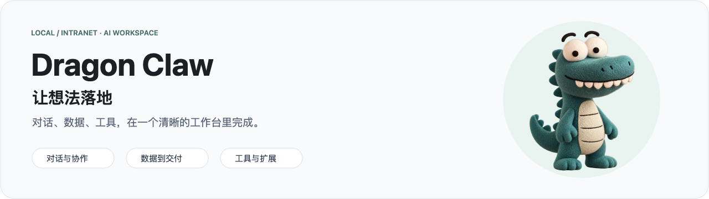
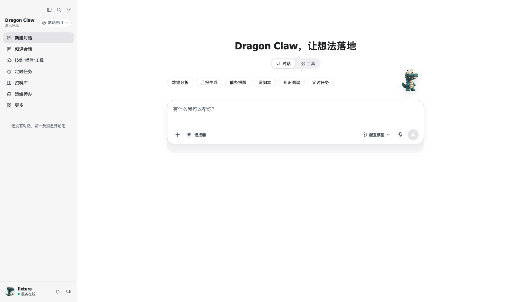
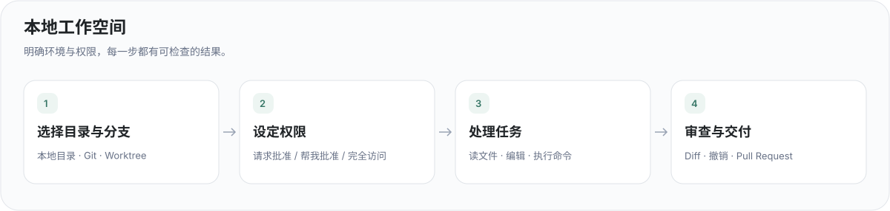
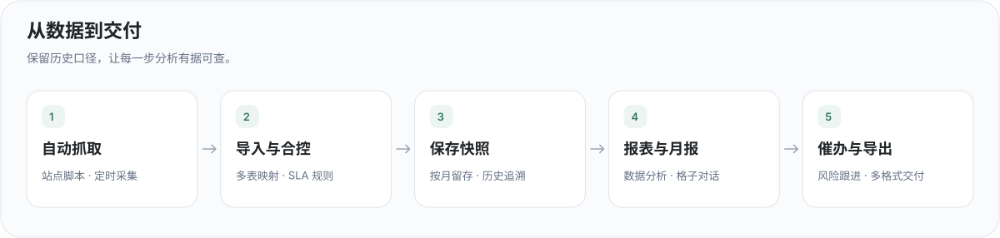
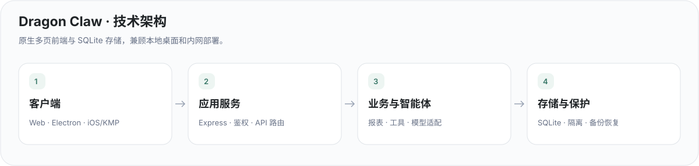

<div align="center">



**对话、数据、工具，在一个清晰的工作台里完成。**

[下载桌面版](https://github.com/fanxiaolongx-max/Dragon-Platform/releases) · [快速开始](#快速开始) · [视频教程](#视频教程) · [完整使用指南](tools-platform/README.md)

</div>

## Dragon Claw

Dragon Claw 是运行在自己电脑或内网的智能工具中台。从对话中查数据、处理文档与代码，也能沿着数据抓取、SLA 合控、报表月报到催办交付的业务主线完成日常工作。

当前界面以亮色为默认风格：白色画布、浅灰侧栏、细边框、单色功能图标和统一恐龙标识。Windows 安装版、绿色版与 macOS 客户端的启动、授权界面也沿用这一风格。

| 对话与协作 | 数据到交付 | 工具与扩展 |
| --- | --- | --- |
| 真实模型名称、技能、桌面 Agent 与渠道连接器 | 自动抓取、多表导入、SLA 规则与历史快照 | 技能、插件脚本和工具共用一个中心 |
| 本地目录、Git 分支、Worktree、变更审查 | 报表看板、AI 月报、专题分析与催办 | 搜索、分类、收藏、导入及版本更新 |

[首页与连接器](#首页与连接器) · [本地工作空间](#本地工作空间) · [数据工作流](#数据工作流) · [工具中心](#工具中心) · [数通协议专家](#数通协议专家) · [视频教程](#视频教程) · [技术与数据边界](#技术与数据边界) · [文档导航](#文档导航)

## 首页与连接器



*当前代码在隔离演示环境中的页面截图，不包含真实账号或业务数据。*

- **稳定的输入体验**：切换场景、悬停建议或填入长提示词时，输入框高度和位置保持稳定。悬停显示完整灰色预览，点击只填入，发送由用户触发。
- **清晰的操作层级**：添加文件、引用对话文件、技能和连接器收纳在菜单中；模型直接显示真实名称，支持快速切换与配置自定义模型。增强提示词可帮助完善需求，语音按钮目前仅预留入口。
- **任务与空间**：一级列表直接展示任务和空间，会话带来源图标与时间，支持简短自动标题、搜索高亮和右键操作。逐批展开更多；收缩一级分类后，下次展开重置深层状态。侧栏可拖动调整宽度。
- **精简首页**：工具推荐卡片、效能统计和大块插件下载区已移除。业务入口、友情链接、项目知识图谱及下载收纳到左侧“更多”；隐私政策、服务条款和项目演进采用统一弹窗。

| 连接器 | 适用场景 |
| --- | --- |
| Codex / Claude Code / Antigravity | 桌面 Agent，可单选或组合多 Agent 协作 |
| 微信 | 微信渠道会话 |
| WeLink 官方 | CLI，本人授权账号的消息、会议与邮件等办公信息 |
| WeLink 助手 | SDK，手机或群聊中的平台助手与运营跟进 |
| 数字人 NetCare | 数字人基座的数据探查与自然语言问数 |

新对话开关仅做预选，不会打开旧会话。未就绪的连接器不能启用；发送后绑定当前场景，历史会话恢复原有选择并锁定。渠道与其他连接器互斥，桌面 Agent 可以组合。WeLink 官方与数字人 NetCare 使用普通对话技能通道，不能与本地工作区混用。

[连接器与会话绑定](tools-platform/README.md#首页连接器与会话绑定) · [桌面 Agent 接入](tools-platform/docs/desktop-agent-conversations.md) · [数字人基座](tools-platform/docs/digital-human-netcare.md)

## 本地工作空间

选择本地目录，在授权范围内读文件、编辑代码、执行命令、核对结果并查看变更。目录选择器支持搜索、近期目录、新建空间和不使用工作空间；菜单根据视口自动向上或向下展开。

Git 仓库会显示真实分支，支持切换或新建分支，以及创建独立 Worktree。文件差异可逐项审查与撤销；PR 流程需要本机 Git、GitHub CLI 及相应授权。



权限分为请求批准、帮我批准和完全访问；非管理员及具体工具还受后端权限限制。敏感信息会脱敏，普通目录操作受工作空间边界约束。参见[工作空间与安全机制](tools-platform/README.md#291-agent-workspace-本地代码协同工作区深度解析)。

## 数据工作流



| 阶段 | 完成什么 | 操作指南 |
| --- | --- | --- |
| 自动抓取 | 按站点组织脚本，使用 UI.Vision 或 F12 控制台采集数据 | [数据抓取](tools-platform/README.md#21-自动化数据抓取与-uivf12-ai-网站适配器) |
| 导入与合控 | 多表合并、列映射、工单时限与指标规则 | [SLA 与指标](tools-platform/README.md#22-sla-数据合控与指标规则引擎) |
| 快照与报表 | 按月保存入库口径，查看排名和短板 | [报表与月报](tools-platform/README.md#23-报表看板月报工作区与运营大屏) |
| AI 月报 | 格子对话、公式计算、章节排版、按月复用及导出 | [月报指南](tools-platform/docs/monthly-designer.md) |
| 专题与交付 | 专题快照、风险分析、催办文案及多格式交付 | [专题月报](tools-platform/docs/topic-monthly-reports.md) · [催办](tools-platform/README.md#24-一键精准催办与导出) |

历史分析优先读取入库时保存的分数、目标与计分方式；业务数据变更后不会用当前规则悄悄重算旧月份。

## 工具中心

首页“工具”与左侧“技能·插件·工具”使用同一个中心。统一搜索、分类、最近使用、收藏和排序，避免在两套工具页面之间切换。

| 分类 | 代表工具 |
| --- | --- |
| 质量运营 | 会议考勤、操作激励、奖励申报、负向事件、PR 审计、FRT KPI |
| 业务核验 | 供应商比价、在线验收表、仓储管理、欠款对账、强控业务检索 |
| 学习成长 | 数通协议专家、阿拉伯语课堂、题库学习与 Excel 转换 |
| 日常效率 | 日程安排、光码传文件、聊天记录、胶片设计、Python 脚本更新器 |
| 插件与扩展 | F12 扩展打包、NetCare RFC 方案与 AI 审计、题库与答题助手 |


单文件 HTML、ZIP 或托管 Python Web 应用可接入现有平台能力。内置工具差异弹窗联合发布版本、更新时间与完整程序大小给出建议；明确更新的本地版本不会仅因随包更大而被建议降级，更新前保留备份与用户额外文件。

[工具导入与市场](tools-platform/README.md#28-自定义工具与多源工具市场生态) · [内置工具更新](tools-platform/README.md#系统内置工具差异与更新建议) · [Python 应用托管](tools-platform/docs/hosted-python-apps.md)

## 数通协议专家

把协议笔记组织为图解文章、分步动画、参数实验、报文字段拆解和知识大纲，支持中英切换。OSPF 邻居状态机、DR/BDR 选举、区域与 LSA 等内容均有对应学习入口。

配套教程使用文字链接，按需打开：

- **OSPF 邻居状态机** · [高清](https://github.com/fanxiaolongx-max/Dragon-Platform-Media/releases/download/datacom-ospf-fsm-20261020-1/ospf-fsm-hd%2Emp4) · [标清](https://github.com/fanxiaolongx-max/Dragon-Platform-Media/releases/download/datacom-ospf-fsm-20261020-1/ospf-fsm%2Emp4)
- **OSPF 路由器角色** · [高清](https://github.com/fanxiaolongx-max/Dragon-Platform-Media/releases/download/datacom-ospf-router-types-20261020-2/ospf-router-types-hd%2Emp4) · [标清](https://github.com/fanxiaolongx-max/Dragon-Platform-Media/releases/download/datacom-ospf-router-types-20261020-2/ospf-router-types%2Emp4)
- **Router-ID 选举与生效** · [高清](https://github.com/fanxiaolongx-max/Dragon-Platform-Media/releases/download/datacom-ospf-router-id-20261020-1/ospf-router-id-hd%2Emp4) · [标清](https://github.com/fanxiaolongx-max/Dragon-Platform-Media/releases/download/datacom-ospf-router-id-20261020-1/ospf-router-id%2Emp4)
- **DR / BDR：路由器班会与三幅图** · [高清](https://github.com/fanxiaolongx-max/Dragon-Platform-Media/releases/download/datacom-ospf-dr-bdr-20261020-1/ospf-dr-bdr-hd%2Emp4) · [标清](https://github.com/fanxiaolongx-max/Dragon-Platform-Media/releases/download/datacom-ospf-dr-bdr-20261020-1/ospf-dr-bdr%2Emp4)
- **Forwarding Address：消息来源与数据方向** · [高清](https://github.com/fanxiaolongx-max/Dragon-Platform-Media/releases/download/datacom-ospf-fa-20261020-1/ospf-fa-hd%2Emp4) · [标清](https://github.com/fanxiaolongx-max/Dragon-Platform-Media/releases/download/datacom-ospf-fa-20261020-1/ospf-fa%2Emp4)
- **OSPF 五种报文：一次地图交接** · [高清](https://github.com/fanxiaolongx-max/Dragon-Platform-Media/releases/download/datacom-ospf-packets-20261022-1/ospf-packets-hd%2Emp4) · [标清](https://github.com/fanxiaolongx-max/Dragon-Platform-Media/releases/download/datacom-ospf-packets-20261022-1/ospf-packets%2Emp4)
- **OSPF 区域：哪些路标可以进来** · [高清](https://github.com/fanxiaolongx-max/Dragon-Platform-Media/releases/download/datacom-ospf-areas-20261022-1/ospf-areas-hd%2Emp4) · [标清](https://github.com/fanxiaolongx-max/Dragon-Platform-Media/releases/download/datacom-ospf-areas-20261022-1/ospf-areas%2Emp4)
- **LSA：从资料卡到路由地图** · [高清](https://github.com/fanxiaolongx-max/Dragon-Platform-Media/releases/download/datacom-ospf-lsa-handbook-20261022-1/ospf-lsa-handbook-hd%2Emp4) · [标清](https://github.com/fanxiaolongx-max/Dragon-Platform-Media/releases/download/datacom-ospf-lsa-handbook-20261022-1/ospf-lsa-handbook%2Emp4)

[可视化学习设计](tools-platform/docs/datacom-visual-learning.md) · [视频发布说明](tools-platform/docs/datacom-video-publishing.md)

## 视频教程

点击语言与清晰度链接打开视频。所有教程保留原发布资源，不在 README 中嵌入播放器或封面缩略图。

| 教程 | 内容 | 中文 | English |
| --- | --- | --- | --- |
| AI 月报 · 这个月做好，下个月接着用 | 明确数据口径、核对图表依据、修改要求、复用月报配方 · 2:36 | [高清](https://github.com/fanxiaolongx-max/Dragon-Platform-Media/releases/download/ai-monthly-guide-20261028-2/ai-monthly-guide-hd%2Emp4) · [标清](https://github.com/fanxiaolongx-max/Dragon-Platform-Media/releases/download/ai-monthly-guide-20261028-2/ai-monthly-guide%2Emp4) | — |
| WeLink CLI · 把散落的办公信息找回来 | 本人授权登录、查找办公信息、整理会前清单、确认后发送 · 2:40 | [高清](https://github.com/fanxiaolongx-max/Dragon-Platform-Media/releases/download/feature-guides-20261028-1/welink-cli-guide-hd%2Emp4) · [标清](https://github.com/fanxiaolongx-max/Dragon-Platform-Media/releases/download/feature-guides-20261028-1/welink-cli-guide%2Emp4) | — |
| WeLink SDK · 把运营助手装进口袋 | 接通手机入口、配置可用范围、带着月份和对象问平台数据 · 2:40 | [高清](https://github.com/fanxiaolongx-max/Dragon-Platform-Media/releases/download/feature-guides-20261028-1/welink-sdk-guide-hd%2Emp4) · [标清](https://github.com/fanxiaolongx-max/Dragon-Platform-Media/releases/download/feature-guides-20261028-1/welink-sdk-guide%2Emp4) | — |
| 数字人基座 · 从看不懂表，到查得清数据 | 连接基座、认识表和字段、核对查询结果、用自然语言问数 · 2:46 | [高清](https://github.com/fanxiaolongx-max/Dragon-Platform-Media/releases/download/feature-guides-20261028-1/digital-human-guide-hd%2Emp4) · [标清](https://github.com/fanxiaolongx-max/Dragon-Platform-Media/releases/download/feature-guides-20261028-1/digital-human-guide%2Emp4) | — |
| 从数据到月报 · 五站通关 | 抓数据、导入合控、看报表、编月报、催办交付 · 7:17 | [高清](https://github.com/fanxiaolongx-max/Dragon-Platform-Media/releases/download/home-videos-20261019/platform-guide-hd%2Emp4) · [标清](https://github.com/fanxiaolongx-max/Dragon-Platform-Media/releases/download/home-videos-20261019/platform-guide%2Emp4) | [HD](https://github.com/fanxiaolongx-max/Dragon-Platform-Media/releases/download/home-videos-20261019/platform-guide-en-hd%2Emp4) · [SD](https://github.com/fanxiaolongx-max/Dragon-Platform-Media/releases/download/home-videos-20261019/platform-guide-en%2Emp4) |
| EOS 风险收编月报 | 一键取数、测算目标、自动成稿 · 7:53 | [高清](https://github.com/fanxiaolongx-max/Dragon-Platform-Media/releases/download/eos-guide-20261019/eos-report-guide-hd%2Emp4) · [标清](https://github.com/fanxiaolongx-max/Dragon-Platform-Media/releases/download/eos-guide-20261019/eos-report-guide%2Emp4) | [HD](https://github.com/fanxiaolongx-max/Dragon-Platform-Media/releases/download/eos-guide-en-20261019/eos-report-guide-en-hd%2Emp4) · [SD](https://github.com/fanxiaolongx-max/Dragon-Platform-Media/releases/download/eos-guide-en-20261019/eos-report-guide-en%2Emp4) |
| 操作激励统计 | 夜间操作怎么算准每一笔、对得上 · 6:28 | [高清](https://github.com/fanxiaolongx-max/Dragon-Platform-Media/releases/download/home-videos-20261019/operation-incentive-guide-hd%2Emp4) · [标清](https://github.com/fanxiaolongx-max/Dragon-Platform-Media/releases/download/home-videos-20261019/operation-incentive-guide%2Emp4) | [HD](https://github.com/fanxiaolongx-max/Dragon-Platform-Media/releases/download/home-videos-20261019/operation-incentive-guide-en-hd%2Emp4) · [SD](https://github.com/fanxiaolongx-max/Dragon-Platform-Media/releases/download/home-videos-20261019/operation-incentive-guide-en%2Emp4) |
| NetCare RFC 方案与 AI 审计 | 浏览器扩展小助手，手把手教你用 · 3:32 | [高清](https://github.com/fanxiaolongx-max/Dragon-Platform-Media/releases/download/home-videos-20261019/netcare-rfc-ai-guide-hd%2Emp4) · [标清](https://github.com/fanxiaolongx-max/Dragon-Platform-Media/releases/download/home-videos-20261019/netcare-rfc-ai-guide%2Emp4) | [HD](https://github.com/fanxiaolongx-max/Dragon-Platform-Media/releases/download/home-videos-20261019/netcare-rfc-ai-guide-en-hd%2Emp4) · [SD](https://github.com/fanxiaolongx-max/Dragon-Platform-Media/releases/download/home-videos-20261019/netcare-rfc-ai-guide-en%2Emp4) |

**项目演进**：[观看《银河之旅》](https://github.com/fanxiaolongx-max/Dragon-Platform-Media/releases/download/project-evolution-galaxy-20261019/project-evolution-galaxy-hd%2Emp4)。平台首页也可从“项目演进”弹窗播放。

视频资源托管在 [Dragon-Platform-Media](https://github.com/fanxiaolongx-max/Dragon-Platform-Media/releases)。平台内支持按需下载与本地缓存，已缓存内容可离线观看。

## 快速开始

| 方式 | 适合 | 入口 |
| --- | --- | --- |
| Windows 安装版 / 绿色版 | 个人本地使用 | [下载发行版](https://github.com/fanxiaolongx-max/Dragon-Platform/releases) |
| macOS | Apple Silicon / Intel | [下载发行版](https://github.com/fanxiaolongx-max/Dragon-Platform/releases) |
| 浏览器 / 内网部署 | 团队共用数据和工具 | 下方源码启动命令 |
| PR 小助手绿色版 | 无需安装 Python 的抽查场景 | [说明](python-packager/README.md) |
| iOS / KMP 工程 | 移动端开发与只读指标接入 | [移动端工程](tools-platform/iosapp/) |

源码启动需要 Node.js；当前 CI 使用 Node.js 22。后端预检会提示本机环境和原生依赖问题。

```bash
cd tools-platform/backend
npm ci
npm run doctor
npm start
# 默认 http://localhost:3030
```

按首次启动引导完成账号设置，可选择导入默认脚本与指标规则。在全局设置中配置平台标识和 AI 模型后，再按需连接桌面 Agent 或渠道。

[部署与运行目录](tools-platform/README.md#12-多系统部署桌面客户端与新手配置指引) · [首次使用清单](tools-platform/README.md#125-新手入门安装登录后需要做啥-day-1-checklist)

## 技术与数据边界

| 层 | 当前实现 |
| --- | --- |
| 前端 | 原生 HTML / CSS / JavaScript，多页结构，无前端打包步骤；默认亮色、中英双语 |
| 后端 | Node.js + Express，Session 鉴权与管理员写保护 |
| 存储 | SQLite（WAL），历史 JSON 仅用于迁移兼容 |
| 模型 | Gemini、Claude、OpenAI / Azure、MiniMax 及兼容接口；真实模型名与用量统计 |
| 桌面 | Electron；Windows 安装版 / 绿色版、macOS；亮色启动与 License 激活 |
| 验证 | Node 测试覆盖业务、权限、备份恢复与导出；Electron 专项验证界面交互 |

平台采用“一个账号 = 一个团队”的多用户模型：超级管理员 `admin` 使用默认数据空间并负责创建账号，每个账号拥有独立隔离的团队数据空间，团队之间不共享业务数据；超级管理员可在导航栏查看各团队。渠道、MCP、桌面 Agent、备份恢复等平台级能力仅超级管理员可用，详见 [多用户与团队说明](tools-platform/docs/multi-user-teams.md)。本地文件夹“工作空间”与业务数据空间是不同概念。

桌面固定图标与安装包名称随重新构建更新；内部 appId、授权标识和历史用户目录保留兼容。平台数据保存在本机或部署服务器，调用外部 AI、渠道或其他外部服务时仍会按配置发送所需请求。

<details>
<summary>展开技术架构示意</summary>



</details>

## 文档导航

| 想了解 | 文档 |
| --- | --- |
| 完整功能、部署与排障 | [平台使用指南](tools-platform/README.md) |
| 月报、公式与导出 | [AI 月报](tools-platform/docs/monthly-designer.md) · [专题月报](tools-platform/docs/topic-monthly-reports.md) |
| Agent 与技能 | [桌面 Agent](tools-platform/docs/desktop-agent-conversations.md) · [技能](tools-platform/docs/dragon-claw-skills.md) · [安全](tools-platform/docs/dragon-claw-hardening.md) |
| 频道与数据探查 | [WeLink 接入](tools-platform/README.md#welink-sdk-频道对接手机上的运营助手) · [数字人基座](tools-platform/docs/digital-human-netcare.md) |
| 页面与 API | [页面入口](tools-platform/README.md#7-常用页面入口清单) · [API 路由](tools-platform/README.md#8-主要-api-路由全景表) · [外部指标](tools-platform/docs/external-metrics-api.md) |
| 品牌、启动与发布 | [平台标识](tools-platform/README.md#126-平台标识品牌资产与使用视频) · [macOS 发布](tools-platform/docs/macos-desktop-release.md) |
| 数据保护与参与开发 | [备份恢复](tools-platform/README.md#5-备份恢复与远端主站同步) · [AGENTS.md](tools-platform/AGENTS.md) |

## 做好每一个工具

从一个 HTML 页面到完整工作台，目标始终是减少重复劳动：少复制一次表格、少漏掉一次跟进，让好用的小工具能够被找到、被复用、被持续维护。

**Dragon Claw，让想法落地。**
