<div align="center">

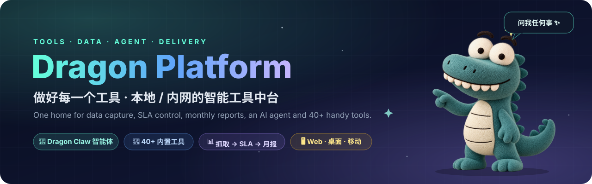

**一个跑在你自己电脑或内网里的工具中台：首页是能聊天、能看数据、能改代码的智能体，背后是从数据抓取到月报交付的整条流水线，外加 40 多个随取随用的小工具。**

[📥 下载桌面版](https://github.com/fanxiaolongx-max/Dragon-Platform/releases) ·
[🎬 三分钟看懂](#-先看一段视频) ·
[🐉 Dragon Claw](#-dragon-claw首页的全能智能体) ·
[🚀 快速开始](#-快速开始) ·
[📘 完整使用指南](tools-platform/README.md)

</div>

---

## 🎬 先看一段视频

<table>
<tr>
<td width="62%">
<a href="https://github.com/fanxiaolongx-max/Dragon-Platform-Media/releases/download/home-videos-20261019/platform-guide-hd%2Emp4"></a>
</td>
<td>

### 从数据到月报 · 五站通关

跟着小龙走一遍：**抓数据 → 导入合控 → 看报表 → 编月报 → 催办交付**，7 分钟知道平台每一站在干什么、该点哪里。

▶️ [中文高清](https://github.com/fanxiaolongx-max/Dragon-Platform-Media/releases/download/home-videos-20261019/platform-guide-hd%2Emp4) · [中文标清](https://github.com/fanxiaolongx-max/Dragon-Platform-Media/releases/download/home-videos-20261019/platform-guide%2Emp4)<br>
▶️ [English HD](https://github.com/fanxiaolongx-max/Dragon-Platform-Media/releases/download/home-videos-20261019/platform-guide-en-hd%2Emp4) · [English SD](https://github.com/fanxiaolongx-max/Dragon-Platform-Media/releases/download/home-videos-20261019/platform-guide-en%2Emp4)

更多专题视频见 [📺 视频中心](#-视频中心)。

</td>
</tr>
</table>

## 目录

- [它是什么](#-它是什么)
- [🐉 Dragon Claw：首页的全能智能体](#-dragon-claw首页的全能智能体)
- [📊 数据主线：从抓取到月报](#-数据主线从抓取到月报)
- [🧰 工具矩阵：每个小需求都值得一个好工具](#-工具矩阵每个小需求都值得一个好工具)
- [📡 数通协议专家：把协议「演」给你看](#-数通协议专家把协议演给你看)
- [📺 视频中心](#-视频中心)
- [🚀 快速开始](#-快速开始)
- [🧱 技术一览](#-技术一览)
- [📚 文档导航](#-文档导航)
- [🌌 项目演进](#-项目演进)
- [💫 愿景：做好每一个工具](#-愿景做好每一个工具)

---

## 🌱 它是什么

Dragon Platform 最初只是一个 HTML 页面，用来少做一点重复的表格活。现在它长成了一个完整的工具中台，但初心没变：**把日常工作里那些「又要手工弄一遍」的事，变成点一下就好的工具。**

- **一个首页解决大多数事**：问问题、查数据、找工具、改代码，都从 Dragon Claw 对话框开始。
- **一条数据主线**：网页数据自动抓取 → 多表导入与 SLA 合控 → 报表看板 → AI 月报生成与导出 → 一键催办。
- **一个工具市场**：任何一个 HTML 页面都能变成平台工具，统一登录、统一入口、按租户隔离数据。
- **数据留在本地**：服务跑在你自己的电脑或内网服务器上，SQLite 存储，按租户物理隔离。

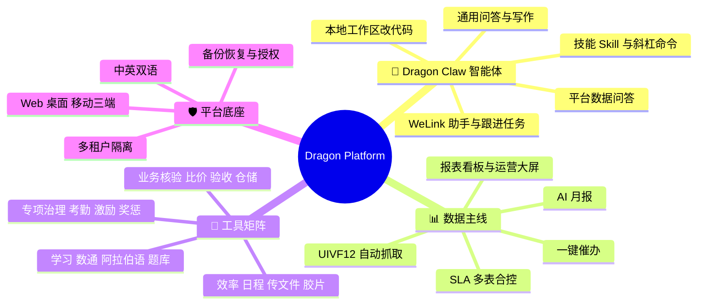

---

## 🐉 Dragon Claw：首页的全能智能体

打开平台首页，迎面就是 Dragon Claw。它不只会聊天：能读懂平台里的报表和工具数据，能在你选定的本地目录里看代码、改文件、跑命令，也能被拉进 WeLink 群里当团队助手。


### 它能帮你做什么

| | |
| :---: | :---: |
| 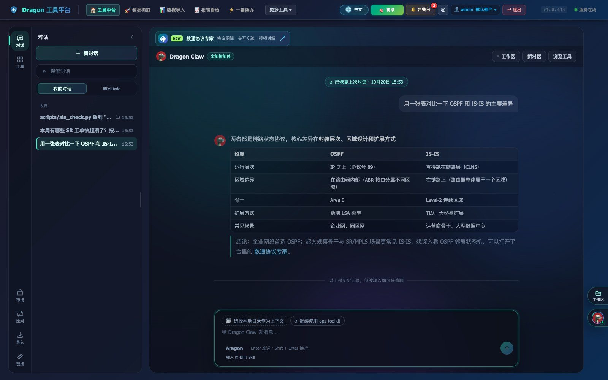 | 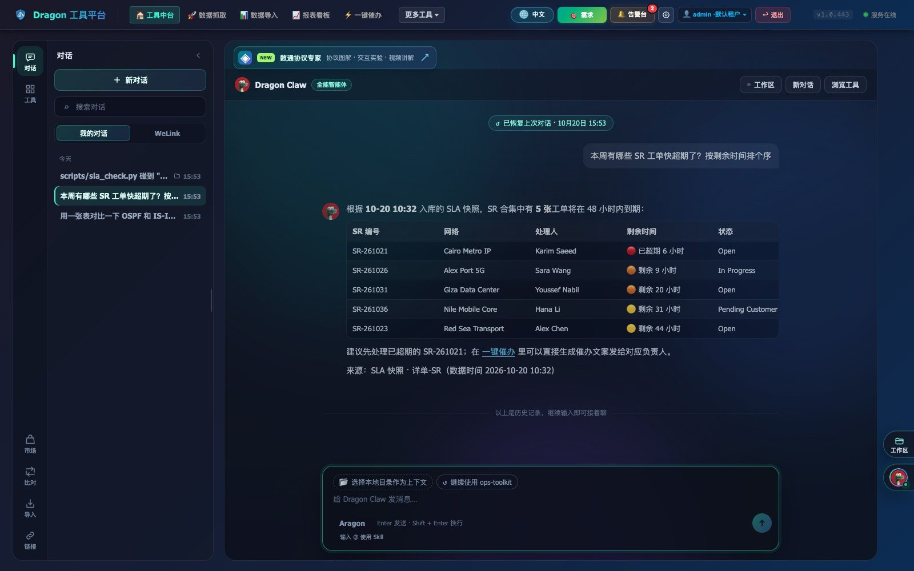 |
| **💬 什么都能问**<br>编程、写作、翻译、技术对比……默认用表格把结论讲清楚，还会顺手推荐平台里相关的工具。 | **📈 直接问平台数据**<br>「本周哪些工单快超期？」它会读取最新入库的快照作答，并注明数据来源和时间，不编造数字。 |
| 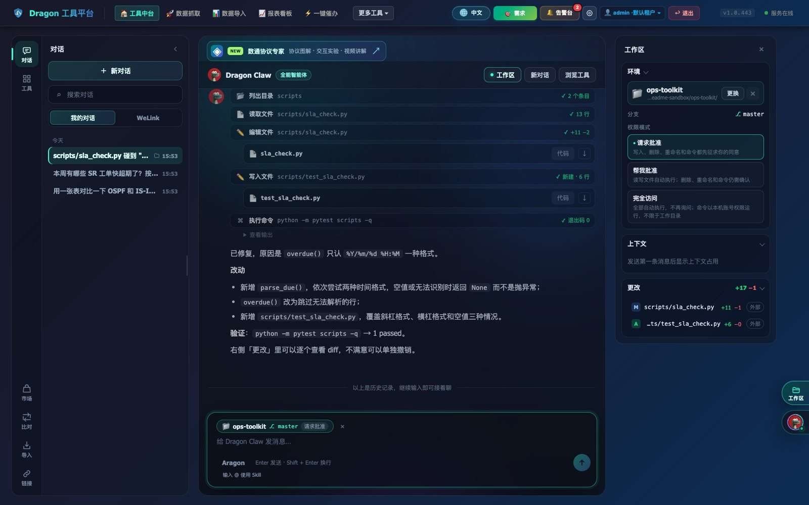 | 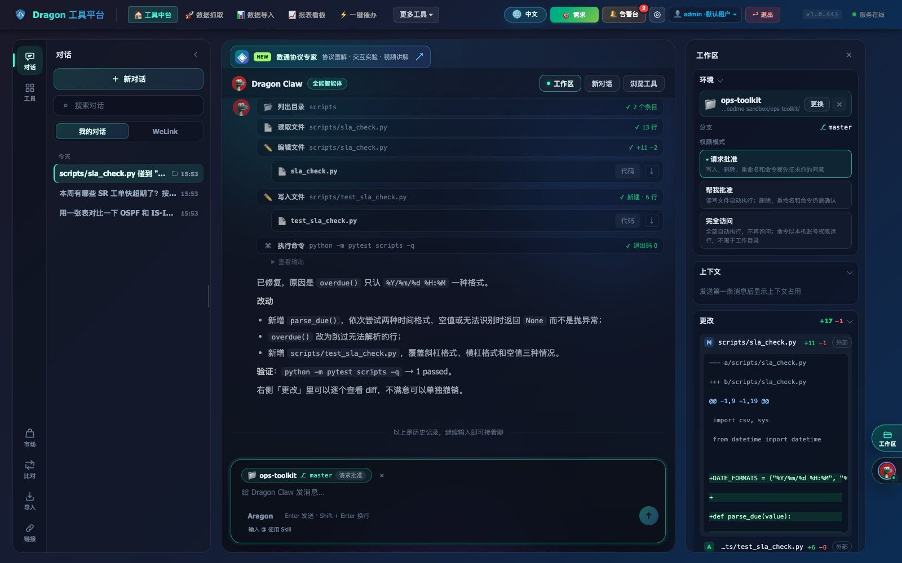 |
| **🛠️ 在本地目录里干活**<br>选一个项目目录，用一句话交代任务：它会列目录、读文件、改代码、跑测试，每一步都看得见。 | **🔍 改了什么一目了然**<br>右侧工作区显示每个文件的增删行数和差异，不满意可以单独撤销；验证通过后还能一键发起 PR。 |
|  |  |
| **🎯 @ 一个技能**<br>输入 `@` 挑选项目导览、排查故障、代码审查、数据核查、编写文档等技能，也可以把好用的提示词存成自己的技能。 | **⌨️ / 斜杠命令**<br>`/session` 翻找历史对话、`/new` 开新对话，键盘就能完成常用操作。 |

> [!TIP]
> 工作区有三档权限：**请求批准**（每次写文件、跑命令都问你）、**帮我批准**（只在删除和执行命令时问）、**完全访问**。非管理员账号自动只读，路径被限制在你选的目录里，密码和令牌会自动脱敏。

### WeLink 助手：在群里 @ 一下，平台帮你记着、按时提醒

把 Dragon Claw 接入 WeLink 后，同事在群里 @助手 就能提问；说一句「帮我记一下，后边跟进」，它会把任务、提醒人和频率存进平台，到点在原群里 @ 相关人。所有群聊和单聊记录都按群或按人合并显示在首页「WeLink」分类里，上方的进度条显示任务走到了哪一步。

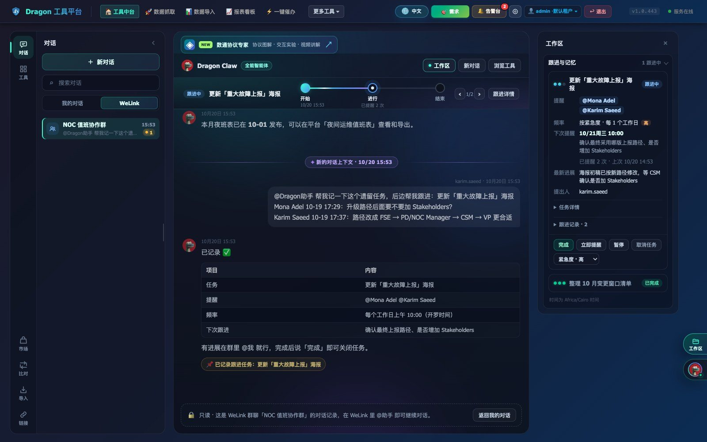

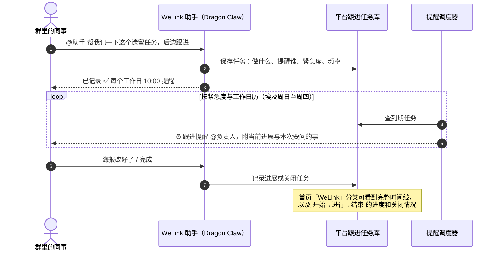

想深入了解智能体的执行循环、安全设计和接口，见[完整使用指南 · Dragon Claw 章节](tools-platform/README.md#29-dragon-claw-智能体agent-workspace-协同工作区与-2d3d-双视图知识图谱)。

---

## 📊 数据主线：从抓取到月报

平台最核心的一条线，是把散落在各个网站和 Excel 里的运维数据，变成一份能直接发出去的月报。

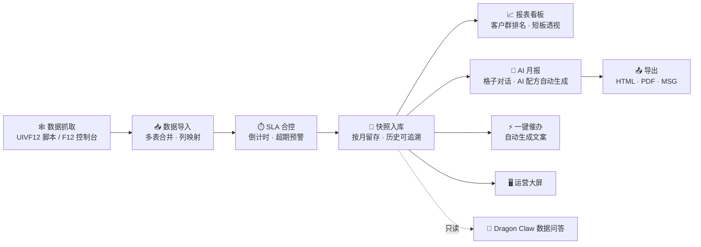

| 第一站：自动抓取 | 第二站：导入与 SLA 合控 |
| :---: | :---: |
| 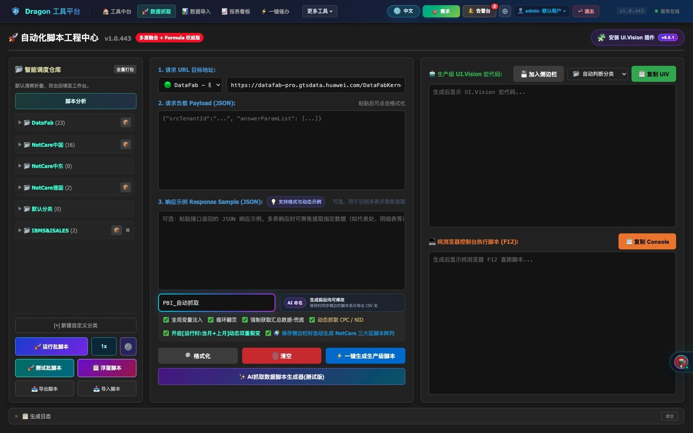 | 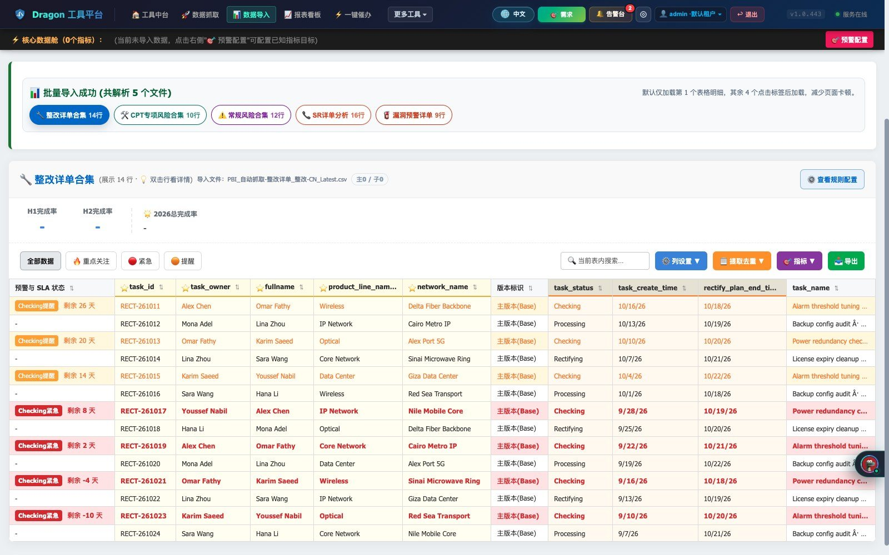 |
| 脚本仓库按站点分组，填网址、贴接口样例，就能生成 UI.Vision 宏或 F12 控制台脚本，批量定时抓取。 | 一次拖入多张详单，自动归类到整改、风险、SR、漏洞等合集；每张工单按规则算出剩余时间，超期标红。 |
| **第三站：AI 月报** | **第四站：专题分析** |
|  | 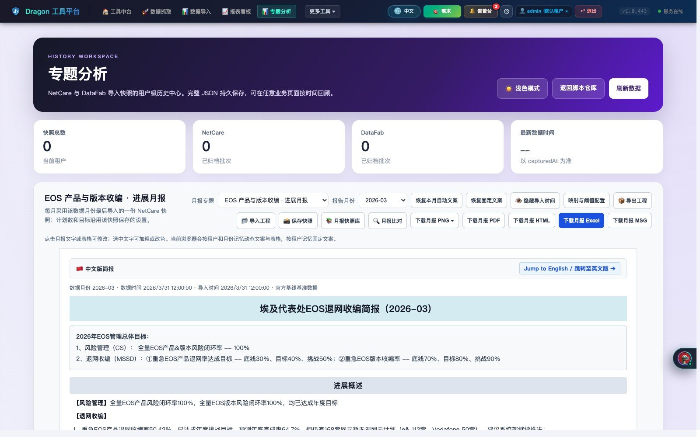 |
| **想改哪里点哪里**：点格子聊数据、点 LOGO 换图或让 AI 当场画徽标、点报头字段定每月自动更新规则、点章节统一排版（锁死数字只改外观）、点顶部换全篇配色；AI 自己翻表算数据，12 道质检关卡挡住假数字与拥挤排版，改坏了一秒粒子消散撤回；看到哪个词不顺眼双击直接改，拉窄格子自动重排，到了下个月切一下月份全篇自动重算，一键导出可离线 3 级下钻的 HTML、矢量 PDF 或 Outlook 邮件。 | 按租户沉淀 NetCare / DataFab 快照，生成 EOS 收编等专题月报，支持版本对比与多格式导出。 |

<details>
<summary>📷 展开更多 AI 月报真实界面（格子对话、多列图表网格与整体风格顾问）</summary>


| 多列窄格图表网格与空白格直接提问 | 整体风格顾问与四分类全局规则 |
| :---: | :---: |
|  |  |

*注：截图取自真实 AI 月报页面（敏感部门、人员及具体指标数值已做模糊打码处理）。完整用法见 [AI 月报指南](tools-platform/docs/monthly-designer.md)。*
</details>

**这条线的每一站怎么用：** [数据抓取](tools-platform/README.md#21-自动化数据抓取与-uivf12-ai-网站适配器) · [SLA 与指标规则](tools-platform/README.md#22-sla-数据合控与指标规则引擎) · [报表与月报](tools-platform/README.md#23-报表看板月报工作区与运营大屏) · [催办与导出](tools-platform/README.md#24-一键精准催办与导出) · [默认快速上手包](tools-platform/README.md#默认快速上手包)

---

## 🧰 工具矩阵：每个小需求都值得一个好工具

首页切到「工具」模式，所有工具按分类排好，支持搜索和收藏。平台内置 40 多个工具，覆盖专项治理、业务核验、学习和日常效率。

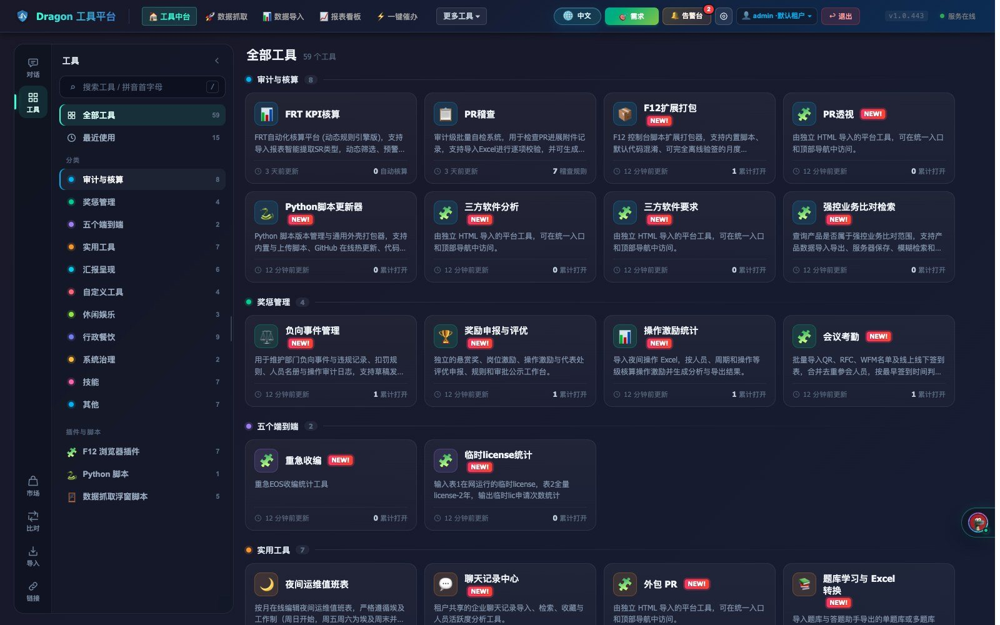

### 常用工具一览

| | | |
| :---: | :---: | :---: |
| 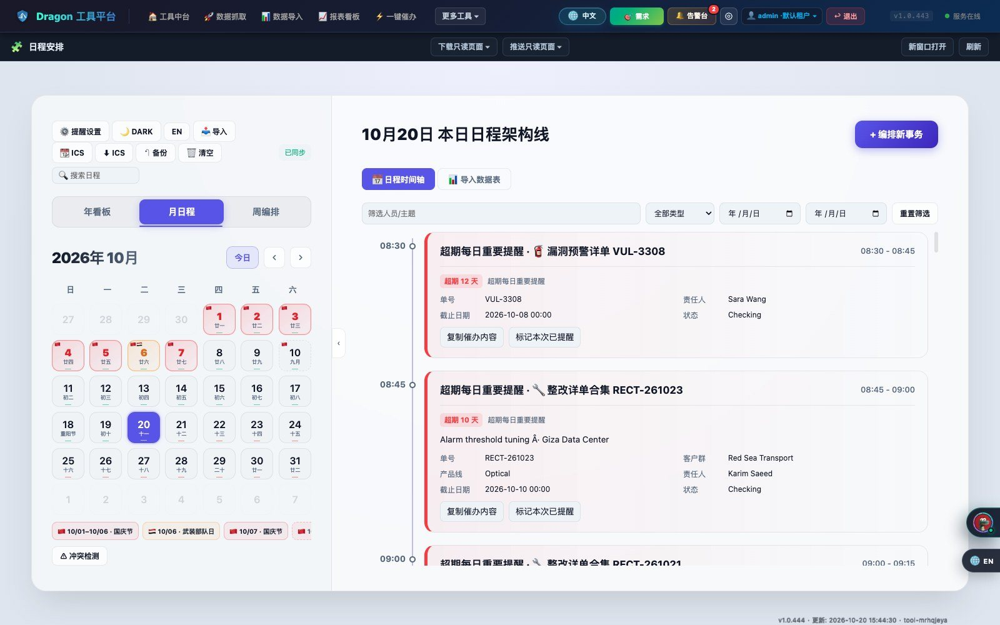<br>**📅 日程安排**<br>自动读取最新 SLA 快照，为快到期的工单排好三次提醒 | 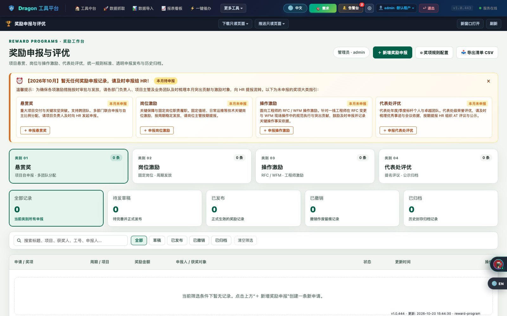<br>**🏅 奖励申报与评优**<br>悬赏奖、岗位激励、操作激励的申报、审批与公示 | 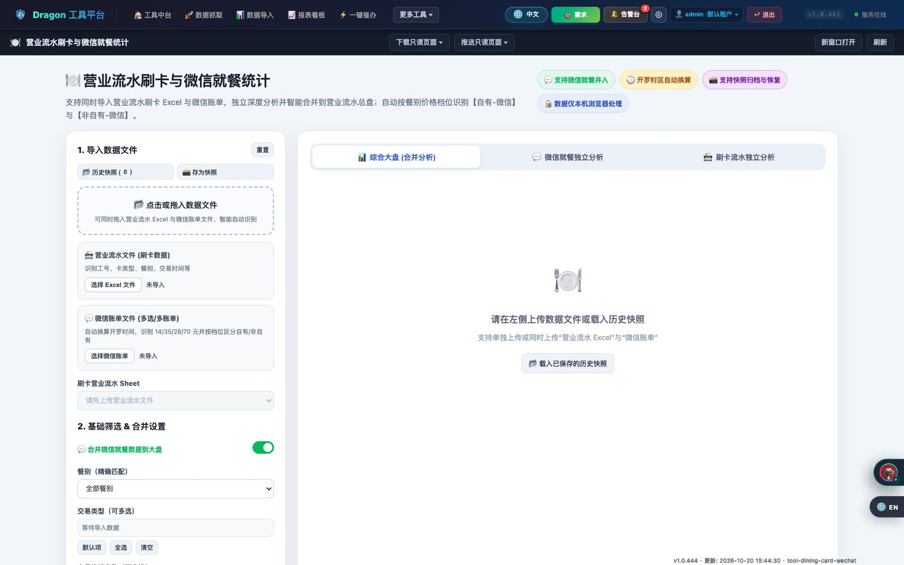<br>**🍱 就餐统计**<br>刷卡流水与微信账单合并分析，自动识别餐别档位 |
| 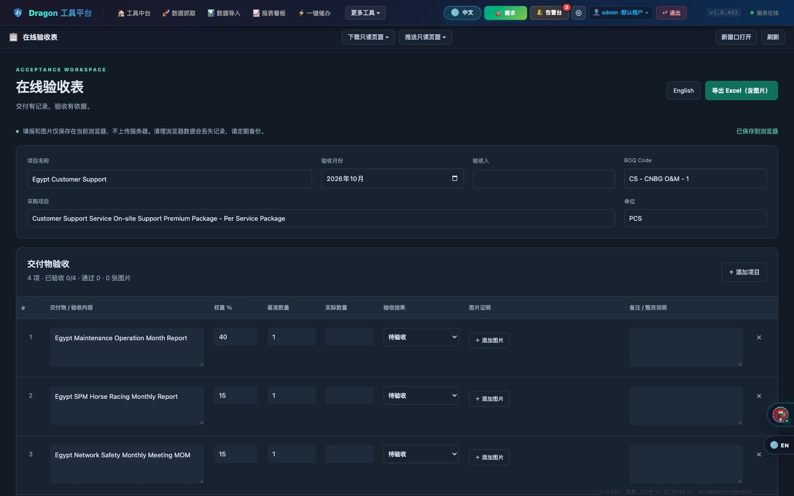<br>**📋 在线验收表**<br>纯浏览器填报，多图证明，导出带图片的 Excel | 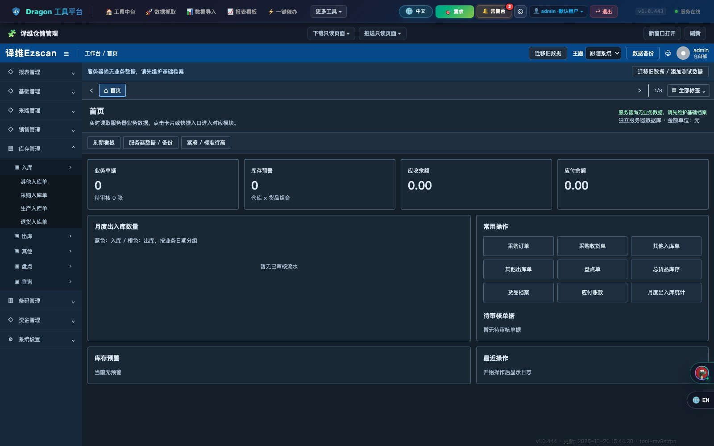<br>**📦 仓储管理**<br>货品档案、出入库、盘点、条码与资金账单 | 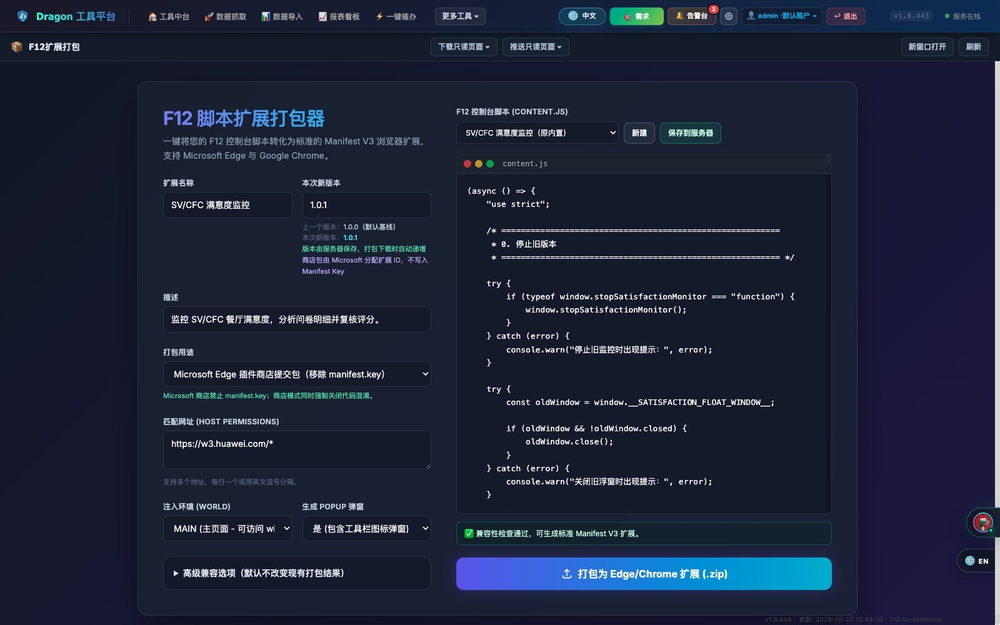<br>**🧩 F12 扩展打包**<br>把控制台脚本打包成浏览器扩展，可离线验签授权 |
| 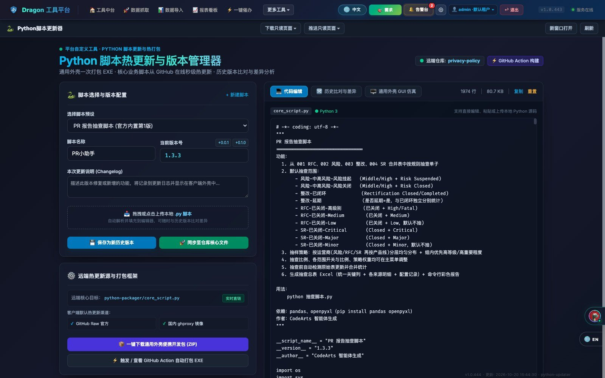<br>**🐍 Python 脚本热更新**<br>脚本版本管理、差异对比，一键打包绿色外壳 | 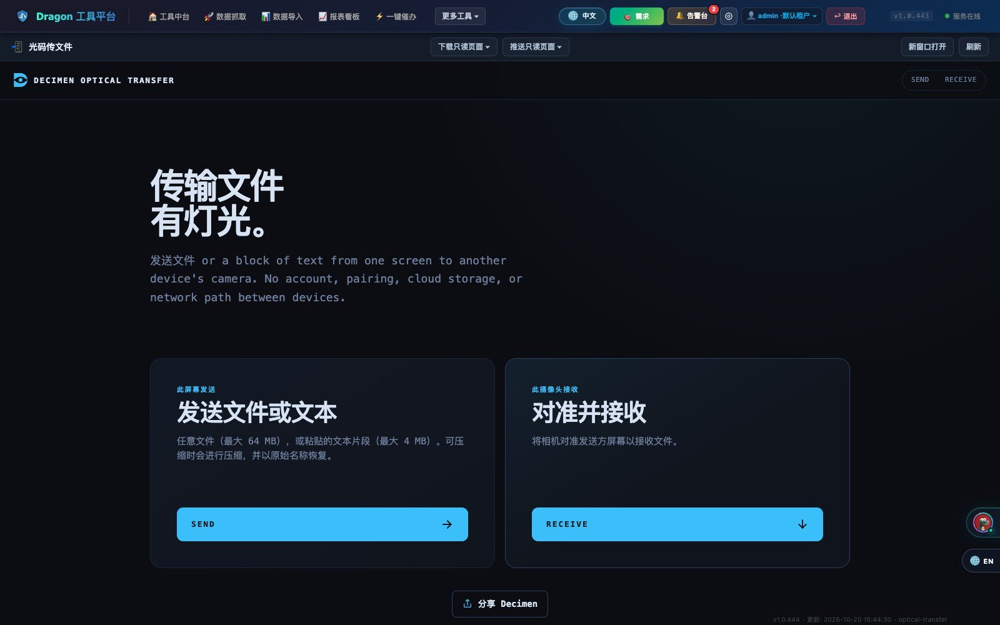<br>**🔦 光码传文件**<br>屏幕播二维码、手机扫码收文件，不经过服务器 | 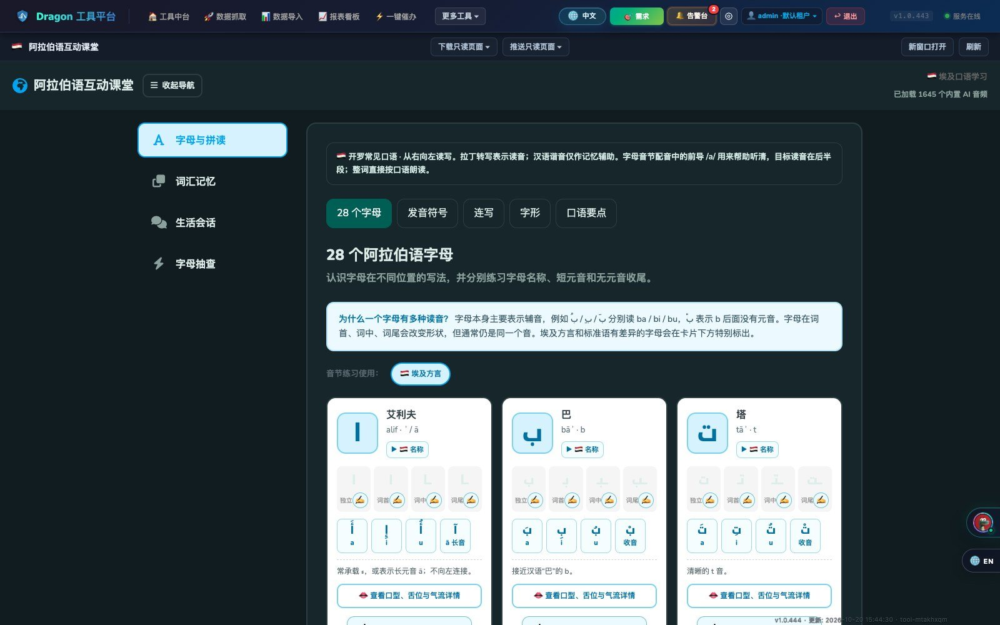<br>**🗣️ 阿拉伯语课堂**<br>开罗口语：字母、词汇、会话，配音跟读闯关 |
| 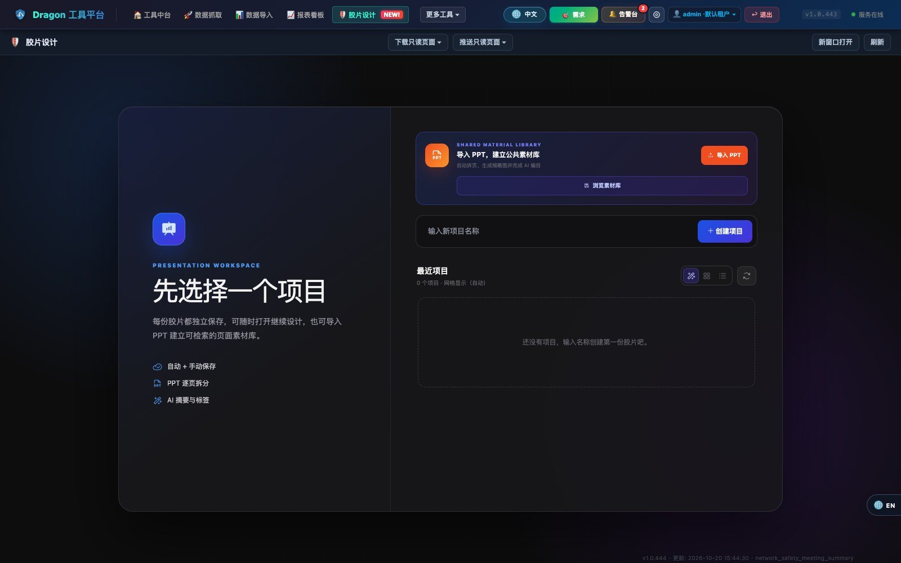<br>**🎞️ 胶片设计**<br>组件可拖拽缩放的胶片编辑器，导出 PDF / PPT | 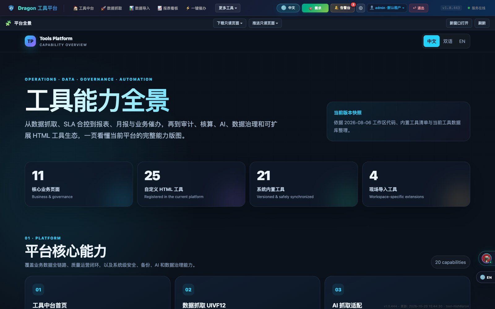<br>**🗺️ 平台全景**<br>中英双语介绍全部模块与工具，支持搜索筛选 | <br>**🎬 光影大厅**<br>沉浸式影院，复盘录像与培训视频点播 |

<details>
<summary>📜 内置工具完整清单</summary>

| 分类 | 工具 |
| --- | --- |
| 专项治理 | 会议考勤 · 操作激励统计 · 奖励申报与评优 · 负向事件管理 · 夜间值班表 · 重急收编 · 临时 License 统计 · PR 透视 · 外包 PR · PR 审计 · FRT KPI 核算 |
| 业务核验 | 供应商报价比价 · 餐单核验 · 强控业务比对检索 · 在线验收表 · 仓储管理 · 欠款对账 · 三方软件分析 |
| 学习成长 | 数通协议专家 · 阿拉伯语互动课堂 · 题库学习与 Excel 转换 · 膳食手册 |
| 效率工具 | 日程安排 · 光码传文件 · 聊天记录中心 · 胶片设计 · 汇报胶片 · F12 扩展打包 · Python 脚本更新器 · 人数计数 · 粒子特效 |
| 平台介绍 | 平台全景 · 平台介绍 · 上传指南 · 重点通知 |

每个工具怎么用：[专项治理工具链](tools-platform/README.md#26-专项治理工具链) · [题库助手](tools-platform/docs/f12-exam-ai.md) · [埃及口语课堂](tools-platform/docs/egyptian-classroom.md) · [奖励申报](tools-platform/docs/reward-program.md) · [Python 外壳](python-packager/README.md)
</details>

### 一个工具是怎么来的

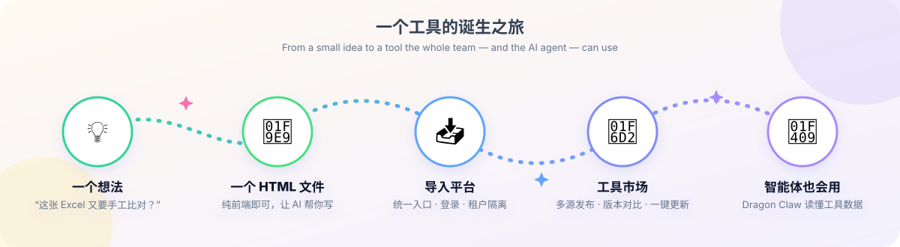

任何一个单文件 HTML（或打包好的 ZIP）都能导入成平台工具：自动获得登录保护、顶部导航、中英文切换和按租户隔离的数据存储。工具可以发布到多个市场源，平台对比版本后一键更新，也能整体离线导出。详见[自定义工具与工具市场](tools-platform/README.md#28-自定义工具与多源工具市场生态)。

<div align="center">
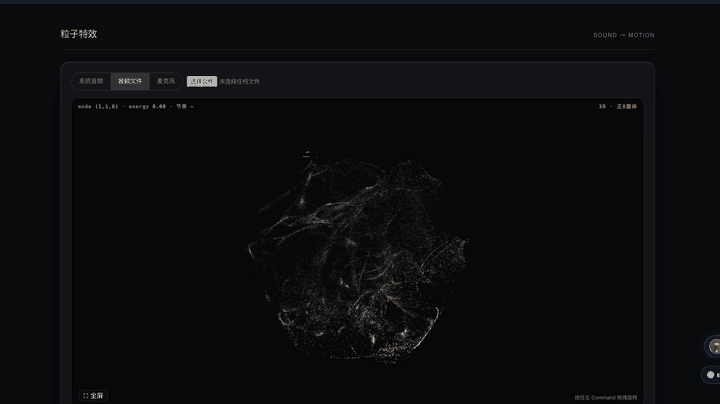<br>
<sub>连「粒子特效」这样纯好玩的工具也有一席之地：跟着音乐或麦克风实时变化的 3D 粒子。</sub>
</div>

---

## 📡 数通协议专家：把协议「演」给你看

OSPF 邻居为什么卡在 2-Way？DR 是怎么选出来的？数通协议专家把 28 篇笔记做成了**分步动画、可调参数的实验、报文逐字段拆解和知识大纲**，支持**中英双语**一键切换，每一步都告诉你发生了什么、为什么。

<div align="center">
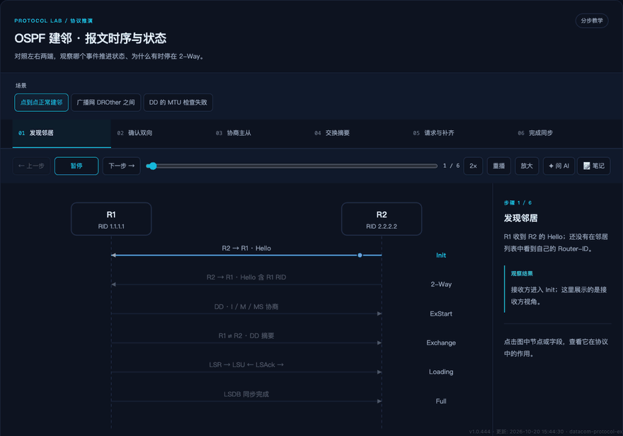<br>
<sub>分步教学自动播放：OSPF 两台路由器从 Init、2-Way 一路走到 Full。</sub>
</div>

| 知识库总览 | 图解文章 |
| :---: | :---: |
| 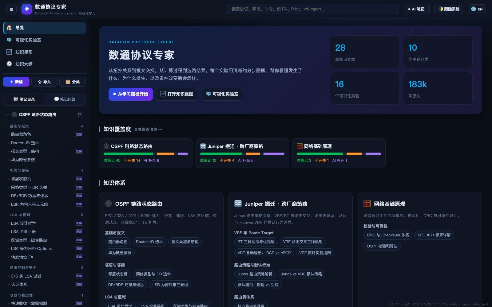 | 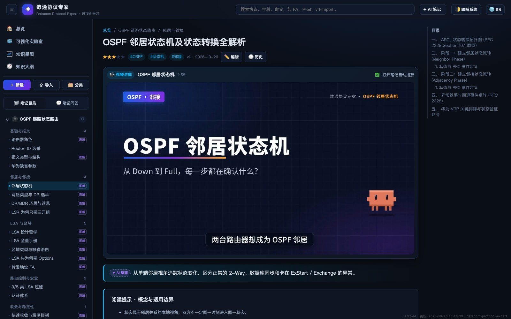 |
| **可视化实验室** | **知识大纲** |
| 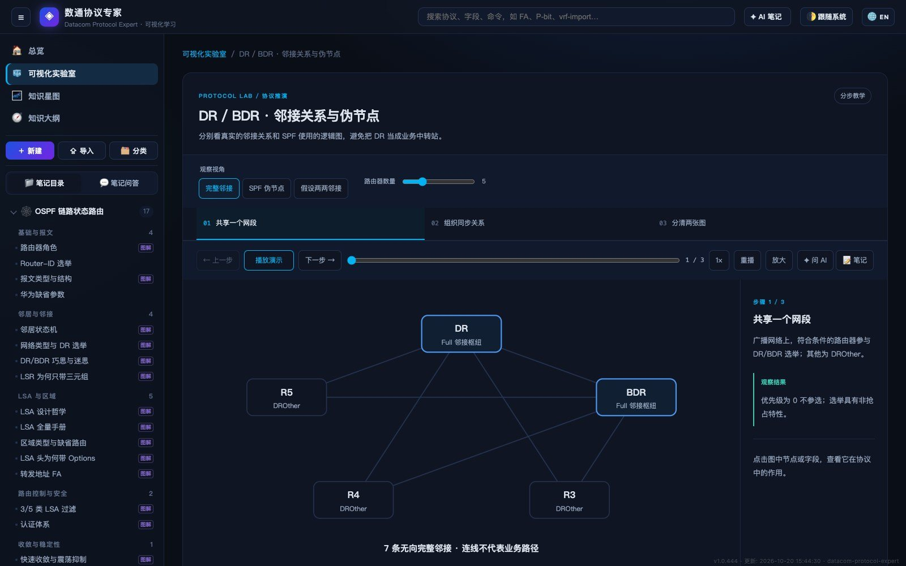 | 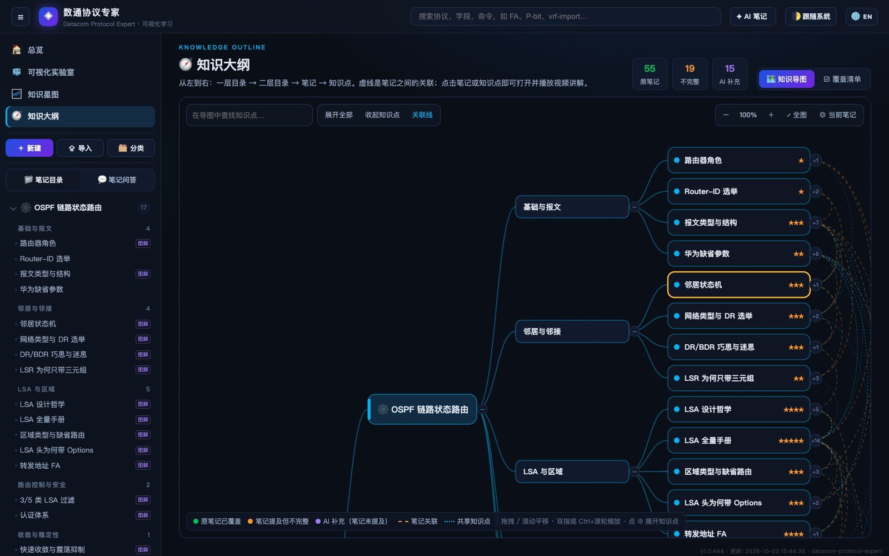 |

还有配套的 8 集笔记讲解视频：

| [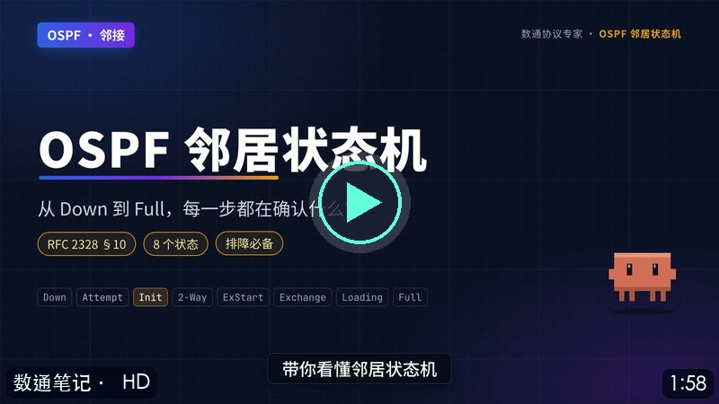](https://github.com/fanxiaolongx-max/Dragon-Platform-Media/releases/download/datacom-ospf-fsm-20261020-1/ospf-fsm-hd%2Emp4) | [](https://github.com/fanxiaolongx-max/Dragon-Platform-Media/releases/download/datacom-ospf-router-types-20261020-2/ospf-router-types-hd%2Emp4) | [](https://github.com/fanxiaolongx-max/Dragon-Platform-Media/releases/download/datacom-ospf-router-id-20261020-1/ospf-router-id-hd%2Emp4) |
| :---: | :---: | :---: |
| **OSPF 邻居状态机** · [标清](https://github.com/fanxiaolongx-max/Dragon-Platform-Media/releases/download/datacom-ospf-fsm-20261020-1/ospf-fsm%2Emp4) | **OSPF 路由器角色** · [标清](https://github.com/fanxiaolongx-max/Dragon-Platform-Media/releases/download/datacom-ospf-router-types-20261020-2/ospf-router-types%2Emp4) | **Router-ID 选举与生效** · [标清](https://github.com/fanxiaolongx-max/Dragon-Platform-Media/releases/download/datacom-ospf-router-id-20261020-1/ospf-router-id%2Emp4) |

- **DR / BDR：路由器班会与三幅图** · [高清](https://github.com/fanxiaolongx-max/Dragon-Platform-Media/releases/download/datacom-ospf-dr-bdr-20261020-1/ospf-dr-bdr-hd%2Emp4) · [标清](https://github.com/fanxiaolongx-max/Dragon-Platform-Media/releases/download/datacom-ospf-dr-bdr-20261020-1/ospf-dr-bdr%2Emp4)
- **Forwarding Address：消息来源与数据方向** · [高清](https://github.com/fanxiaolongx-max/Dragon-Platform-Media/releases/download/datacom-ospf-fa-20261020-1/ospf-fa-hd%2Emp4) · [标清](https://github.com/fanxiaolongx-max/Dragon-Platform-Media/releases/download/datacom-ospf-fa-20261020-1/ospf-fa%2Emp4)
- **OSPF 五种报文：一次地图交接** · [高清](https://github.com/fanxiaolongx-max/Dragon-Platform-Media/releases/download/datacom-ospf-packets-20261022-1/ospf-packets-hd%2Emp4) · [标清](https://github.com/fanxiaolongx-max/Dragon-Platform-Media/releases/download/datacom-ospf-packets-20261022-1/ospf-packets%2Emp4)
- **OSPF 区域：哪些路标可以进来** · [高清](https://github.com/fanxiaolongx-max/Dragon-Platform-Media/releases/download/datacom-ospf-areas-20261022-1/ospf-areas-hd%2Emp4) · [标清](https://github.com/fanxiaolongx-max/Dragon-Platform-Media/releases/download/datacom-ospf-areas-20261022-1/ospf-areas%2Emp4)
- **LSA：从资料卡到路由地图** · [高清](https://github.com/fanxiaolongx-max/Dragon-Platform-Media/releases/download/datacom-ospf-lsa-handbook-20261022-1/ospf-lsa-handbook-hd%2Emp4) · [标清](https://github.com/fanxiaolongx-max/Dragon-Platform-Media/releases/download/datacom-ospf-lsa-handbook-20261022-1/ospf-lsa-handbook%2Emp4)

---

## 📺 视频中心

所有视频都有高清版。新增的 4 部功能教程由小龙用普通话讲解；原有的平台五站指南、EOS 月报、操作激励统计和 NetCare RFC 教程同时提供中英文。点击封面直接播放中文高清版。

| 视频 | 讲什么 | 中文 | English |
| :--- | :--- | :---: | :---: |
| [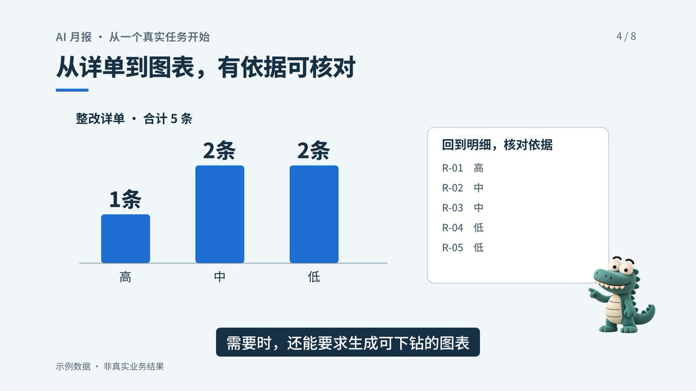](https://github.com/fanxiaolongx-max/Dragon-Platform-Media/releases/download/ai-monthly-guide-20261028-2/ai-monthly-guide-hd%2Emp4) | **AI 月报 · 这个月做好，下个月接着用**<br>明确数据口径、核对图表依据、修改要求、复用月报配方 · 2:36 | [高清](https://github.com/fanxiaolongx-max/Dragon-Platform-Media/releases/download/ai-monthly-guide-20261028-2/ai-monthly-guide-hd%2Emp4) · [标清](https://github.com/fanxiaolongx-max/Dragon-Platform-Media/releases/download/ai-monthly-guide-20261028-2/ai-monthly-guide%2Emp4) | — |
| [](https://github.com/fanxiaolongx-max/Dragon-Platform-Media/releases/download/feature-guides-20261028-1/welink-cli-guide-hd%2Emp4) | **WeLink CLI · 把散落的办公信息找回来**<br>本人授权登录、查找办公信息、整理会前清单、确认后发送 · 2:40 | [高清](https://github.com/fanxiaolongx-max/Dragon-Platform-Media/releases/download/feature-guides-20261028-1/welink-cli-guide-hd%2Emp4) · [标清](https://github.com/fanxiaolongx-max/Dragon-Platform-Media/releases/download/feature-guides-20261028-1/welink-cli-guide%2Emp4) | — |
| [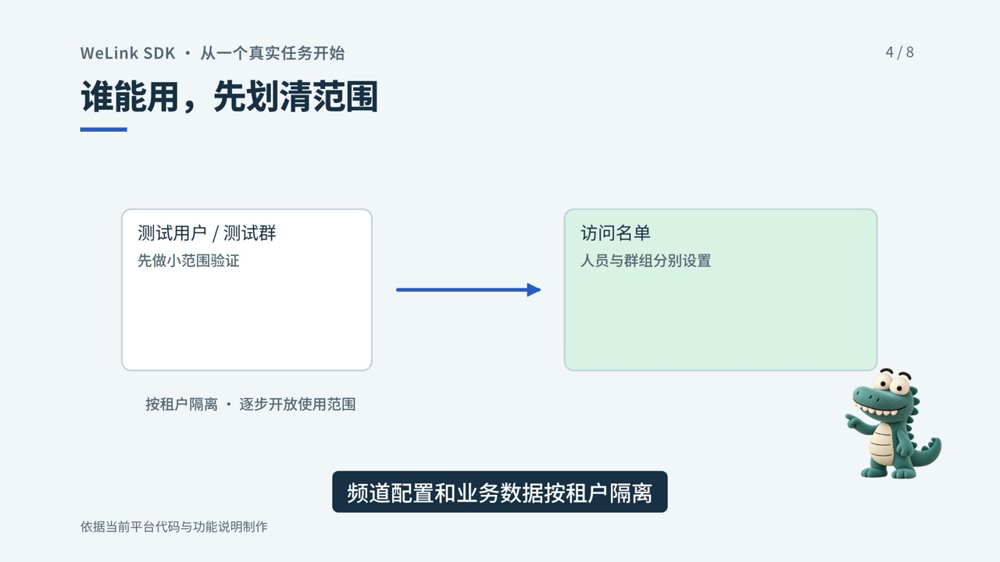](https://github.com/fanxiaolongx-max/Dragon-Platform-Media/releases/download/feature-guides-20261028-1/welink-sdk-guide-hd%2Emp4) | **WeLink SDK · 把运营助手装进口袋**<br>接通手机入口、配置可用范围、带着月份和对象问平台数据 · 2:40 | [高清](https://github.com/fanxiaolongx-max/Dragon-Platform-Media/releases/download/feature-guides-20261028-1/welink-sdk-guide-hd%2Emp4) · [标清](https://github.com/fanxiaolongx-max/Dragon-Platform-Media/releases/download/feature-guides-20261028-1/welink-sdk-guide%2Emp4) | — |
| [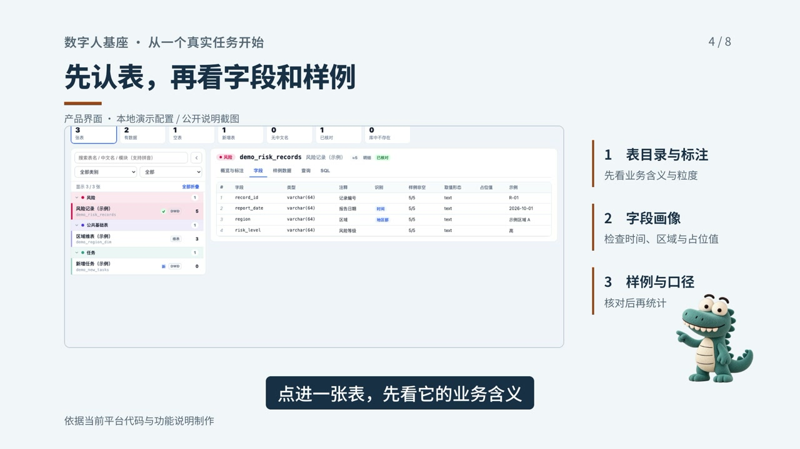](https://github.com/fanxiaolongx-max/Dragon-Platform-Media/releases/download/feature-guides-20261028-1/digital-human-guide-hd%2Emp4) | **数字人基座 · 从看不懂表，到查得清数据**<br>连接基座、认识表和字段、核对查询结果、用自然语言问数 · 2:46 | [高清](https://github.com/fanxiaolongx-max/Dragon-Platform-Media/releases/download/feature-guides-20261028-1/digital-human-guide-hd%2Emp4) · [标清](https://github.com/fanxiaolongx-max/Dragon-Platform-Media/releases/download/feature-guides-20261028-1/digital-human-guide%2Emp4) | — |
| [](https://github.com/fanxiaolongx-max/Dragon-Platform-Media/releases/download/home-videos-20261019/platform-guide-hd%2Emp4) | **从数据到月报 · 五站通关**<br>抓数据、导入合控、看报表、编月报、催办交付 · 7:17 | [高清](https://github.com/fanxiaolongx-max/Dragon-Platform-Media/releases/download/home-videos-20261019/platform-guide-hd%2Emp4) · [标清](https://github.com/fanxiaolongx-max/Dragon-Platform-Media/releases/download/home-videos-20261019/platform-guide%2Emp4) | [HD](https://github.com/fanxiaolongx-max/Dragon-Platform-Media/releases/download/home-videos-20261019/platform-guide-en-hd%2Emp4) · [SD](https://github.com/fanxiaolongx-max/Dragon-Platform-Media/releases/download/home-videos-20261019/platform-guide-en%2Emp4) |
| [](https://github.com/fanxiaolongx-max/Dragon-Platform-Media/releases/download/eos-guide-20261019/eos-report-guide-hd%2Emp4) | **EOS 风险收编月报**<br>一键取数、测算目标、自动成稿 · 7:53 | [高清](https://github.com/fanxiaolongx-max/Dragon-Platform-Media/releases/download/eos-guide-20261019/eos-report-guide-hd%2Emp4) · [标清](https://github.com/fanxiaolongx-max/Dragon-Platform-Media/releases/download/eos-guide-20261019/eos-report-guide%2Emp4) | [HD](https://github.com/fanxiaolongx-max/Dragon-Platform-Media/releases/download/eos-guide-en-20261019/eos-report-guide-en-hd%2Emp4) · [SD](https://github.com/fanxiaolongx-max/Dragon-Platform-Media/releases/download/eos-guide-en-20261019/eos-report-guide-en%2Emp4) |
| [](https://github.com/fanxiaolongx-max/Dragon-Platform-Media/releases/download/home-videos-20261019/operation-incentive-guide-hd%2Emp4) | **操作激励统计**<br>夜间操作怎么算准每一笔、对得上 · 6:28 | [高清](https://github.com/fanxiaolongx-max/Dragon-Platform-Media/releases/download/home-videos-20261019/operation-incentive-guide-hd%2Emp4) · [标清](https://github.com/fanxiaolongx-max/Dragon-Platform-Media/releases/download/home-videos-20261019/operation-incentive-guide%2Emp4) | [HD](https://github.com/fanxiaolongx-max/Dragon-Platform-Media/releases/download/home-videos-20261019/operation-incentive-guide-en-hd%2Emp4) · [SD](https://github.com/fanxiaolongx-max/Dragon-Platform-Media/releases/download/home-videos-20261019/operation-incentive-guide-en%2Emp4) |
| [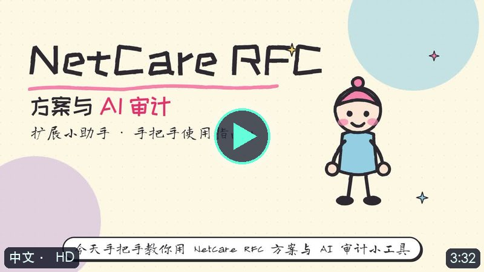](https://github.com/fanxiaolongx-max/Dragon-Platform-Media/releases/download/home-videos-20261019/netcare-rfc-ai-guide-hd%2Emp4) | **NetCare RFC 方案与 AI 审计**<br>浏览器扩展小助手，手把手教你用 · 3:32 | [高清](https://github.com/fanxiaolongx-max/Dragon-Platform-Media/releases/download/home-videos-20261019/netcare-rfc-ai-guide-hd%2Emp4) · [标清](https://github.com/fanxiaolongx-max/Dragon-Platform-Media/releases/download/home-videos-20261019/netcare-rfc-ai-guide%2Emp4) | [HD](https://github.com/fanxiaolongx-max/Dragon-Platform-Media/releases/download/home-videos-20261019/netcare-rfc-ai-guide-en-hd%2Emp4) · [SD](https://github.com/fanxiaolongx-max/Dragon-Platform-Media/releases/download/home-videos-20261019/netcare-rfc-ai-guide-en%2Emp4) |
| 数通笔记 × 8 | OSPF 邻居状态机 · 路由器角色 · Router-ID · DR/BDR · FA · 五种报文 · 区域 · LSA 手册，见[数通协议专家](#-数通协议专家把协议演给你看) | ✅ | — |
| 项目演进 · 银河之旅 | 一个 HTML 页面如何长成一座工具中台，见[项目演进](#-项目演进) | ✅ | — |

<sub>视频托管在 [Dragon-Platform-Media](https://github.com/fanxiaolongx-max/Dragon-Platform-Media/releases) 的发布页；平台首页也会按需下载并缓存这些视频，离线也能看。</sub>

---

## 🚀 快速开始

### 选一种用法

| 方式 | 适合 | 获取 |
| --- | --- | --- |
| 🪟 **Windows 桌面版** | 一个人在自己电脑上用，安装版或免安装绿色版 | [下载发行版](https://github.com/fanxiaolongx-max/Dragon-Platform/releases) |
| 🍎 **macOS 桌面版** | Apple Silicon / Intel 双架构，已签名公证 | [下载发行版](https://github.com/fanxiaolongx-max/Dragon-Platform/releases) |
| 🌐 **浏览器 / 内网部署** | 团队共用一套数据和工具 | 见下方命令 |
| 🐍 **PR 小助手绿色版** | 不想装 Python 的 Windows 抽查场景 | [下载](https://github.com/fanxiaolongx-max/Dragon-Platform/releases) · [说明](python-packager/README.md) |
| 📱 **iOS / KMP 移动工程** | 移动端开发与只读指标接入 | [移动端工程](tools-platform/iosapp/) |

### 从源码启动（需要 Node.js 20 LTS）

```bash
cd tools-platform/backend
npm install
npm run doctor   # 检查运行环境
npm start        # 默认 http://localhost:3030
```

首次打开会引导你创建管理员，并可一键导入**默认快速上手包**（数据抓取脚本库与指标规则），装好就能用。

<details>
<summary>🏢 华为内网安装依赖前，先切换 npm 镜像</summary>

```bash
npm config set registry http://mirrors.tools.huawei.com/npm/
npm config get registry
```
</details>

装好之后第一天做什么、PM2 常驻部署、桌面端文件目录在哪里，见[完整使用指南 · 部署与新手配置](tools-platform/README.md#12-多系统部署桌面客户端与新手配置指引)。

---

## 🧱 技术一览

| 层 | 选型 | 特点 |
| --- | --- | --- |
| 前端 | 原生 HTML / CSS / JavaScript | 不依赖框架、不需要打包，改完刷新即生效；中英双语、深色界面 |
| 后端 | Node.js + Express | 53 个路由模块，统一鉴权、租户上下文与管理员写保护 |
| 存储 | SQLite（WAL） | 每个租户独立目录和数据库，启动自检与自动修复 |
| 智能体 | 多模型函数调用 | 接入 Gemini、Claude、OpenAI、MiniMax 等，自动熔断与降级 |
| 桌面端 | Electron | Windows 安装版 / 绿色版，macOS 签名公证版，自动增量更新 |
| 质量 | `node --test` | 259 个测试文件覆盖业务规则、权限隔离、导出与界面回归 |

<details>
<summary>🗺️ 展开完整技术架构图</summary>


</details>

<details>
<summary>🛡️ 安全与数据边界</summary>

- 所有业务接口都需要登录，写操作默认只有管理员可以执行。
- 每个租户的数据、自定义工具和备份放在各自目录里，备份、恢复、出厂重置都会校验租户。
- 发给 AI 的内容会自动去掉密码、令牌、Cookie 和密钥；工作区智能体只能访问你选定的目录。
- 桌面版使用非对称签名的 License，支持离线激活。

详见[安全授权](tools-platform/README.md#3-安全授权与双轨-license-体系)与[备份恢复](tools-platform/README.md#5-备份恢复与远端主站同步)。
</details>

---

## 📚 文档导航

这一页负责「看懂它」；具体怎么用、怎么配、怎么排障，都在工程目录的完整指南里。

| 想了解 | 去看 |
| --- | --- |
| 全部功能的操作步骤、数据流、部署与排障 | 📘 [完整使用指南](tools-platform/README.md) |
| 第一次装好后该做什么 | [新手入门 Day 1 清单](tools-platform/README.md#125-新手入门安装登录后需要做啥-day-1-checklist) |
| AI 月报怎么用、格子配方怎么写、怎么导出 | [AI 月报指南](tools-platform/docs/monthly-designer.md) |
| 专题月报 | [专题月报说明](tools-platform/docs/topic-monthly-reports.md) |
| Dragon Claw 技能与安全加固 | [技能说明](tools-platform/docs/dragon-claw-skills.md) · [安全加固](tools-platform/docs/dragon-claw-hardening.md) |
| 数通协议专家与视频发布 | [可视化学习设计](tools-platform/docs/datacom-visual-learning.md) · [视频发布流程](tools-platform/docs/datacom-video-publishing.md) |
| 页面地址与 API | [页面入口清单](tools-platform/README.md#7-常用页面入口清单) · [API 路由全景](tools-platform/README.md#8-主要-api-路由全景表) |
| 外部系统读取指标 | [外部指标 API](tools-platform/docs/external-metrics-api.md) |
| macOS 打包与签名 | [macOS 发布文档](tools-platform/docs/macos-desktop-release.md) |
| 参与开发 | [开发约定 AGENTS.md](tools-platform/AGENTS.md) |

---

## 🌌 项目演进

2025 年 11 月 16 日，第一次提交只有一个 HTML 页面。一年里，1000 多次提交，它一点点长出了数据主线、月报编辑器、工具市场、桌面客户端，再到今天能读代码、能进群、能记事的 Dragon Claw。

<div align="center">
<a href="https://github.com/fanxiaolongx-max/Dragon-Platform-Media/releases/download/project-evolution-galaxy-20261019/project-evolution-galaxy-hd%2Emp4"></a>

**▶️ [观看《项目演进 · 银河之旅》高清版](https://github.com/fanxiaolongx-max/Dragon-Platform-Media/releases/download/project-evolution-galaxy-20261019/project-evolution-galaxy-hd%2Emp4)**　·　平台内也可以打开「项目演进」页面，沿着时间轴逐一回看每个里程碑。
</div>

---

## 💫 愿景：做好每一个工具

> 没有哪个工具小到不值得认真做。

我们相信，真正改变日常工作的往往不是宏大的系统，而是一个个**刚好解决眼前问题的小工具**：少复制一次表格、少算错一笔激励、少漏掉一次跟进。Dragon Platform 想做的，就是让这样的工具：

- **容易诞生**：有想法就能做，一个 HTML 文件就是一个工具，AI 帮你写；
- **好用耐用**：统一的登录、数据、备份和更新，工具不会因为没人维护而散落、失效；
- **越用越聪明**：每个工具的数据都能被 Dragon Claw 读懂、串起来，回答更大的问题；
- **属于大家**：工具可以分享到市场，一个人的好点子变成整个团队的效率。

**做好每一个工具，让每一份重复劳动都有人替你记得、替你完成。** 🐉

<div align="center">
<sub>截图均来自本地沙箱，使用平台自带的默认上手包与虚构的人员、网络和工单数据。</sub>
</div>
