# Dragon Platform

> **把运营工作台装进口袋：通过 WeLink SDK 接入 Dragon Claw，出门也能用手机 WeLink 对话查指标、看风险进展、梳理待跟进事项。** [查看接入方法](#welink-sdk-频道对接手机上的运营助手)

Dragon Platform（Tools Platform）是面向质量运营的本地/内网工具中台，串联数据抓取、SLA 合控、报表月报、风险跟进与专项治理。首页提供 Dragon Claw 对话工作台和工具矩阵，也可通过 WeLink 在手机上查询平台数据。

项目采用 **Express + 原生多页前端 + SQLite**，支持源码部署、Windows 安装版/绿色版和 macOS 客户端，并配套 iOS/KMP 移动端工程。

**功能亮点**

| 场景 | 可以做什么 | 详细说明 |
| --- | --- | --- |
| 数据到月报 | 调度抓取、识别多源表格、计算指标并沉淀历史快照 | [SLA 合控](#22-sla-数据合控与指标规则引擎) · [报表与月报](#23-报表看板月报工作区与运营大屏) |
| 手机运营助手 | 在 WeLink 单聊或群聊中查指标、分析短板、梳理风险待跟进项 | [WeLink SDK 接入](#welink-sdk-频道对接手机上的运营助手) |
| AI 问答与工作区 | 检索平台知识和业务数据，或在授权的本地目录协同处理代码与文档 | [Dragon Claw](#29-dragon-claw-智能体agent-workspace-协同工作区与-2d3d-双视图知识图谱) |
| RFC 方案审计 | 批量整理 NetCare RFC 方案，按章节审计并导出材料 | [F12 插件与 RFC 审计](#f12-插件下载与-netcare-rfc-审计) |
| 租户与数据保护 | 业务隔离、历史快照、当前租户备份及远端同租户同步 | [租户管理](#租户模式与数据隔离) · [备份恢复](#5-备份恢复与远端主站同步) |
| 桌面与移动体验 | 首页中英文介绍视频、桌宠额度趋势，以及手机与窄屏布局 | [首页工作台](#12-首页双模工作台体系架构-dual-mode-workspace-architecture) · [桌宠与客服](#211-dragon-桌面伙伴与智能客服) |

首次使用可从 [安装部署](#12-多系统部署桌面客户端与新手配置指引) 和 [Day 1 配置清单](#125-新手入门安装登录后需要做啥-day-1-checklist) 开始；日常查阅可直达 [页面入口](#7-常用页面入口清单)、[API 路由](#8-主要-api-路由全景表) 或 [排障 FAQ](#排障-faq)。

---

## 目录

1. [系统架构与全景数据流](#1-系统架构与全景数据流)
   - [1.1 平台全景数据流转架构](#11-平台全景数据流转架构)
   - [1.2 首页双模工作台体系架构 (Dual-Mode Workspace Architecture)](#12-首页双模工作台体系架构-dual-mode-workspace-architecture)
2. [核心业务与功能详析 (含业务流程图)](#2-核心业务与功能详析-含业务流程图)
   - [2.1 自动化数据抓取与 UIVF12 AI 网站适配器](#21-自动化数据抓取与-uivf12-ai-网站适配器)
   - [2.2 SLA 数据合控与指标规则引擎](#22-sla-数据合控与指标规则引擎)
   - [默认快速上手包](#默认快速上手包)
   - [租户模式与数据隔离](#租户模式与数据隔离)
   - [2.3 报表看板、月报工作区与运营大屏](#23-报表看板月报工作区与运营大屏)
   - [2.4 一键精准催办与导出](#24-一键精准催办与导出)
   - [2.5 胶片设计与 PPT 素材库](#25-胶片设计与-ppt-素材库)
   - [2.6 专项治理工具链](#26-专项治理工具链)
   - [2.7 平台效能大盘、服务监控与友情链接](#27-平台效能大盘服务监控与友情链接)
   - [2.8 自定义工具与多源工具市场生态](#28-自定义工具与多源工具市场生态)
     - [F12 插件与 RFC 审计](#f12-插件下载与-netcare-rfc-审计) · [静态快照与 Pages](#静态快照导出与-pages-发布)
   - [2.9 Dragon Claw 智能体、Agent Workspace 协同工作区与 2D/3D 双视图知识图谱](#29-dragon-claw-智能体agent-workspace-协同工作区与-2d3d-双视图知识图谱)
     - [WeLink SDK 频道对接：手机上的运营助手](#welink-sdk-频道对接手机上的运营助手)
   - [2.10 光影大厅 (Tools Cinema) 与多媒体生态](#210-光影大厅-tools-cinema-与多媒体生态)
   - [2.11 Dragon 桌面伙伴与智能客服](#211-dragon-桌面伙伴与智能客服)
   - [2.12 Python 脚本热更新与 PR 小助手独立生态 (Python Packager)](#212-python-脚本热更新与-pr-小助手独立生态-python-packager)
3. [安全授权与双轨 License 体系 (含安全基线与脱敏)](#3-安全授权与双轨-license-体系)
4. [数据存储、启动自愈与迁移治理](#4-数据存储启动自愈与迁移治理)
5. [备份恢复与远端主站同步](#5-备份恢复与远端主站同步)
6. [高可用设计、性能基准与全链路可观测性](#6-高可用设计性能基准与全链路可观测性)
   - [预警 AI 熔断与恢复](#63-预警-ai-的断网熔断与自动恢复)
7. [常用页面入口清单](#7-常用页面入口清单)
8. [主要 API 路由全景表](#8-主要-api-路由全景表)
9. [移动端生态 (iOS / KMP)](#9-移动端生态-ios--kmp)
10. [目录结构详解](#10-目录结构详解)
11. [环境变量与配置字典](#11-环境变量与配置字典)
12. [多系统部署、桌面客户端与新手配置指引](#12-多系统部署桌面客户端与新手配置指引)
    - [12.1 跨操作系统基础环境准备](#121-跨操作系统基础环境准备)
    - [12.2 生产环境 PM2 常驻部署指引](#122-生产环境-pm2-常驻部署指引)
    - [12.3 桌面客户端指引 (Windows 安装版/绿色版 vs macOS 签名公证版)](#123-桌面客户端指引-windows-安装版绿色版-vs-macos-签名公证版)
    - [12.4 桌面客户端本地生成文件与目录全景字典 (Windows vs macOS)](#124-桌面客户端本地生成文件与目录全景字典-windows-vs-macos)
    - [12.5 新手入门：安装登录后需要做啥 (Day 1 Checklist)](#125-新手入门安装登录后需要做啥-day-1-checklist)
    - [12.6 平台标识、品牌资产与使用视频](#126-平台标识品牌资产与使用视频)
13. [CI/CD 自动化发布与客户端平滑升级机制](#13-cicd-自动化发布与客户端平滑升级机制)
14. [开发约定与排障 FAQ](#14-开发约定与排障-faq)

---

## 1. 系统架构与全景数据流

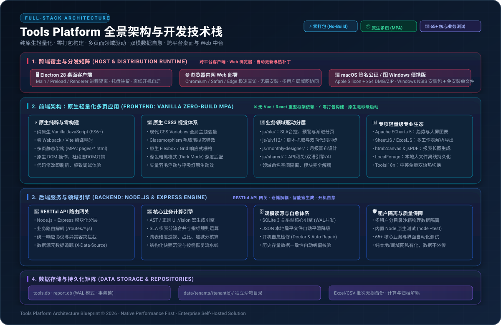

### 1.1 平台全景数据流转架构

平台整体架构以“数据采集自动化、指标计算规则化、报告呈现多维化、治理工具标准化、AI 协同自治化”为核心设计原则，全链路数据流转如下图所示：

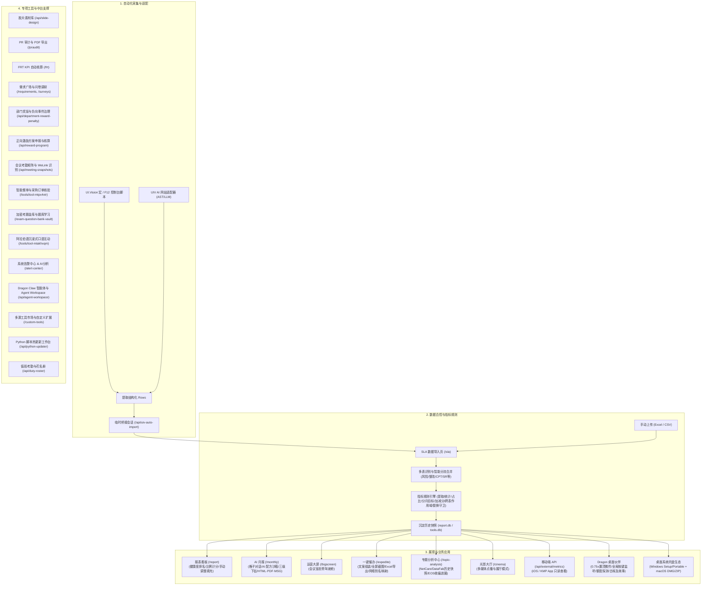

### 1.2 首页双模工作台体系架构 (Dual-Mode Workspace Architecture)

首页（`frontend/index.html`）经历了重大改版，由原本单向的静态工具卡片列表升级为**“Agent 智能体深度协同 + 全功能工具矩阵”双模工作台（Dual-Mode Workspace）**：

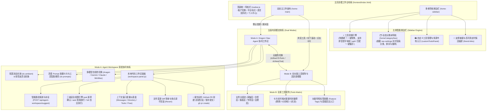

- **首页介绍视频**：右上角提供 NetCare RFC 审计和平台五站使用指南，随中英文界面切换对应配音与字幕。小窗播放轻量版本，点击放大加载高清版本；可仅本次关闭或永久关闭小窗，保留视频入口。
- **渐进收起与窄屏适配**：视频区进入首页时靠上展示，3 秒后平滑下移，9 秒后在未观看或操作视频区时自动收起到右侧标签；开始操作页面也会收起，点击标签可展开。布局适配手机与 Electron 窄窗口，并尊重系统减少动态效果设置。

---

## 2. 核心业务与功能详析 (含业务流程图)

### 2.1 自动化数据抓取与 UIVF12 AI 网站适配器

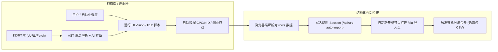

- **脚本工程仓库**：集中维护生产级 UI.Vision Macro JSON 和 F12 控制台脚本，实现按系统模块分类、版本迭代、语法高亮与快速检索。
- **调度引擎特性**：
  - **智能 CPC/NID 嗅探**：动态识别当前登录账号权限、所属组织节点与大区上下文。
  - **分页与重试机制**：自动注入防掉登探测、网络波动自动重试、批量连续翻页与跨大区阵列调度。
  - **双月裂变执行**：在跨月窗口期自动分裂为当月与上月两条抓取任务线。
- **UIV AI 网站适配器 (`/api/uiv-ai-adapter`)**：
  - 将抓包请求（Fetch/cURL）输入后，后端结合 **AST 语法树解析 (Acorn)** 与大模型，自动分析请求结构并严格脱敏敏感头 (`Authorization/Cookie`)，生成可执行代码。
- **免上传自动导入流转 (`/api/uiv-auto-import`)**：
  - 抓取完成后，直接将 rows 数据送入服务端临时会话并唤起 `/sla`，彻底免去手动下载和上传 CSV。

---

### 2.2 SLA 数据合控与指标规则引擎

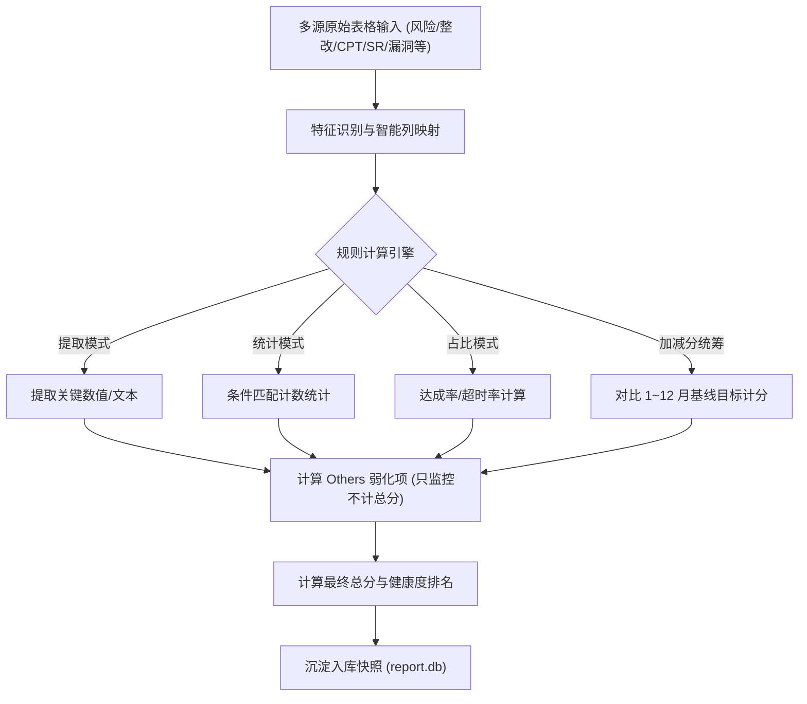

- **多源数据特征自动识别**：
  - 自动识别日常运维中的 8 大类表格：**风险表、整改表、CPT任务表、SR工单表、漏洞表、红线表、业务比对表、日志稽查表**等。
  - 采用智能列名归一化与相似度算法，支持异构表格列自动映射。
- **指标与子指标规则引擎**：
  - **计算模式**：支持提取值、计数统计、占比百分比、加减分统筹等多种计算逻辑。
  - **跨表指标作用域切换**：支持指标规则自由切换全局跨表提取或限定单一源表，轻松满足多张异构表格联合计分诉求。
  - **分月目标基线与批量防护**：支持针对 1~12 个月分别设定差异化目标基线值；内置 **SLA 目标基线批量替换防护守卫 (Bulk replacement guard)**，防范并发请求或外部调用导致基线目标被意外全量清空覆盖。
  - **超宽规则配置工作台**：规则弹窗重构为全屏超宽沉浸式视野，支持多子指标、多条件公式、分月目标与权重联动高效编辑。
  - **预警呼吸灯与倒计时**：基于剩余处理时间与 SLA 阈值，前端动态渲染红/黄/绿呼吸灯与倒计时标签。
- **常用字段自动前置**：详单支持双击查看竖排详情、隐藏空字段及一键复制。服务器按表类型记忆常用复制字段，主表自动显示并优先排列这些列，也可从详情面板主动同步，减少横向翻找。
- **偏好持久化与快照管理**：
  - 用户配置的列宽、显隐、冻结列、排序、计算开关保存在 `tools.db`；入库历史快照沉淀至 `report.db`。

<details>
<summary>默认快速上手包：展开查看首次导入说明、默认脚本、指标规则与分组清单</summary>

<!-- DEFAULT_QUICK_START_BEGIN -->
### 默认快速上手包

项目第一次启动后（Windows 安装版、绿色免安装版和源代码启动一致），超级管理员首次进入页面会看到一次性引导，可分别选择导入“默认智能调度脚本仓库”和“全量指标规则”，也可两项都不导入。选择保存在当前运行数据目录的 `first-run-defaults.json`，不依赖浏览器缓存，因此各启动形态行为一致。

首次没有手动选择过语言时，引导界面会优先跟随浏览器语言：英文浏览器显示英文，其他语言默认显示中文；用户通过顶部语言按钮做出的选择优先级最高。


> 首次启动界面会直接列出默认脚本仓库、全量指标规则和“不抢占现有配置”的导入策略；管理员可只选其中一项，也可暂不导入直接使用。

- 导入策略是 **只补齐、不覆盖**：现有同名脚本、同 ID/同名分组和同 key 指标规则保留用户版本。
- 真正写入前会在 `backups/first-run-defaults/` 生成 JSON 备份；任一步失败会尝试回滚。
- 默认包是可版本化的静态快照，发布前运行 `npm run defaults:export` 可用当前 `tools.db` 重新生成。
- 脚本不携带固定 Cookie、Authorization 或口令；运行时从用户已登录的目标系统会话动态取得令牌。使用前仍需确认目标系统授权、地区/代表处参数和数据合规要求。

管理员后续可进入 **全局设置 → 初始化**：

- **启动开箱即用模式**：再次补齐仓库内置脚本和全量指标规则，仍采用“只补齐、不覆盖”，适合首次跳过或后续默认包升级后使用。
- **彻底初始化当前租户**：要求输入 `RESET` 二次确认；系统先生成当前租户的 `pre-factory-reset` 安全备份，再归档该租户数据并建立干净数据库。账号、其他租户、桌面授权和 F12 授权不受影响；初始化后该租户会再次出现首次导入引导。为保护历史数据，默认租户在已经创建其他租户后禁止整库初始化。
- 如果需要恢复初始化前状态，可从“备份恢复”使用安全备份，或由管理员从 `factory-reset-archives/` 完整归档人工恢复。执行期间不要强制结束初始化工作进程。

本版默认包摘要：**43** 个脚本、**6** 个脚本分类、**58** 条目标/权重规则、**72** 份偏好与数据源规则、**9** 个指标分组、**4** 个客户类别和 **137** 个双语字典词条。

#### 默认智能调度脚本（逐个说明）

| 仓库分类 | 脚本 | 用途 |
|---|---|---|
| NetCare中国 | PBI_自动抓取-数字证书 | 抓取数字证书整改/达成数据，供证书指标核算。 |
| NetCare中国 | PBI_自动抓取-锂电池 | 抓取锂电池治理数据，供锂电达成率指标核算。 |
| NetCare中国 | PBI_自动抓取-重急EOS风险 | 抓取重急 EOS 风险库存与处置进度。 |
| NetCare中国 | PBI_自动抓取-版本EOS风险 | 抓取版本级 EOS 风险与收编进度。 |
| NetCare中国 | PBI_自动抓取-产品EOS风险 | 抓取产品级 EOS 风险与收编进度。 |
| NetCare中国 | PBI_自动抓取-SRFRT-CN | 抓取中国区 SR FRT 数据，供首次响应达成率核算。 |
| NetCare中国 | PBI_自动抓取-事故-CN | 抓取中国区事故数据，供恶性事故数量监控。 |
| NetCare中国 | PBI_自动抓取-路由器整改 | 抓取路由器整改进度和明细。 |
| NetCare中国 | PBI_自动抓取-数据存储整改 | 抓取数据存储整改进度和明细。 |
| NetCare中国 | PBI_自动抓取-软件MM收编/停退 | 抓取“软件MM收编/停退”业务数据，供后续 SLA 合控和报表使用。 |
| NetCare中国 | PBI_自动抓取-风险详单-CN | 抓取中国区 NetCare 风险明细，用于风险合控。 |
| NetCare德国 | PBI_自动抓取-风险详单-DE | 抓取德国 NetCare 风险明细，用于风险合控。 |
| NetCare中国 | PBI_自动抓取-CPT风险详表-CN | 抓取中国区 CPT 风险详表。 |
| NetCare德国 | PBI_自动抓取-CPT风险详表-DE | 抓取德国 CPT 风险详表。 |
| DataFab | PBI_自动抓取_逃生演练 | 抓取逃生演练达成率汇总数据。 |
| DataFab | PBI_自动抓取-整改详单_整改 | 抓取整改任务明细，用于进度和超期核算。 |
| DataFab | PBI_自动抓取_整改 | 抓取整改看板汇总数据，用于整改达成率。 |
| DataFab | PBI_自动抓取_维护红线资源 | 抓取维护红线资源汇总数据。 |
| DataFab | PBI_自动抓取-任职匹配度_维护红线资源 | 抓取维护红线岗位任职匹配度。 |
| DataFab | PBI_自动抓取-红线人员工单统计_维护红线资源 | 抓取红线人员工单量，用于低工单/零工单监控。 |
| DataFab | PBI_自动抓取_17_CN_业务比对报告看板_CO | 抓取业务比对看板汇总数据。 |
| DataFab | PBI_自动抓取-业务比对明细_17_CN_业务比对报告看板_CO | 抓取业务比对任务明细，用于回传和备案核算。 |
| DataFab | PBI_自动抓取_日志稽查率CN | 抓取日志稽查达成率。 |
| DataFab | PBI_自动抓取_图形化拦截_CN | 抓取图形化命令拦截汇总数据。 |
| DataFab | PBI_自动抓取_ADMS_事中：高危命令拦截人员管理 | 抓取 ADMS 高危命令拦截人员数据。 |
| DataFab | PBI_自动抓取_延期操作补授权监控 | 抓取延期操作补授权进度。 |
| DataFab | PBI_自动抓取_产品TOPN风险 | 抓取产品 TOPN 风险整改数据。 |
| DataFab | PBI_自动抓取_预案拓扑 | 抓取应急预案和网络拓扑覆盖情况。 |
| DataFab | PBI_自动抓取_应急演练 | 抓取 iLab/应急演练完成进度。 |
| DataFab | PBI_自动抓取_价值网络巡检 | 抓取价值网络巡检汇总与 HC 数据。 |
| DataFab | PBI_自动抓取-巡检详单_价值网络巡检 | 抓取价值网络巡检明细，识别未完成巡检单。 |
| DataFab | PBI_自动抓取-详单_逃生演练 | 抓取逃生演练明细，支持客户群穿透。 |
| DataFab | PBI_自动抓取-详单_图形化拦截_CN | 抓取图形化拦截明细，支持原因穿透。 |
| DataFab | PBI_自动抓取_漏洞预警 | 抓取漏洞预警汇总与闭环进度。 |
| NetCare中国 | PBI_自动抓取-详单-SR-CN | 抓取中国区 SR 工单明细，支持 SLA/FRT 分析。 |
| NetCare中国 | PBI_自动抓取-详单预警冒泡_026902-CN | 抓取 SR/风险预警冒泡明细。 |
| DataFab | PBI_自动抓取-详单漏洞_漏洞预警 | 抓取漏洞预警明细，支持漏洞穿透。 |
| DataFab | PBI_自动抓取_15_CN_事前：操作资质积分_CO | 抓取事前操作资质积分和人员风险数据。 |
| DataFab | PBI_自动抓取-明细红线_维护红线资源 | 抓取维护红线人员明细，支撑风险人员识别。 |
| NetCare中国 | PBI_自动抓取-重疾软件EOS | 抓取重疾软件 EOS 库存与预案数据。 |
| NetCare中国 | PBI_自动抓取-重急EOS收编 | 抓取分年份重急 EOS 收编进度。 |
| IBMS&ISALES | IBMS | 抓取 IBMS 完成情况，支持 IBMS 达成率指标。 |
| IBMS&ISALES | isales-summit | 抓取 iSales 服务峰会/客户活动数据。 |

#### 默认数据源/偏好规则（逐个说明）

以下每个 `sla_prefs_*` 条目都是一份可匹配到具体导入表的规则档案；除了自定义指标，还包含列显隐、列宽、排序和数据源识别元数据。

| 配置 Key | 数据源/全局项 | 规则内容 |
|---|---|---|
| `expediteIgnoreKeywords` | expediteIgnoreKeywords | 一键催办忽略关键词。 |
| `expediteTemplate` | expediteTemplate | 一键催办默认文案模板。 |
| `i18nMap` | i18nMap | 指标中英文字典，共 137 个词条。 |
| `isAutoStandardTotalScore` | isAutoStandardTotalScore | 标准总分自动计算开关。 |
| `manualAdjustAutoFill` | manualAdjustAutoFill | 手工加减分自动填充配置。 |
| `manualAdjustItems` | manualAdjustItems | 手工加减分项清单，共 22 项。 |
| `sla_builtin_rule_risk_v1` | sla_builtin_rule_risk_v1 | 常规风险表的内置状态、时间和告警分级规则。 |
| `sla_prefs_other_16amqd` | PBI_自动抓取-任职匹配度_维护红线资源_Latest | 自定义指标：任职率；1 个主指标、0 个客户群子指标。 |
| `sla_prefs_other_1c0vz` | IBMS | 自定义指标：IBMS；1 个主指标、0 个客户群子指标。 |
| `sla_prefs_other_1es9ww` | Report_mqukzpsh | 保存该数据源的列显隐、宽度、排序与识别信息；当前未定义顶部自定义指标。 |
| `sla_prefs_other_36ksoy` | PBI_自动抓取-重急EOS风险_Latest | 自定义指标：重急EOS、重疾EOS预案覆盖率；2 个主指标、8 个客户群子指标。 |
| `sla_prefs_other_3i73d` | PBI_自动抓取_维护红线资源_Latest | 自定义指标：维护红线岗；1 个主指标、0 个客户群子指标。 |
| `sla_prefs_other_4eeqp1` | transaction-history | 保存该数据源的列显隐、宽度、排序与识别信息；当前未定义顶部自定义指标。 |
| `sla_prefs_other_4xrqmw` | PBI_自动抓取-事故_Latest | 自定义指标：事故；1 个主指标、0 个客户群子指标。 |
| `sla_prefs_other_5jcrzk` | PBI_自动抓取_应急演练_Latest | 自定义指标：iLab 应急演练；1 个主指标、3 个客户群子指标。 |
| `sla_prefs_other_a33iom` | PBI_自动抓取-版本EOS风险_Latest | 自定义指标：全量EOS-版本；1 个主指标、4 个客户群子指标。 |
| `sla_prefs_other_a9v3sp` | PBI_自动抓取-重疾软件EOS_Latest | 自定义指标：重疾软件EOS；1 个主指标、4 个客户群子指标。 |
| `sla_prefs_other_adofvo` | PBI_自动抓取_日志稽查率CN_Latest | 自定义指标：日志稽查；1 个主指标、3 个客户群子指标。 |
| `sla_prefs_other_b4qno2` | PBI_自动抓取-业务比对明细_17_CN_业务比对报告看板_CO_Latest | 保存该数据源的列显隐、宽度、排序与识别信息；当前未定义顶部自定义指标。 |
| `sla_prefs_other_blghgh` | PBI_自动抓取-路由器整改_Latest | 自定义指标：路由器；1 个主指标、4 个客户群子指标。 |
| `sla_prefs_other_byn3uq` | PBI_自动抓取_延期操作补授权监控_Latest | 自定义指标：延期补授权；1 个主指标、0 个客户群子指标。 |
| `sla_prefs_other_ccmx6n` | PBI_自动抓取-红线人员工单统计_维护红线资源_Latest | 自定义指标：工单<1人数、0工单；2 个主指标、0 个客户群子指标。 |
| `sla_prefs_other_cs4972` | PBI_自动抓取-软件MM收编_停退_Latest | 自定义指标：软件MM；1 个主指标、0 个客户群子指标。 |
| `sla_prefs_other_d634kw` | sla_prefs_other_d634kw | 保存该数据源的列显隐、宽度、排序与识别信息；当前未定义顶部自定义指标。 |
| `sla_prefs_other_djz3q` | sla_prefs_other_djz3q | 保存该数据源的列显隐、宽度、排序与识别信息；当前未定义顶部自定义指标。 |
| `sla_prefs_other_dxi147` | PBI_自动抓取-明细红线_维护红线资源_Latest | 自定义指标：任职/任命不满足人数；1 个主指标、0 个客户群子指标。 |
| `sla_prefs_other_fvv9vu` | PBI_自动抓取-巡检详单_价值网络巡检_Latest | 自定义指标：未完成价值网络巡检单数；1 个主指标、3 个客户群子指标。 |
| `sla_prefs_other_g6zjrl` | PBI_自动抓取-详单_逃生演练_Latest | 保存该数据源的列显隐、宽度、排序与识别信息；当前未定义顶部自定义指标。 |
| `sla_prefs_other_ibnj66` | PBI_自动抓取_15_CN_事前：操作资质积分_CO_Latest | 自定义指标：高风险人员、超高风险人员；2 个主指标、0 个客户群子指标。 |
| `sla_prefs_other_irg0bu` | PBI_自动抓取-数字证书_Latest | 自定义指标：数字证书；1 个主指标、4 个客户群子指标。 |
| `sla_prefs_other_ju1fve` | PBI_自动抓取-详单_图形化拦截_CN_Latest | 保存该数据源的列显隐、宽度、排序与识别信息；当前未定义顶部自定义指标。 |
| `sla_prefs_other_k9sq8x` | PBI_自动抓取-SRFRT_Latest | 自定义指标：SR FRT；1 个主指标、4 个客户群子指标。 |
| `sla_prefs_other_kdv95b` | 美元到人民币 | 保存该数据源的列显隐、宽度、排序与识别信息；当前未定义顶部自定义指标。 |
| `sla_prefs_other_kxxuiv` | PBI_自动抓取_ADMS_事中：高危命令拦截人员管理_Latest | 自定义指标：高危命令拦截；1 个主指标、3 个客户群子指标。 |
| `sla_prefs_other_n0fxcz` | PBI_自动抓取-锂电池_Latest | 自定义指标：锂电；1 个主指标、1 个客户群子指标。 |
| `sla_prefs_other_nbbmhr` | PBI_自动抓取_漏洞预警_Latest | 自定义指标：漏洞；1 个主指标、0 个客户群子指标。 |
| `sla_prefs_other_pufzvl` | PBI_自动抓取_价值网络巡检_Latest | 自定义指标：价值网络HC；1 个主指标、3 个客户群子指标。 |
| `sla_prefs_other_qud1i1` | PBI_自动抓取-重急EOS收编_Latest | 自定义指标：重急EOS收编2025、重急EOS收编2026；2 个主指标、8 个客户群子指标。 |
| `sla_prefs_other_r7ivhq` | PBI_自动抓取_预案拓扑_Latest | 自定义指标：拓扑、预案；2 个主指标、8 个客户群子指标。 |
| `sla_prefs_other_renltd` | PBI_自动抓取-数据存储整改_Latest | 自定义指标：存储整改；1 个主指标、4 个客户群子指标。 |
| `sla_prefs_other_scojkl` | PBI_自动抓取_整改_Latest | 自定义指标：整改；1 个主指标、4 个客户群子指标。 |
| `sla_prefs_other_tl0h8g` | PBI_自动抓取-产品EOS风险_Latest | 自定义指标：全量EOS-产品；1 个主指标、4 个客户群子指标。 |
| `sla_prefs_other_tye0xk` | sla_prefs_other_tye0xk | 保存该数据源的列显隐、宽度、排序与识别信息；当前未定义顶部自定义指标。 |
| `sla_prefs_other_uxx002` | PBI_自动抓取_产品TOPN风险_Latest | 自定义指标：TOPN 风险；1 个主指标、4 个客户群子指标。 |
| `sla_prefs_other_v7jtrw` | PBI_自动抓取_图形化拦截_CN_Latest | 自定义指标：GUI拦截次数；1 个主指标、3 个客户群子指标。 |
| `sla_prefs_other_vmy0fv` | PBI_自动抓取_逃生演练_Latest | 自定义指标：逃生演练；1 个主指标、3 个客户群子指标。 |
| `sla_prefs_other_vsq8j3` | PBI_自动抓取_17_CN_业务比对报告看板_CO_Latest | 自定义指标：日志回传、日志回传备案；2 个主指标、6 个客户群子指标。 |
| `sla_prefs_other_wxu3j2` | PBI_自动抓取-详单预警冒泡_Latest | 保存该数据源的列显隐、宽度、排序与识别信息；当前未定义顶部自定义指标。 |
| `sla_prefs_rectification_swtui4` | sla_prefs_rectification_swtui4 | 保存该数据源的列显隐、宽度、排序与识别信息；当前未定义顶部自定义指标。 |
| `sla_prefs_rectification_x7jydx` | 整改详单合集 | 保存该数据源的列显隐、宽度、排序与识别信息；当前未定义顶部自定义指标。 |
| `sla_prefs_risk_2g5f4q` | sla_prefs_risk_2g5f4q | 保存该数据源的列显隐、宽度、排序与识别信息；当前未定义顶部自定义指标。 |
| `sla_prefs_risk_bwy2wp` | ️ 常规风险合集 | 保存该数据源的列显隐、宽度、排序与识别信息；当前未定义顶部自定义指标。 |
| `sla_prefs_risk_eunoq8` | sla_prefs_risk_eunoq8 | 保存该数据源的列显隐、宽度、排序与识别信息；当前未定义顶部自定义指标。 |
| `sla_prefs_risk_g62vve` | ️ 常规风险合集 | 保存该数据源的列显隐、宽度、排序与识别信息；当前未定义顶部自定义指标。 |
| `sla_prefs_risk_tfawpd` | sla_prefs_risk_tfawpd | 保存该数据源的列显隐、宽度、排序与识别信息；当前未定义顶部自定义指标。 |
| `sla_prefs_risk_xjn92q` | ️ 常规风险合集 | 保存该数据源的列显隐、宽度、排序与识别信息；当前未定义顶部自定义指标。 |
| `sla_prefs_special_4ny14x` | sla_prefs_special_4ny14x | 保存该数据源的列显隐、宽度、排序与识别信息；当前未定义顶部自定义指标。 |
| `sla_prefs_special_7nigy9` | sla_prefs_special_7nigy9 | 保存该数据源的列显隐、宽度、排序与识别信息；当前未定义顶部自定义指标。 |
| `sla_prefs_special_xg6eua` | ️ CPT专项风险合集 | 保存该数据源的列显隐、宽度、排序与识别信息；当前未定义顶部自定义指标。 |
| `sla_prefs_sr_1r3rw1` | sla_prefs_sr_1r3rw1 | 保存该数据源的列显隐、宽度、排序与识别信息；当前未定义顶部自定义指标。 |
| `sla_prefs_sr_5w97d7` | SR详单分析 | 保存该数据源的列显隐、宽度、排序与识别信息；当前未定义顶部自定义指标。 |
| `sla_prefs_sr_8rjdx9` | sla_prefs_sr_8rjdx9 | 保存该数据源的列显隐、宽度、排序与识别信息；当前未定义顶部自定义指标。 |
| `sla_prefs_sr_ahu3bc` | sla_prefs_sr_ahu3bc | 保存该数据源的列显隐、宽度、排序与识别信息；当前未定义顶部自定义指标。 |
| `sla_prefs_sr_curpon` | sla_prefs_sr_curpon | 保存该数据源的列显隐、宽度、排序与识别信息；当前未定义顶部自定义指标。 |
| `sla_prefs_sr_f7fxxk` | sla_prefs_sr_f7fxxk | 保存该数据源的列显隐、宽度、排序与识别信息；当前未定义顶部自定义指标。 |
| `sla_prefs_sr_j7joro` | SR详单分析 | 保存该数据源的列显隐、宽度、排序与识别信息；当前未定义顶部自定义指标。 |
| `sla_prefs_sr_n01rwj` | SR详单分析 | 保存该数据源的列显隐、宽度、排序与识别信息；当前未定义顶部自定义指标。 |
| `sla_prefs_sr_ntg995` | sla_prefs_sr_ntg995 | 保存该数据源的列显隐、宽度、排序与识别信息；当前未定义顶部自定义指标。 |
| `sla_prefs_sr_ocybva` | sla_prefs_sr_ocybva | 保存该数据源的列显隐、宽度、排序与识别信息；当前未定义顶部自定义指标。 |
| `sla_prefs_sr_qkuxx8` | sla_prefs_sr_qkuxx8 | 保存该数据源的列显隐、宽度、排序与识别信息；当前未定义顶部自定义指标。 |
| `sla_prefs_vulnerability_7jo3jx` | 漏洞预警详单 | 保存该数据源的列显隐、宽度、排序与识别信息；当前未定义顶部自定义指标。 |
| `sla_prefs_vulnerability_qft6ym` | sla_prefs_vulnerability_qft6ym | 保存该数据源的列显隐、宽度、排序与识别信息；当前未定义顶部自定义指标。 |

#### 默认目标、权重与达标方向（逐个说明）

`gte` 表示“越高越好”，`lte` 表示“越低越好”。表中“分月目标”完整列出当前默认包已配置的月份；未设置的手工经营指标需由管理员按实际业务补充。

| 指标 | 规则 Key | 达标与权重 | 分月目标 |
|---|---|---|---|
| IBMS | `manual_target_1778881260277` | 实际值 ≥ 目标时达标；权重 2分。 | 5–12月：100 |
| 月度例会 | `manual_target_1778882000001` | 实际值 ≥ 目标时达标；权重 2分。 | 5–12月：1 |
| Jam服务专刊/季度 | `manual_target_1778882000002` | 实际值 ≥ 目标时达标；权重 3分。 | 5–12月：1 |
| 服务峰会/半年 | `manual_target_1778882000003` | 实际值 ≥ 目标时达标；权重 3分。 | 5–12月：1 |
| Jam客户活动/月度 | `manual_target_1778882000004` | 实际值 ≥ 目标时达标；权重 2分。 | 5–12月：1 |
| L4骨干 | `manual_target_1778882000005` | 实际值 ≥ 目标时达标；权重 1分。 | 5–12月：1 |
| 员工能力 | `manual_target_1778882000006` | 实际值 ≥ 目标时达标；权重 1分。 | 5–12月：1 |
| 专家讲座分享 | `manual_target_1778882000007` | 实际值 ≥ 目标时达标；权重 1分。 | 5–12月：1 |
| 项目复盘学习 | `manual_target_1778882000008` | 实际值 ≥ 目标时达标；权重 1分。 | 5–12月：1 |
| 青年人才培养 | `manual_target_1778882000009` | 实际值 ≥ 目标时达标；权重 1分。 | 5–12月：1 |
| 网络韧性 | `manual_target_1778882000010` | 实际值 ≥ 目标时达标；权重 0分。 | 未设置分月值（待按业务填写） |
| 风险感知 | `manual_target_1778882000011` | 实际值 ≥ 目标时达标；权重 0分。 | 未设置分月值（待按业务填写） |
| 维保订单 | `manual_target_1778900000001` | 实际值 ≥ 目标时达标；权重 2分。 | 未设置分月值（待按业务填写） |
| 过保订单及SPMS | `manual_target_1778900000002` | 实际值 ≥ 目标时达标；权重 8分。 | 未设置分月值（待按业务填写） |
| 业务收入 | `manual_target_1778900000003` | 实际值 ≥ 目标时达标；权重 5分。 | 未设置分月值（待按业务填写） |
| PS GP利润率 | `manual_target_1778900000004` | 实际值 ≥ 目标时达标；权重 5分。 | 未设置分月值（待按业务填写） |
| TE备件短缺解决方案 | `manual_target_1778900000005` | 实际值 ≥ 目标时达标；权重 5分。 | 未设置分月值（待按业务填写） |
| TE AOS 2.0过保订单 | `manual_target_1778900000006` | 实际值 ≥ 目标时达标；权重 5分。 | 未设置分月值（待按业务填写） |
| ORG AOS 2.0过保订单 | `manual_target_1778900000007` | 实际值 ≥ 目标时达标；权重 10分。 | 未设置分月值（待按业务填写） |
| VDF AOS 2.0过保订单 | `manual_target_1778900000008` | 实际值 ≥ 目标时达标；权重 10分。 | 未设置分月值（待按业务填写） |
| ET成本控制(GPR提升10%) | `manual_target_1778900000009` | 实际值 ≥ 目标时达标；权重 10分。 | 未设置分月值（待按业务填写） |
| 任职率 | `other_16amqd_m_1778786853776` | 实际值 ≥ 目标时达标；权重 1分。 | 5–12月：100 |
| IBMS | `other_1c0vz_m_1783578265717` | 实际值 ≥ 目标时达标；权重 未设置分。 | 5–12月：100 |
| 重急EOS | `other_36ksoy_m_1778705593174` | 实际值 ≥ 目标时达标；权重 3分。 | 5月 40 / 6月 50 / 7月 60 / 8月 70 / 9月 80 / 10月 90 / 11月 100 / 12月 100 |
| 重疾EOS预案覆盖率 | `other_36ksoy_m_1781984663938` | 实际值 ≥ 目标时达标；权重 1分。 | 5–12月：100 |
| 维护红线岗 | `other_3i73d_m_1778791639908` | 实际值 ≥ 目标时达标；权重 1分。 | 5–12月：100 |
| 事故 | `other_4xrqmw_m_1778786511235` | 实际值 ≤ 目标时达标；权重 1分。 | 5–12月：1 |
| iLab 应急演练 | `other_5jcrzk_m_1778790896339` | 实际值 ≥ 目标时达标；权重 2分。 | 5月 35 / 6月 45 / 7月 55 / 8月 65 / 9月 75 / 10月 85 / 11月 100 / 12月 100 |
| 全量EOS-版本 | `other_a33iom_m_1778706872642` | 实际值 ≥ 目标时达标；权重 1.5分。 | 5月 40 / 6月 50 / 7月 60 / 8月 70 / 9月 80 / 10月 90 / 11月 100 / 12月 100 |
| 重疾软件EOS | `other_a9v3sp_m_1781984381332` | 实际值 ≥ 目标时达标；权重 1分。 | 5月 10 / 6月 10 / 7月 11 / 8月 12 / 9月 13 / 10月 14 / 11月 15 / 12月 16 |
| 日志稽查 | `other_adofvo_m_1779032730680` | 实际值 ≥ 目标时达标；权重 2分。 | 5–12月：80 |
| 路由器 | `other_blghgh_m_1778787005176` | 实际值 ≥ 目标时达标；权重 5分。 | 5月 40 / 6月 60 / 7月 70 / 8月 80 / 9月 90 / 10月 100 / 11月 100 / 12月 100 |
| 延期补授权 | `other_byn3uq_m_1778791415417` | 实际值 ≥ 目标时达标；权重 1分。 | 5–12月：100 |
| 工单<1人数 | `other_ccmx6n_m_1778787671971` | 实际值 ≤ 目标时达标；权重 1分。 | 5–12月：0 |
| 0工单 | `other_ccmx6n_m_1780821731020` | 实际值 ≤ 目标时达标；权重 1分。 | 5–12月：0 |
| 软件MM | `other_cs4972_m_1778786563981` | 实际值 ≥ 目标时达标；权重 1分。 | 5–12月：100 |
| 任职/任命不满足人数 | `other_dxi147_m_1781985014738` | 实际值 ≤ 目标时达标；权重 1分。 | 5–12月：0 |
| 未完成价值网络巡检单数 | `other_fvv9vu_m_1778874886825` | 实际值 ≤ 目标时达标；权重 1分。 | 5–12月：0 |
| 高风险人员 | `other_ibnj66_m_1780824661415` | 实际值 ≤ 目标时达标；权重 1分。 | 5–12月：0 |
| 超高风险人员 | `other_ibnj66_m_1780824676604` | 实际值 ≤ 目标时达标；权重 1分。 | 5–12月：0 |
| 数字证书 | `other_irg0bu_m_1778785490158` | 实际值 ≥ 目标时达标；权重 5分。 | 5月 30 / 6月 50 / 7月 70 / 8月 90 / 9月 100 / 10月 100 / 11月 100 / 12月 100 |
| SR FRT | `other_k9sq8x_m_1778788023171` | 实际值 ≥ 目标时达标；权重 1分。 | 5–12月：98.5 |
| 高危命令拦截 | `other_kxxuiv_m_1778707460232` | 实际值 ≤ 目标时达标；权重 1分。 | 5–12月：50 |
| 锂电 | `other_n0fxcz_m_1778787483188` | 实际值 ≥ 目标时达标；权重 5分。 | 5–12月：100 |
| 漏洞 | `other_nbbmhr_m_1780165781641` | 实际值 ≥ 目标时达标；权重 1分。 | 5–12月：100 |
| 价值网络HC | `other_pufzvl_m_1778792227261` | 实际值 ≥ 目标时达标；权重 5分。 | 5月 90 / 6月 100 / 7月 100 / 8月 100 / 9月 100 / 10月 100 / 11月 100 / 12月 100 |
| 重急EOS收编2025 | `other_qud1i1_m_1781983645878` | 实际值 ≥ 目标时达标；权重 1分。 | 5月 40 / 6月 40 / 7月 45 / 8月 50 / 9月 55 / 10月 60 / 11月 65 / 12月 70 |
| 重急EOS收编2026 | `other_qud1i1_m_1781983675539` | 实际值 ≥ 目标时达标；权重 1分。 | 5–12月：3 |
| 拓扑 | `other_r7ivhq_m_1778790642772` | 实际值 ≥ 目标时达标；权重 1分。 | 5–12月：100 |
| 预案 | `other_r7ivhq_m_1778790662446` | 实际值 ≥ 目标时达标；权重 1分。 | 5–12月：100 |
| 存储整改 | `other_renltd_m_1778786309907` | 实际值 ≥ 目标时达标；权重 1分。 | 5月 16 / 6月 60 / 7月 70 / 8月 80 / 9月 90 / 10月 100 / 11月 100 / 12月 100 |
| 整改 | `other_scojkl_m_1778788213878` | 实际值 ≥ 目标时达标；权重 5分。 | 5月 40 / 6月 60 / 7月 70 / 8月 80 / 9月 90 / 10月 100 / 11月 100 / 12月 100 |
| 全量EOS-产品 | `other_tl0h8g_m_1778705794580` | 实际值 ≥ 目标时达标；权重 1.5分。 | 5月 40 / 6月 50 / 7月 60 / 8月 70 / 9月 80 / 10月 90 / 11月 100 / 12月 100 |
| TOPN 风险 | `other_uxx002_m_1778792452712` | 实际值 ≥ 目标时达标；权重 5分。 | 5月 70 / 6月 90 / 7月 100 / 8月 100 / 9月 100 / 10月 100 / 11月 100 / 12月 100 |
| GUI拦截次数 | `other_v7jtrw_m_1779277760371` | 实际值 ≤ 目标时达标；权重 1分。 | 5–12月：100 |
| 逃生演练 | `other_vmy0fv_m_1778791792772` | 实际值 ≥ 目标时达标；权重 5分。 | 5月 50 / 6月 50 / 7月 50 / 8月 70 / 9月 70 / 10月 100 / 11月 100 / 12月 100 |
| 日志回传 | `other_vsq8j3_m_1778792882724` | 实际值 ≥ 目标时达标；权重 1分。 | 5–12月：95 |
| 日志回传备案 | `other_vsq8j3_m_1778792901855` | 实际值 ≤ 目标时达标；权重 1分。 | 5–12月：25 |

#### 默认指标分组（逐个说明）

默认客户类别为：TE、ORG、ET、VDF。

| 分组 | 分组 ID | 包含指标 |
|---|---|---|
| Order | `grp_1778920000001` | 过保订单及SPMS、维保订单 |
| Revenue | `grp_1778920000002` | 业务收入 |
| PS GP (%) | `grp_1778920000003` | PS GP利润率 |
| Key Project and Task | `grp_1778920000004` | TE备件短缺解决方案、TE AOS 2.0过保订单、ORG AOS 2.0过保订单、VDF AOS 2.0过保订单、ET成本控制(GPR提升10%) |
| "0" Vicious Incident | `grp_1778915828771` | 整改、TOPN 风险、数字证书、全量EOS-产品、全量EOS-版本、重急EOS、锂电、路由器、日志回传、日志回传备案、日志稽查 |
| "0" Long Time Restore Incident | `grp_1778916107400` | 价值网络HC、网络韧性、风险感知、逃生演练、iLab 应急演练、拓扑、预案、IBMS |
| Value Present | `grp_1778917168901` | 月度例会、Jam服务专刊/季度、服务峰会/半年、Jam客户活动/月度 |
| Capability Improvement | `grp_1778917230508` | L4骨干、员工能力、专家讲座分享、项目复盘学习、青年人才培养 |
| Others | `grp_1778917307362` | 存储整改、软件MM、SR FRT、高危命令拦截、GUI拦截次数、漏洞、任职率、维护红线岗、0工单、延期补授权、事故、未完成价值网络巡检单数、工单<1人数、高风险人员、超高风险人员、重急EOS收编2025、重急EOS收编2026、重疾软件EOS、重疾EOS预案覆盖率、任职/任命不满足人数 |
<!-- DEFAULT_QUICK_START_END -->

</details>

### 租户模式与数据隔离

登录后点击右上角“账号名 · 当前租户”可切换租户；管理员可在 **全局设置 → 租户管理** 新增、编辑、归档、恢复或彻底删除租户。租户切换只修改当前登录 Session，不会改变服务进程的全局目录，因此同一服务上的不同浏览器、不同账号或并发请求可以安全访问不同租户。

租户包含两个不同概念：**租户名称**是界面显示文字，可以随时修改，也可以在不同站点使用不同语言；**租户 ID** 是创建时确定的稳定标识，只允许小写字母、数字、下划线和连字符，用于数据目录、Session、备份归属和远端同步。系统判断备份来源时比较 ID，不比较名称。例如名称“华北运营中心”可以对应 ID `north-ops`。

- **默认租户零迁移**：升级后原 `tools.db`、`report.db`、附件和配置仍留在原路径，直接作为 `default` 租户使用，不搬动、不重命名现有业务数据。
- **新租户结构初始化**：新租户先在临时目录中复制当前数据库的表结构，不复制任何业务行；所有数据库都成功后才原子切换为正式目录，失败不会留下半初始化状态。
- **完整业务隔离**：脚本仓库、SLA 规则、报表/月报快照、需求广场、导航与 AI 配置、告警、问卷、自定义工具、图片/PPT 素材、知识库以及首次导入选择都使用当前租户目录。
- **聊天记录租户共享**：聊天正文保存在当前租户的 `chat-history.db`，会话内容对租户成员共享；已读、置顶、收藏和“我的工号”按平台账号分开保存。导入、重导和删除只允许管理员操作。会话类型按 TXT 相对路径的目录段识别：`联系人`/`单聊` 为单聊，`固定群`/`群组`/`群聊` 为群组，`讨论组` 为讨论组；规则升级后会自动修正已入库会话的分类，无需重新解析原文件。
- **浏览器状态隔离**：切换租户时会保存当前租户的业务 `localStorage` 快照并恢复目标租户快照，同时清空临时 `sessionStorage`；登录凭据和语言偏好保持全局，退出账号时会清除所有租户浏览器快照。
- **账号属于全局控制面**：账号、登录 Session、租户清单及桌面/F12 License 不随租户切换。当前版本所有已登录账号都可切换到所有启用租户，只有管理员可以增删改租户。
- **两步删除与归档管理**：先执行“归档”，租户立即停止显示和访问，相关 Session 自动回到默认租户，但数据目录完整保留。已归档租户会持续显示在管理页的“已归档租户”区，可随时恢复启用。
- **彻底删除保护**：只有已归档的非默认租户可以彻底删除；管理员必须在平台自定义高危弹窗中输入完整租户 ID。确认后会关闭该租户数据库连接，并永久删除其数据库、脚本、规则、附件、自定义工具和租户内备份；默认租户始终禁止删除。
- **租户级备份与初始化**：备份、恢复、开箱即用导入和彻底初始化均作用于当前租户。默认租户的备份/恢复明确排除 `tenants/`，不会覆盖其他租户目录；恢复默认租户时还会保留当前账号、Session 与租户登记表。
- **备份租户身份校验**：新备份包在 `manifest.json` 写入 `scope: single-tenant`、`tenantId`、`tenantName` 和 `includesAllTenants: false`。同 ID 直接恢复；不同 ID 首次请求返回结构化 `409 BACKUP_TENANT_MISMATCH`，且不会生成安全备份、关闭数据库或替换文件。管理员在自定义弹窗核对来源与目标后，可以明确选择“确认强制恢复”。早期没有租户标记的兼容包按 `default` 识别。
- **跨租户强制恢复**：确认后先备份目标租户，再把来源租户的脚本、规则、数据库、附件和自定义工具写入目标租户。目标租户 ID、账号、Session、租户清单和其他租户保持不变；该功能适合明确的数据复制/迁移，不会自动改变来源或目标租户名称。
- **远端同租户同步**：手动远端检查、拉取和恢复会先把远端 Session 切换到与本地相同的租户 ID，再读取备份。远端不存在相同 ID 的租户或账号无权访问时立即停止，不会把远端默认租户数据写入本地其他租户。

| 范围 | 默认租户 | 新租户 `acme` |
|---|---|---|
| 主库 | 原路径 `data/tools.db` | `data/tenants/acme/tools.db` |
| 报表库 | 原路径 `report.db`（或部署配置路径） | `data/tenants/acme/report.db` |
| 需求/知识库 | 原路径 `data/requirements.db`、`data/ai-knowledge.db` | `data/tenants/acme/requirements.db`、`ai-knowledge.db` |
| 聊天记录 | `data/chat-history.db` | `data/tenants/acme/chat-history.db` |
| 文件数据 | 原有 `custom-tools/`、`images/`、`slide-library/` 等 | `data/tenants/acme/` 下的同名独立目录 |

> 新租户是“空白初始化状态”，不会自动复制默认租户的脚本、规则和历史数据。需要快速上手时，可在该租户首次引导中选择导入仓库自带的 43 个脚本和全量指标规则，或稍后进入“全局设置 → 初始化”启动开箱即用模式。

仓库随程序发布的系统内置工具会安装到每个租户并在切换时检查版本；这类只读产品能力不属于默认租户业务数据。用户自行上传的自定义工具及其状态、历史记录仍严格保存在各自租户目录中，不会复制到其他租户。

#### 租户日常操作流程

1. 管理员进入 **全局设置 → 租户管理** 创建租户；界面会立即打开实时进度日志，展示参数校验、四类数据库结构、目录、内置工具、原子提交和备份调度状态。租户目录在所有结构初始化成功后才原子生效。
2. 用户点击右上角账号名切换租户；页面刷新后，脚本、规则、报表、附件和浏览器业务状态一起切换。
3. 新租户首次进入时可选择导入默认脚本仓库和全量指标规则，也可保持空白状态，稍后从 **全局设置 → 初始化** 补齐。
4. 在 **全局设置 → 备份恢复** 管理当前租户的服务器备份、定时备份、上传恢复和远端同租户同步。
5. 不再使用的租户先执行“归档”：立即禁止进入并把相关 Session 切回默认租户，但保留磁盘目录。管理员后续可在已归档区恢复，或输入租户 ID 执行不可撤销的彻底删除。

> 在“数据抓取 → 运行批脚本”期间，从抓取启动到 SLA 自动导入完成前请勿切换租户。抓取进度面板、完成弹窗和自动导入页会持续显示该提示。

> 当前账号体系是全局控制面，不是一租户一账号。账号默认可进入所有启用租户；只有管理员可以管理租户。租户恢复不会回滚账号密码、登录 Session、租户清单或其他租户数据。

---

### 2.3 报表看板、月报工作区与运营大屏
- **报表看板 (`/report`)**：
  - **客户群健康度排名**：汇总各维度加减分，动态生成客户群/代表处健康度积分与梯队排名。
  - **比例计分系统**：根据实际达成值相对于目标基线的偏移比例动态计分。
  - **Others 额外监控弱化机制**：部分指标仅作为日常监控参考，在看板与月报中以弱化样式呈现，**自动不计入总分**，避免干扰主绩效。
  - **短板透视矩阵**：直接定位扣分严重、不达标频次最高的客户群与责任指标。
- **AI 月报 (`/monthly`，`pages/ai-report.html`)**：
  - **入口统一与平滑演进**：`/monthly` 直接承载全新 **AI 月报编辑器**；历史路径 `/ai-report`、`/monthly/legacy`、`/pages/monthly-designer.html`、`/pages/monthly.html` 均自动 302 跳转至 `/monthly`（旧版三栏设计器已归档至 `backups/monthly-designer-classic-2026-10-21`）。完整操作与接口契约见 [AI 月报指南](docs/monthly-designer.md)。

| 报头、快速跳转导航与本月概述总览 | 格子对话、最终提示词与子块布局联动 |
| :---: | :---: |
| 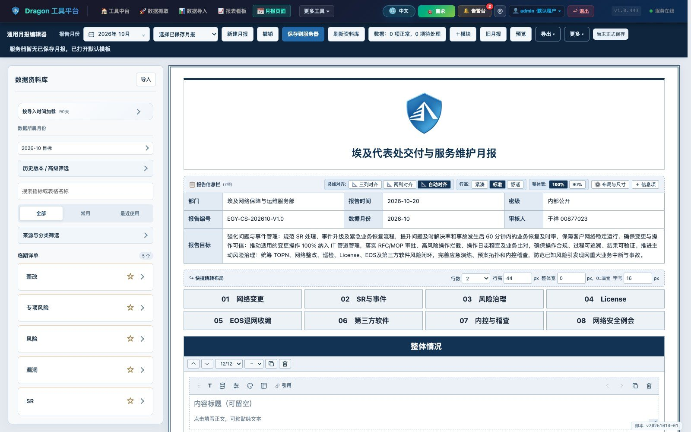 | 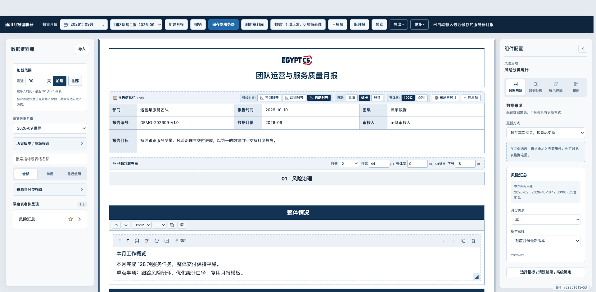 |
| **多列窄格图表网格与空白格提问** | **「✦ 整体风格」全篇风格顾问** |
| 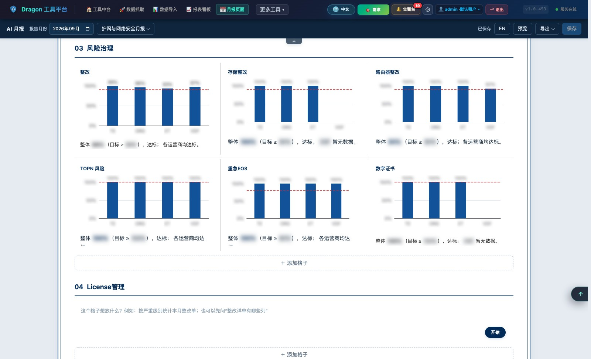 | 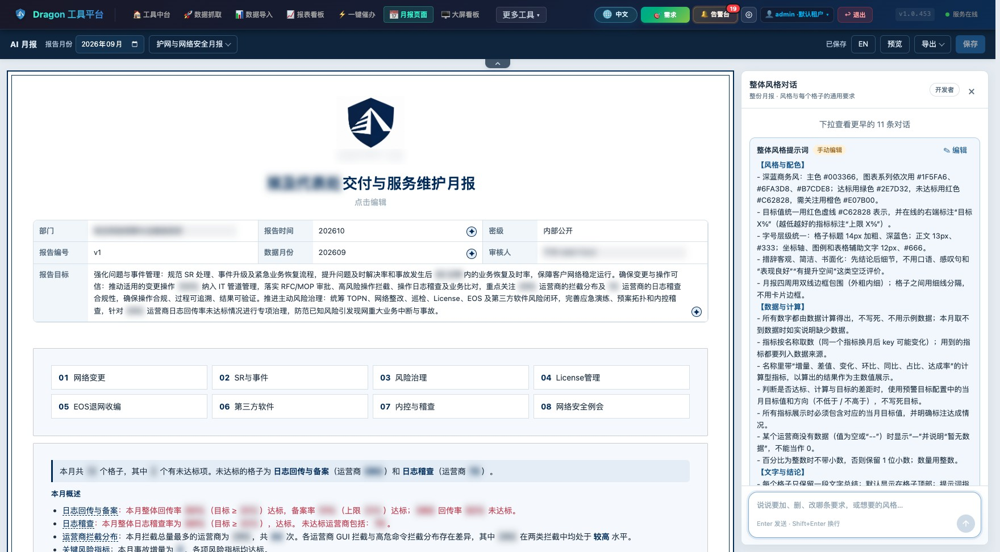 |
  - **想改哪里点哪里：五个地方都能直接跟 AI 对话 (`cell-chat.js`, `app.js`, `backend/routes/ai-report.js`)**：
    - **① 点格子聊数据 (`/api/ai-report/cell/{chat,prompt}`)**：在空白格内直接打字，或在右侧面板连续对话。你只需说日常用语，AI 会自己调用 7 个查数工具去翻当月导入的原始表格（哪怕刚导入还没点开解析过的表，它也会当场自动解析）、SLA 指标与 11 类业务工具数据。遇到列太多（超过 8 列）或口径有歧义时，它会弹出 2–5 个现成胶囊按钮让你点选；一旦需求明确，立刻帮你写好顶部的**「最终提示词」**并直接出图，不用多点一次“确认生成”。改坏了点一下 **`↶ 撤回`**，画面会像沙粒一样消散再瞬间聚合成上一版，不用重新等 AI 计算。
    - **② 点左上角 LOGO 换图或画图 (`/api/ai-report/{images,image/chat,image/generate}`)**：点击报头 LOGO 打开「✦ 图片对话」，支持上传本地图片、从历史图片画廊里挑、调整显示宽度（`40–400px`），或者直接让 AI 画一个新徽标——配了「丹青」等绘图模型时会生成高清图，甚至能以当前 LOGO 为底图局部改色改字；没配绘图模型时也会自动手绘匹配月报主题色的 `512×512` 矢量 SVG，每次更换都能随时一步步撤回。
    - **③ 点报头与页脚旁的 `✦` 定动态规则 (`/api/ai-report/template/field{,/chat,/prompt}`)**：主标题、副标题、信息栏每项（部门、报告时间、数据月份、审核人、报告目标）和页脚既可以直接双击改成固定文字，也能点旁边的 `✦` 设为按月自动生成的规则（如“报告时间永远写报告月份的下一个月，格式 `YYYYMM`”或“结合本月未达标格子写三段式报告目标”）。服务端会预先算好当月/上月/下月的精确日历值再交给 AI，绝不算错跨年与月份。
    - **④ 点章节标题栏 `✦` 统一整章排版 (`/api/ai-report/chapter/{chat,prompt}`, `/api/ai-report/cell/restyle`)**：一句话统一本章所有格子的图表方向、配色或总结位置。重排时服务端在后台**死死锁住每个格子的取数来源与计算公式**，只允许改外层展示代码，保证换皮肤绝不换数字。
    - **⑤ 点顶部「✦ 整体风格」换全篇主题 (`/api/ai-report/report/{chat,prompt,theme}`)**：按 `【风格与配色】`、`【数据与计算】`、`【文字与结论】`、`【排版与图表】` 四类维护全篇规矩。平时在单格子里随口说出的全局偏好（如“所有总结不超过两句”），AI 会在回复下方弹出「✦ 加入整体风格提示词」按钮供一键收录；修改整体风格时只精准改动你提到的那一条，绝不改乱其他规则，并实时刷新全篇配色、字体与边框。
    - **多层规矩冲突时先问你听谁的 (`checkConflict`)**：如果你这次说的要求跟以前在「整体风格」或「章节样式」里定下的规矩矛盾（比如之前定过目标线用红虚线，这次说用蓝实线），AI 绝不会偷偷覆盖，而是把新旧两条要求并列摆出来，提供「以这次为准，替换原要求」「保留原来的要求」「只在这个格子例外」按钮让你拍板。
  - **12 道自动质检关卡：宁可后台重做，绝不给你看假数字或乱排版 (`runner.js`, `sandbox.js`, `/api/ai-report/cell/compile`)**：
    - AI 不直接填数字，而是把需求编译成一套可跨月复用的“取数 + 计算 + 渲染”配方（`recipe`），关进**完全断网的安全沙箱**里运行。
    - 在画面呈现给你之前，系统会自动完成 **12 道质检**：严禁联网、严禁使用随机数或“示例数据”、严禁编造不存在的表名；如果因为指标名没写全（比如把 `TOPN 风险 / TE` 简写成 `TE`）或过滤条件写错导致有数据的表算出一堆 `0` 或空表、如果把“本月总数”错填进“环比增量”、如果并列第一时写出“某代表处最高又最低”的矛盾句子、如果画面漏出 `undefined`/`NaN`/源码标签、如果顶部有了总结下面又重复写总结，甚至渲染后发现**漏掉了你要求写的标题**或**左右并排两块把格子挤出了横向滚动条**——系统都会在几秒钟内自动把问题打回给 AI 回炉重做（最多 3 次），直到算准、排好才端上桌面。
  - **图表能下钻 3 层、能跟表格联动 (`render-kit.js`, `widgets.js`)**：
    - 生成的图表（`kit.chart`，高清 SVG）支持最多 **3 级点击下钻**（如从「大区」点进「代表处」再点进「单据明细」，带面包屑一键退回）；点击左边图表的柱子，右边的数据表（`kit.datatable`）会自动跟着筛选对应单据，并支持实时搜索、点击表头排序与翻页。
    - KPI 卡片（`kit.kpi`）自动把变化量写成 `较上月 +2`、`与上月持平` 等人话；极值组件（`kit.extremes`）自动合并展示并列第一/垫底项；导览与概述里的指标名和数字支持一键平滑滚动定位到对应章节或格子。
  - **看着画面直接上手微调，不用事事打字 (`app.js`, `layout.js`)**：
    - **哪里不顺眼双击直接改 (`/api/ai-report/cell/text-edit`)**：双击表头、单元格、标题、KPI 或顶栏总结就能原地改字。AI 能自动听懂你是想把缩写替换成固定中文名（`replace`），还是想润色总结文风（`refine`），并自动把规则记进提示词。
    - **像摆桌面图标一样拖拽格子与章节**：拖格子时旁边的卡片平滑让位；拖章节时**整篇长月报自动缩小成一屏总览（`zoomOut`）**，松手后再平滑放大落位；两章之间悬停随时点击 `＋ 插入章节`。
    - **拉尺寸有 2.5 秒缓冲倒计时条（`.air-settle`）**：拉窄或拉矮已生成的格子后，底部会浮现一条 2.5 秒倒计时条（带「立即生成」和「撤销调整」），你继续拉扯时它会自动等你，调满意了再一次性让 AI 按新尺寸重排（缩窄到 4 列以内自动改成上下堆叠；若横轴名字超过 6 个字还会弹窗问你按哪种方式缩写）。格子内部左右分栏的缝隙也能直接用鼠标拉宽拉高，双击右下角或横线即可恢复自动高度。
  - **想看底牌时随时翻看：排查信息与「开发者」全屏划词诊断 (`trace.js`, `trace-viewer.js`)**：
    - 点开最终提示词下方的「排查信息」，就能看到这一格读了哪张表、用了什么计算和展示代码。
    - 打开对话面板右上角的 **「开发者」** 开关，后台每一步思考、查表、重试和耗时都会实时记入「开发者记录」。点 **`⛶ 全屏`** 打开双栏阅读器后，可以点 **`✦ AI 总结全部内容`** 听大白话复盘、点 **`🩺 分析错误原因`** 找病根，或者**直接用鼠标划选任意一段看不懂的提示词、JSON 或报错文字**，点浮出的 **`✦ AI 对话`** 选中哪句问哪句（`/api/ai-report/debug/explain`）。
  - **平时改一格全篇联动，下个月切一下月份直接导出 (`runner.js`, `export.js`)**：
    - **总览格 0.4 秒自动跟随（`followReport`）**：只要你改了下面某个格子的算法、改了章节名或挪了顺序，顶部的导览和「本月概述」总览格会在 0.4 秒内自己静默重算。
    - **下个月一键换月**：切换顶部「报告月份」，所有数据格、动态报头字段与顶部总览格按两阶段自动拉取新月份数据重算；旧总结自动亮起「✦ 更新总结（N）」供一键批量重写。
    - **三种交付格式**：支持一键导出**独立交互式单文件 HTML**（发给同事断网双击打开也能做 3 级图表下钻和表格筛选）、**高清矢量 PDF**（自动冻结图表并展开全部分页表格）以及 **Outlook `.msg` 邮件草稿**（双击直接在 Outlook 发送）。
- **运营质量大屏 (`/bigscreen`)**：
  - 专为会议室全屏展示与运维中枢大屏设计，包含态势总览、达标巡检雷达、风险客户群排行榜、短板指标分布与实时数据探针。

---

### 2.4 一键精准催办与导出


- **一键精准催办 (`/expedite`)**：
  - 基于当前最新报表快照，自动提取扣分短板与超时未达标项，一键组装高优先级跟进催办文案。
  - **网络映射与分类穿透 (`network-mapping.js`)**：与月报工作区共享同一套网络别名映射字典（例如将 `EG-Egypt ET` 规范解析为 `ET`），精准过滤收件人名下的短板单据。
  - **关键词过滤**：支持自定义忽略特定关键词或豁免客户群。
  - **多模板配置**：支持按业务群、高层汇报、责任人催办等多种风格模板一键切换。
  - **全屏截图与原生导出**：一键生成全屏高清长截图，支持导出带公式的原生 Excel 报表。

---

### 2.5 胶片设计与 PPT 素材库

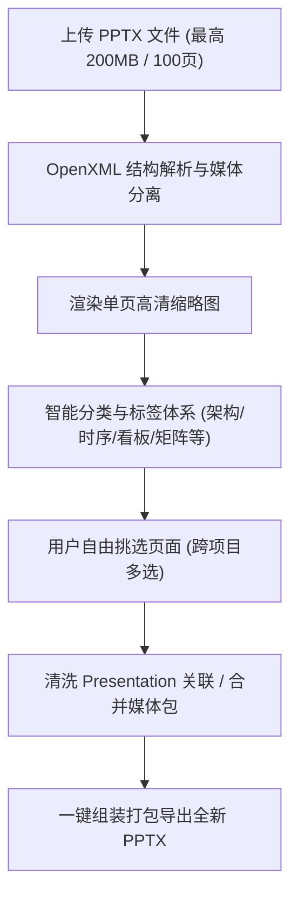

- **PPTX 智能拆解与解析 (`/api/slide-design`)**：
  - 支持上传最高 200MB 的 PPTX（单文件最多 100 页），深度解析底层 OpenXML，拆解单页 Slide、提取多媒体资源并自动渲染高清缩略图。
- **素材分类体系重组与标签复用**：
  - 建立统一的胶片素材库（架构图、时序图、数据看板、对比矩阵等），支持分类预览与标签复用检索。
- **页面自由挑选与打包重组**：
  - 用户多选所需单页后，服务端自动清洗 presentation 结构并组装打包为全新的标准 PPTX 文件。

---

### 2.6 专项治理工具链

针对交付与运维中的高复杂度场景，平台打造了覆盖专题历史回顾、负向事件奖惩、正向激励审批、花名册考勤矩阵、订单智能核验、加密考题金库及多语言学习的专项治理工具矩阵：

- **专题分析中心与历史快照 (`/topic-analysis`, `/api/topic-snapshots`)**：
  - **租户级快照数据中心**：集中归档 NetCare 与 DataFab 的批次导入快照，保留完整的原始 JSON 结构，支持跨月份按时间轴追溯与穿透检索。
  - **EOS 产品与版本收编进展月报**：专为 EOS 重点项目构建的交互式月报，打通月报工作区能力，支持计划数对比、工程导出导入、快照版本分屏 Diff 及多格式长图下载。
- **部门奖惩与负向事件治理 (`/api/department-reward-penalty`)**：
  - **全生命周期闭环**：涵盖红线违规登记、证据链留存、免责归因、跨代表处流转与整改闭环追踪。
  - **自动化 Pages 与单文件发布 (`snapshot-publish-service.js`)**：
    - **单文件离线发布**：支持一键生成内嵌完整结构化数据与全部证据附件（图片/PDF）的单文件 HTML，实现完全离线化只读审计。
    - **Git Pages 自动化持续发布**：后端集成 Git 克隆、差异比对与推送管道；支持按租户配置部署分支与路径模板（`{toolSlug}/index.html`），可发布为“单文件内嵌版”或“Pages 数据分离版”。
    - **多工具快照聚合与首页菜单维护**：推送时自动维护仓库根目录的 `index.html` 站点导航目录和说明文档，自动聚合月报与奖惩等多工具快照。
    - **定时自动发布调度与执行终端**：后台调度器依配置周期 (`auto_push_minutes`) 自动检测新数据并执行推送；前端弹窗内置实时 Web 终端，流式展示克隆、比对、提交与推送全过程，并配有门禁解锁 (Gatekeeper unlock) 安全防护。
- **正向激励方案管理 (`/api/reward-program`)**：
  - **规范化申报与核算**：支持多维度业务正向激励方案设定、月度/季度申报立项、激励额度核算、佐证凭证（PDF/图片/压缩包）上传及多级审批流转。
  - **异议与留痕台账**：支持对激励结果发起在线异议申诉，系统完整记录版本修订历史与审计日志。
  - **快照同步发布**：同样支持一键将正向激励台账打包并自动化推送至 Pages 站点归档。
- **会议考勤矩阵与花名册体系 (`/api/meeting-snapshots`, `/api/operation-incentive-snapshots`)**：
  - **多场次会议批量导入与场次切换**：支持单次导入多场次打卡明细，前端支持场次动态无缝切换、单独维护出勤基线与统计结论。
  - **跨场次考勤比对矩阵 (Comparison Matrix)**：
    - 生成多场次全量人员交叉核验矩阵，直观对比出勤率、缺勤场次及连续出勤表现。
    - 支持一键切换**全屏视图 (Fullscreen / Exit Fullscreen)**，高密度表头吸顶滚动，提供沉浸式管理大屏审查体验。
  - **伪考勤防刷识别算法**：智能识别“多日伪打卡”与“截止时间后伪考勤”，精准识破后续日期提前补卡或截断后的虚假记录。
  - **晚班/夜班 WFM 排班豁免机制**：支持按场次设定校验时间窗，关联 WFM 排班系统，自动识别合法晚班/夜班人员并给予免打卡豁免处理。
  - **自动生成 WeLink 人员查询脚本与映射导入**：
    - 针对提取结果中未匹配的人员，一键自动生成针对企业通讯录 (WeLink) 的批量检索脚本。
    - 支持导入通讯录映射表，自动合并新旧工号（智能剥离工号首字母及 `m` 前缀别名）并实现跨表同人识别。
  - **疑似离职与工号变更判定**：系统在考勤汇总与人员清单导出中自动将未匹配人员标记为“疑似离职或工号变更 ('Suspected Departure or ID Change')”，方便管理员逐级核实。
  - **名单双持久化与彻底删除**：考勤记录双重落盘保障，归档记录支持按需彻底物理删除。
- **餐单与采购订单智能核验器 (`tool-mtpx4vtr` / `order-validator`)**：
  - **内容驱动的列画像分析 (Column Profiling)**：根据整列数据特征（数值分布、文本模式、日期格式）自动反推真实列含义，自动纠偏人工错标的表头列名。
  - **抗干扰日期与数量识别**：智能剥离 WK 预留周列、Excel 内部日期序列号，防止采购数量被错误劫持；自动过滤无日期或严重偏离基准日期的杂质数据行；自动忽略采购量、实际量与差异三者全为 0 的无效对比行。
  - **品名规范清洗**：自动清洗商品品名与规格中悬空的未闭合或多余冗余括号。
  - **层级呈现看板**：顶部提供每日差异汇总卡片，下方提供默认折叠的每日明细表格、空供应商折叠过滤与悬浮卡片交互。
- **供应商报价比对 (`supplier-quotation-comparison`) 与强控业务比对 (`tool-mumxi3px`)**：
  - 同样搭载数据驱动列画像引擎，支持跨供应商、跨型号的多规格报价明细比对与差异高亮。
  - 强控业务比对产品查询系统，支持产品范围检索与合规排查。
- **加密考题金库与题库学习 (`question-bank-study` / `exam-question-bank-vault`)**：
  - 加密考题金库存储引擎，题目、题干与答案选项经强加密隔离存储。
  - 题库学习支持多模型 AI 辅助答题建议、投票共识推断、错误经验自动剔除与思考日志全过程追溯。
- **阿拉伯语/埃及口语沉浸式互动学习 (`tool-mtakhxqm`)**：
  - 专为海外一线团队打造的沉浸式口语教室，提供词汇跟读、字母发音练习、互动操练与多媒体音频播放。
- **PR 进展审计 (`/praudit`)**：
  - 审计级批量自检系统，检查 PR 进展附件记录是否完整合规，支持导入 Excel 校验并导出双语 PDF 报告。
- **FRT KPI 自动核算 (`/frt`)**：
  - 基于动态规则引擎，智能提取 SR 类型，多周期自动化核算 FRT KPI 达成率并诊断扣分项。
- **全民需求广场 (`/requirements`)**：
  - 平台需求全民提交入口，提供待评审 -> 评估中 -> 开发中 -> 已上线 -> 已驳回的可视化流转看板。
  - 新增和编辑需求时，浏览器通过 AES-256-GCM 加密整份表单，并使用服务器 RSA-OAEP/SHA-256 公钥封装一次性密钥；后端校验账号、租户、请求方法和目标路径后解密，仍按原有权限和业务规则保存。数据库保存可正常回读的原文，写请求正文不进入服务监控日志；旧客户端的明文 API 调用继续兼容。
  - 加密提交需要 HTTPS 或 localhost。无法加密或校验失败时保留表单并提示重试，不自动降级为明文。详情没有独立字数上限，输入框下方实时显示字数；加密后的总数据不超过 50 MB。
  - 较大的加密表单自动拆为随机 256–512 KiB 数据块（末块可更小），通过 `/api/requirements/uploads/` 顺序上传。每个 JSON 正文不超过 800,000 字节，并计入应用包头、额外预留 64 KiB，确保预算小于十进制 1,000,000 字节。按钮显示分块进度，临时失败自动重试；后端收齐后校验整包 SHA-256 并解密，再复用原有新增/编辑流程。完成响应丢失时复用同一会话结果，避免重复创建。
  - 分块会话按账号和租户隔离，编辑仍仅限管理员；密文临时文件保存在当前租户的 `tmp/encrypted-requirement-uploads/`，完成、取消或闲置 15 分钟后清理。重启服务会使未完成会话失效，需要重新提交。
  - 此方式可减少脚本文本触发网关内容规则的情况，但不保证消除所有 Cloudflare 拦截。若仍被拦截，应根据 Security Events 中的具体规则检查误报，参见 [Cloudflare WAF 误报排查](https://developers.cloudflare.com/waf/managed-rules/troubleshooting/)。
- **可配置问卷调研系统 (`/surveys`)**：
  - 自由定义调研表单字段，支持针对特定管理角色进行统计分析，收集提交并一键导出 Excel。

---

### 2.7 平台效能大盘、服务监控与友情链接
- **平台效能总览**：
  - 首页动态实时统计：已完成指标检查量、累计服务次数、等效人工工时、累计节约工时与效率提升百分比。
- **服务状态与链路追踪 (`/api/platform-metrics/service-status`)**：
  - 自动记录全量 API 响应码、耗时、IP、UA，保留 180 天异常失败日志，敏感字段全程脱敏。平台返回的 `401 AUTH_REQUIRED`（未登录）和 `401 AUTH_EXPIRED`（会话过期）作为正常鉴权拦截单独计数，不计入 4xx 异常或服务降级，默认失败明细也会排除；原始诊断记录保留，普通 401、400、403、404 和 5xx 仍按异常统计。历史记录仅在仍保留的明细中能明确识别错误码时排除，已裁剪的旧明细无法追溯。
- **友情链接与可用性自动探测 (`/api/friend-links`)**：
  - 首页友情链接矩阵，后台常驻定时探活服务，动态以“正常 (绿) / 告警 (黄) / 离线 (红)”展示健康状态。
- **平台推广 (`/api/platform-promotions`，全局设置 › 平台推广)**：
  - 首页右上角推广区同时包含推广视频与推广链接，同一时间只有一个小窗（视频或链接画面），其余以横幅显示，颜色与角标区分类型。浏览器首次进入优先展示第一个已启用的推广链接；之后刷新或重新进入时，视频和链接混合随机轮换，每轮内不重复，跨轮避免连续展示相同项。没有推广链接时轮换视频，永久关闭小窗的偏好仍然保留；静态推送首页沿用相同行为。
  - 系统自带的视频与 NetCare 链接只能隐藏；自定义链接可增删改、排序。首页最多显示的链接数默认 3 个，超出后按设定间隔轮换。
  - 默认（系统自带）链接保存在受版本控制的 `backend/platform-promotions-defaults.json`：可直接手动编辑，或在源码目录运行的服务上用「编辑默认 / 设为默认」写回，提交并推送到 Git 后即为所有环境的默认链接（打包后的桌面版只读）。
  - 桌面端登录后在屏幕右下角以置顶卡片堆打开推广链接（`desktop-promo/`，独立持久分区保存登录态），小窗按完整桌面视口等比缩小，隐藏主页面及 iframe 内的滚动条，锁定手势缩放；点击将当前页面移入 Dragon 浏览器标签并恢复原页面滚动样式；最小化或关闭浏览器后恢复预览。首页小窗显示其实时画面，点击推广链接在 Dragon 浏览器新增标签；浏览器打开期间首页可回退推广封面，右下角预览恢复后继续更新；托盘可暂停，关闭卡片堆当天不再弹出，Windows 全屏/演示时自动隐藏。
  - 浏览器访问时链接显示封面卡片，点击在固定命名的标签页打开（已打开则直接切换），NetCare 等禁止被嵌入的站点也能正常访问。
  - Dragon 浏览器（所有入口共用一个多标签窗口）：没有有效期的会话 Cookie 自动续存 7 天，但服务端过期或撤销登录仍需重新认证，且不共享系统 Chrome / Edge 的登录态；工具栏「🧩」加载浏览器插件——项目自带插件随平台更新自动重新加载，也可导入打包好的 .zip / 插件文件夹或本机 Chrome / Edge 已安装的插件。启动时自动识别名称以 ICPM 开头的插件并加载一份：沿用已保存的选择，首次选择较新版本，同版本优先 Chrome；手动切换只保留一份，取消后不再自动启用。插件原样加载，License 校验照常生效；“已加载”只表示扩展加载成功，Electron 仅支持部分扩展接口，依赖 `nativeMessaging` 本机通信的插件会显示兼容性提示，不能据此承诺 XGate 等公司免密登录可用；需要完整企业认证环境时可通过工具栏「↗」在系统浏览器打开。「🪟」与托盘菜单在同一窗口新增浮窗脚本标签，登录跳回目标站点后自动运行。首页推广、网站的新窗口链接、插件面板和设置也在这个窗口打开标签；各标签独立保留页面和脚本状态，共享原有登录会话与插件。支持标签切换/关闭、新标签、地址栏，以及 Ctrl/Cmd+T、Ctrl/Cmd+W、Ctrl/Cmd+L、Ctrl/Cmd+Tab 快捷键。关闭最后一个标签关闭浏览器，右下角预览继续保留。
  - Dragon 浏览器下载文件默认直接保存到系统“下载”目录，不再每次弹出保存位置选择框；同名文件自动追加 `(1)`、`(2)` 等序号，批量同时下载也不会相互覆盖。使用系统配置的下载目录，支持 Windows 将下载目录移动到其他磁盘。
  - 数据抓取 →「📋 浮窗脚本」在桌面端多一个「🖥 Dragon 浏览器」按钮，脚本与「复制此站点」完全相同；打开数据抓取页时自动刷新桌面端缓存的站点脚本。
  - 点击统计（设置页底部）：按推广项汇总点击次数与去重人数，区分视频大窗 / 新标签页 / 首页弹出桌面大窗 / 卡片堆直接放大四种渠道，同一账号 5 秒内重复点击只算一次，不展示账号明细。

---

### 2.8 自定义工具与多源工具市场生态

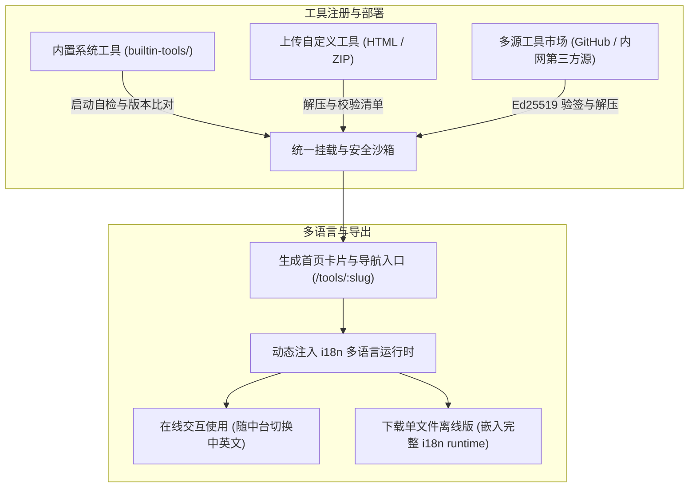

- **自定义 HTML 工具 (`/custom-tools`)**：
  - 上传 HTML 或 ZIP 工具包后自动解压校验并挂载独立 URL (`/tools/:slug`)，生成首页卡片与导航。
  - 直接上传遇到网络中断、超时、413 或可重试服务错误时，自动切换 AES-256-GCM 加密分块；会话密钥使用 RSA-OAEP/SHA-256 加密传送。每块原始数据最多 512 KiB，编码后请求正文约 700 KB，客户端另预留 64 KiB 包头空间，整体小于十进制 1 MB；服务端分块接口请求正文上限为 850,000 字节。
  - 上传窗口底部显示进度、加密/接收校验状态、每块大小、耗时和重试日志。整包 SHA-256 校验通过后才导入；同一导入请求重试不会重复创建工具。会话按租户和管理员隔离，闲置 15 分钟过期，临时数据保存在当前租户的 `tmp/encrypted-tool-imports/`，完成或过期后清理。
  - 加密分块需要 HTTPS 或 localhost 的浏览器安全环境；导入请求数据上限为 50 MB（ZIP 文件原有 35 MB 限制仍适用）。服务重启后未完成的分块需重新上传；格式、权限等业务错误直接提示，不能通过拆分解决。
  - 数据导入页的 NetCare/DataFab 专题模拟浮窗也复用该传输机制：归档 JSON 请求达到 800,000 字节时直接加密分块，小请求先直接上传。浮窗底部保留进度和过程日志；合并后仍执行原有管理员权限、专题格式和 45 MB 快照上限校验，并按快照内容去重。专题上传会话与工具上传会话相互隔离，临时数据存于当前租户的 `tmp/encrypted-topic-imports/`。无结构化业务错误信息的网关 403 可回退分块，真实权限拒绝不会重试。
- **译维仓储管理 (`/tools/tool-mv9strpn`)**：
  - 货品、仓库、库存单据、扫码记录和资金账款统一保存到服务器独立 SQLite 文件 `ezscan-warehouse.db`，不写入平台 `tools.db` 或浏览器 localStorage。默认租户文件位于 `TOOLS_DATA_DIR/ezscan-warehouse.db`（未配置时为 `backend/data/ezscan-warehouse.db`）；命名租户位于 `TOOLS_DATA_DIR/tenants/<tenant-id>/ezscan-warehouse.db`。
  - 同一租户跨浏览器、跨设备读取同一份仓储数据；登录账号可查看，管理员可修改。保存状态在服务器确认后更新；其他窗口已保存新版本时会阻止旧版本覆盖，可先导出未保存内容再重新加载。
  - 新数据库从空业务数据开始。在“服务器数据与备份”中可明确导入当前浏览器旧版数据或恢复 JSON 备份；导入覆盖前需要确认。浏览器旧数据不会自动覆盖已有服务器记录。
  - 页面可导出完整 JSON 或独立 SQLite 备份；SQLite 下载通过数据库快照生成，包含 WAL 中已提交的记录。仓储数据库也纳入当前租户的平台备份。自定义工具包仅用于分发页面代码，转移业务数据请使用仓储备份或租户备份；离线下载 HTML 不能脱离服务器修改业务数据。
  - 右上角固定提供“迁移旧数据”入口及“浅色 / 暗色 / 跟随系统”主题切换；未检测到旧数据也可通过 JSON 文件或粘贴内容迁移。“数据备份”支持追加和单独清理测试数据，重复添加不会创建重复记录，正式记录引用测试档案时禁止清理。
  - 月报按货品和单位分组，订单执行、库存回滚和资金核销有对应关联校验。完整检查范围、测试数据组成及 PDA / 审批 / 岗位模板能力边界见 [仓储管理说明](docs/ezscan-warehouse-review.md)。
- **日程安排单据提醒 (`/tools/tool-mrhqjeya`)**：
  - 自动读取当前租户最新 SLA 数据导入快照，默认在截止前 7 天、前 3 天及截止当天安排三次提醒，超期后每天持续催办；提前天数可在页面调整。
  - 卡片展示单号、内容、客户群、产品线、产品、责任人、截止日期及状态，可复制催办内容或标记本次已提醒。新快照移除或排除的单据自动标记完成，相同日期、单据和提醒阶段不会重复创建。
  - 在 08:30–12:00、13:30–18:30 的空闲时段编排，避开已有日程，每单按当天任务量分配 1–30 分钟；没有空闲时段的单据保留为待排。手工修改时间后保留该时间。
  - 页面打开时每 2 分钟检查新快照，预排未来至少 45 天并随查看日期扩展；无新快照或读取失败时沿用最后有效数据。旧快照没有精确截止时间时按快照日期与剩余天数估算并标注。此功能生成日程及催办文案，发送给责任人/客户群由使用者执行。
- **内置系统工具自动同步 (`builtin-tools-sync.js`)**：
  - 服务启动时自动扫描 `backend/builtin-tools/`，对比哈希并自动安装缺失的系统工具。
  - Web 按选择更新在工作线程中校验、备份和复制，仅扫描本次处理的工具；弹窗实时展示处理阶段、文件数量和进度，完成后刷新页面。同一租户的更新禁止重复提交，旧版接口保持兼容。
- **多源工具市场生态 (`/api/custom-tools/market/sources`)**：
  - 支持聚合官方 GitHub `tool-market` 分支与多个第三方内网静态源（HTTP/HTTPS），可随时启停源仓库。
  - 同名工具按优先级展示并支持一键安装/更新；支持 Ed25519 签名与 SHA-256 指纹校验，确保企业内网分发绝对可信。
- **多语言 (i18n) 运行时注入**：
  - 动态注入 `custom-tool-i18n-runtime.js`，支持单文件离线导出。
- **强控业务比对检索 (`tool-mumxi3px`)**：
  - 标题和平台悬浮语言按钮保持同步，支持完整的中英文切换。
  - 管理员可导入 XLSX（首个工作表）、CSV、TSV、TXT（制表符分隔）或 JSON，导入成功后替换当前租户的产品列表并保存到 SQLite；无效文件不会覆盖已有数据。
  - 表格需要“产品 / Product”或“产品名称 / Product Name”表头，支持中英文双语表头、引号内换行。页面可展开查看 XLSX 表格和 UTF-8 CSV 示例；仅产品名称必填，其余列可留空或省略。单文件不超过 10 MB，最多 50000 条产品记录。
  - 产品数据导出为 JSON，可直接再次导入；查询与导出供登录用户使用，导入需要管理员权限。
  - 静态页面下载及推送的单文件 HTML / Pages 分离版包含生成时最新的服务器产品数据。静态页只保留查询，生成时自动移除数据管理区域、格式示例和导入导出代码；服务器数据变化后需再次推送，或使用已有的定时推送设置。

#### F12 插件下载与 NetCare RFC 审计

管理员可在**全局设置 → F12插件**（设置侧栏最下方）添加首页快捷插件下载。选择内置插件或当前租户的服务器脚本，指定默认用途（Edge 商店或本地安装 / 企业分发），调整显示顺序即可自动保存。首页在知识图谱入口旁显示下载按钮，数量不限，多项自动换行。按钮直接复用 F12 打包流程及插件默认参数，沿用现有管理员权限、版本号预留和扩展身份配置。

内置 **NetCare RFC 方案与 AI 审计**兼容方案在 RFC 详情或门户站内页签中打开；识别与当前单号对应的原生入口后，由扩展另开浏览器标签处理。Word 导出连接按方案身份隔离，保留 `DNC` 等原生文档 ID。开启 AI 审计后，自动流程先缓存 Word、章节材料和审计 ZIP；全部处理完成后，在主面板 **审计结果 → 下载审计材料 ZIP** 手动统一导出。缓存失败会提示重试，不会自动另存单独的 Word；主面板只有在本批次审计结果和 ZIP 缓存都就绪后才计入完成。更新这类扩展逻辑后，需要重新打包并更新已安装的扩展，已安装包不会随平台源码自动更新。

- **面板最小化与恢复**：关闭浮窗时可选择最小化到右下角或彻底关闭，并记住选择。最小化保留任务运行，点击角标恢复；刷新后也可恢复面板。
- **按模型控制输入规模**：模型配置支持独立输入上限，采集与后台调用共同限制材料规模；审计最多同时处理 3 个分组，并复用同一附件行的截图。
- 具体安装、参数和操作说明见 [NetCare RFC 扩展指南](backend/builtin-tools/f12-to-extension/NETCARE_RFC_WORD_README.md)。

#### 静态快照导出与 Pages 发布

静态推送会发布与平台使用同一份 HTML、样式和中英文组件的主页与登录页，替代原来的简易工具列表。首页保留导航、分类、搜索、效能概览、推广图片、视频和工具预览；只有已推送工具可进入其只读页面，其余工具与服务端操作提示“无权限，请联系管理员添加”。脚本仓库、插件包和私人 AI 会话不随网站发布。

全站统一使用推送时同步的当前租户平台账号登录，密码与本地一致，账号或密码修改后需再次推送。每个工具不再单独设置密码。业务页面、JSON 和工具资源采用 AES-GCM 加密，账号使用独立的 PBKDF2 密钥包装，平台明文密码、原始密码哈希和 Session 不写入发布仓库。站点需使用 HTTPS，浏览器需支持 Service Worker 和 Web Crypto；已下载副本与旧 Git 历史不会被撤回。站点密钥保存在租户 SQLite 中，随正常租户备份保留。

右上角四组推广视频保留中文、英文普通版和高清版切换，登录页下方“项目演进”视频也会映射到独立媒体仓库的固定 Release 地址。封面和背景随页面发布，MP4 不进入代码仓库；播放视频需要联网，平台本地的同源播放与缓存保持不变。数通协议专家的已登记笔记讲解视频也按文章 ID 自动关联媒体 Release，支持普通版与高清版。

首页“平台推广”同时同步当前租户的推广链接、封面、视频开关、链接数量和轮换间隔；静态网站点击链接时在新标签页打开。登录页版本徽标和首页右上角版本号使用推送时主程序的版本并附加“在线测试版”（英文为 “Online test version”），登录页无需先登录即可显示版本。推广配置和版本号在重新推送后更新。

管理员可在“全局设置 → 静态页面推送”配置远端仓库、分支、`{toolSlug}/index.html` 路径模板、单文件或 Pages 工具快照格式，以及自动推送周期。网站首页始终使用统一登录，工具格式只影响生成的工具内容。单工具推送保留其他已发布工具；全量推送会清理取消勾选的工具。默认推送仅提交发生变化的内容，强制推送可触发托管平台重新部署。

当前工具的单文件 HTML / Pages ZIP 下载仍由平台管理员导出，用于独立只读查看，与网站的加密载荷不同。支持负向事件、奖励申报、会议考勤、操作激励、产品范围、数通知识库、调查模板及记录，以及原有纯静态 HTML/ZIP 工具。无需数据库接口的工具沿用通用适配器；依赖平台 API 的工具需像数通知识库一样配套数据导出。F12 等脚本插件仍保留原有平台使用与管理员下载能力，暂不发布到静态网站。

详细实现、升级规则与验证命令见 [静态平台主页与统一登录](docs/static-portal.md)。

### 2.9 Dragon Claw 智能体、Agent Workspace 协同工作区与 2D/3D 双视图知识图谱

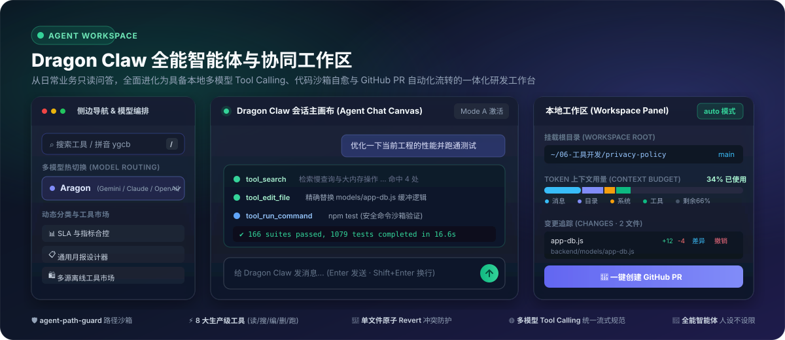

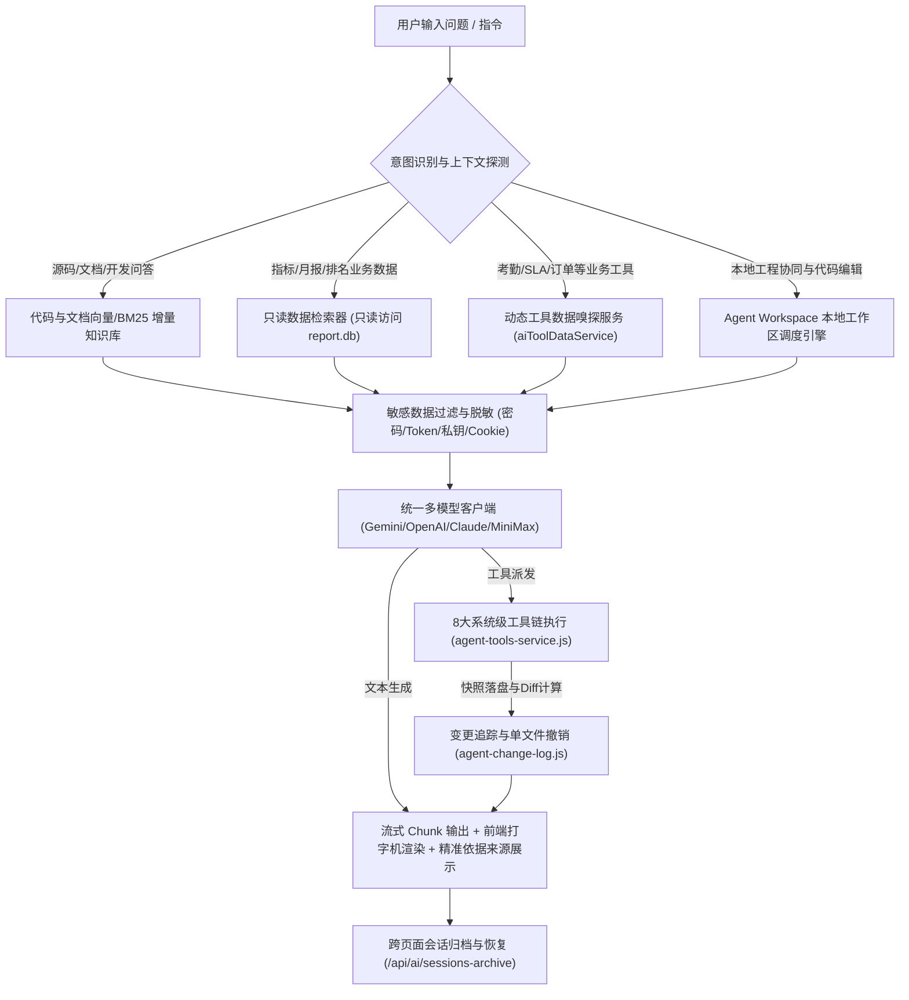

#### WeLink SDK 频道对接：手机上的运营助手

通过 `@wecode/bridge-runtime-sdk`，可将平台的 Dragon Claw 接入企业 WeLink 助理。人在外边时，直接在手机 WeLink 中发送问题，就能查询平台已入库的指标、分析客户群短板、了解风险进展，并继续追问待跟进事项；无需先打开电脑上的平台页面。频道复用首页 Dragon Claw 的平台知识、业务数据检索和多轮对话能力，支持单聊与群聊。

**常见问法**（按实际客户群、月份和已入库数据替换）：

- “本月各客户群哪些指标没有达标？按差距排序。”
- “帮我看一下某客户群的风险指标和整改进展，列出待跟进项。”
- “这个指标相比上个月有什么变化？主要短板在哪里？”
- “平台如何使用？数据抓取、SLA 合控和月报怎么串起来？”

**接入步骤**：

1. 管理员打开 **全局设置 → 频道对接 → WeLink**，确认 SDK 已检测到。平台优先提供内置 SDK；缺失时可在页面导入 welink-cli 或 Bot 工程中的 `@wecode` 文件夹，也可指定 SDK 路径。文件结构见 [内置 SDK 说明](backend/vendor/@wecode/bridge-runtime-sdk/README.md)。
2. 使用“扫码授权”创建助理并获取连接凭据（需 SDK 支持），或手动填写 WeLink 侧提供的 Channel、AK/SK 等参数；按实际环境配置网关。
3. 在“助理行为”中选择 **Dragon Claw 智能回复**，模型可跟随当前激活方案，也可单独选择已配置的模型。需先在“AI 助手”中配置可用模型。
4. 设置人员、群组的黑白名单，启用 WeLink 助理并保存，确认状态为已连接；保存后自动连接，平台重启后自动恢复。更新 SDK 或连接参数后，按页面提示“重启连接”。
5. 在手机 WeLink 中打开已授权助理并开始对话。开启斜杠命令后，可用 `/help` 查看帮助、`/new` 开启新对话、`/whoami` 查看账号及群 ID、`/status` 查看状态。

**使用范围与运行条件**：

- **风险跟进**：当前频道身份为普通用户，仅开放平台知识与业务数据的只读查询、分析及建议，不开放本地 Agent Workspace、业务数据修改或命令执行。回答依据平台已有数据；先完成抓取、导入和快照更新，手机查询才能反映最新入库进展。
- **连接条件**：平台服务须持续运行，且部署机器能访问 WeLink 网关和配置的模型服务；手机通过 WeLink 与助理对话，无需直接访问平台网页。
- **租户与会话**：连接配置、访问名单和业务数据按租户隔离，对话以 `welink:<账号>` 身份保存到平台聊天记录中心；SDK 文件属于本机共享运行依赖。
- **推送协作**：频道设置还提供向人员或群组主动推送的配置与测试入口。推送受访问名单及推送权限约束，普通用户只有在管理员开启权限后才能向默认推送范围发送。
- **频道定时任务**：WeLink / 微信可直接说“一分钟后提醒我睡觉”“每天 9 点提醒我检查告警”，或使用 `/schedule 明天 9:00 汇总告警`。明确时间由服务端解析并写入 SQLite，成功回复包含任务编号、执行时间与时区；时间不明确或权限不满足时明确提示未创建。发送“定时任务”查看，发送“取消定时任务 <任务编号>”取消；首页该会话右侧工作区也可查看状态。
- **地区时区**：支持“荷兰时间每天中午十二点提醒小王提交日报”“每天十二点（荷兰时间）提醒小王提交日报”，也可在末尾用“，按荷兰时间”或括号标注；`Europe/Amsterdam` 等有效地区时区可直接使用。支持荷兰/阿姆斯特丹、埃及/开罗、中国/北京、英国/伦敦、德国/柏林、法国/巴黎、日本/东京、新加坡、印度、迪拜、沙特、纽约、洛杉矶等名称。周期任务保存地区时区，随当地夏令时调整 UTC 执行时刻；未指定时沿用该频道自己的时区配置。“美国时间”等不能唯一确定时区的写法会提示补充城市，不会静默按默认时区创建。WeLink 的前置 `@助理` 可与时间指令连写，时间后的 `@人员` 保留在提醒正文中。
- **预约边界**：频道发起的任务只回到原群/单聊，沿用人员和群组名单，创建与发送时均校验；不开放任意收件对象，也不授予平台主动推送或业务写权限。服务须持续运行，调度器每分钟检查一次；简单提醒不依赖模型，汇总、分析等指令仍需可用的模型服务。
- **持续跟进**：WeLink / 微信的“帮我记一下、后边持续跟进、记录进展、暂停/恢复跟进、已完成”等意图由模型调用 `followup_*` 工具保存与更新，依赖已启用跟进功能和支持工具调用的模型，并非单纯的关键词开关。微信仅支持原单聊，不会向其他联系人转发或群内 @；同一会话的多项任务及状态、进展流水可在首页右侧工作区查看，管理员可暂停、恢复、完成或立即提醒。两种频道独立使用各自的跟进开关和工作日历；微信模型未实际保存任务时不会回复“已记录”，以任务编号与工作区记录为准。
- **统一对话列表**：「我的对话」、WeLink/微信和桌面 Agent 按「最近（3 天内）／3 天前／7 天前／一个月前」分组，置顶单独显示；时间默认隐藏，悬停才在右侧显示，停留 2 秒后换为「···」。右键或点击「···」可重命名、置顶、归档和删除；「已归档」可查看并恢复。偏好按账号和租户保存；外部会话的重命名和移除只影响本平台列表，原客户端内容保留。
- **桌面 Agent 最近会话**：管理员在「全局设置 → 桌面 Agent」连接服务所在电脑后，首页对话侧栏新增「桌面 Agent」分类，自动同步 Codex、Claude Code、Antigravity 最近会话，并支持切换、搜索和手动同步。Codex、Antigravity 支持在 Web 继续选中的原生桌面会话；Claude Code 当前为历史只读，发送连接尚未接通。连接绑定单一账号及租户；设置、收发边界与实测见 [桌面对话连接说明](docs/desktop-agent-conversations.md)。
- **同一对话内的桌面 Agent 讨论**：点击首页输入框或对话顶部的 DragonTAC 即创建讨论组；首次发送自动为 Codex、Claude Code、Antigravity 各新建一条原生桌面对话，后续消息沿用本讨论组自己的三条会话。回复按来源保存，无需手动选会话或讨论模式。自动新建 Codex、Claude 需要 macOS 辅助功能权限，Claude 还需开启模拟操作发送；成员不可用时明确显示原因。详见 [同会话讨论](docs/desktop-agent-conversations.md#同一-dragonclaw-对话内讨论)。
- **DragonTAC 升级支持**：目标优先复用 Codex、Claude Code、Antigravity 的桌面会话，三家桌面端已完成 [实际收发与网页读取测试](docs/dragon-tac-desktop-probe.md)，持续桌面连接器尚未部署。当前另有可保留的 CLI 备用原型：首页或频道内说“打开 https://example.com 并分析页面”，系统展示实际可用成员、执行通道与任务编号，原发起人明确确认后，浏览器读取公开网页并由官方 CLI 分析/复核，结果回传原会话。当前 HUD 适配器可探测真实 MCP 工具，不将布局工具当成派发接口。执行边界、部署变量和尚未接通的部分见 [DragonTAC 说明](docs/dragon-tac.md)。

#### 2.9.1 Agent Workspace 本地代码协同工作区深度解析

随着 Dragon Claw 演进为全能编程与协同智能体，系统在首页集成了原生 **Agent Workspace**（基于 `workspace-panel.js`、`home-workspace.css`、`backend/routes/agent-workspace.js` 及系列底层服务）。

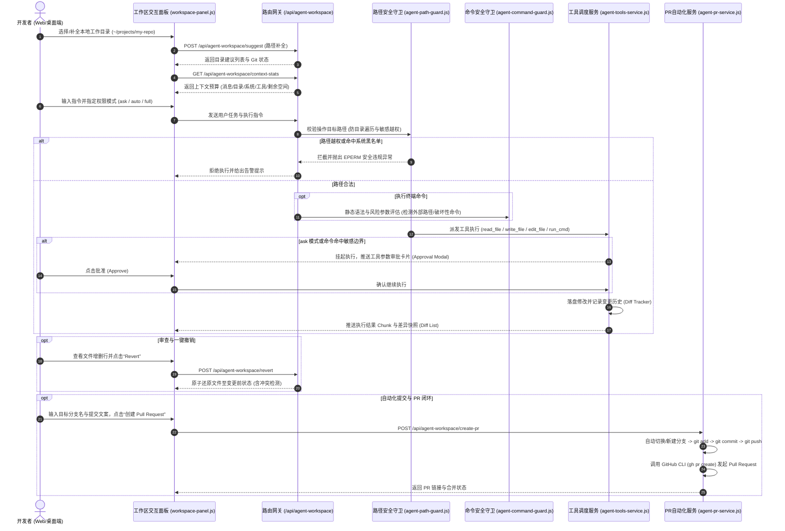

- **内置 Skills（`@` 调用）**：首页输入 `@` 可搜索并选择项目导览、排查故障、代码审查、数据核查和编写文档；支持方向键选择、Enter/Tab 插入。发送后后端加载对应 `SKILL.md`，复用现有工具与账号权限；加载过的 Skill 显示为输入框上方的标签，本对话后续消息继续生效，点 × 停用。示例：`@project-map 帮我梳理项目入口和数据流`。需要读取项目/数据库的 Skill 请先选择工作目录；文档草稿可直接使用。详见 [Dragon Claw Skills 使用说明](docs/dragon-claw-skills.md)。
- **数字人基座对接（NetCare 数据）**：「全局设置 › 频道对接 › 数字人」粘贴写报告服务的 `.env` 即可导入基座地址与应用身份（默认 beta 基座，可改），连通性测试逐步显示基座返回。管理员可在 `/netcare-explorer` 浏览 NetCare 业务库实时表清单（叠加全表盘点 441 张种子与人工标注，新表自动出现），查看字段画像与样例、结构化查询、只读 SQL，应用库支持写入；首页 `@netcare-data` 让 Dragon Claw 只读查询。平台直接请求基座 REST API，不经过 FastAPI。详见 [数字人基座对接](docs/digital-human-netcare.md)。
- **运营消息确认**：频道对接的运营计划选择“到点生成草稿，确认后发送”后，主页只显示一行“有 N 条消息待确认 → 进入对话”。点击后直接打开收件对象的微信或 WeLink 会话，在真实消息时间线中查看、修改、保存和确认草稿；其他工具页右上方横幅也导航到该入口（`/#ops-drafts`）。不同收件对象的草稿可通过“待确认会话”选择器切换；多收件对象草稿会列出完整范围，确认时发送到全部列出的对象。最后一条处理成功后，成功提示短暂停留，草稿区域及提示条消失，会话和已发送消息仍保留；失败提示保留。页面可见时每 20 秒刷新，并在重新切回页面时刷新；暂时收起横幅后，有新草稿会再次提醒。原“全局设置 → 频道对接 → 运营 → 草稿与推送记录”入口保留，记录按时间倒序分页展示，每页 20 条，支持上一页、下一页及页码跳转，翻页保留未保存的草稿与上方表单；提醒与操作均限定当前租户，独立下载文件和静态快照不显示在线待办。
  多条待确认消息合并成一个汇总横幅，横幅上限为 1 条；打开后卡片纵向排列，每页最多 20 条。存在待确认消息时，页面上的推广浮窗、推广横幅和边缘入口自动隐藏，并暂停推广小视频；即使暂时收起待办提醒，推广也继续避让。待办清空后恢复推广原先的展开或收起状态，不改写永久关闭偏好。
- **频道手动运营**：微信 / WeLink 会话底部可以从“查看记录”切换为“以 Bot 身份发送”，输入正文后直接由已连接的 Bot 发往当前会话。支持 Enter 发送、Shift + Enter 换行，未发送正文按会话暂存，失败时保留；发送后会写回实际会话并标注“手动运营”和操作人。管理员可以发送；普通账号仅在该频道启用“允许普通用户推送”且当前对象位于默认推送范围内时可发送。频道名单、连接状态和可推送会话等限制仍生效；微信仅支持联系人。手动运营不暂停已有自动回复或定时计划。
- **三大核心安全权限模式 (Permission Modes)**：
  - **`ask` (逐项审批模式)**：默认安全防线。任何涉及文件写入、内容替换、文件删除或终端命令调用的操作均会暂停，在界面弹窗展示操作详情与参数，等待用户手动点击“批准”或“拒绝”。
  - **`auto` (智能安全放行模式)**：只读操作（读取文件、文件搜索、目录探索）及普通安全编辑自动执行；对于破坏性操作（递归删除、执行带危险参数的 Shell 脚本）强制唤起安全确认。
  - **`full` (完全自治模式)**：面向深度可信的本地工程或批处理任务，智能体拥有全自主读写与脚本执行权限，极速完成复杂的多文件重构与全链路验证。
  - **非管理员只读保护**：当前登录账号非管理员时，智能体自动锁定为只读模式（仅能查看与检索代码，禁止任何写入、删除与终端调用）。
- **工作区系统工具链字典 (`agent-tools-service.js`)**：
  | 工具名称 | 类别 | 参数规范 | 核心职责与安全策略 |
  | :--- | :--- | :--- | :--- |
  | `list_directory` | 读取 | `path`, `depth` (1~3), `showHidden` | 列出目录条目，目录优先排序，默认限制返回前 500 项。 |
  | `read_file` | 读取 | `path`, `startLine`, `limit` (最大2000), `endLine` | 带行号精确读取文本，单次最大 200KB，超长行截断并提示分段继续读取。 |
  | `search` | 读取 | `query`, `path`, `pattern`, `caseSensitive`, `maxMatches` | 全局正则/关键词代码检索，内置 10s 执行超时与最大 20,000 文件扫描上限。 |
  | `list_databases` / `database_schema` / `read_database_table` | 读取 | `database`, `table`, `columns`, `filter` 等 | 列出当前租户实际业务库与所选项目本地 SQLite，查看结构并分页读取；凭据与控制面表排除。 |
  | `insert_database_row` / `update_database_rows` | 写入 | `database`, `table`, `values`（JSON 对象字符串）, `filters` 等 | 管理员在事务内新增/更新业务行；按权限模式审批，提交后返回影响行数。 |
  | `delete_database_rows` | 删除 | `database`, `table`, `filters`, `allowAllRows`, `maxAffectedRows` | 管理员删除业务行；`auto` 模式仍需批准，`full` 自动执行；整表操作须显式指定。 |
  | `write_file` | 写入 | `path`, `content` | 完整写入文件（单次最大 1MB），写入前自动留存原文件快照至变更记录。 |
  | `edit_file` | 写入 | `path`, `edits: [{ old_string, new_string }]` | 精确块级文本替换；要求 `old_string` 在文件中唯一匹配，防范误伤。 |
  | `delete_path` | 写入 | `path`, `recursive` | 删除文件或目录；按权限模式审批，管理员完全访问模式自动执行。 |
  | `rename_path` | 写入 | `old_path`, `new_path`, `overwrite` | 安全移动或重命名文件/目录，目标已存在时默认拦截保护。 |
  | `run_command` | 命令 | `command`, `timeoutMs` (默认60s/最大300s) | 以所选目录为默认位置执行 Shell；自动剥离敏感环境变量，实际权限由服务进程的系统账号决定。 |
- **文件路径守卫与命令审批 (`agent-path-guard.js` / `agent-command-guard.js`)**：
  - 文件工具限制在工作区根目录内；Shell 可以访问任务所需的其他目录，不是系统沙箱，也不会自动获得更高的系统账号权限。
  - 自动忽略 `.git` 内部对象、`node_modules`、编译临时目录等膨胀文件，保障上下文窗口利用率最大化。
  - 管理员的“完全访问”模式自动执行文件操作和命令，跨目录或敏感路径风险标记不会强制降级为审批；模型按当前任务自主规划、执行和验证。
  - “请求批准”和“帮我批准”模式保留命令审批及静态风险提醒；普通用户始终只读，选择完全访问也不能执行命令或写入。聊天归属、凭据脱敏、操作记录和撤销冲突保护继续生效。
  - 数据库增删改仅在首页选定工作目录后向管理员开放，涵盖当前租户业务库及所选项目本地 SQLite；AI 月报、知识索引及管理员聊天记录库也可访问。数据库修改不能通过文件更改面板撤销。涉及触发器或受保护级联的表须走业务 API，详见 [Dragon Claw 数据库权限](docs/dragon-claw-database-access.md)。
- **实时上下文用量仪表盘 (Context Usage Bar)**：
  - 精确统计并以多色度量环呈现当前模型的 Token 预算分布：**对话消息 (Messages)**、**目录树 (Directory, 最多 200 项轻量级投影)**、**系统提示词 (System)**、**可用工具定义 (Tools)** 以及 **剩余可用额度 (Free Space)**，防止上下文溢出截断。
- **差异审查与单点原子回滚 (Diff Review & Revert)**：
  - 记录每次工具写操作的前后文件快照；前端可直观查看绿红高亮的代码变更 Diff，并支持一键撤销指定文件的修改，杜绝误操作破坏本地代码；若文件在操作后被外部程序二次篡改，自动提示冲突警告并允许确认覆盖。
- **GitHub PR 自动化流转服务 (`agent-pr-service.js`)**：
  - 深度集成本地 Git 与 `gh` CLI 工具链；在工作区修改验证完成后，开发者只需在面板中确认分支名与 Commit 摘要，即可一键自动化完成**本地分支创建、代码暂存、提交、推送到远程仓库并自动发起 GitHub Pull Request**。

#### 2.9.2 智能体品牌形象、跨会话恢复与多模型生态

- **Dragon Claw 智能体专属品牌形象**：
  - 系统 AI 品牌全面定制升级为 **“Dragon Claw 智能体”**，对话弹窗左上角搭载用户专属绿恐龙品牌形象，问候语、思考动效与输入框占位符全链路同步呈现。
- **租户全局跨页面历史会话检索与恢复 (`/api/ai/sessions-archive`)**：
  - **打破页面孤岛**：默认汇聚租户内所有页面的有效问答记录（包含活跃和归档），支持按关键词进行跨页面全文检索与状态过滤。
  - **无缝恢复与续聊**：前端会话浏览器清晰标注“活跃 / 已归档”标签，支持一键切换进入活跃对话或恢复归档历史会话继续深入讨论。
  - **业务数据兼容增强**：完善静态快照考勤工号前缀别名兼容，精准识别提问中的业务实体与人员对象。

- **多模型统一 Tool Calling 与流式转录架构 (`ai-provider-client.js`)**：
  - 针对 **Google Gemini、Anthropic Claude、OpenAI / Azure OpenAI、MiniMax**，统一将 `{ name, description, parameters }` 抽象转换为各大供应商的原生 Function Calling 格式。
  - 支持 **Gemini 3 思考签名 (`thoughtSignature`)** 协议回传，支持 Server-Sent Events 流式工具调用 Chunk 解析，与 `agent-run-manager` 形成最多 25 轮的自治推理内循环。
- **业务工具数据实时动态嗅探回填 (`aiToolDataService`)**：
  - 突破传统孤立只读问答：当用户在首页向智能体询问“某客户群本月指标”、“昨晚会议考勤结果”或“采购订单差异”时，后端由 `aiToolDataService` 自动嗅探对应业务工具（考勤矩阵、SLA 快照、订单核验器等）最新真实运行数据并结构化注入上下文，使 Dragon Claw 无需人工复制粘贴即可直达真实业务事实。
- **多模型提供商接入与流式体验**：
  - 原生适配 **Google Gemini、OpenAI / Azure OpenAI、Anthropic Claude、MiniMax** 以及兼容 OpenAI 接口规范的各大内外部大模型。
  - **Anthropic 认证类型定制**：针对 Anthropic/Claude 模型支持配置独立的认证类型（`x-api-key` 或 `Bearer` Token 自由切换），完美兼容官方直连与内网反向代理网关。
  - 后端通过 `ai-provider-client.js` 统一适配，支持真实的 Server-Sent Events / Chunk 流式输出与前端打字机渲染，支持用户中途主动中断生成。
  - **多模型自动故障转移 (Auto-Switch Failover)**：支持在设置中心按优先级编排备用模型链；当主力模型发生 429 并发上限、503 服务过载、网关超时或格式畸变时，客户端自动无感熔断并热切换至下一顺位模型重试，前端实时标注实际响应模型与降级标签。
  - **单模型 Token 用量核算与一键清理 (`ai_usage_daily_models`)**：按模型粒度精确统计当日 Prompt Token、Completion Token 与等效财务成本，提供费用分析与限额保护，并支持一键清空历史模型用量统计以满足阶段性核算需求。
  - 设置中心支持配置不同模型的 API Token、模型标识、系统提示词与输入/输出 Token 单价，前端对话实时显示 **Token 消耗量与成本费用估算**。

- **双引擎只读安全检索架构**：
  - **项目源码与文档增量知识库**：
    - 自动对 `README.md`、`docs/*.md`、前后端核心源码、UIV 脚本及自带/自定义 HTML 工具源码建立增量向量与 BM25 索引。
    - 回答底部附带“本次回答依据”卡片，严格区分“知识库规模”、“检索候选”与“实际引用”，仅将通过动态相关度门槛的片段作为证据，并精准展示文件相对路径、起始行号与代码片段。
  - **业务数据受限只读分析**：
    - 普通页面问答和频道问答针对指标当前值、分月得分、客户群排名或扣分矩阵等问题，通过专用只读配置与数据检索器定向查询当前租户报表快照，不执行自由 SQL 或业务数据写入。首页工作区中的管理员可另用结构化数据库工具按权限模式执行增删改。
    - 涉及历史月报分析时，严格读取历史入库当时保存的得分状态，不按当前规则重算旧数据。

- **2D / 3D 双视图智能知识图谱**：

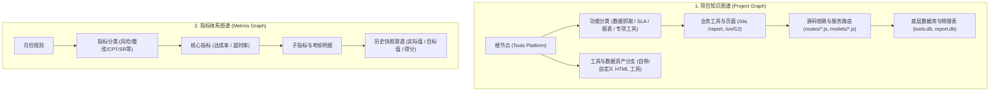

  - **项目知识图谱分支与拓扑关联**：
    - 完整展现平台根节点、功能模块、页面入口、服务路由、代码文件与底层 SQLite 物理表的拓扑网络。
    - 包含独立的“工具与数据资产”分支，按“自带 HTML 工具 / 自定义 HTML 工具 / 数据库与表”层层展开。
    - 同一 HTML 工具下的 MP3 音频默认折叠为一个聚合节点，节点保留真实文件数量与总大小；代码对具体音频文件的依赖统一指向该节点，避免大量二进制资源节点拖慢 2D/3D 布局计算。
  - **智能层级渲染与碰撞避让**：
    - 标签文字按“根节点 → 分类 → 业务节点 → 文件/子指标”随缩放级别逐级出现，内置数量上限控制与标签碰撞避让算法。
    - **单节点聚焦与一跳高亮**：悬浮或点击节点时仅高亮其一跳直接邻居与关联线，避免根节点点亮整张图造成视觉干扰；单击后高亮锁定保留，支持悬浮临时预览其他节点关系。
  - **分层生长动画与外观/力导向控制面板**：
    - 支持按真实 `contains` 归属层级重播生长动画：根节点、分类、指标/工具、文件依次生长，归属线先展开、跨模块依赖线渐次绘制。
    - 提供外观与力导向实时控制面板：可调多种**空间主题配色**、节点尺寸、连线粗细、标签密度、动画速度、向心力、排斥力、连接吸引力、连线长度与漂浮阻尼，偏好实时保存在浏览器本地。
  - **3D 空间透视引擎与相机反投影拖拽**：
    - 顶部工具栏支持一键在 2D 平面图谱与 3D 空间透视视角间无缝切换。
    - **3D 景深与光照**：通过深度分层减少密集连线交叉，利用固定左上方柔和环境光呈现球体节点漫反射、小范围高光与景深衰减。
    - **3D 视角交互**：鼠标左键拖动空白处旋转视角，按住鼠标滚轮拖动平移视角，滚轮滚动缩放视角。
    - **相机反投影节点拖拽算法**：节点拖拽时，系统根据当前相机的水平角 (Yaw)、俯仰角 (Pitch) 和透视投影比例，将屏幕二维位移实时反投影为 3D 世界坐标，确保旋转任意视角后节点依然随鼠标同向位移，释放时沿当前相机视平面保留平滑物理惯性。
  - **指标体系图谱动态仿真**：
    - 按“月份规则 → 指标分类 → 核心指标 → 子指标”展示，支持月份动态切换与仿真推演；点击指标节点可穿透查看已保存的历史录入值、基线目标、扣分明细与达标状态。
  - **全局多语言实时联动**：
    - 智能客服与知识图谱深度订阅全局语言切换事件；顶部导航切换为英文后，客服界面、图谱节点、连线关系与 AI 默认回答语言均同步切换为英文。

---

### 2.10 光影大厅 (Tools Cinema) 与多媒体生态

- **光影大厅 (`/cinema.html`)**：
  - 专为运维复盘、项目宣讲、胶片多媒体回顾与技术分享打造的专属沉浸式影院播放大厅。
  - 支持多类型多媒体格式点播、高保真视听呈现与响应式全屏播放体验。
  - **自动网络字幕**：打开影片后，后台通过射手接口按视频指纹分别查询中英文字幕，命中后自动加载；两种语言均有时按时间轴合成双语轨道，默认优先双语，其次中文、英文。播放器可选择双语、中文、英文或关闭；字号支持小、中、大三档，默认小号，语言和字号均记住选择。支持 SRT、ASS/SSA、WebVTT 与常见中文编码，字幕不可用不影响播放。
  - **播放异常恢复**：HLS 媒体解码报错时先尝试一次解码器恢复，再切换后备流并保留当前播放位置；旧影片的延迟错误不会干扰新影片。倍速播放保持语音音高。这是针对报错的恢复机制，不保证消除所有上游音频异常。
  - **画面背光**：播放器周围的柔光跟随当前视频画面颜色，通过 48×27 Canvas 每秒最多更新 5 次。开关记住选择，关闭或切到后台后停止绘制，暂停时保留当前画面背光；不处理音频。页面固定的紫色装饰背景独立保留。
  - 本地文件和飞牛原始视频均仅读取四个 4KB 区块计算指纹，字幕源只收到指纹与文件名，不上传视频或媒体服务凭据。飞牛需支持原始文件的 HTTP Range；字幕收录、版本匹配及时间同步取决于上游，未收录不会自动翻译或转写。结果在服务进程内限量缓存（命中 6 小时、未收录 5 分钟、故障 1 分钟），重启后重查；字幕继承影片分类 PIN 权限。
- **多媒体流式服务与安全控制 (`/api/media`)**：
  - 提供视频/音频的流式切片分发、按需 Range 分段加载与访问权限隔离，确保内网多媒体资产平稳加载不卡顿。

---

### 2.11 Dragon 桌面伙伴与智能客服

针对日常办公中的陪伴、趣味互动、敲击键盘反馈以及极速 AI 问答诉求，桌面客户端内置了高交互、低资源占用的 **Dragon 桌面伙伴**。

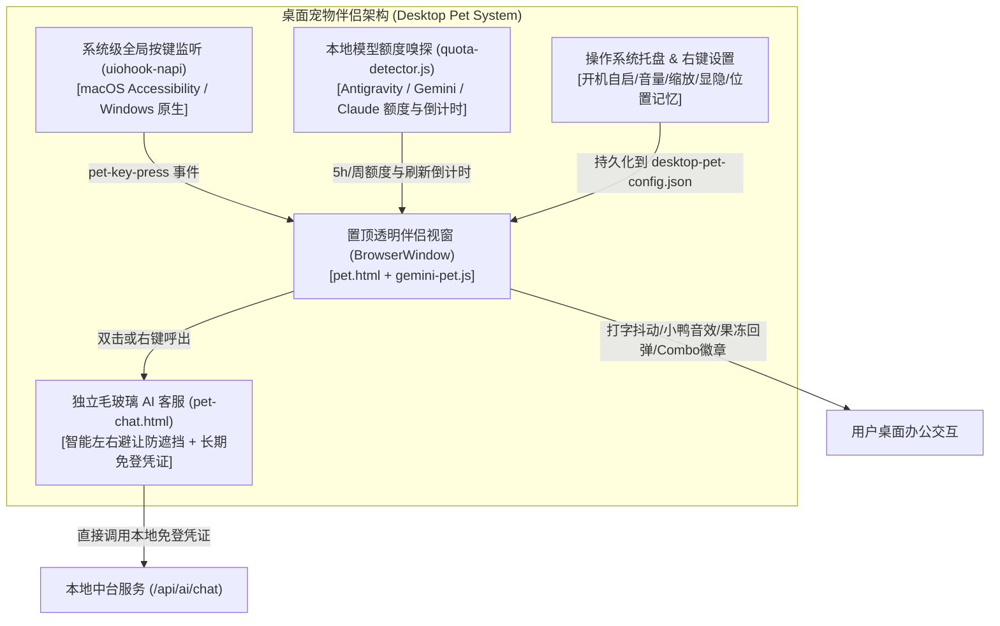

- **高保真动画与物理反馈引擎**：
  - **丰富姿态与动效**：内置 `idle`（待机呼吸）、`dragged`（抓取悬空）、`happy`（欢呼跃动）、`chill`（惬意打盹）、`fall`（下落跌坐果冻回弹 `gpet-jelly`）、`pat`（抚摸心心升腾 `gpet-heart`）以及 `typing`（极速打字与上下震荡）等多套状态资产。
  - **拖拽与窗口穿透**：悬浮窗支持按住小宠小人直接在桌面上任意拖拽，松手自动记忆坐标；气泡与背景支持精准透明穿透，日常完全不干扰其他工作窗口。
- **跨平台系统级全局键盘监听与连击热力系统 (`pet-keyboard-hook.js`)**：
  - **无侵入全局捕获**：基于 `uiohook-napi` 监听系统按键事件，Windows 下开箱即用，macOS 下提供系统“辅助功能 (Accessibility)”授权检测与一键打开系统隐私设置引导。
  - **敲击联动与小鸭音效**：在任意外部软件（代码编辑器、微信、Word 等）中打字，小宠均能同步触发打字动画，并按配置播放清脆可爱的小鸭子叫声 (`Ya1.mp3`/`Ya2.mp3`)。
  - **连击徽章 (Combo Badge) 与狂热模式 (Fever Mode)**：连续高频输入时，小宠头顶浮现流光渐变的 Combo 连击计数；达到连击阈值时触发火焰色狂热震颤 (Fever Shake) 特效，极大提升敲键盘的节奏感与趣味性。
- **Dragon 2D 手绘桌宠与自然动作**：采用青绿色毛毡小龙主题，四张透明图集包含 32 张姿态，覆盖逐帧眨眼、张望、挥手、轻步行走、思考、悬空、困倦与摸头。统一角色比例和脚底基线；拖动、点击、打字与工作状态优先于随机待机，支持减少动态效果和隐藏暂停。头像、聊天角色、设置与托盘名称同步更新，旧图特图片已移除。素材与验证方式见 [Dragon 桌宠资源说明](desktop-pet/assets/dragon/README.md)。
- **Dragon 故事屋**：保留 SQLite 中原有的 40 篇中英文历史与神话故事及用户修改，由 Dragon 担任讲述伙伴，原稿中的第一人称属于故事角色。AI 不可用时可阅读保存的完整故事；支持追问、换故事和 1–30 分钟主动讲述间隔。详见 [桌宠故事库说明](docs/desktop-pet-stories.md)。
- **本地多模型额度实时探测器 (`quota-detector.js`)**：
  - **多模型配额嗅探**：支持无感探测本地 Antigravity 语言服务器状态，提取 CSRF 凭证并解析 Gemini 与 Claude 的 `5h` 和 `weekly` 周期剩余百分比与刷新倒计时（例如自动将 `refresh in 3 hours 20 minutes` 解析为 `3小时20分后刷新`）。
  - **智能动态气泡**：小宠头顶的气泡支持按需轮播模型剩余额度或警告信息，让开发者对自身 AI 额度水位一目了然。
  - **独立额度侧栏与历史趋势**：额度默认以屏幕右侧独立侧栏显示，拖动标题可自由移动，贴近左右屏幕边缘自动停靠，并记住独立位置。桌宠移动不再带动额度窗。桌宠右键菜单的「显示额度侧栏」、额度窗右键的「隐藏额度侧栏」和右上角关闭按钮均可单独控制；隐藏后可从桌宠菜单或托盘恢复。侧栏显示 Codex、Claude Code、Antigravity 的 5 小时/每周剩余比例及接口提供的订阅类型；点击任意额度数字打开趋势窗口，可选近 24 小时、7 天、30 天或自定义 1–90 天，并切换服务商、额度/模型组和剩余/已用比例。Codex、Antigravity 约每 60 秒读取，Claude Code 约每 120 秒读取；主进程每 15 秒检查缓存，趋势图每 30 秒同步历史，也可手动刷新。
  - **真实采样边界**：本地登录桌面 API 将有效新读数保存到租户 SQLite 的 `desktop_pet_quota_samples`，按本机安装标识和会话用户隔离，仅保留 90 天；不会持久化认证凭据或把缓存反复写成新读数。应用运行且桌宠、独立 HUD、对话或趋势窗口可见时采集，启用前及关闭期间的历史无法补回。曲线按提供方实际返回的额度组展示（包括可用时的 Claude Opus/Sonnet 周额度）；共享池比例不能当作每个模型的精确 token 消耗。重置、额度回升或较长停采会断开曲线，长范围按时间桶采样。
- **独立毛玻璃 AI 客服视窗 (`pet-chat.html`)**：
  - **防遮挡坐标避让算法 (`calculateChatBounds`)**：根据小宠当前所处的屏幕绝对坐标及主显示器工作区，自动计算对话框的最佳落点（优先放置在空间更充裕的左侧或右侧，底边对齐脚底），杜绝对话框遮挡小宠本身。
  - **毛玻璃粉红极简设计**：视窗采用 24px 高斯模糊 backdrop-filter、圆润卡片设计、猫耳头像呼吸动画，支持按住标题栏自由拖动。
  - **本地安全免登凭证**：系统启动时通过 `auth-sessions-repository` 为小宠自动签发 `desktop_pet` 专属长期会话 Token，直接免登调用中台全部 AI 会话与报表接口，支持上下文对话与交互式错误排查。
- **个性化设置与托盘菜单集成**：
  - **默认启动尺寸自适应调整 (0.75x)**：桌面端（macOS DMG 与 Windows EXE/安装版）桌宠默认启动缩放比例设定为 **`0.75x`**（自适应主视窗尺寸 `218×293`），相比早期版本更加精致小巧，不遮挡日常编码与业务窗口；旧版本历史配置（如 1.2x 或无版本号）自动平滑治愈升级至 `0.75x`。
  - **右键悬浮控制面板**：右键点击小宠即可呼出轻量控制面板，支持体型缩放（0.6x~2.5x 自由滑动，精确至 0.05x 步长）、音量控制（0%~100%）、打字声音开启/关闭、动态气泡开关、打字动作开关及位置重置。
  - **配置持久化**：所有个性化参数与最后停放位置自动持久化至用户数据目录下的 `desktop-pet-config.json`，版本升级与重启完全无缝保留。
  - **系统托盘一键调度**：系统托盘右键菜单提供专有“🐾 Dragon 桌面伙伴”子菜单，包含“开机/启动自动运行桌宠”、“本次隐藏/唤回显示桌宠”以及“呼出桌宠AI客服对话”。另有「显示 Agent 额度侧栏」和「隐藏桌宠时保留额度侧栏」开关：前者控制额度窗显示，后者控制隐藏或停用桌宠后是否保留额度窗；新配置默认保留，已有明确设置继续沿用。外部 Agent HUD 应用也可单独运行。

---

### 2.12 Python 脚本热更新与 PR 小助手独立生态 (Python Packager)

针对日常离线办公、快速抽查与网络受限场景，项目构建了配套的 **Python 独立抽查外壳 (PR小助手) 与动态热更新生态**（代码位于 `python-packager/` 及中台 `/python-updater.html`、`/api/python-updater`）。

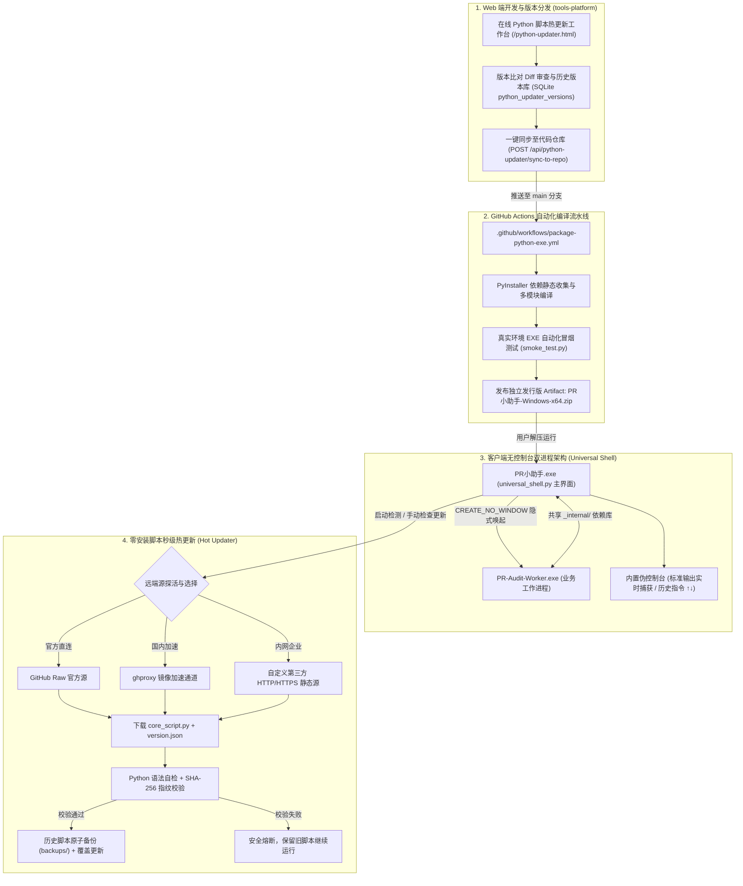

- **无控制台双进程架构 (Dual-Process Clean GUI)**：
  - 打包彻底剥离传统黑色 CMD 控制台黑窗闪烁，由 `PR小助手.exe` 提供原生现代化轻量界面；
  - 核心执行由后台工作进程 `PR-Audit-Worker.exe` 承担，二者共享 `_internal/` 目录下的 Pandas、OpenPyXL 等重型依赖库，避免冗余体积。
- **免重新打包的秒级热更新机制**：
  - 传统 PyInstaller 打包导致代码修改 1 行就需重新下载 50~100MB 压缩包；本方案中核心业务脚本 `core_script.py` 为纯 Python 源码外挂形式；
  - 启动器检测到新版本时，自动在本地 `backups/` 归档备份当前脚本，校验下载代码的 AST 语法正确性与 SHA-256 哈希值后进行原子无感热替换，实现“轻量更新秒级生效”。
- **Web 端热更新工作台 (`/python-updater.html`)**：
  - 在中台提供可视化 Python 源码编辑器，支持 Monaco/语法高亮、版本发布记录查看、Git 差异 Diff 比对，以及一键将测试无误的代码同步至 `python-packager/` 工程。

---

## 3. 安全授权与双轨 License 体系

为了保证安装包与扩展在企业内网的安全合规分发，平台构建了严密的**双轨非对称加密授权体系**：

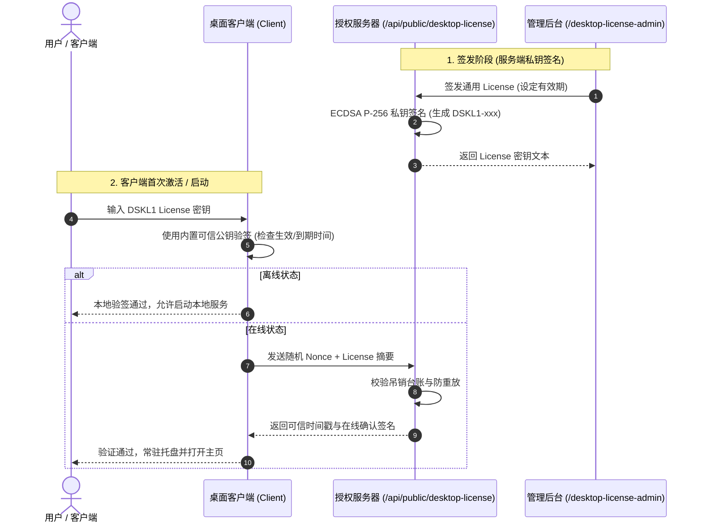

### 3.1 核心授权机制与安全设计
1. **ECDSA P-256 算法**：采用行业标准椭圆曲线数字签名算法，签名内容包含产品标识、生效时间与精确到期时间戳。
2. **离线高可用**：客户端内置公钥配置 (`frontend/desktop-license-client-config.json`)，即使完全无外网也能永久在有效期内核验合法性。
3. **打包安全隔离**：
   - 签发权威私钥 (`desktop-license-signing-key.json`)、授权台账 (`desktop-license-registry.json`)、管理员签发路由与管理页面，**在 electron-builder 打包配置中被严格排除 (`!backend/...`)**，绝不随客户端分发。
4. **F12 浏览器扩展 License**：
   - 针对浏览器扩展提供独立公钥验签与打包接口 (`/api/public/f12-license`)。
5. **现代化双语激活界面与里程碑验证**：
   - 客户端激活页全面支持中英双语自适应，内置标准 License 格式示例展示与一键快捷复制。
   - 激活核验过程配备动态进度条与阶段里程碑跟踪（语法格式校验 $\rightarrow$ 离线公钥验签 $\rightarrow$ 租户权限初始化 $\rightarrow$ 在线可信时间确认），提供丝滑透明的用户体验。
6. **单实例互斥锁与 SQLite 防死锁守护**：
   - 桌面端启动期通过 Electron 原生 `app.requestSingleInstanceLock()` 机制实行单实例保护，重复启动将自动聚焦已打开的程序并退出当前进程，彻底避免多进程并发读写 SQLite。
   - SQLite 底层驱动配置 `busy_timeout = 15000` (15秒等待)，杜绝启动与跨表批量写入时的瞬时锁冲突。

#### 机器码与在线授权申请

客户端激活页支持查看和复制本机机器码，填写申请人及备注后在线提交授权申请；管理员在桌面授权管理页审批或拒绝，并设置授权有效期。客户端可查询审批结果，获批后取得绑定本机的授权并继续校验激活；也支持取消待审批申请。已有授权码仍可直接粘贴激活。

授权服务请求使用 Electron 网络栈并跟随系统代理，适配企业内网代理环境。若在线申请服务不可达，激活页提供连接状态及重试入口；可将机器码交给管理员签发后手动导入。

---

### 3.2 企业级安全基线与全链路数据脱敏

平台严格遵循企业级内网安全规范与数据隐私保护原则：

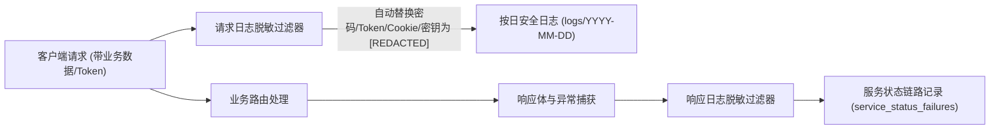

1. **全链路动态脱敏过滤器 (`sanitizeOriginalUrl` / `redactForLog`)**：
   - 无论是控制台输出、按日应用日志，还是失败链路追踪库 (`service_status_failures`)，系统均自动拦截并脱敏所有敏感字段。
   - 脱敏匹配键集合：`authorization`, `password`, `token`, `access_token`, `refresh_token`, `api_key`, `apikey`, `secret` 等；URL query 参数与 JSON 深度嵌套对象全程递归脱敏为 `[REDACTED]`。
2. **多层级访问控制与静态资源保护 (`shouldProtectHtmlEntry`)**：
   - 业务 HTML 页面全部受 JWT Session 强校验保护，未登录拦截重定向至登录页，防止退出登录后页面因浏览器缓存闪现。
   - 公开资源白名单严格受限：仅限登录页、隐私声明、服务条款及非敏感静态资源 (`.css`, `.js`, `.png`, `.ico`)。
   - 自定义 HTML 工具按 `publicAccess` 字段实施细粒度权限隔离，支持管理员灵活开放免密公开访问或强制登录访问。
3. **数据隐私驻留合规 (Data Privacy by Design)**：
   - 平台采用纯本地/私有化部署架构，所有业务指标、快照数据与分析结论完全驻留于企业内网数据库，绝不向任何外部第三方服务器外发原始数据。

---

## 4. 数据存储、启动自愈与迁移治理

### 4.1 物理存储分布与职责

| 数据库 / 存储文件 | 宿主目录 | 存储内容与核心表 |
| :--- | :--- | :--- |
| **`tools.db`** | `backend/data/` | 账号鉴权 (`users`, `sessions`)、租户元数据 (`tenants`)、UIV 脚本仓库 (`uiv_categories`, `uiv_scripts`)、SLA 规则配置 (`sla_targets`, `sla_prefs`, `sla_groups`, `sla_snapshots`)、AI 月报文档与图片资产 (`ai_report_documents`, `ai_report_images`)、归档源表与工作表 (`import_source_files`, `import_source_sheets`)、月报历史快照 (`monthly_report_snapshots`)、专题快照 (`topic_snapshots`)、会议考勤与操作激励快照 (`meeting_attendance_snapshots`, `operation_incentive_snapshots`)、负向事件与奖惩 (`department_reward_penalty_*`)、正向激励 (`reward_program_*`)、静态推送 (`snapshot_publish_*`)、多源市场 (`tool_market_settings`)、FRT 规则、PR 审计配置、告警事件 (`alert_events`)、服务状态指标等 |
| **`report.db`** | `data/` | 报表看板入库历史快照、各代表处/客户群月度得分、全量指标计算明细数据、月报读取主库 |
| **`requirements.db`** | `data/` | 需求广场提议记录 (`requirements`)、需求流转状态变更日志与评论 |
| **`ai-knowledge.db`** | `backend/data/` | Dragon Claw 智能体代码与项目文档增量向量/BM25 索引缓存（可随源码更新随时重建） |
| **`custom-tools/`** | `backend/data/` | 所有上传的自定义 HTML 工具与静态资源文件 |
| **`images/`** | `data/` | 报表全屏高清截图、导出 Excel/PDF 临时缓存文件 |
| **`desktop-pet-config.json`** | 用户数据目录 (`%APPDATA%` 或 `~/Library/Application Support/`) | 桌面宠物个性化运行配置（启停状态、当前可见性、小宠缩放比例、打字音效音量、声音方案、气泡显隐、打字反馈及屏幕坐标记忆） |

管理员的“数据探索”默认使用当前租户的 `tools.db`，可在页首切换当前租户实际存在的 SQLite 运行库（报表、需求、AI 知识索引、聊天记录、数通知识库、仓储等）。报表库按 `TOOLS_REPORT_DATA_DIR` 解析，其余业务库按 `TOOLS_DATA_DIR`/当前租户目录解析；不会扫描备份、归档或其他租户目录。默认租户的 `tools.db` 同时包含平台控制面，命名租户可显式选择标有“全局”的平台账号与租户控制库。切换会重载表列表、清空旧结果，并按实际表生成查询示例；未初始化的库不显示。SQL 仍支持管理员执行增删改和 DDL，跨库文件操作须通过选择器完成，不支持 `ATTACH`/`DETACH`/`VACUUM INTO`。数据库查询正文和结果不写入请求或服务状态日志。

探索页采用双列侧边栏与右侧工作区：最左侧窄列选择 SQL 终端、数据表查看或日志收集；第二列展示当前模块的常用示例、按业务分类的完整表目录或日志日期范围。目录支持搜索表名、业务分类和用途，不截断表数量。当前建表代码中定义的 126 张表提供中英文用途说明，历史或扩展表未登记时会明确提示；查看字段结构时不加载业务行，切到“表数据”后再分页读取。结构页同时展示字段类型、主键顺序、非空约束、默认值、索引、外键与建表语句。

页面默认亮色，可在右上角切换暗色并记住本页的选择，不随操作系统自动变暗。SQL 输入框默认两行高，可拖动右下角调整。数据库选择器下方展示所选库的中英文用途；自动发现的 0 字节文件标注为“空数据库文件”，仅浏览其目录不会初始化文件。其余无法确认用途的扩展库明确标注“用途未登记”，不会按文件名猜测。

接口兼容原有调用：`GET /api/db-explorer/databases` 返回可选库和默认标识；`GET /api/db-explorer/catalog` 返回所选库的完整表目录及用途分类；表列表、表数据接口通过 `?database=<id>` 选库，表数据接口另可使用 `view=schema` 只取结构。`POST /api/db-explorer/query`（以及 `/sql`）可在 JSON 中传入 `database`。省略时仍使用 `tools`，库标识须来自数据库列表，不能传入本地路径。

### 4.2 启动期完整性自检与自愈 (`sqlite-integrity-repair.js`)

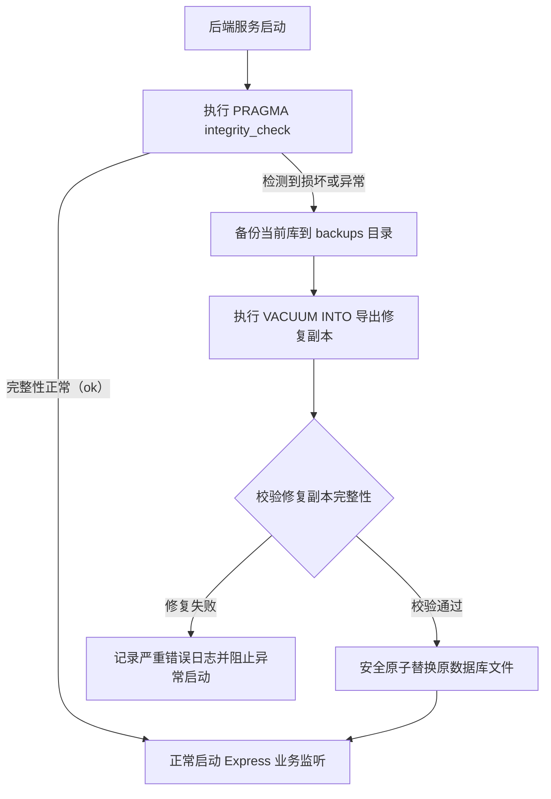

### 4.3 配置变更指纹监控 (`config-change-monitor.js`)
- 后台常驻定时计算 SLA 指标规则、分月目标、权重与表格偏好的 SHA-256 结构指纹。
- 当检测到指标规则异常减少、目标被外部修改时，自动向**系统告警中心**投递 Warning 级别告警，并记录变更前后差异与请求来源。

### 4.4 存储迁移治理台 (`/storage`)
- 提供从历史 JSON 配置向 SQLite 数据库迁移的全程可视化状态台。
- 支持实时执行 **Parity 一致性校验**，精准比对 JSON 与 SQLite 中的数据条数与内容差异；确认迁移无损后，支持管理员一键安全清理遗留 JSON 文件。

### 4.5 核心数据库物理表 Schema 字典

平台采用领域驱动划分 SQLite 数据库边界，主要核心物理表设计如下：

#### 1. `backend/data/tools.db` (中台核心配置与运行库)
| 表名 | 核心字段 | 业务用途与说明 |
| :--- | :--- | :--- |
| `users` | `username` (PK), `password_hash`, `role`, `created_at` | 用户身份认证、哈希密码存储与角色权限 |
| `sessions` | `token` (PK), `username`, `expires_at`, `created_at` | 登录态 Session 凭据管理 |
| `tenants` | `id` (PK), `name`, `status`, `created_at` | 租户注册表、租户生命周期与状态管理 |
| `uiv_categories` | `id` (PK), `name`, `icon`, `sort_order` | UIVF12 抓取脚本分类体系 |
| `uiv_scripts` | `id` (PK), `category_id`, `name`, `code`, `console_code`, `payload` | UI.Vision 宏与 F12 抓取脚本实体与版本 |
| `sla_targets` | `metric_key` (PK), `target_json`, `weight`, `updated_at` | SLA 各指标 1~12 月基线目标与权重配置（带批量替换防清空守卫） |
| `sla_prefs` | `pref_key` (PK), `pref_json`, `updated_at` | 每张表的显示列、排序、冻结列与计算模式偏好 |
| `sla_groups` | `id` (PK), `name`, `metrics_json`, `sort_order` | 指标大类与分组聚合配置 |
| `sla_snapshots` | `id` (PK), `month`, `snapshot_name`, `data_json`, `created_at` | SLA 上传与计算的历史快照沉淀 |
| `ai_report_documents` | `id` (PK), `name`, `report_month`, `payload_json`, `created_at`, `updated_at`, `updated_by` | AI 月报文档实体（报头、字段动态提示词、图片历史、全篇风格与主题、章节与章节样式、12 列网格格子、对话历史、最终提示词与配方缓存） |
| `ai_report_images` | `id` (PK), `name`, `mime`, `bytes`, `source`, `prompt`, `created_at`, `created_by` | AI 月报上传与 AI 生成（丹青绘图 / 矢量 SVG）的 LOGO 及图片资产表 |
| `import_source_files` / `import_source_sheets` | `id` (PK), `report_month`, `file_name`, `sheet_name`, `headers_json`, `rows_json` | 数据导入归档的原始文件与结构化工作表（供 AI 月报与资料库按月检索） |
| `monthly_report_snapshots` | `id` (PK), `tool_key`, `topic_key`, `month`, `snapshot_name`, `summary_json`, `created_at` | 月报与专题历史快照沉淀（支持版本比对 Diff 与 AI 月报跨源读取） |
| `topic_snapshots` | `id` (PK), `source`, `batch_id`, `captured_at`, `payload_json`, `created_at` | NetCare 与 DataFab 专题历史快照（保存原始 JSON 结构） |
| `meeting_attendance_snapshots`| `id` (PK), `meeting_date`, `roster_json`, `summary_json`, `created_at` | 例会花名册、参会考勤与状态快照（支持智能工号去 m 与去重） |
| `operation_incentive_snapshots`| `id` (PK), `period`, `records_json`, `summary_json`, `created_at` | 操作激励在册人员名单与周期激励快照 |
| `department_reward_penalty_items`| `id` (PK), `date`, `person_id`, `category`, `score_impact`, `evidence_json` | 部门奖惩与负向事件登记、证据归因与整改跟踪主表 |
| `reward_program_applications` | `id` (PK), `category`, `rule_id`, `period`, `applicant`, `status`, `amount_minor` | 正向激励方案申报、审批流转与额度核算主表 |
| `snapshot_publish_settings` | `tenant_id` (PK), `repo_url`, `branch`, `path_template`, `format`, `auto_push_minutes` | 静态页面 Git 仓库克隆与 Pages 自动化推送配置 |
| `snapshot_publish_jobs` | `id` (PK), `tenant_id`, `trigger_type`, `status`, `logs_text`, `created_at` | 静态页面 Git 自动化发布调度历史与执行流水日志 |
| `tool_market_settings` | `key` (PK), `value_json`, `updated_at` | 多源工具市场第三方仓库源与开关偏好设置 |
| `custom_tools` | `slug` (PK), `name`, `version`, `entry`, `manifest_json`, `updated_at` | 自定义 HTML/ZIP 工具与内置系统工具注册表 |
| `custom_tools_snapshots` | `id` (PK), `tool_slug`, `snapshot_name`, `data_json`, `created_at` | 自定义工具数据状态历史快照 |
| `slide_design_projects` | `id` (PK), `title`, `slides_json`, `metadata_json`, `updated_at` | 胶片设计工作区项目实体与单页挑选清单 |
| `slide_library_assets` | `id` (PK), `project_id`, `category`, `tags`, `thumb_path`, `asset_path` | 胶片素材库切片、分类标签与高清缩略图索引 |
| `survey_templates` | `id` (PK), `title`, `schema_json`, `status`, `created_at` | 动态问卷调研设计模板 |
| `survey_submissions` | `id` (PK), `template_id`, `submitter`, `answers_json`, `created_at` | 问卷调研填报记录与答卷结果 |
| `praudit_configs` | `id` (PK), `rules_json`, `thresholds_json`, `updated_at` | PR 进展合规性审计规则与判定阈值 |
| `frt_snapshots` | `id` (PK), `month`, `kpi_json`, `summary_json`, `created_at` | FRT KPI 动态核算结果与历史归档快照 |
| `ai_chat_sessions` | `session_id` (PK), `tenant_id`, `page_route`, `title`, `status`, `created_at`, `updated_at` | Dragon Claw 智能体跨页面会话元数据与归档管理主表 |
| `ai_chat_messages` | `id` (PK), `session_id`, `role`, `content`, `model`, `tokens`, `created_at` | 智能体会话流式消息内容、使用模型与 Token 计量明细 |
| `ai_usage_daily_models` | `date_key`, `model_id` (PK), `prompt_tokens`, `completion_tokens`, `cost_estimate` | 单模型粒度日调用量、Token 消耗与财务成本核算 |
| `alert_events` | `id` (PK), `event_type`, `severity`, `status`, `title`, `message`, `detail_json` | 系统告警事件、AI 诊断建议回填与流转记录 |
| `service_status_daily` | `service_key`, `status_date` (PK), `request_count`, `success_count`, `duration_ms` | 平台 API 服务可用性与耗时统计日聚合表 |
| `service_status_failures` | `id` (PK), `service_key`, `request_at`, `method`, `path`, `status_code`, `detail` | 4xx/5xx 异常链路追踪明细（自动脱敏） |
| `config_fingerprints` | `scope` (PK), `hash`, `summary_json`, `updated_at` | 核心配置 SHA-256 指纹监控基准表 |
| `auth_login_attempts` | `ip`, `username` (PK), `failed_count`, `locked_until`, `last_attempt_at` | 登录防暴力破解安全审计与动态 IP/账号封锁表 |

#### 2. `data/report.db` (报表看板与月报分析库)
| 表名 | 核心字段 | 业务用途与说明 |
| :--- | :--- | :--- |
| `PlatformConfig` | `key` (PK), `value_json`, `updated_at` | 月报中英文标题、看板全局参数等中台配置 |
| `snapshots` | `id` (PK), `month`, `snapshot_name`, `summary_json`, `created_at` | 月度质量入库基准快照 |
| `metrics_data` | `snapshot_id`, `rep_office`, `customer_group`, `metric_key`, `score` | 客户群各维度指标计算得分与扣分明细 |

#### 3. `data/requirements.db` (需求广场与协作流转库)
| 表名 | 核心字段 | 业务用途与说明 |
| :--- | :--- | :--- |
| `requirements` | `id` (PK), `title`, `description`, `status`, `submitter`, `created_at` | 全民需求提议与流转状态 |
| `requirement_logs` | `id` (PK), `requirement_id`, `actor`, `action`, `comment`, `created_at` | 需求评审、评估、开发与上线审计留痕 |

#### 4. `backend/data/chat-history.db` (租户隔离的聊天记录中心与全文检索库)
| 表名 | 核心字段 | 业务用途与说明 |
| :--- | :--- | :--- |
| `chat_conversations` | `conversation_id` (PK), `title`, `type`, `member_count`, `message_count`, `pinned` | 单聊/群组会话元数据、置顶状态与成员统计 |
| `chat_messages` | `message_id` (PK), `conversation_id`, `sender_id`, `sender_name`, `sent_at`, `body` | 聊天记录历史消息正文、发送人与高精度时间戳 |
| `chat_messages_fts` | `body`, `sender_name` (FTS5 Virtual Table) | 聊天正文高效分词全文检索虚表 |
| `chat_person_directory` | `person_id` (PK), `display_name`, `staff_id`, `aliases_json`, `groups_json` | 发言人通讯录、工号去 m 别名归一化与归属群组索引 |
| `chat_analytics_cache` | `cache_key` (PK), `data_json`, `expires_at` | 互动频次热力图、发言活跃度与人际拓扑关系图谱缓存 |
| `chat_favorites` | `id` (PK), `username`, `message_id`, `created_at` | 用户个人重要消息与证据收藏夹 |
| `chat_user_states` | `username`, `conversation_id` (PK), `last_read_message_id`, `read_at` | 个人维度的各会话已读位置与未读数管理 |
| `chat_group_preferences`| `conversation_id`, `username` (PK), `is_pinned`, `alias` | 个人对群组的置顶与备注偏好 |

---

## 5. 备份恢复与远端主站同步

### 5.1 当前租户核心数据备份 (`/api/global-backup`)

接口名称中的 `global-backup` 是租户功能上线前保留的历史名称；在租户模式下，它表示**当前租户的核心业务数据备份**，不是整台服务器所有租户的一键归档。

| 操作 | 实际范围 | 对其他租户的影响 |
|---|---|---|
| 生成服务器备份 / 生成并下载 | 当前 Session 所在租户的 SQLite、JSON 配置、自定义工具和核心运行数据 | 不读取其他租户目录 |
| 定时备份 | 每个启用租户独立保存时间、保留周期、最近状态和备份目录 | 各租户分别调度、分别清理历史包 |
| 从服务器备份恢复 | 默认列表属于当前租户；如人工放入了不同 ID 的包，也执行来源/目标二次确认 | 只替换当前目标租户，不替换其他租户目录 |
| 上传 ZIP 恢复 | 同 `tenantId` 直接恢复；不同 ID 先返回 `409` 并展示来源/目标，管理员二次确认后可强制恢复 | 首次拦截不修改数据；确认后也只覆盖当前目标租户 |
| 恢复默认租户 | 恢复默认租户业务数据，但重新写回恢复前的账号、Session 和租户登记表 | `data/tenants/` 原样保留，其他租户仍可访问 |

- **备份清单**：`manifest.json` 明确记录 `scope: "single-tenant"`、稳定的 `tenantId`、创建时的 `tenantName`、`includesAllTenants: false`、文件数量、大小和数据目标。
- **恢复前保护**：正式替换前自动生成当前租户的 `pre-restore` 安全备份，并校验 ZIP 类型、版本、路径和租户身份。
- **跨租户确认**：租户 ID 不同会先安全停止，前端使用平台自定义弹窗同时展示“当前目标租户（名称 + ID）”和“备份来源租户（名称 + ID）”。只有管理员点击“确认强制恢复”后才携带 `forceCrossTenant` 重新发起恢复。
- **自动备份调度**：`globalBackupRepo.startAutoBackupScheduler()` 会遍历启用租户，为每个租户建立独立定时器；过期清理仅删除该租户的自动备份。
- **租户级容量上限**：可在 **全局设置 → 备份恢复 → 定时备份** 设置当前租户备份 ZIP 的总容量上限，默认 `10 GB`，支持 `0.1 GB` 起的小数。保存设置、服务启动以及每次生成备份后都会检查容量；超限时按修改时间从旧到新清理所有类型的旧备份，保护本次新包并至少保留一个最新恢复点。若最新单包本身超过上限，界面会明确显示仍然超限。
- **轻量包排除项**：`images/`、`slide-library/`、内部 `backups/`、`tmp/`、`quarantine/`、租户运行状态、`chat-history.db` 及其 WAL/SHM 边车文件和机器级 License 文件不进入 ZIP，恢复时保留目标服务器现有副本。这样可避免把历史备份再次装进新备份，也不会因未清理的胶片导入临时文件让日常包异常膨胀；该功能不等同于整机文件镜像。
- **目标租户双重校验**：恢复请求会显式携带页面显示的目标租户 ID，后端再与鉴权 Session 中的租户 ID 比较，并使用该 ID 重新建立恢复上下文。页面与 Session 不一致时返回 `409 ACTIVE_TENANT_CHANGED`，不会查找备份、关闭数据库或改写任何租户。

#### 如何备份全部租户

当前界面没有“一键恢复全部租户”的高风险操作。需要整机迁移或灾难恢复时，应先停止 Tools Platform 服务，再对以下路径做一次离线整体归档：

- 默认租户及全局控制面：`backend/data/`（或 `TOOLS_DATA_DIR`）；
- 新租户目录：`backend/data/tenants/`；
- 分离部署的报表目录：`data/`（或 `TOOLS_REPORT_DATA_DIR`）；
- 默认租户大素材：实际部署中的 `images/`、`slide-library/`；
- 机器级远端连接配置：`backend/runtime/remote_backup_sync_settings.json`。

整机恢复时应在服务停止状态下整体恢复上述目录，不能把某个租户 ZIP 当作全租户镜像。日常误操作恢复则优先使用界面中的当前租户备份，影响范围更小。

### 5.2 远端主站自动同步 (`remote-backup-sync-repository.js`)
- **同租户映射**：远端自动同步按稳定 ID 映射，而不是按显示名称。本地 ID `acme` 只读取远端 ID `acme`，两边名称不同不影响同步；系统先登录远端，再调用租户切换接口，切换失败就终止同步。
- **配置与状态边界**：远端域名和凭据属于机器级运维配置，不写入租户备份包；最近检查、最近恢复和下载临时文件按租户隔离，避免不同租户互相误判“已同步”。
- **启动自动恢复**：当前只对 `default` 租户开放，避免一个进程启动时连续恢复多个 SQLite 工作区。其他租户可在切换后手动执行“测试连接/检查最新”或“按规则拉取恢复”。
- **适用场景**：用于同一套租户结构的主站与分站/Windows 本地节点同步。远端与本地应预先创建相同租户 ID；系统不会根据相似名称猜测租户，也不会自动创建远端租户。如果确实需要把不同 ID 的远端租户复制到本地，应先下载其备份包，再在目标租户使用“上传备份包恢复”，核对弹窗后强制恢复。

---

## 6. 高可用设计、性能基准与全链路可观测性

平台为工业级稳定运行设计了全方位的韧性架构与可观测性体系：

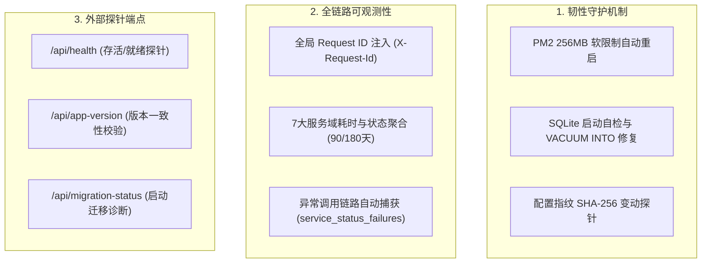

### 6.1 性能基准与高并发设计
1. **轻量毫秒级响应**：
   - 前端采用原生 HTML/JS 静态分发，无 SSR 构建开销；后端路由经过深度优化，常规 API 平均响应时间控制在 **< 15ms**。
2. **SQLite WAL 高性能读写**：
   - 数据库全面启用 WAL (Write-Ahead Logging) 模式，实现高并发场景下“读写互不阻塞”，单库轻松支撑百级运维并发吞吐。
3. **内存与连接池自动回收**：
   - Node.js 内存占用通过 PM2 设置 256MB 软限制自动平滑重启；数据库操作采用受控连接生命周期与自动关闭机制，杜绝连接泄露。

### 6.2 全链路追踪与健康探针体系
1. **统一链路追踪 ID (`X-Request-Id`)**：
   - 每个进入系统的 HTTP 请求自动分配全局唯一 `requestId`（如 `req_m7x9k2_a1b2c3d4`），在响应头和日志中全程透传，便于多系统日志联合排障。
2. **7 大服务域健康监控 (`service-status-repository`)**：
   - 自动将 API 划分为 `core` (平台核心)、`auth` (账号授权)、`automation` (抓取自动化)、`data` (数据报表)、`ai` (AI服务)、`tools` (自定义工具)、`operations` (运维告警) 七大域，按天统计请求量、成功率、P99/平均耗时。
3. **标准运维探针端点**：
   - **`/api/health`**：标准健康检查接口，用于 Kubernetes Liveness/Readiness 探针或 Nginx upstream 健康检查。
   - **`/api/app-version`**：免鉴权读取版本号，用于桌面端与集群多节点版本一致性对比。
   - **`/api/migration-status`**：免鉴权获取数据自检与 JSON $\rightarrow$ SQLite 迁移诊断报告。

### 6.3 预警 AI 的断网熔断与自动恢复

主动预警分析和告警值班分析在模型网络不可达或超时时使用独立熔断保护：连续 2 次网络类失败后进入 2 分钟冷却，期间使用本地规则降级；冷却结束后允许一次请求探测，成功即恢复 AI 分析。单次调用超时为 3.5 秒，持续故障每 15 分钟至多发送一次故障告警，恢复后记录恢复通知。

该机制用于预警分析链路；对话中的备用模型切换见 [多模型生态](#292-智能体品牌形象跨会话恢复与多模型生态)。

---

## 7. 常用页面入口清单

默认服务端口为 `3030`。

| 页面名称 | 访问路径 | 访问权限 | 核心功能与业务场景 |
| :--- | :--- | :--- | :--- |
| **首页大中台** | `/` | 需登录 | 平台主入口、效能大盘、工具卡片矩阵、友情链接、知识图谱入口 |
| **登录页** | `/login.html` | 公开 | 用户账号密码登录，支持弹窗查看隐私政策与服务条款 |
| **数据抓取** | `/uivf12` | 需登录 | UIVF12 脚本仓库、UI.Vision 批量调度与 F12 抓取控制台 |
| **数据导入** | `/sla` | 需登录 (修改需Admin) | SLA 多表数据合并、列映射、指标规则管理与历史快照上传 |
| **报表看板** | `/report` | 需登录 | 客户群健康度排名、比例计分、入库计算、短板透视矩阵 |
| **AI 月报** | `/monthly` | 需登录 | 模板 + 12 列网格章节：每个格子用一句话描述需求，AI 查数据、追问确认后生成可跨月复用的配方（数据来源 + 计算 + 渲染），切换报告月份自动重算；支持 ECharts 三级下钻、双击就地改字、全局风格顾问与 HTML / PDF / MSG 导出（`/ai-report`、`/monthly/legacy`、`/pages/monthly-designer.html`、`/pages/monthly.html` 自动跳转至此） |
| **一键催办** | `/expedite` | 需登录 | 基于快照自动生成催办文案、网络别名映射、全屏长截图与 Excel 导出 |
| **大屏看板** | `/bigscreen` | 需登录 | 全屏运营态势驾驶舱、短板风险分布、雷达巡检 |
| **专题分析** | `/topic-analysis.html` | 需登录 | NetCare/DataFab 租户级历史快照中心、EOS 收编进展月报、版本 Diff 比对与工程导出导入 |
| **值班表与考勤** | `/duty-roster.html` | 需登录 | 值班排班日历管理、人员轮值调度、考勤班次统计与花名册联动 |
| **光影大厅** | `/cinema.html` | 需登录 | Tools Cinema 沉浸式影院播放大厅、运维复盘点播与多媒体展映 |
| **PR 审计** | `/praudit` | 需登录 | PR 进展附件审计、Excel 导入校验与双语 PDF 报告导出 |
| **Python 热更新** | `/python-updater.html` | 需登录 (管理需Admin) | Python 业务脚本在线编辑、版本历史查看、Diff 差异比对与一键同步至打包工程 |
| **FRT 核算** | `/frt` | 需登录 | FRT 动态规则引擎与 KPI 自动化核算平台 |
| **需求广场** | `/requirements`| 需登录 | 平台功能需求提议、流转状态看板与评论日志追踪 |
| **存储迁移** | `/storage` | 需登录 (修改需Admin) | SQLite/JSON 迁移进度核对、数据一致性 Parity 校验与安全清理 |
| **数据探索** | `/db-explorer` | 仅Admin | 当前租户多数据库切换、表与 SQL 查询、全局控制库管理及多日日志导出 |
| **自定义工具** | `/custom-tool` / `/tools/:slug` | 按工具配置 | 运行与管理自定义 HTML/ZIP 工具，支持多源市场扩展 |
| **License 管理** | `/desktop-license-admin` | 管理员专有 | 管理员签发、续期、失效与归档客户端 License（服务端专有） |
| **桌面 License 激活** | `/desktop-license-activation.html` | 公开/桌面端 | 桌面客户端离线 License 激活页，展示激活状态与离线凭据导入 |
| **桌面宠物 AI 对话窗** | `desktop-pet/pet-chat.html` | 客户端本地免登 | Dragon 桌面伴侣独立 AI 客服视窗，支持智能避让、上下文问答与错误排查 |
| **餐单与采购核验** | `/tools/tool-mtpx4vtr` | 需登录/本地 | 内容驱动列画像自动纠偏、WK预留周列智能剥离、每日差异汇总与明细折叠 |
| **强控业务比对产品查询** | `/tools/tool-mumxi3px` | 需登录/本地 | 强控业务比对产品多维度模糊检索与合规范围排查 |
| **阿拉伯语互动学习** | `/tools/tool-mtakhxqm` | 需登录/本地 | 埃及口语课堂词汇发音跟读、字母练习与多媒体互动测验 |
| **聊天记录中心** | `/tools/chat-history-center` | 需登录 (管理需Admin) | 租户隔离的 TXT 聊天消息、全文检索、人员统计与多源数据源管理 |
| **合规与隐私** | `/privacy`, `/terms` | 公开 | 平台合规静态说明页，支持独立或弹窗访问 |

---

## 8. 主要 API 路由全景表

平台后端由多个高内聚业务路由模块构成：

| 路由前缀 | 对应文件 | 鉴权要求 | 核心职责与接口描述 |
| :--- | :--- | :--- | :--- |
| `/api/auth` | `auth.js` | 部分公开 | 用户登录、退出、Session 状态校验、修改密码与账号管理 |
| `/api/tenants` | `tenants.js` | 需登录（管理写操作需 Admin） | 当前 Session 的租户清单与切换，以及租户新增、编辑和安全归档 |
| `/api/nav-settings` | `nav-settings.js` | 需登录 (写需Admin) | 顶部导航栏配置、分类及菜单显隐排序、平台名称与可选使用视频链接 |
| `/api/ai-settings` | `ai-settings.js` | 需登录 (写需Admin) | Dragon Claw 智能体模型提供商 (Gemini/OpenAI/Claude/MiniMax)、Token 与提示词配置 |
| `/api/channels/welink` | `channels.js` | 需登录；管理需Admin，推送按权限开放 | WeLink SDK 检测/导入、扫码授权、连接管理、访问名单、会话目标与主动推送 |
| `/api/ai` | `ai.js` | 需登录 | Dragon Claw 智能体流式问答、代码/文档知识库检索、跨页面会话检索恢复 (`/sessions-archive`)、只读报表分析、知识图谱数据 |
| `/api/uiv` | `uiv.js` | 需登录 (写需Admin) | UIVF12 脚本仓库 CRUD 与 UI.Vision Macro 临时 runner 调度 |
| `/api/uiv-ai-adapter` | `uiv-ai-adapter.js` | 需登录 (写需Admin) | 目标站点抓取请求 AST 分析与 AI 规则自动推断 |
| `/api/uiv-auto-import` | `uiv-auto-import.js`| 需登录 | 抓取后自动导入的结构化 rows 临时桥接会话 |
| `/api/sla` | `sla.js` | 需登录 (写需Admin) | SLA 指标规则、分月目标、跨表作用域、列映射偏好、批量替换守卫与快照入库 |
| `/api/upload` | `upload.js` | 需登录 | 上传文件历史记录与临时附件处理 |
| `/api/db` | `db.js` | 需登录 (写需Admin) | 报表看板计算、客户群得分、月报指标读取与配置存储 |
| `/api/ai-report` | `ai-report.js` | 需登录 | AI 月报模板与文档 CRUD、数据源/数据集/指标解析、五大 AI 对话（单格对话、LOGO 图片对话与绘图、报头/页脚字段对话、章节样式顾问、整体风格顾问）、多层级提示词冲突仲裁、配方编译与锁计算重排（`/cell/restyle`）、双击改字、一句话摘要（`gist`）及开发者全屏追踪 AI 诊断（`/debug/explain`） |
| `/api/import-sources` | `import-sources.js` | 需登录 | 数据导入归档源表、工作表懒加载解析、关联指标树与展示映射管理 |
| `/api/monthly-snapshots`| `monthly-snapshots.js`| 需登录 | 月报历史快照保存、列表读取与多版本 Diff 比对 |
| `/api/report-msg` | `report-msg.js` | 需登录 | 月报富文本 RTF 封装与 Outlook `.msg` 邮件草稿一键生成与导出 |
| `/api/topic-snapshots` | `topic-snapshots.js` | 需登录 | NetCare 与 DataFab 专题历史快照持久化管理与时间序列分析 |
| `/api/department-reward-penalty`| `department-reward-penalty.js`| 需登录 (写需Admin)| 部门奖惩与负向事件治理、证据附件归档与静态单文件/Pages 自动化发布 |
| `/api/reward-program` | `reward-program.js` | 需登录 (管理需Admin) | 正向激励方案申报立项、额度核算、证明凭证管理与审批流转 |
| `/api/meeting-snapshots`| `meeting-snapshots.js`| 需登录 | 会议考勤历史快照管理与在册人员校验 (支持工号去 m 与复合名单去重) |
| `/api/operation-incentive-snapshots`| `operation-incentive-snapshots.js`| 需登录 | 操作激励历史快照管理与全量在册人员提取 (别名: `/api/incentive-snapshots`) |
| `/api/external/metrics`| `external-metrics.js` | 需登录/Token | 面向移动端 (iOS/KMP) 和外部系统的只读指标 OpenAPI |
| `/api/media` | `media.js` | 需登录 | 光影大厅 (Tools Cinema) 多媒体流媒体切片分发与 Range 断点播放 |
| `/api/praudit` | `praudit.js` | 需登录 (写需Admin) | PR 进展审计规则配置、抽查数据校验与 PDF 报告生成 |
| `/api/chat-history` | `chat-history.js` | 需登录（导入/删除需 Admin） | 递归 TXT 导入、会话浏览、全文检索、个人收藏/已读状态及人员统计 |
| `/api/frt` | `frt.js` | 需登录 (写需Admin) | FRT 动态核算规则配置与 KPI 历史快照计算 |
| `/api/requirements` | `requirements.js` | 需登录 | 需求广场提议发布、流转状态变更与评论日志 |
| `/api/slide-design` | `slide-design.js` | 需登录 | PPTX 胶片拆解、缩略图渲染、分类重组、标签复用与重组打包导出 |
| `/api/surveys` | `surveys.js` | 需登录 (写需Admin) | 可配置问卷调研模板维护、提交记录与 Excel 导出 |
| `/api/alert-center` | `alert-center.js` | 需登录 (写需Admin) | 系统告警事件列表、状态标记与 AI 智能告警分析回填 |
| `/api/platform-metrics`| `platform-metrics.js`| 需登录 | 首页效能大盘统计指标与 API 服务请求状态监控追踪 |
| `/api/friend-links` | `friend-links.js` | 需登录 (写需Admin) | 首页友情链接维护与后台定时可用性探活 |
| `/api/platform-promotions` | `platform-promotions.js` | 需登录 (写需Admin；`/desktop/*` 仅限本机桌面端) | 首页推广区配置、桌面推广卡片堆同步、实时画面与打开大窗 |
| `/api/onboarding` | `onboarding.js` | 需登录 (写需Admin) | 首次启动默认内容预览/决策、从全局设置重新补齐默认内容，以及带安全备份与完整归档的程序数据初始化 |
| `/api/custom-tools` | `custom-tools.js` | 需登录 (写需Admin) | 自定义 HTML/ZIP 工具上传、多源市场源管理 (`/market/sources`) 与状态同步 |
| `/api/global-backup` | `global-backup.js` | 需登录 (写需Admin) | 当前租户核心数据备份包生成、租户级自动备份调度与同租户恢复 |
| `/api/storage` | `storage.js` | 需登录 (写需Admin) | SQLite/JSON 存储迁移状态、读源切换与遗留 JSON 安全清理 |
| `/api/db-explorer` | `db-explorer.js` | 仅Admin | 数据库列表与切换、SQLite 表结构与 SQL 查询、日志打包下载 |
| `/api/agent-workspace` | `agent-workspace.js` | 需登录 | Dragon Claw 智能体专属本地代码工作区、目录补全、权限守卫、变更差异与 PR 自动化 |
| `/api/python-updater` | `python-updater.js` | 需登录 (写需Admin) | Python 业务脚本版本仓库、版本差异比对与打包工程一键同步 |
| `/api/platform-logo` | `platform-logo.js` | 需登录 (写需Admin) | 平台高清品牌资产、自动去底与多平台图标（1024/256/32）导出 |
| `/api/desktop-pet` | `desktop-pet.js` | 需登录 | 桌面宠物古埃及故事集（40篇中英双语故事）分发与 AI 上下文展开 |
| `/api/duty-roster` | `duty-roster.js` | 需登录 | 值班花名册、轮值规则与夜间运维考勤排班数据管理 |
| `/api/recent-nav` | `recent-nav.js` | 需登录 | 按租户和账号持久化保存用户最近使用的功能与工具足迹 |
| `/api/desktop-license` | `desktop-license-local.js` | 需登录 | 桌面客户端本地 License 授权状态检查 |
| `/api/public/desktop-license` | `desktop-license-public.js` | 公开 | 桌面端 License 激活、心跳验签、机器码授权申请、审批结果查询与取消申请 |
| `/api/public/f12-license` | `f12-license-public.js` | 公开 | F12 浏览器扩展 License 验签、可信时间与打包服务 |
| `/api/desktop-licenses` | `desktop-license-admin.js` | 管理员专有 | 管理员专用：桌面 License 签发、续期、吊销与台账管理 |

---

## 9. 移动端生态 (iOS / KMP)

平台在 `tools-platform/iosapp/` 提供了配套的移动端工程，实现多端协同：
- **工程架构**：基于 **Kotlin Multiplatform (KMP)** + **Compose Multiplatform** 构建跨平台共享逻辑，包含 iOS 原生 Xcode 工程包装。
- **数据对接**：移动端直接调用后端的 `/api/external/metrics` 只读接口，支持随时随地在 iPhone/iPad 上查看：
  - 各代表处/客户群月度排名与得分变化。
  - 重点短板指标与未达标项。
  - SLA 预警与大屏关键态势数据。

---

## 10. 目录结构详解

```text
privacy-policy/
├── README.md                              # 根目录索引导航与快捷入口
├── python-packager/                       # PR小助手独立外壳工程 (无控制台双进程架构/热更新)
│   ├── universal_shell.py                 # 通用启动器 GUI 源码 (无控制台主进程)
│   ├── core_script.py                     # PR 报告抽查核心业务逻辑外挂脚本
│   ├── build_exe.py                       # 本地与 CI 自动化打包构建入口 (PyInstaller)
│   ├── smoke_test.py                      # 真实菜单与数据读写自动化冒烟测试
│   └── updater_config.json                # 在线热更新多源配置 (GitHub Raw/加速镜像/自定义源)
│
└── tools-platform/                        # 中台主工程根目录
    ├── package.json                       # Electron 桌面端打包与根构建配置 (Dragon Platform)
    ├── electron-main.js                   # 桌面托盘壳主进程 (Windows / macOS)
    ├── electron-preload.js                # 桌面端 IPC 与日志桥接脚本
    ├── desktop-license-client.js          # 桌面端 License 离线/在线验签客户端
    ├── desktop-license-preload.js         # License 激活页面预加载脚本
    │
    ├── desktop-pet/                       # Dragon 桌面宠物伴侣 (置顶微件/动效/客服/音效)
    │   ├── pet.html                       # 伴侣透明独立渲染视窗
    │   ├── gemini-pet.js                  # 动效状态机、音效、果冻回弹与拖拽物理引擎
    │   ├── pet-chat.html                  # 毛玻璃独立 AI 客服会话视窗 (防遮挡智能避让)
    │   ├── pet-manager.js                 # 伴侣窗口生命周期、自愈修复与配置持久化
    │   └── pet-keyboard-hook.js           # 跨平台系统级全局按键监听与热力连击 (uiohook)
    │
    ├── desktop-promo/                     # 桌面推广卡片堆独立视窗与管理器
    │
    ├── backend/                           # Express 后端核心服务
    │   ├── server.js                      # 后端服务主入口、中间件装配、自检与后台任务调度
    │   ├── preflight.js                   # 启动前端口与系统环境预检
    │   ├── ecosystem.config.js            # PM2 生产运维配置文件
    │   ├── package.json                   # 后端依赖配置
    │   ├── routes/                        # 53 个业务 API 路由模块 (含 ai-report, agent-workspace, python-updater 等)
    │   ├── models/                        # 数据库仓储 (app-db, report-store, ai-report-*)、业务引擎与 AI 适配器
    │   ├── middleware/                    # JWT 鉴权与管理员权限控制中间件
    │   ├── logger/                        # 日志按日轮转与格式化输出
    │   ├── builtin-tools/                 # 系统内置标准 HTML 工具包 (启动自动同步)
    │   └── data/                          # 后端运行数据库与配置 (tools.db, ai-knowledge.db 等)
    │
    ├── frontend/                          # 原生多页面静态前端
    │   ├── index.html                     # 首页双模工作台主页面 (Dragon Claw Agent + 工具矩阵)
    │   ├── pages/                         # 各独立业务页面 (uivf12, sla, report, ai-report, topic-analysis, cinema 等)
    │   ├── css/                           # 全局样式、设计系统与暗黑主题 (含 ai-report.css)
    │   ├── js/                            # 前端业务逻辑
    │   │   ├── shared/                    # 公共组件 (navbar, api, ai-assistant, 2D/3D知识图谱等)
    │   │   ├── uivf12/                    # 抓取脚本工程业务代码
    │   │   ├── sla/                       # SLA 导入与规则引擎
    │   │   ├── report/                    # 报表看板与催办交互
    │   │   └── ai-report/                 # AI 月报前端引擎 (格子对话、配方沙箱、AiReportKit、ECharts 下钻、布局与导出)
    │   └── assets/                        # 图标、免安装 Splash 与静态资源
    │
    ├── data/                              # 业务数据主目录 (report.db, requirements.db, images/ 等)
    ├── docs/                              # 专项开发与 API 文档
    │   ├── monthly-designer.md            # AI 月报完整使用与架构指南
    │   ├── external-metrics-api.md        # 外部指标 OpenAPI 调用文档
    │   └── tools-platform-feature-overview-bilingual.html # 中英双语全景特性文档
    ├── iosapp/                            # 配套 iOS / Kotlin Multiplatform 移动端工程
    ├── scripts/                           # 运维、License 密钥同步与构建辅助脚本
    └── tests/                             # 自动化单元测试与浏览器回归测试 (259 个测试文件)
```

---

## 11. 环境变量与配置字典

后端支持通过环境变量进行灵活定制与容器化部署：

| 环境变量名 | 默认值 | 说明与取值范围 |
| :--- | :--- | :--- |
| `PORT` | `3030` | HTTP 服务监听端口 |
| `TOOLS_DATA_DIR` | `backend/data/` | 后端核心数据存储目录（桌面版自动重定向至系统用户数据目录） |
| `TOOLS_REPORT_DATA_DIR` | `data/` | 报表核心数据存储目录 (`report.db`) |
| `SLIDE_IMPORT_MAX_MB` | `200` | PPTX 胶片包上传大小上限（单位：MB，支持 10~2048） |
| `TOOLS_DAILY_LOGS` | `1` (生产) / `0` (桌面) | 是否开启按日归档日志写入 |
| `TOOLS_DESKTOP_RUNTIME` | `0` | 是否处于 Windows Electron 桌面壳运行时环境 |
| `GEMINI_API_KEY` | - | Google Gemini AI 默认 API Key（设置中心配置优先于此变量） |
| `NODE_ENV` | `development` | 运行环境（`production` / `development`） |
| `TOOLS_SNAPSHOT_REPO_DIR` | - | 负向事件只读页面推送所参考的本地 Git 仓库路径；未在“全局设置 → 静态页面推送”保存配置时作为默认值。服务端读取其 `origin`，在临时目录克隆目标分支，只提交一个 HTML，不改写该仓库工作区。远端认证由服务器的 Git 凭据负责。 |
| `TOOLS_SNAPSHOT_BRANCH` | `master` | 推送目标分支的默认值，须已存在；也可在全局设置中修改。 |
| `TOOLS_SNAPSHOT_PATH` | `{toolSlug}/index.html` | 仓库内目标 HTML 路径模板的默认值；`{toolSlug}` 发布时替换为工具市场的稳定 slug（当前为 `department-reward-penalty`）。也可在全局设置中修改。 |

---

## 12. 多系统部署、桌面客户端与新手配置指引

### 12.1 跨操作系统基础环境准备

推荐运行环境为 **Node.js 20 LTS** 与 **npm 9+**。

> [!IMPORTANT]
> ### 华为内网源码安装特别强调 (Huawei Intranet Environment)
> 如果在**华为内网环境**进行源码安装或拉取依赖，在执行任何 `npm install` 前**必须先设置华为内部 npm 镜像源**，否则由于网络隔离无法连接公共 npm 仓库，会导致依赖下载失败或连接超时：
> ```powershell
> # 1. 切换至华为内网镜像源
> npm config set registry http://mirrors.tools.huawei.com/npm/
> 
> # 2. 检查验证当前生效镜像源
> npm config get registry
> # 正确输出应为: http://mirrors.tools.huawei.com/npm/
> ```
> 确认输出为 `http://mirrors.tools.huawei.com/npm/` 后，再执行后续各系统的依赖安装命令。

#### 1. Linux (Ubuntu / Debian / CentOS / RHEL) 部署
```bash
# 1. 安装 Node.js 20 LTS (以 Ubuntu 为例)
curl -fsSL https://deb.nodesource.com/setup_20.x | sudo -E bash -
sudo apt-get install -y nodejs build-essential

# 2. 华为内网先配置镜像源 (外网环境可跳过)
npm config set registry http://mirrors.tools.huawei.com/npm/

# 3. 拉取代码并安装后端依赖
cd /opt/tools-platform/backend
npm install --production

# 4. 运行环境与启动自检
npm run doctor

# 5. 独立启动 (默认 3030 端口)
PORT=3030 npm start
```

#### 2. macOS 部署

macOS Electron DMG 的本地构建、Developer ID 签名、公证与桌宠验收见 [macOS 桌面发布指南](docs/macos-desktop-release.md)。先运行 `npm run build:mac:local` 验证当前架构，再配置公证并接入远端发布。
```bash
# 1. 推荐使用 nvm 或 brew 安装 Node 20
brew install node@20
brew link node@20

# 2. 华为内网先配置镜像源 (外网环境可跳过)
npm config set registry http://mirrors.tools.huawei.com/npm/

# 3. 安装依赖并启动
cd tools-platform/backend
npm install
npm run doctor
npm start
```

#### 3. Windows (Node.js 原生运行)
```powershell
# 1. 确保安装 Visual Studio Build Tools (勾选 Desktop development with C++)
# 2. 华为内网先配置镜像源 (外网环境可跳过)
npm config set registry http://mirrors.tools.huawei.com/npm/
npm config get registry # 确认输出: http://mirrors.tools.huawei.com/npm/

# 3. 在 PowerShell 中进入后端目录安装依赖并启动
cd tools-platform\backend
npm install
npm run doctor

# 指定端口启动
$env:PORT=3030; npm start
```

---

### 12.2 生产环境 PM2 常驻部署指引

生产服务器强烈建议使用 **PM2** 进行进程守护、自动重启与集群监控。

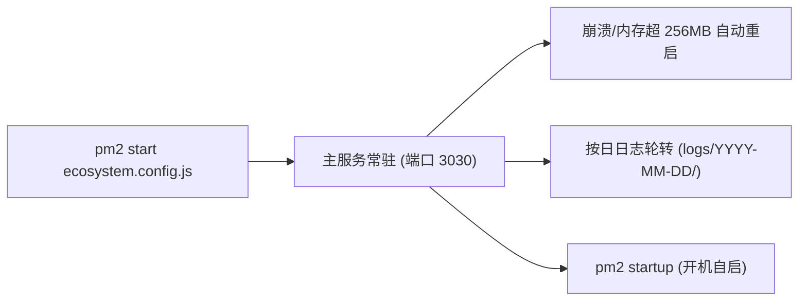

#### 1. 安装与初始化 PM2
```bash
npm install -g pm2
cd tools-platform/backend
```

#### 2. `ecosystem.config.js` 核心配置解析
```javascript
module.exports = {
  apps: [{
    name: 'tools-platform',
    script: './server.js',
    instances: 1,
    autorestart: true,
    max_memory_restart: '256M', // 内存超过 256MB 自动平滑重启
    env: {
      NODE_ENV: 'production',
      PORT: 3030
    },
    error_file: './logs/error.log',
    out_file: './logs/out.log',
    time: true
  }]
};
```

#### 3. 常用 PM2 运维命令
```bash
pm2 start ecosystem.config.js   # 启动服务
pm2 save                        # 保存当前进程列表
pm2 startup                     # 生成并配置操作系统开机自启脚本
pm2 status                      # 查看服务状态、CPU与内存占用
pm2 logs tools-platform         # 实时跟踪输出日志
pm2 restart tools-platform      # 平滑重启服务
pm2 stop tools-platform         # 停止服务
```

---

### 12.3 桌面客户端指引 (Windows 安装版/绿色版 vs macOS 签名公证版)

平台通过 GitHub Actions 自动化流水线构建并发布 Windows 与 macOS 多端桌面客户端：

| 特性维度 | Windows NSIS 安装版 (`Setup.exe`) | Windows 绿色免安装版 (`Portable.exe`) | macOS 原生客户端 (`DMG` / `ZIP`) |
| :--- | :--- | :--- | :--- |
| **文件名格式** | `Dragon-Platform-Setup-X.Y.Z.exe` | `Dragon-Platform-Portable-X.Y.Z.exe` | `Dragon-Platform-X.Y.Z-arm64.dmg` / `x64.dmg` |
| **支持架构** | x64 (64位) | x64 (64位) | **Apple Silicon (arm64) & Intel (x64) 双原生** |
| **安装方式** | 标准 Windows 安装向导，可自定义路径 | 单文件 EXE，双击直接运行，无需安装 | 挂载 DMG 拖入 `/Applications`，开箱即用 |
| **快捷方式** | 自动创建桌面与开始菜单快捷方式 | 不创建快捷方式，可手动发送到桌面 | 自动集成于 macOS 启动台 (Launchpad) 与访达应用目录 |
| **版本升级** | **支持应用内检测更新与静默自动升级** | 需从 GitHub Releases 手动下载新 EXE 替换 | **支持通过 ZIP 载荷进行应用内增量检测与升级** |
| **开机自启** | 托盘菜单可直接一键勾选开机自启动 | 不写注册表启动项，纯绿色便携 | 托盘/Dock 支持配置登录项自动启动 |
| **系统级桌宠** | **支持Dragon 桌宠全功能与全局键盘监听** | **支持Dragon 桌宠全功能与全局键盘监听** | **支持Dragon 桌宠全功能（需系统辅助功能权限）** |
| **数据存储** | `%APPDATA%\Dragon Platform\` | 共享相同目录，更换 EXE **数据不丢失** | `~/Library/Application Support/Dragon Platform/` |
| **安全机制** | 单实例锁 + SQLite 15s Busy Timeout | 单实例锁 + SQLite 15s Busy Timeout | **Apple Developer 签名 + Hardened Runtime + 官方公证** |

#### 客户端获取与激活步骤：
1. **下载对应版本**：从 GitHub Releases 下载适合操作系统的最新客户端。macOS 用户按芯片选择 `arm64` (M系列芯片) 或 `x64` (Intel芯片)。
2. **首次启动与激活**：
   - 首次打开程序，将弹出中英双语 License 激活窗口（支持标准样例一键复制）。
   - 可提交在线授权申请，等待管理员审批并查询结果；也可直接输入管理员签发的授权码（以 `DSKL1-` 开头）。机器绑定授权需与本机机器码一致。
   - 客户端完成离线公钥验签与可信时间校验后，在后台自动启动本地服务并常驻系统托盘/状态栏。
3. **打开主页与桌宠联动**：
   - 双击托盘图标，程序将自动调用默认浏览器打开 `http://localhost:3030`。
   - 屏幕右下角自动唤起**Dragon 桌面宠物**。
   - **macOS 全局打字监听授权**：若要在敲击键盘时触发桌宠打字动画与小鸭叫声，请在系统弹窗中点击前往设置，或打开“系统设置 $\rightarrow$ 隐私与安全性 $\rightarrow$ 辅助功能 (Accessibility)”，为 `Tools Platform` 勾选授权。未授权时桌宠其他功能与 AI 客服依然完全可用。

---

### 首页介绍视频的按需加载与离线缓存

现有的 NetCare RFC / AI 审计、操作激励统计、平台五站指南共 3 个视频，各有中英文、小窗和高清版本，共 12 个 MP4；EOS 月报指南另有中英文小窗和高清 4 个 MP4。合计 16 个文件均从桌面安装包中排除，封面随包保留；其他未登记的视频仍按原有方式打包。

登录框下方另有“项目演进 · 银河之旅”入口，点击在新窗口打开 `/project-evolution` 播放 88 秒、1080p 高清视频。登录页不会预加载该视频；播放页及视频在登录前可访问，并复用相同的按需分段下载、校验、缓存及离线播放机制。采用原作品的 1080p 分享成品（约 53 MiB），不改动原视频工程；高清 MP4 也从桌面包中排除，封面随包保留，因此远程媒体清单共 17 个文件。视频发布在独立的 [项目演进媒体 Release](https://github.com/fanxiaolongx-max/Dragon-Platform-Media/releases/tag/project-evolution-galaxy-20261019)。

- 首页只请求当前语言、当前播放的小窗版；切换视频才请求另一部。
- 点击大窗才请求对应高清版。播放器通过本地服务分段读取 GitHub Releases 视频，首段到达即可播放，无需等待整个文件下载完成，并支持拖动进度。
- 已请求的版本继续在后台补齐缓存；关闭后再次观看会复用已完成的片段。每段经过 SHA-256 校验，网络中断、超时、损坏片段可在重试时继续获取，不把未完成下载标记为有效缓存。
- 完整缓存的版本可离线观看；首次观看和缺失片段需要联网。下载失败会保留封面，并显示重试入口。
- 缓存在 Windows `%APPDATA%\Dragon Platform\cache\home-videos\` 或 macOS `~/Library/Application Support/Dragon Platform/cache/home-videos/`，独立于安装目录、绿色版临时解压目录及租户业务数据。退出程序不会清除完整片段；程序更新后仍可复用相同版本。
- 服务器/源码运行时优先使用现有本地视频；文件不存在时同样可以从远端缓存加载。可用 `TOOLS_PROMO_CACHE_DIR` 指定缓存目录，默认位于 `TOOLS_DATA_DIR/cache/home-videos/`。

媒体发布在独立的 [Dragon-Platform-Media 仓库](https://github.com/fanxiaolongx-max/Dragon-Platform-Media/releases/tag/home-videos-20261019)，EOS 中文版使用单独的 [EOS 媒体 Release](https://github.com/fanxiaolongx-max/Dragon-Platform-Media/releases/tag/eos-guide-20261019)，EOS 英文版使用 [EOS 英文媒体 Release](https://github.com/fanxiaolongx-max/Dragon-Platform-Media/releases/tag/eos-guide-en-20261019)，原来 12 个文件的地址和缓存标识保持不变。固定媒体 Release 与桌面应用自动更新分别管理。客户端只访问公开附件，不内置 GitHub Token。文件清单、大小及分段校验保存在版本控制的 `backend/home-promo-videos.json`，其中 `assets.<文件名>.url` 可指定独立的发布地址；未指定时使用清单的 `baseUrl`。运行时不依赖可变的 `latest` 链接。

维护这些视频时，先为新内容选择新的媒体 Release 标签，在 `scripts/prepare-home-promo-videos.js` 中新增该标签的地址常量，把新文件加入 `FILES` 和 `RELEASE_URLS`，并在 `package.json` 的打包排除规则里登记；再运行 `node scripts/prepare-home-promo-videos.js --write` 生成清单。上传该 Release 对应的视频及清单文件后，对比远端文件的大小和 SHA-256 并验证 HTTP Range 播放，再发布使用新清单的客户端。不要覆盖旧标签下的文件，以免旧客户端校验失败。

`node scripts/prepare-home-promo-videos.js` 和 `npm run release:verify-assets` 会检查源视频与清单是否一致、MP4 元数据是否支持渐进播放。首页添加新视频需要登记其清单和打包规则。

数通笔记视频已接入同一独立媒体仓库：导出后自动登记，运行 `npm run datacom:publish-videos` 自动上传并校验，`npm run media:install-hook` 启用推送前同步，CI 检查附件已发布。所有数通 MP4 均排除在代码仓库和桌面包之外。后续 AI 接入规则与命令见 [数通视频发布说明](docs/datacom-video-publishing.md) 和数通内置工具目录的 `AGENTS.md`。

### 12.4 桌面客户端本地生成文件与目录全景字典 (Windows vs macOS)

为方便运维审计、数据迁移、备份及排障分析，以下详细列出桌面客户端在 Windows 与 macOS 系统中落地生成的所有目录、文件及其具体用途。

#### 12.4.1 安装版 / 绿色版 / macOS 落地特征概览

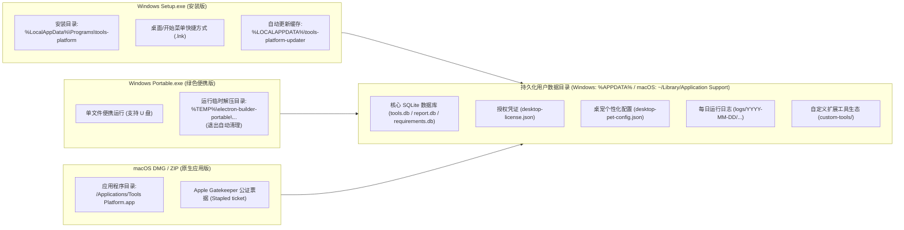

#### 12.4.2 客户端安装与执行层目录 (Program & Temp Files)

| 适用平台 / 版本 | 默认物理路径 | 生成文件清单 | 作用与生命周期说明 |
| :--- | :--- | :--- | :--- |
| **Windows 安装版 (Setup)** | `%LocalAppData%\Programs\tools-platform\` | • `Tools Platform.exe`<br/>• `Uninstall Tools Platform.exe`<br/>• `resources\app.asar`<br/>• 核心 DLLs 与运行环境 | **程序主程序与运行依赖库**。覆盖安装或卸载时变动。 |
| **Windows 快捷方式** | `%USERPROFILE%\Desktop\`<br/>`%APPDATA%\Microsoft\Windows\Start Menu\Programs\` | • `Tools Platform.lnk` | **桌面与开始菜单快捷方式**。卸载时自动移除。 |
| **Windows 绿色版 (Portable)** | `%TEMP%\electron-builder-portable\tools-platform-*\` | • 临时解包的 EXE 运行载荷与 asar 资源 | **临时自解压运行目录**。客户端退出时自动清理，0 残留。 |
| **macOS 客户端 (DMG/ZIP)** | `/Applications/Tools Platform.app/` | • `Contents/MacOS/Tools Platform`<br/>• `Contents/Resources/app.asar`<br/>• `Contents/Frameworks/...` | **macOS 签名公证独立包**。包含全部原生模块、前后端代码与运行时。 |

#### 12.4.3 持久化用户数据目录 (Windows vs macOS)

> [!IMPORTANT]
> **所有业务数据、配置、授权凭证均统一持久化存储于操作系统的专用数据目录下：**
> - **Windows**：`%APPDATA%\Tools Platform\`（即 `C:\Users\<Username>\AppData\Roaming\Tools Platform\`）
> - **macOS**：`~/Library/Application Support/Tools Platform/`
> 这意味着在安装版与绿色版之间互相切换、升级新版或更换客户端时，**所有业务数据与桌宠个性化设置均 100% 自动继承且绝对不会丢失**。

##### 用户数据目录完整拓扑结构：
```text
用户数据目录/ (Windows: %APPDATA%\Tools Platform\ | macOS: ~/Library/Application Support/Tools Platform/)
├── desktop-license.json                 # [授权] 客户端本地离线激活状态与硬件签名凭证
├── desktop-license-public-status.json   # [授权] 授权只读状态镜像 (供前端安全调用展示)
├── desktop-pet-config.json              # [桌宠] Dragon 个性化配置 (缩放、音量、打字开关、气泡开关、记忆坐标)
├── launch-state.json                    # [运行] 启动时间戳、窗口坐标与上次状态缓存
├── tools-platform-runtime-monitor.ps1   # [监控] Windows 原生托盘状态探针脚本 (仅 Windows)
├── logs\                                # [日志] 系统运行日志与运行时进程监控
│   ├── YYYY-MM-DD\                      #       按日期分目录归档
│   │   ├── out.log                      #       标准输出日志 (后端启动流水、API 访问日志)
│   │   └── error.log                    #       异常报错日志 (崩溃堆栈、异常捕获、网络超时)
│   ├── runtime-status.json              #       实时运行时快照 (PID、端口 3030、内存驻留、心跳)
│   └── runtime-command.json             #       托盘控制与主服务双向 IPC 调度通信文件
├── data\                                # [核心数据] 平台核心数据目录 (TOOLS_DATA_DIR)
│   ├── tools.db                         # [SQLite] 全局账号/租户控制面 + 默认租户原有业务库
│   ├── report.db                        # [SQLite] 报表与月报库 (SLA 快照、指标明细、健康度计分)
│   ├── requirements.db                  # [SQLite] 需求广场库 (专项治理协作需求与工单流转)
│   ├── ai-knowledge.db                  # [SQLite] AI 知识图谱向量库 (本地问答切片与检索索引)
│   ├── chat-history.db                  # [SQLite] 租户隔离的聊天记录与全文检索库
│   ├── *.db-wal / *.db-shm              # [SQLite] WAL 模式高并发读写临时预写日志与索引
│   ├── custom-tools\                    # [生态] 自定义工具目录 (每个微工具的 HTML/JS/manifest/.i18n)
│   ├── builtin-tools-sync-decisions.json# [生态] 内置工具升级冲突判定记录 (保护本地修改)
│   ├── backups\                         # [备份] 升级安全备份与数据库全量快照
│   │   └── builtin-tools\               #       内置工具官方升级前的自动镜像归档 (支持一键回滚)
│   ├── images\                          # [素材] 胶片 PPT 切图、报表配图、知识库附件图片
│   ├── tmp\                             # [暂存] 临时中转目录 (解压、大文件上传、UIV 抓取中间数据)
│   └── tenants\                         # [租户] 新租户独立业务空间（默认租户不搬迁）
│       └── <tenant-id>\                 #       每个租户独立的 DB、附件、脚本和工具目录
└── Cache\ / Code Cache\ / Local Storage # [引擎缓存] Chromium 渲染引擎与离线本地前端状态缓存
```

##### 核心业务文件功能字典：

| 文件 / 目录路径 | 文件类型 | 存储内容与核心功能 | 丢失或误删影响 |
| :--- | :--- | :--- | :--- |
| `desktop-license.json` | JSON | 存储客户端激活码（`DSKL1-` 开头）、机器指纹 Hash、签名认证及离线授权有效期。 | 需在下次启动时重新输入授权码激活。 |
| `desktop-license-public-status.json` | JSON | 授权脱敏公开状态（有效期、授权状态、租户名），供前端安全展示。 | 重启后由主进程自动重新生成。 |
| `desktop-pet-config.json` | JSON | Dragon 桌面宠物配置（enabled, visible, scale, soundVol, soundSet, bubbleOn, typingOn, position 坐标）。 | 重启后恢复默认桌宠大小与音量配置。 |
| `launch-state.json` | JSON | 记录上次启动时间、端口分配、窗口尺寸与位置缓存。 | 重启后由程序重新生成默认窗口位置。 |
| `logs/YYYY-MM-DD/out.log` / `error.log` | Log 文本 | 记录本地后台运行流水与异常报错堆栈，支持托盘右键一键打开分析。 | 无影响，日志按日自动归档。 |
| `logs/runtime-status.json` | JSON | 实时运行时快照（进程 PID、本地服务端口 3030、心跳状态）。 | 由主进程定时刷新写入。 |
| `data/tools.db` | SQLite 数据库 | **全局控制面及默认租户兼容库**。账号、Session、租户清单保存在这里；升级前已有的导航、AI 配置、脚本、SLA 规则和自定义工具注册表继续作为默认租户数据原地使用。 | **极高**。丢失将影响登录、租户清单及默认租户业务。 |
| `data/chat-history.db` | SQLite 数据库 | 租户共享的 TXT 聊天消息、全文索引、人员统计及用户个人状态。 | 丢失将需重新导入 TXT；该库不进入平台全局备份。 |
| `data/tenants/<tenant-id>/` | 独立租户目录 | 新租户的独立业务空间，目录之间严格数据隔离。 | 仅影响对应租户；归档租户时目录会保留。 |
| `data/report.db` | SQLite 数据库 | **报表看板与月报分析库**。包含历史月度快照、指标合控计算结果、各维度健康度计分、短板排名明细。 | **极高**。丢失将失去所有历史月报与数据看板记录。 |
| `data/requirements.db` | SQLite 数据库 | **需求广场流转库**。包含专项治理需求提单、流转进度与反馈工单。 | **高**。丢失将清空需求广场数据。 |
| `data/custom-tools/` | 文件夹 | 存放用户自行开发或导入的自定义小工具全部静态源码与多语言字典。 | 丢失将无法打开自建的扩展微工具。 |
| `data/backups/builtin-tools/` | 文件夹 | 每次内置工具随版本升级前自动创建的安全备份副本。 | 无影响，仅在需要回滚旧版内置工具时使用。 |
| `data/images/` | 图片媒体文件 | 胶片设计素材库切图、PPT 页面图片、报表生成的缩略图与图表资产。 | 相关 PPT 素材与图片无法正常展示预览。 |

#### 12.4.4 用户主动导出文件目录 (Downloads)

- **默认导出路径**：`%USERPROFILE%\Downloads\`（即 Windows 系统的“下载”文件夹）。
- **常见导出文件**：
  - `月度运营报告_YYYY-MM.xlsx`：月报分析导出的多维度 Excel 表格。
  - `SLA_催办提醒_*.html` / `*.txt`：一键催办生成的结构化邮件/即时通信模版。
  - `tools-platform-backup-*.zip`：在“存储与备份”中导出的全局全量数据备份包。
  - `custom-tool-*.zip`：在“自定义工具”中导出的独立微工具包。

#### 12.4.5 客户端数据清理、迁移与出厂重置指引

| 运维场景 | 推荐操作步骤 | 预期结果与注意事项 |
| :--- | :--- | :--- |
| **仅卸载主程序 (保留业务数据)** | 通过 Windows“设置 $\rightarrow$ 应用 $\rightarrow$ 卸载”运行卸载向导，或直接删除 Portable.exe。 | 仅清理安装目录和快捷方式，`%APPDATA%\Tools Platform` 完整保留，后续重装可直接复用全部数据。 |
| **全量迁移至新电脑** | 1. 退出旧电脑的 Tools Platform。<br/>2. 复制旧电脑的 `%APPDATA%\Tools Platform\data\` 文件夹到新电脑的对应路径。<br/>3. 在新电脑安装启动客户端并输入授权码。 | 新电脑无缝恢复所有配置、账号、历史月报、自定义工具与媒体素材。 |
| **彻底清除数据 / 恢复出厂设置** | 1. 退出托盘客户端进程。<br/>2. 直接删除整个 `%APPDATA%\Tools Platform\` 文件夹。 | 清除所有本地数据与授权状态，下次启动时将进入全新首次初始化与激活向导。 |

---

### 12.5 新手入门：安装登录后需要做啥 (Day 1 Checklist)

首次完成部署或安装并登录系统后，推荐按照以下顺序完成初始化配置：

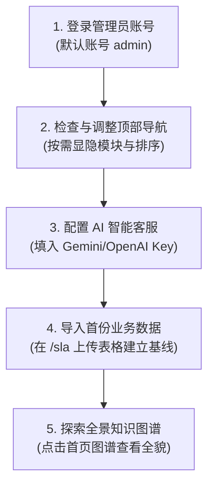

1. **第一步：登录账号**
   - 打开 `http://localhost:3030/login.html`。
   - 输入管理员账号登录（默认账号密码或联系运维管理员获取），登录后建议立即在“账号管理”中修改密码。
2. **第二步：配置顶部导航与分类 (`/api/nav-settings`)**
   - 点击右上角设置菜单中的“全局设置” $\rightarrow$ “顶部导航配置”。
   - 根据团队实际业务需求，调整常用工具的显隐状态、排序权重以及“更多工具”下拉分类。
3. **第三步：激活 AI 智能客服 (`/api/ai-settings`)**
   - 在“全局设置” $\rightarrow$ “AI 助手配置”中，选择模型提供商（推荐 Google Gemini 或 OpenAI 兼容模型）。
   - 填入对应 API Token 并保存，即可在右下角开启具备上下文感知的智能客服助理与只读报表分析。
4. **第四步：导入首份 SLA 数据并生成快照 (`/sla`)**
   - 进入“数据导入”页，拖入当月的多表数据（如风险表、整改表或工单表）。
   - 核对指标映射与达标阈值，点击“一键入库”，沉淀首份历史快照。
   - 前往“报表看板” (`/report`) 查阅健康度排名与短板透视矩阵，并在“AI 月报” (`/monthly`) 中通过格子对话生成月度质量报告。
5. **第五步：体验 2D/3D 知识图谱**
   - 点击首页 Hero 区域的“项目知识图谱”按钮，探索平台模块拓扑、源码链路与指标体系。

---

### 12.6 平台标识、品牌资产与使用视频

全局设置 → **平台标识** 可修改平台显示名称（最多 80 字符，留空使用默认名称），同步应用到当前租户首页、顶部导航和页面标题。名称保存在现有 SQLite 配置中，旧客户端保存导航或恢复默认导航不会覆盖它。

平台标识中的 Logo 使用纯 JavaScript 编解码与后台线程处理，不需要 Python 或系统图片处理环境。支持在设置页上传 PNG、JPG、JPEG、WEBP；WEBP 由浏览器无损转为 PNG 后处理。源码服务上传会更新打包源图标；也可在项目根目录执行 `npm run logo:generate -- <图片.png或.jpg路径>`，使用 `--root <临时目录>` 验证而不覆盖当前图标。EXE、DMG 客户端的新图标保存到用户数据目录的 `branding/`，页面、浏览器图标和运行中的托盘图标优先读取它，应用升级不覆盖该目录。EXE 文件、macOS 应用包及安装包的固定图标在重新打包后更新。

“一键下载全部运营物料资产包”保留原有桌面/Web 图标，并在 `store-assets/` 中自动生成 128×128 商店图标（96×96 主体、16px 透明留白）、440×280 小型宣传图和 1400×560 顶部宣传图。未选择截图时前端直接发起 GET 请求下载，由服务端在后台纯算力合成 1280×800 标准科技风宣传截图，无需前端加载 iframe 截屏或 POST 上传大图；若需上传插件或定制业务截图，亦可选择最多 5 张真实界面 PNG/JPEG（每张不超过 10 MB）上传。截图居中裁切为 1280×800，不拉伸；截图与宣传图均为无 alpha 的 24 位 RGB PNG。服务端在后台线程中处理图片，不需要 Python。截图仅用于本次打包，不额外持久化。商店提交前检查截图内容与品牌对应关系；插件上架应选择该插件的真实截图。YouTube 宣传视频需另行上传并填写真实 URL，资产包不会自动发布视频。

**平台使用介绍视频（可选）**：在“全局设置 → 平台标识”配置视频链接，默认使用公司社区的介绍视频地址。Dragon Claw、右下角智能客服及 SDK 频道共用的 AI 对话入口，在识别到平台使用问题后会于回答末尾附上链接；可修改地址，清空后关闭推荐。该链接用于跳转观看，与首页内置视频分别配置。

---

## 13. CI/CD 自动化发布与客户端平滑升级机制

平台配置了工业级 **GitHub Actions 自动化流水线**，实现了“主分支代码推送 -> 自动打标/语义化升级 -> Windows/macOS 双端并行交叉编译与签名公证 -> 发布 GitHub Releases -> 客户端差量增量更新”的闭环发布生命周期：

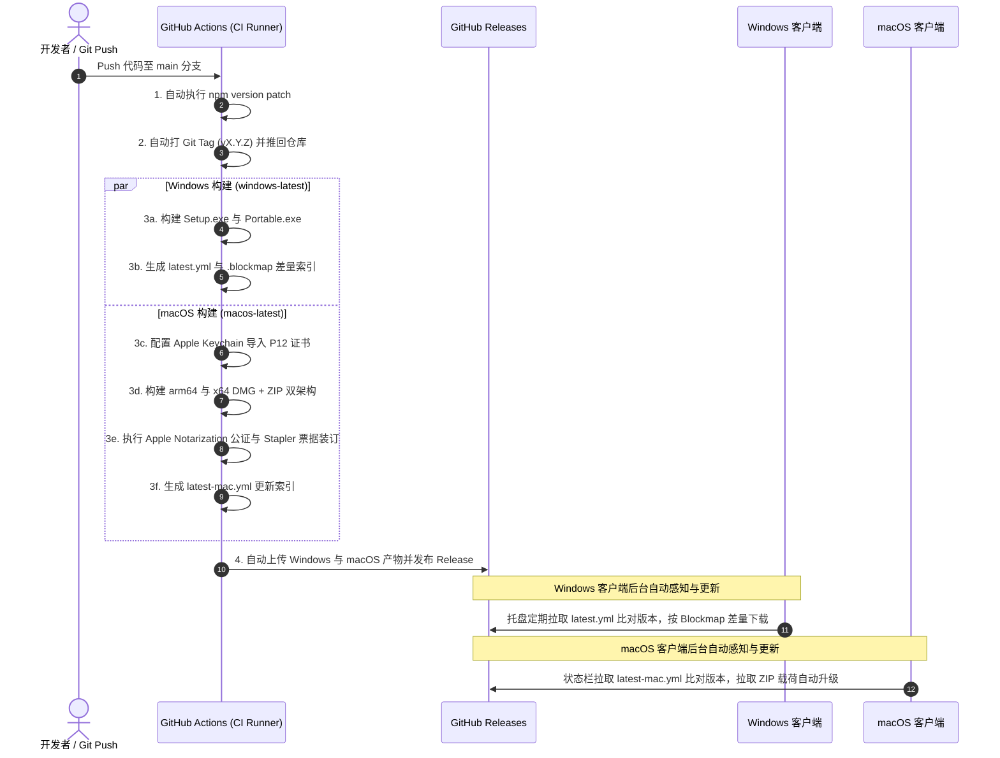

### 13.1 语义化版本与自动化 Release 流水线 (`.github/workflows/build.yml`)
1. **自动 Patch 版本递增 (`prepare-release`)**：
   - 开发者向 `main` 分支提交代码后，流水线在 `ubuntu-latest` 环境中自动在 `tools-platform/package.json` 中自增 patch 版本号。
   - 自动提交 `chore: release vX.Y.Z [skip ci]` 并打上对应 `vX.Y.Z` 的 Git Tag，随后推回 GitHub 仓库。
2. **Windows 交叉编译 (`build-windows`)**：
   - 在 `windows-latest` 环境下拉取最新 Tag。
   - 执行 `npm run build:win`，同时构建 NSIS 安装包 (`Setup.exe`) 与绿色免安装单文件 (`Portable.exe`)。
   - 自动生成 `latest.yml` 校验清单与 `.blockmap` 增量索引。
3. **macOS 签名与公证流水线 (`build-mac`)**：
   - 在 `macos-latest` 环境下拉取最新 Tag。
   - **钥匙串安全注入**：将 Base64 编码的 Developer ID Application P12 证书解码并导入专用钥匙串，设置分区列表权限 (`set-key-partition-list`)。
   - **原生双架构构建**：执行 `npm run build:mac`，同时编译 `arm64` (Apple Silicon) 与 `x64` (Intel) 两套架构的 DMG 安装镜像与 ZIP 更新包。
   - **官方公证 (Apple Notarization)**：集成 Apple `notarytool` 提交公证，公证成功后执行 `stapler` 将凭证票据压入 DMG 与 `.app`，完全杜绝 macOS Gatekeeper 拦截警告。
   - 自动生成 `latest-mac.yml` 跨版本更新索引。
4. **Release 资产自动归档**：
   - 通过 `softprops/action-gh-release` 统一归档 Windows 与 macOS 全部安装包、更新包及元数据。

### 13.2 客户端平滑增量更新机制 (Electron-Updater)
1. **Windows Blockmap 差量增量下载**：
   - 安装版客户端内置 `electron-updater`，启动时或托盘右键手动“检查更新”时，自动向 GitHub Releases 拉取 `latest.yml`。
   - 比对本地版本号与远程版本号；若发现新版本，利用 `.blockmap` 索引仅下载变动的二进制 Block 数据，**节省 80%+ 的网络流量消耗**。
2. **macOS 自动升级机制**：
   - macOS 客户端自动向 GitHub Releases 拉取 `latest-mac.yml`，检测到新版本后下载对应架构的 ZIP 载荷，在后台解压并于用户确认后静默重启覆盖应用。
3. **托盘日志与进度可视化**：
   - 下载进度实时推送到托盘与原生进度监控窗口。
   - 下载完成后弹出“重启安装新版本”提示，用户点击后自动平滑重启恢复服务。

### 13.3 HTML 工具市场与独立发布

- 首页管理员区域提供“工具市场”，可比较本地版本、目录版本、包大小和 SHA-256 指纹，并支持按需安装或更新。
- `.github/workflows/tools-market.yml` 在 `backend/builtin-tools/` 变化时独立生成每工具 ZIP 和 `catalog.json`，发布到 `tool-market` 分支，不递增桌面端版本、不重新构建 EXE。
- 客户端默认读取官方仓库的 `tool-market` 分支；私有部署可用 `TOOLS_MARKET_CATALOG_URL` 替换目录地址，并用 `TOOLS_MARKET_ALLOWED_HOSTS` 增加逗号分隔的可信下载域名。
- 工具市场右上角的齿轮可添加多个第三方 `catalog.json` 仓库，并分别启停 GitHub 和第三方仓库。启用时 GitHub 优先；同名工具只显示优先仓库的版本。某个仓库不可用时，其余仓库仍会正常显示。设置按租户保存在 `tools.db`。
- 内网部署时，把 `catalog.json` 和 `packages/` 放在内网 HTTP(S) 静态服务中，目录里的 `package.url` 使用同站地址或相对路径，并保持包大小与 SHA-256 正确。市场设置中的“帮助”按钮提供操作步骤。第三方目录允许使用内网地址，安装时仍会校验目录格式、包大小、SHA-256 和解压内容指纹。
- Actions 可通过 `TOOLS_MARKET_SIGNING_PRIVATE_KEY` Secret 使用 Ed25519 签名目录。客户端通过 `TOOLS_MARKET_PUBLIC_KEY` 验签；设置 `TOOLS_MARKET_REQUIRE_SIGNATURE=1` 后会拒绝未签名目录。密钥均使用 DER 格式的 Base64 文本（私钥 PKCS#8，公钥 SPKI）。
- 工具更新仅替换受管理的程序文件，替换前备份到当前租户的 `backups/tool-market/`；未关联的手动导入工具遇到同名 slug 时不会被自动覆盖。
- 主程序随包模板位于 `backend/builtin-tools/`，页面优先加载当前租户数据目录中的 `custom-tools/<slug>/`。主程序启动时会对注册表中的活跃租户自动同步未被本地修改的受管工具；切换租户时也会检查。旧目录先备份到该租户的 `backups/builtin-tools/`，用户额外文件与业务数据库保留。
- 本地修改、无法验证的旧版工具和管理员选择跳过的版本保持原样；需要处理的差异仍可在提示窗口查看。市场安装的版本代表用户选择，启动和自动提醒均保留它，即使新主程序带有不同的模板也不会自动覆盖或反复弹窗。
- 首页左下角“市场”和“导入”之间的“比对”按钮提供管理员手动比对入口，列出“当前使用 → 随包内置”的内容、日期及文件差异（包括市场版本和之前跳过的工具）。默认不勾选；勾选后可强制使用当前主程序的随包版本，即使它更旧。替换前备份当前目录，未选项及其提醒偏好保持不变。需要重新使用市场版本时，仍可从市场主动安装。静态只读页面仅展示入口，不允许执行替换。
- 自动同步会打印实际生效目录、逐工具文件增改数量、备份位置、保留或失败原因。桌面端通过托盘的“查看实时日志/更新进度”可查看这些记录（运行日志 `out.log`）；工具市场安装完成也会打印实际目录和备份位置。

---

## 14. 开发约定与排障 FAQ

### 开发约定规范
1. **轻量静态原则**：前端保持原生 HTML/JS/CSS 架构，严禁随意引入庞大且不必要的重型前端打包构建链。
2. **SQLite 规范**：新增任何业务模型一律优先设计 SQLite 数据表并编写自愈脚本，严禁新增裸 JSON 文件读写。
3. **版本防缓存机制**：HTML 中引用的本地 js/css 由 `backend/models/asset-versioning.js` 在返回页面时按文件内容自动追加 `?v=<hash>`（含 `/custom-tools/<slug>/` 内置工具页面），不要手写版本戳。
4. **安全与脱敏原则**：所有包含密码、Token、Secret、Cookie、私钥的请求与响应体必须经过统一脱敏拦截器过滤后再打印到日志或投递到 AI 模型。

### 排障 FAQ
- **Q: 启动报端口已被占用 (`EADDRINUSE`)？**
  - A: 指定新端口启动即可：`PORT=3031 npm start`（PowerShell: `$env:PORT=3031; npm start`）。
- **Q: 数据库出现死锁或损坏提示？**
  - A: 服务在 `server.js` 启动时已集成 `repairStartupDatabases()` 自动检测与修复，可在 `backend/data/backups/` 中查看自动修复前后的 `.db` 副本。
- **Q: Windows 安装版无法启动本地服务？**
  - A: 右键托盘图标打开“查看实时日志/更新进度”，检查系统用户数据目录下的 `logs/YYYY-MM-DD/error.log`。
- **Q: 绿色版与安装版如何共存或迁移？**
  - A: 两者数据均存储在当前用户的 `%APPDATA%/tools-platform/data` 目录下，直接关闭旧版本运行新版本 EXE 即可，数据完全无缝继承。

### 页面启动加载与 AI 月报保存机制

数据抓取、数据导入、报表看板、一键催办和大屏看板使用统一的羽毛与毛玻璃加载界面（`frontend/css/startup-screen.css`、`frontend/js/shared/startup-screen.js`）；AI 月报（`/monthly`）内置同风格的毛玻璃进度遮罩（`frontend/js/ai-report/splash.js`）。进度按页面实际初始化步骤更新（校验登录状态 → 读取报告列表与当前月报 → 渲染章节与格子），完成后平滑淡出，顶部导航保持可见。

AI 月报在修改报头、章节、格子布局、对话或配方后约 520ms 自动防抖持久化至当前租户的 `tools.db`（`ai_report_documents` 表），也可点击顶部「保存」按钮立即写入。当最终提示词更新并重跑配方时，系统自动将上一版最终提示词、计算配方与结果缓存保存在格子的 `previousPrompt` 快照中；点击对话面板顶部的 `↶ 撤回` 即可伴随高斯粒子消散动画一键回退到上一版状态。切换报告月份时，所有已配置配方的格子自动拉取新月份数据并在零网络 CSP 沙箱中重跑。
