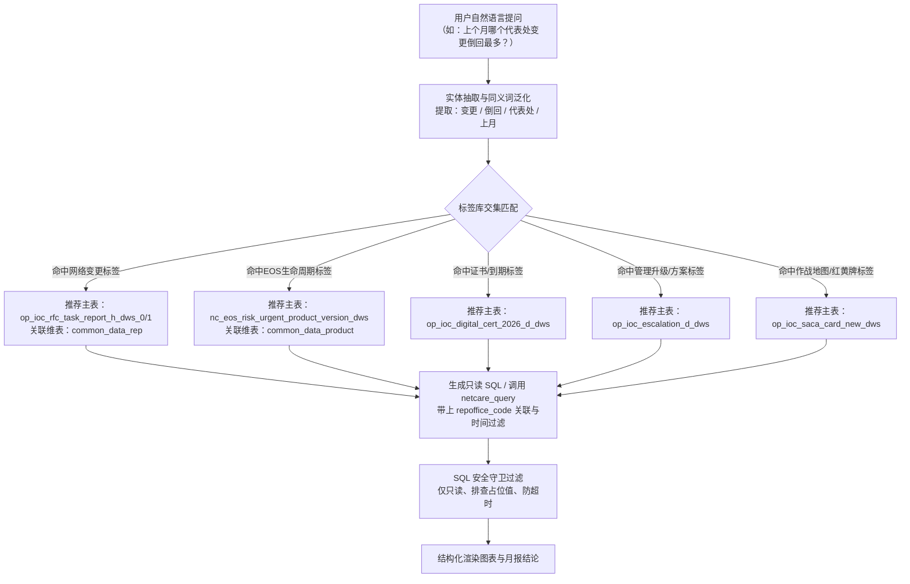

# AIOps 数据资产全景字典与 AI 指标标签知识库

本文档整合了「数据资产看板（Data Asset Dashboard）」的 83 项数据资产、223 个应用接口指标，以及数仓分层（ODS/DWD/DWS/SNAP/DIM）与 AI 问答意图标签体系，为 AI 智能月报、Dragon Claw 智能体和开发者工具提供由浅入深的精准检索索引。

---

## 一、数仓分层深度解析（ODS / DWD / DWS / SNAP / DIM）

数仓架构采用业界经典的分层模型，结合本项目的大数据运维场景，各层定义如下：

| 分层编码 | 英文全称 | 核心定位 | 数据加工深度 | 典型应用场景 | 页面 Badge 标识 |
|---|---|---|---|---|---|
| **ODS** | Operational Data Store (操作数据源/贴源层) | 业务源端原始镜像 | 未清洗、未聚合，原样保留上游接口/库表结构与测试/异常数据 | 数据溯源、源端对账、数据稽核 | `[ODS 贴源]` (琥珀黄) |
| **DWD** | Data Warehouse Detail (数据明细层/事实层) | 清洗后的单据事实明细 | 单一业务过程清洗（空值处理、状态标准化、编码归一化），最细粒度 | 单号查询、故障排查、下钻明细、详单穿透 | `[DWD 明细]` (翠绿) |
| **DWS** | Data Warehouse Summary (数据汇总层/服务层) | 多维预聚合宽表 | 按主题、时间（月/日）、组织（地区部/代表处）、产品线进行预聚合 | 月报图表、大屏看板、AI问答提取（毫秒级） | `[DWS 汇总]` (晴天蓝) |
| **SNAP** | Snapshot (历史快照层) | 历史月末/日终切片冻结 | 定时任务全量或增量冻结 DWD/DWS 数据，记录历史当时快照 | 历史月报复现、环比同比趋势分析 | `[SNAP 快照]` (罗兰紫) |
| **DIM** | Dimension (公共维度字典层) | 主数据与层级关系 | 维护组织树、地区国家、客户、产品层级等代码到中文的映射 | 跨表关联补齐中文名称与组织层级 | `[DIM 维表]` (松石绿) |
| **APP** | Application (应用专属库表) | 基座运行时应用表 | 各应用在自身 UUID Schema 下写入的配置、结果、日志等 | 仅限本应用读写，跨应用只读 | `[APP 专属]` (板岩灰) |

### 选表决策树（AI 推荐链路）
1. **统计汇总与趋势分析**：优先选择 **DWS 汇总表**（响应快，防超时）。
2. **需要按组织名称呈现**：DWS 关联 `common_data_rep` 维表取 `rep_name_cn`。
3. **查单号/单据原因/设备明细**：下钻查询 **DWD 明细表**（必须带时间或代表处过滤条件）。
4. **历史月份复盘与环比**：查询对应的 **SNAP 快照表**（必须指定 `period_date` 或 `target_month`）。
5. **绝对禁止**：严禁直接用 ODS 贴源层做月报求和或比率计算（会有重复数据或未清洗的测试脏数据）。

---

## 二、83 项数据资产全景画像与 AI 检索标签库

### 1. 公共数据源（4 项，全组织只读）
- `common_data_customer_dlvy_org`:
  - 中文名：客户/交付主体维表
  - 功能：维护客户与交付组织对应关系，数据来源 BIDS，GaussDB，T+1。
  - AI 标签：`[公共维表, 交付主体, 客户映射, 组织维表]`
- `common_data_customer_rel_country_relation`:
  - 中文名：国家地区关系维表
  - 功能：维护国家与地区的层级映射关系，GaussDB，约 300 行。
  - AI 标签：`[国家映射, 地区映射, 海外区域, 组织层级]`
- `common_data_product`:
  - 中文名：产品维表
  - 功能：全量产品基础数据（含产品分类/产品族/EOS 信息），GaussDB，约 68,220 行。
  - AI 标签：`[产品维表, 产品族, EOS基础信息, 硬件生命周期]`
- `common_data_rep`:
  - 中文名：地区部/代表处组织维表
  - 功能：维护地区部-代表处层级关系（`dept_code` 到 `rep_name_cn`），约 622 行。
  - AI 标签：`[组织维表, 代表处映射, 地区部代码, 必须关联]`

### 2. 业务数据源（67 项，核心专题分类）

#### 专题 A：产品生命周期与 EOS 风险（10 项）
- `ibms_report_dws` (DWS 约 17.8 万行): IBMS 全产品&全版本 EOS 概览统计，每天 9 点更新。
  - 标签：`[EOS概览, IBMS来源, 产品EOS, 版本EOS, 日更汇总]`
- `ibms_report_dws_snap` (SNAP 约 302 万行): IBMS EOS 历史快照，每日快照。
  - 标签：`[EOS快照, 历史趋势, IBMS快照, 趋势回溯]`
- `nc_eos_risk_full_product_version_dws` (DWS 约 7.7 万行): NetCare 来源全量 EOS 风险统计（eos_type 1/2/4），T+1。
  - 标签：`[NetCare EOS, 全量产品版本, 风险统计, 汇总]`
- `nc_eos_risk_full_product_version_dws_snap` (SNAP 约 91.8 万行): 每月 2 号 0 点同步，页面趋势快照。
  - 标签：`[月度快照, 页面趋势, 环比趋势]`
- `nc_eos_risk_management_dwd` (DWD 约 7.2 万行): 全产品&全版本&重急&高风险 EOS 明细表，关联湖表，每天 9 点更新。
  - 标签：`[重急EOS明细, 高风险EOS, 设备明细, 湖表关联, DWD]`
- `nc_eos_risk_management_dwd_snap` (SNAP 约 101 万行): EOS 明细表历史快照。
- `nc_eos_risk_product_version_dws` (DWS 约 7.5 万行): 产品 EOS & 版本 EOS 风险统计表，T+1。
- `nc_eos_risk_product_version_dws_snap` (SNAP 约 191 万行): 产品&版本风险统计快照。
- `nc_eos_risk_urgent_product_version_dws` (DWS 约 1.05 万行): 重急 EOS 产品及高风险 EOS 版本统计表，T+1。
  - 标签：`[重急产品, 高风险版本, 重点盯防, DWS首选]`
- `nc_eos_risk_urgent_product_version_dws_snap` (SNAP 约 84.6 万行): 重急与高风险统计快照。

#### 专题 B：网络变更 RFC 与高危拦截（9 项）
- `op_ioc_rfc_task_report_h_dws_0` / `op_ioc_rfc_task_report_h_dws_1` (DWS 约 137 万行): 网络变更 RFC 任务汇总表（0号/1号双表轮换），T+1。
  - 标签：`[网络变更, RFC汇总, 成功率, 倒回量, 核心DWS]`
- `op_ioc_rfc_task_report_by_change_h_dws_0` / `_1` (DWS 约 240 万行): 按变更维度汇总表。
- `op_ioc_rfc_task_report_dtl_m_dwd` (DWD 约 5.1 万行): 网络变更月度明细表（实时指标来源）。
  - 标签：`[变更明细, 月度工单, 实时指标, 穿透分析]`
- `op_ioc_rfc_task_report_dtl_derive_dwd` (DWD 约 515 万行): 网络变更派生明细表。
- `op_ioc_highrisk_commands_d_dws` (DWS 约 36 万行): 高危命令拦截统计表，按多维度汇总。
  - 标签：`[高危拦截, 命令拦截, 拦截统计, 变更合规]`
- `op_ioc_highrisk_commands_d_dwd` (DWD 约 84 万行): 高危拦截明细表（MySQL 实时日志）。
  - 标签：`[拦截日志, 命令明细, 操作人员, 实时明细]`

#### 专题 C：网上问题 SR、重大事故与管理升级（8 项）
- `nc_op_sa_sr_problem_detail_all_bg_dwd` (DWD 约 288 万行): 网上问题明细（全BG，T+1，关联 `dwr_itr_sr_2bg_d`）。
  - 标签：`[网上问题, SR明细, 全BG, 湖表关联, DWD]`
- `nc_op_sa_sr_problem_detail_all_bg_ofr_dwd` (DWD 约 12.3 万行): OFR 维度问题明细表。
- `nc_op_sa_sr_problem_realtime_stat_dws` (DWS 约 3.3 万行): 网上问题实时统计表。
  - 标签：`[实时问题, 实时汇总, 指标概览]`
- `nc_op_sr_emergency_recovery_d_dwd` (DWD 约 1.17 万行): 紧急恢复任务明细表。
  - 标签：`[紧急恢复, 应急响应, 抢修单据]`
- `op_ioc_incident_h_dwd` (DWD 约 6,608 行): 事故明细表（CNBG+EBG 实时同步）。
  - 标签：`[网上事故, 一二级事故, 事故通报, 核心明细]`
- `op_ioc_escalation_d_dws` (DWS 约 1.39 万行): 管理升级统计表，汇总方案提供率等指标。
  - 标签：`[管理升级, 7天方案提供率, 闭环率, 统计宽表]`
- `op_ioc_escalation_d_dwd` (DWD 约 6,804 行): 管理升级明细表。
  - 标签：`[管理升级工单, 升级级别, 责任人, 明细清单]`

#### 专题 D：主动运维（数字证书、巡检、整改、License）（18 项）
- **数字证书**：
  - `op_ioc_digital_cert_2026_d_dws` (DWS 约 3,461 行): 2026 年数字证书统计表。
  - `op_ioc_digital_cert_2026_d_dwd` (DWD 约 2.7 万行): 2026 年数字证书明细表（DRS 实时同步）。
  - `op_ioc_digital_cert_2026_d_dws_snap` / `_dwd_snap`: 证书历史快照。
  - 标签：`[数字证书, 证书到期, 30天预警, 证书安全]`
- **网络巡检**：
  - `op_ioc_health_check_dws` (DWS 约 10.9 万行): 巡检单多维统计表。
  - `op_ioc_health_check_dwd` (DWD 约 14.2 万行): 巡检明细表。
  - `op_ioc_health_check_network_dwd` (DWD 约 6,893 行): 价值网络巡检明细。
  - 标签：`[网络巡检, 健康检查, 巡检完成率, 价值网络]`
- **整改核查**：
  - `op_ioc_rectify_check_d_dws` (DWS 约 87.2 万行): 整改统计表。
  - `op_ioc_rectify_check_d_dwd` (DWD 约 73.1 万行): 整改任务明细表。
  - `op_ioc_rectify_check_d_dwd_derive`: 作战地图整改超期派生表。
  - `op_ioc_rectify_check_d_dws_snap` / `_dwd_snap`: 历史快照（超 2000 万行）。
  - `op_ioc_rectify_notice_d_dwd` (DWD 约 1,111 行): 整改通知单。
  - 标签：`[整改核查, 超期整改, 整改通知, 作战地图]`
- **固定期限 License**：
  - `op_ioc_license_data_stat_d_dws_0` / `_1` (DWS 约 1.4 万行): License 统计表。
  - `op_ioc_license_data_dtl_d_dwd_0` / `_1` (DWD 约 200 万行): License 明细表。
  - 标签：`[License管理, 许可过期, 宽限期, 动态切换表]`

#### 专题 E：维护作战地图 SACA（8 项）
- `op_ioc_saca_date_dws` (DWS 约 8,860 行): 维护作战地图正式得分表（每月）。
- `op_ioc_saca_level_dws` (DWS 约 16.2 万行): 维护作战地图得分表（每天）。
- `op_ioc_saca_card_new_dws` (DWS 约 5,149 行): 红黄牌统计表。
- `op_ioc_saca_card_dwd` (DWD 约 438 行): 红黄牌明细表。
- `op_ioc_saca_score_dws` / `result_dwd` / `result_details_dwd`: 扣分结果与扣分明细。
- 标签：`[作战地图, SACA, 红黄牌, 扣分明细, 月度得分]`

#### 专题 F：备件 OTS 与其他（14 项）
- `spsa_2_access_monthly_ots_rate` (约 30.7 万行): 备件月度达标率。
- `spsa_2_assess_overdue_detail` (约 94.1 万行): 备件超期考核明细。
- `spsa_2_ots_detail` (约 27.2 万行): OTS 明细。
- `spsa_2_hold_overdue_days` / `amount` / `rate`: 备件呆滞天数/金额/比率。
- `op_ioc_accident_event_drill_dwd` / `op_ioc_rpt_plan_topo_dwd`: 预案演练明细与拓扑。
- `cs_nc_comm_customer_d_list`: 大T客户维表（Top客户/分支客户分类，约 3.96 万行）。
- `cs_nc_network_all_dwd`: 价值网络表（约 1.1 万行）。
- 标签：`[备件OTS, 呆滞分析, 预案演练, 大T客户, 价值网络]`

### 3. 应用数据源（12 项，UUID 命名 Schema 下的表）
- `demo_test`: 演示测试表
- `APP_3530e9aa_dash_view_log`: 数字证书看板访问日志
- `t_data_element`, `t_data_source`, `t_report_block`, `t_report_config`, `t_report_template` (分布在 `9af03f4f` 与 `cb6053a5` 两个应用 Schema 下): 动态报表生成的元素与模板表。
- 标签：`[应用专属, 报表配置, 看板访问日志, 动态报表]`

---

## 三、AI 指标问答：语义标签与相近相似识别机制

当用户在 AI 智能月报、Dragon Claw 对话框输入自然语言问题时，系统按如下标签拓扑图进行多级模糊匹配：



---

## 四、一键测试与生产级只读 SQL 模板

以下 SQL 已经过口径校验，消除了占位符，可直接在开发者页面（`/netcare-explorer` 的 SQL 控制台或 DB Explorer）一键执行：

### 1. 网络变更：统计当月各代表处变更总量、倒回量与成功率
```sql
SELECT 
    r.rep_name_cn AS 代表处,
    SUM(c.operation_total) AS 变更操作总数,
    SUM(c.confirmed_rollback) AS 确认倒回数,
    ROUND(SUM(c.operation_total - c.confirmed_rollback) * 100.0 / NULLIF(SUM(c.operation_total), 0), 2) AS 变更成功率_百分比
FROM netcare.op_ioc_rfc_task_report_h_dws_0 c
LEFT JOIN netcare.common_data_rep r ON c.repoffice_code = r.dept_code
WHERE c.period_date >= DATE_SUB(CURRENT_DATE, INTERVAL 30 DAY)
  AND c.repoffice_code NOT IN ('SNULL', '源为空', '-999999', 'Unknown')
GROUP BY r.rep_name_cn
ORDER BY 确认倒回数 DESC
LIMIT 50;
```

### 2. 数字证书：统计各代表处即将于 30 天内到期的证书分布
```sql
SELECT 
    r.rep_name_cn AS 代表处,
    SUM(d.cert_total) AS 证书总数,
    SUM(d.expired_cnt) AS 已过期证书数,
    SUM(d.expiring_30d_cnt) AS 30天内即将过期证书数
FROM netcare.op_ioc_digital_cert_2026_d_dws d
LEFT JOIN netcare.common_data_rep r ON d.repoffice_code = r.dept_code
WHERE d.period_date = (SELECT MAX(period_date) FROM netcare.op_ioc_digital_cert_2026_d_dws)
GROUP BY r.rep_name_cn
HAVING 30天内即将过期证书数 > 0
ORDER BY 30天内即将过期证书数 DESC;
```

### 3. EOS 风险：统计当前重急 EOS 产品与高风险版本分布
```sql
SELECT 
    product_line AS 产品线,
    COUNT(DISTINCT product_name) AS 重急产品数,
    SUM(urgent_eos_cnt) AS 重急设备总数,
    SUM(incorporated_cnt) AS 已收编数,
    SUM(pending_cnt) AS 待收编数,
    ROUND(SUM(incorporated_cnt) * 100.0 / NULLIF(SUM(incorporated_cnt + pending_cnt), 0), 2) AS 收编完成率_百分比
FROM netcare.nc_eos_risk_urgent_product_version_dws
GROUP BY product_line
ORDER BY 待收编数 DESC;
```

### 4. 管理升级：各地区部管理升级总数与 7 天方案提供率
```sql
SELECT 
    region_name AS 地区部,
    SUM(escalation_total) AS 升级总数,
    SUM(level1_total) AS 一级升级数,
    SUM(level2_total) AS 二级升级数,
    SUM(plan_within_7d_cnt) AS 七天提供方案数,
    ROUND(SUM(plan_within_7d_cnt) * 100.0 / NULLIF(SUM(escalation_total), 0), 2) AS 七天方案提供率_百分比,
    SUM(unclosed_total) AS 未闭环数
FROM netcare.op_ioc_escalation_d_dws
WHERE period_month = DATE_FORMAT(CURRENT_DATE, '%Y-%m')
GROUP BY region_name
ORDER BY 升级总数 DESC;
```
