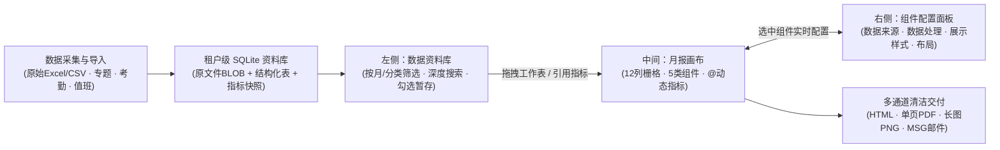
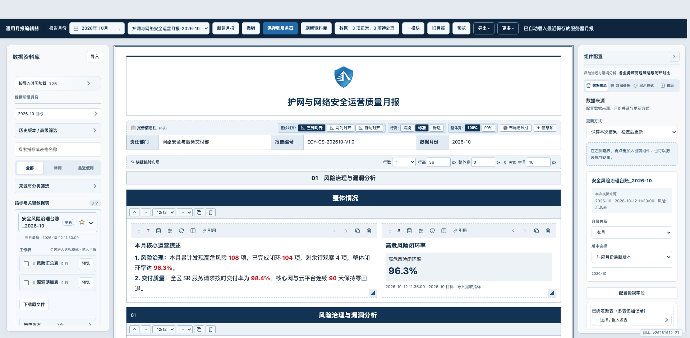
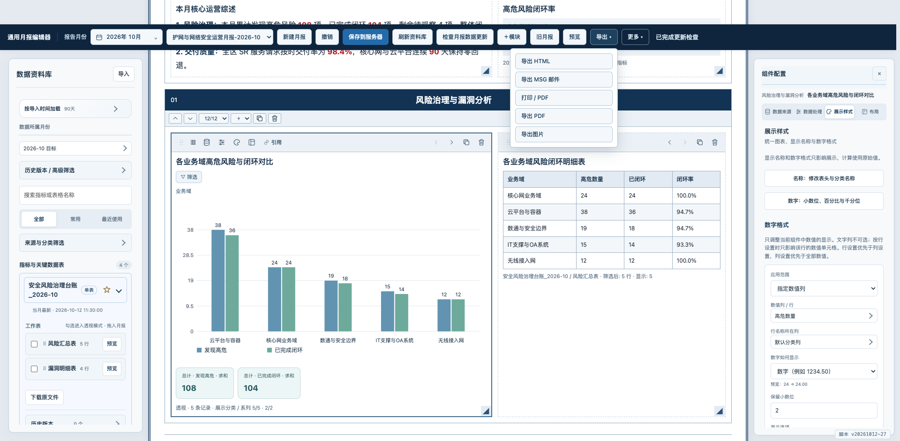
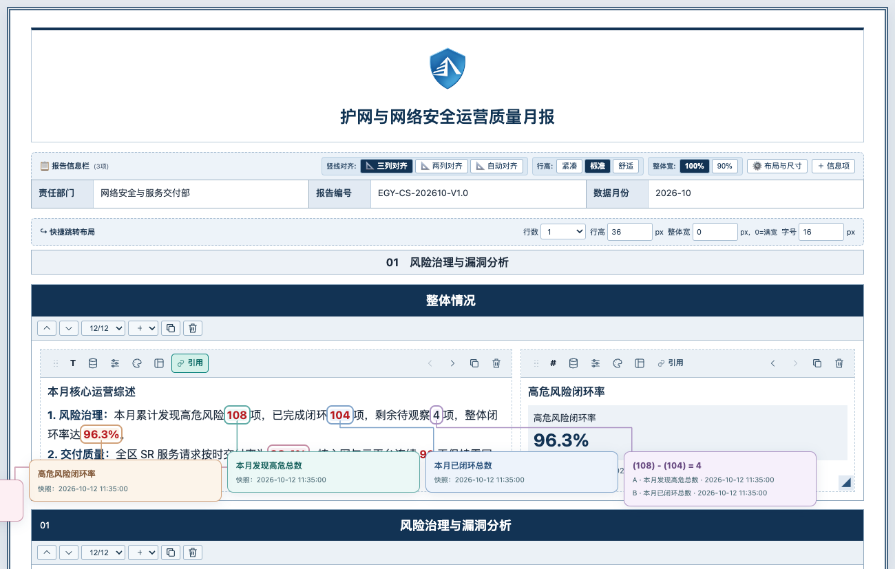
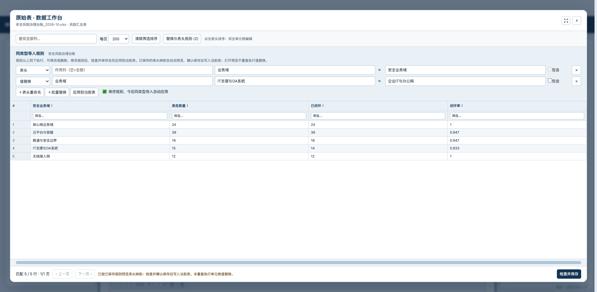
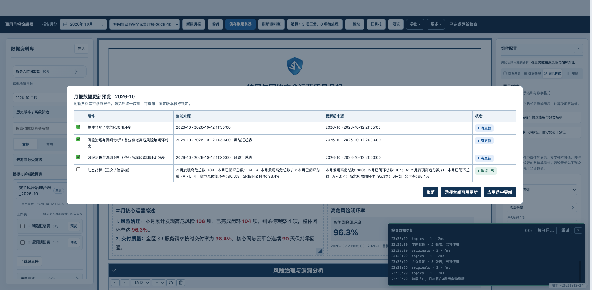

# 通用月报编辑器与原始表资料库使用说明书

> **页面地址**：`/pages/monthly-designer.html`（或通过平台主导航「月报页面」`/monthly` 直接进入）  
> **适用对象**：运营分析人员、网络安全与服务交付团队、SLA 质量管理员、系统研发与维护人员  
> **文档定位**：本文档按照**“由浅入深、从常用操作到高级治理”**的脉络编排，涵盖全景工作台认知、5 分钟快速上手、四大核心工作区详解、动态指标与公式计算、Excel 式多表数据透视、数据清洗工作台、跨月流转及多格式导出，并附带完整界面实拍截图与技术接口契约。

---

## 目录

- [一、产品定位与三栏工作台总览（快速认知）](#一产品定位与三栏工作台总览快速认知)
  - [1.1 核心设计理念](#11-核心设计理念)
  - [1.2 访问入口与首屏平滑加载](#12-访问入口与首屏平滑加载)
  - [1.3 三栏对称工作台全景](#13-三栏对称工作台全景)
- [二、快速上手：5 分钟完成一份标准月报（基础入门）](#二快速上手5-分钟完成一份标准月报基础入门)
- [三、顶部全局控制栏详解（常用操作）](#三顶部全局控制栏详解常用操作)
  - [3.1 核心概念：「报告月份」与「浏览数据月份」双轨隔离](#31-核心概念报告月份与浏览数据月份双轨隔离)
  - [3.2 顶部工具栏主按钮速查](#32-顶部工具栏主按钮速查)
  - [3.3 「导出 ▾」与「更多 ▾」收纳菜单详解](#33-导出-与更多-收纳菜单详解)
- [四、左侧「数据资料库」与源头存档体系（数据底座）](#四左侧数据资料库与源头存档体系数据底座)
  - [4.1 五大类数据源与源头存档机制](#41-五大类数据源与源头存档机制)
  - [4.2 加载范围滑块、月份与多维分类筛选](#42-加载范围滑块月份与多维分类筛选)
  - [4.3 普通搜索与「深度搜索」定位](#43-普通搜索与深度搜索定位)
  - [4.4 工作表拖拽与多表「透视模式」暂存托盘](#44-工作表拖拽与多表透视模式暂存托盘)
- [五、中间「月报画布」与五大内容组件（核心编排）](#五中间月报画布与五大内容组件核心编排)
  - [5.1 页面抬头、报告信息栏与快捷跳转导航](#51-页面抬头报告信息栏与快捷跳转导航)
  - [5.2 模块（Section）与 12 列响应式网格系统](#52-模块section与-12-列响应式网格系统)
  - [5.3 五大内容组件类型详解](#53-五大内容组件类型详解)
  - [5.4 组件卡片工具栏与双向网格缩放](#54-组件卡片工具栏与双向网格缩放)
- [六、富文本排版、动态指标 `@` 与双指标公式计算（进阶写作）](#六富文本排版动态指标--与双指标公式计算进阶写作)
  - [6.1 浮动富文本工具条与表格单元格级样式](#61-浮动富文本工具条与表格单元格级样式)
  - [6.2 `@` 动态指标引用与智能重选](#62--动态指标引用与智能重选)
  - [6.3 相邻双指标公式计算（`A` 与 `B` 四则/函数运算）](#63-相邻双指标公式计算a-与-b-四则函数运算)
  - [6.4 「🔗 引用」可视化气泡连线溯源检查](#64--引用可视化气泡连线溯源检查)
  - [6.5 携带元数据的跨组件/跨月报复制粘贴](#65-携带元数据的跨组件跨月报复制粘贴)
- [七、右侧「组件配置」面板深度指南（高级配置核心）](#七右侧组件配置面板深度指南高级配置核心)
  - [7.1 面板结构与紧凑横向四页签](#71-面板结构与紧凑横向四页签)
  - [7.2 页签一：【数据来源】—— 更新方式与跨月版本规则](#72-页签一数据来源-更新方式与跨月版本规则)
  - [7.3 页签二：【数据处理】—— Excel 式多表数据透视引擎](#73-页签二数据处理-excel-式多表数据透视引擎)
  - [7.4 页签三：【展示样式】—— 图表视觉、名称映射与数据规整](#74-页签三展示样式-图表视觉名称映射与数据规整)
  - [7.5 页签四：【布局】—— 零 IO 轻量尺寸与模块迁移](#75-页签四布局-零-io-轻量尺寸与模块迁移)
- [八、高级治理：数据工作台、跨月更新、模板分发与多格式交付（专家与运维篇）](#八高级治理数据工作台跨月更新模板分发与多格式交付专家与运维篇)
  - [8.1 原始表 · 独立数据工作台与自动替换规则](#81-原始表--独立数据工作台与自动替换规则)
  - [8.2 跨月报告流转与「检查月报数据更新」对比预览](#82-跨月报告流转与检查月报数据更新对比预览)
  - [8.3 默认模板管理与随包同步分发](#83-默认模板管理与随包同步分发)
  - [8.4 多格式清洁导出与 Outlook MSG 邮件深度兼容](#84-多格式清洁导出与-outlook-msg-邮件深度兼容)
  - [8.5 历史看板回溯与 SLA 快照安全删除预览](#85-历史看板回溯与-sla-快照安全删除预览)
  - [8.6 存储架构、REST API 契约与自动化回归验证](#86-存储架构rest-api-契约与自动化回归验证)

---

## 一、产品定位与三栏工作台总览（快速认知）

### 1.1 核心设计理念

通用月报编辑器是一套**“数据从源头归档、版式自由编排、计算基于源值、模板跨月复用”**的企业级月度报告设计工作台。其核心流程如下：



- **源头无损归档**：上传文件按原始字节（BLOB）与解析后工作表双份存入当前租户 SQLite，不随常规快照清理而丢失。
- **浏览与报告解耦**：左侧随意翻阅历史月份资料，不会意外篡改当前月报的正式月份或已有数据。
- **计算与展示分离**：表头/行名映射、小数位与百分比规整仅美化最终视觉呈现，底层透视求和、均值与公式始终基于原始精度计算。
- **快照固化与显式更新**：组件默认将本次数据结果保存在报告内部，即使源表后续被清理，历史月报依然可完整打开与导出；跨月换期时提供可视化对比预览，确认后才更新。

---

### 1.2 访问入口与首屏平滑加载

1. **访问路径**：
   - **主导航入口**：点击顶部导航栏「月报页面」（`/monthly`），直接打开通用月报编辑器。
   - **数据导入页入口**：在数据导入页完成原始存档后，点击「打开数据资料库与月报编辑器」。
   - **报表看板与旧版切换**：报表看板提供「护网与网络安全月报」入口；编辑器顶部提供「旧月报」按钮（访问 `/monthly/legacy`）。
2. **首屏毛玻璃加载层**：
   - 打开编辑器时，全局导航栏保持可交互，下方工作区呈现毛玻璃加载层与矢量羽毛轻摆动效。
   - 进度条按 **8 个真实初始化步骤**推进：月报列表、月报/模板、三类资料库（原始表与指标、专题、会议考勤）、引用解析、组件渲染、字体及 Logo。
   - **停止等待**：若某个数据源响应较慢，可随时点击「停止等待」立即释放画布进入编辑状态，后台取消慢速读取，绝不锁死页面。

---

### 1.3 三栏对称工作台全景



编辑器在桌面端采用**“顶部固定工具栏 + 左中右三栏对称自适应”**布局（1900px 及以上宽屏自动对称留白使月报画布居中，两侧面板最大扩展至 600px；窄屏下右侧配置面板自动停靠至月报下方）：

| 区域名称 | 所在位置 | 核心职责 |
| :--- | :--- | :--- |
| **① 顶部全局控制栏** | 页面最上方（固定） | 管理正式**报告月份**、切换已保存月报、新建/撤销/保存、刷新资料库、**检查月报数据更新**、添加模块、切换预览模式、多格式导出与更多设置。 |
| **② 左侧「数据资料库」** | 左侧边栏（独立滚动） | 按导入时间（7天～全部）和所属月份浏览原始表、SLA指标、专题快照与考勤表；支持**深度搜索**、工作表预览、单表拖拽与多表**透视模式**勾选。 |
| **③ 中间「月报画布」** | 中央主工作区 | 所见即所得的月报文档。包含**Logo与总标题**、**报告信息栏**、**快捷跳转导航**、多模块（Section）及 **5 大类内容组件卡片**。 |
| **④ 右侧「组件配置」** | 右侧边栏（选中卡片开启） | 针对当前选中组件提供 **数据来源**、**数据处理**（Excel式透视四区）、**展示样式**（图表类型/名称映射/数字格式）、**布局** 四个紧凑页签。 |

---

## 二、快速上手：5 分钟完成一份标准月报（基础入门）

如果您是第一次使用通用月报编辑器，只需以下 **5 个步骤**即可产出一份排版规范的月度报告：

1. **第 1 步：确定报告月份与基础模板**
   - 点击顶部工具栏的 **「新建月报」**（系统自动基于当前租户默认模板创建，并自动选用资料库中最新的目标月份）。
   - 如需编制特定月份，点击顶部 **「报告月份」** 日历按钮（如 `2026年 10月`），在弹出的月份面板中选择目标月份。
2. **第 2 步：填写抬头与报告信息栏**
   - 直接点击画布顶部的 **Logo** 可更换图片，点击 **总标题** 直接修改文字。
   - 在 **「报告信息栏」** 中点击各单元格修改责任部门、审核人、报告目标等内容（报告编号与数据月份会根据正式月份自动生成）。
3. **第 3 步：从左侧资料库引入数据或图表**
   - **直接生成表格**：在左侧「数据资料库」展开某份原始文件，按住工作表名称（如 `⠿ 风险汇总表`）直接**拖入画布模块的空白处**（新增表格卡片）或**拖到已有卡片上**（替换为该表）。
   - **生成数据透视图表**：在左侧勾选 1～8 张工作表前的复选框，点击左上方弹出的暂存栏按钮 **「拖入月报生成透视表」** 或 **「其他操作 → 新建图表 / 透视」**。
   - **在正文中插入动态数字**：在任意文字段落中输入 **`@`**，在弹出的搜索框中选择 SLA 指标（如 `@高危风险闭环率`），数值将自动嵌入正文。
4. **第 4 步：在右侧「组件配置」调整透视与样式**
   - 点击画布上的图表或表格卡片，右侧自动打开 **「组件配置」** 面板。
   - 切换到 **「数据处理」** 页签：将字段拖入 **筛选器 / 列 / 行 / 值** 四个区域，选择求和、计数或平均值。
   - 切换到 **「展示样式」** 页签：一键切换 **柱状图 / 折线图 / 饼图 / 环形图 / 透视表**，或配置 **名称映射** 与 **百分比/小数位数字格式**。
5. **第 5 步：保存与多格式导出交付**
   - 点击顶部蓝色主按钮 **「保存到服务器」**（自动按月份递增版本号，如 `V1.0` → `V2.0`）。
   - 点击顶部 **「预览」** 检查无编辑控件的纯净排版，随后点击 **「导出 ▾」** 导出为 **HTML、单页 PDF、高清图片** 或 **Outlook MSG 邮件**。

---

## 三、顶部全局控制栏详解（常用操作）

### 3.1 核心概念：「报告月份」与「浏览数据月份」双轨隔离

初学者最容易混淆的两个月份入口，在编辑器中进行了**严格的职责分离**：

| 对比维度 | 顶部工具栏：「报告月份」 | 左侧资料库：「数据所属月份」 |
| :--- | :--- | :--- |
| **控件位置** | 顶部深色工具栏左侧（带日历图标，如 `2026年 10月`） | 左侧「数据资料库」面板内（如 `2026-10 目标`） |
| **核心作用** | **整份月报的正式业务归属月份**。决定报告编号、数据月份信息栏，以及所有设置「本月 / 上月 / 去年同月」规则组件的解析基准。 | **仅作为左侧资料库目录的浏览筛选器**。用于翻看其他历史月份有哪些文件或快照。 |
| **安全保护** | 修改时会弹出 **「月报数据更新预览」** 弹窗，列出所有将随之更新的组件，确认应用后才正式换期（取消则不改动报告）。 | 随意切换浏览月份**绝不改写**当前月报的正式月份，也不会改动画布中已绑定的组件数据。 |

---

### 3.2 顶部工具栏主按钮速查

从左至右依次排列高频操作：

1. **报告月份选择器**：点击弹出年份切换（`‹` / `›` / 年份下拉）、12 个月份网格按钮及底部「选择本月」快捷按钮，支持方向键与 `Escape` 键盘导航。
2. **已保存月报下拉框**：列出当前租户服务器上已保存的所有月报文档。**选中后立即自动载入**；若当前月报有未保存修改，会贴心弹出提示（支持「保存并切换」「不保存切换」或「取消」）。
3. **新建月报**：基于服务器默认模板（无服务器模板时使用内置模板）初始化一份新月报，自动匹配最新目标月份并从 `V1.0` 开始编号。
4. **撤销**：多步撤销栈，支持撤销文字修改、组件增删、表格替换、透视配置、样式调整及数据批量更新。
5. **保存到服务器**：将当前月报文档（含结构、组件配置、保存的数据快照与本地样式）持久化至租户 SQLite 数据库。
6. **刷新资料库**：重新向服务器请求左侧资料库目录（发现新上传的原始表、新提取的指标或新保存的专题/考勤快照）。**注意**：刷新资料库仅更新左侧目录，不会静默篡改画布已有数据。
7. **数据状态 / 检查月报数据更新**：实时显示当前月报各组件的健康度（如 `数据：3 项正常、0 项待处理`）。点击后打开对比预览窗口，核对并按需应用最新数据源。
8. **`+ 模块`**：在月报画布末尾新增一个大章节模块（Section）。
9. **旧月报**：一键跳转至旧版固定结构月报页面（`/monthly/legacy`）。
10. **预览 / 继续编辑**：
    - 点击 **「预览」**：自动隐藏左侧数据资料库、右侧组件配置面板及画布中所有的编辑工具栏、拖拽手柄与占位框，月报画布居中纯净展示，所有文本锁定防误触。
    - 再次点击 **「继续编辑」**：恢复完整三栏工作台。

---

### 3.3 「导出 ▾」与「更多 ▾」收纳菜单详解

为了保持顶部工具栏清爽，次要操作与交付通道收纳在两个下拉菜单中：

#### 📦 「导出 ▾」菜单
- **导出 HTML**：生成包含完整样式、内嵌 Logo 与 SVG 矢量图表的独立单文件 HTML，移除所有编辑控件，适合内网传阅与归档。
- **导出 MSG 邮件**：生成兼容 Windows Outlook / WPS 的原生邮件草稿文件（详见 [8.4 节](#84-多格式清洁导出与-outlook-msg-邮件深度兼容)）。
- **打印 / PDF**：调用系统原生打印引擎，自适应分页打印或另存为多页矢量 PDF。
- **导出 PDF**：生成**单页长图式无损 PDF**，完美保留深浅背景色、网格并排卡片与图表比例，无分页截断困扰。
- **导出图片**：将整份月报渲染导出为高分辨率 **PNG 长图**，适合即时通讯群组直接发送。

#### ⚙️ 「更多 ▾」菜单
- **快捷选择 Logo**：下拉切换内置品牌 Logo、安全盾牌或上传自定义企业 Logo（支持透明 PNG / SVG）。
- **默认文本大小**：全局设置月报正文默认字号（`12px` ～ `32px`，默认 `16px`）。
- **设为默认模板**：将当前月报的版式、模块、组件绑定规则与样式保存为租户默认模板（详见 [8.3 节](#83-默认模板管理与随包同步分发)）。
- **页面与信息栏**：打开全局弹窗调整文档名称、页面最大宽度（`600px`～`2000px`）、Logo 宽度与对齐方式，以及批量管理报告信息栏字段。
- **删除月报**：打开服务器月报批量管理窗口，支持关键词搜索、单选/全选及二次确认永久删除（当前打开的月报若被删除，画布内容会保留为未保存草稿以防丢失）。
- **导出工程 / 导入工程**：将当前月报导出为 `.json` 工程文件，或从本地 `.json` 工程恢复（适合跨环境迁移或本地备份）。
- **🌙 夜间值班表**：在新标签页打开夜间运维值班表编辑器（`/duty-roster`）。
- **English / 中文**：一键切换整份月报与编辑器界面的中英文语言模式（详见双语独立存储机制）。
- **加载日志**：重新打开右下角数据请求诊断面板，查看各阶段 HTTP 状态、请求 ID 与耗时。

---

## 四、左侧「数据资料库」与源头存档体系（数据底座）


### 4.1 五大类数据源与源头存档机制

通用月报编辑器之所以能够自由组合任意表格与指标，源于平台底层的**全量源头存档体系**：

1. **手工上传原始表（CSV / XLS / XLSX）**：
   - 在「全局设置 → 数据导入 → 原始数据上传到服务器」开启（默认开启）时，导入页会先把选中的文件按**原始字节（BLOB）**存入当前租户 SQLite，再保存各工作表的表头与全量行数据。
   - 即使文件未配置提取规则、未匹配目标月份，甚至解析超限（单文件上限 128 MB），原文件依然安全保留并支持随时下载。
2. **UIVF12 自动抓取结构化表**：
   - 自动抓取任务传入的结构化数据行会自动保存并重建为 CSV，资料库明确标记为「自动抓取的结构化表（CSV 重建）」。
3. **SLA 导入提取快照 & 报表已入库考核结果**：
   - 同一次导入产生的「提取快照」与「报表保存的考核结果」在资料库中按相同导入/目标月份智能归并展示，引用指标时默认采用导入值，也可展开切换选择「考核版本」。
   - **修改规则自动重算**：在数据导入页修改并保存指标规则后，系统直接使用已加载表格自动重算并更新重算快照，无需重新上传原始文件。
4. **专题分析月报数据（只读虚拟工作表）**：
   - 自动对接当前租户已保存的专题服务器快照：**EOS、证书风险、变更质量、高危拦截、SR、日志回传、日志备案**。
   - 按各专题实际目标月份展示于「专题分析月报数据」分类下，同时提供**月报汇总/分析表**与**快照原始明细表**，可直接拖入月报建表或参与多表透视。
5. **会议考勤原始表（只读虚拟工作表）**：
   - 自动对接会议考勤工具「保存快照到服务器」后的 **QR、RFC、WFM、现场签到、在线参会** 全部工作表。
   - 自动遵循会议窗口（`orderWindowMonths`）与开罗夏令时转换规则筛选当月有效记录，并在侧栏清晰展示原始行数、适用行数与日期未识别记录处理说明。

> [!NOTE]
> **生命周期独立保护**：资料库中的原始表和提取数据**不会**因为 SLA 快照列表达到 50 份上限、删除普通快照、清空浏览器缓存或清空上传历史而被自动删除。

---

### 4.2 加载范围滑块、月份与多维分类筛选

为了在海量历史数据下依然保持毫秒级响应，左侧资料库提供了层次分明的范围与分类控件：

1. **按导入时间加载（波浪柱状滑块）**：
   - 默认加载最近 **90 天**导入的目录。点击展开「按导入时间加载」，可拖动滑块在 **7天、30天、90天、半年、一年、全部** 6 个档位间切换。
   - 每个档位上方带有实时高度波浪柱与文件计数预览；拖动过程中仅本地预览，**松手后才发起请求加载**，并自动记住您的偏好（`libraryPrefs.loadDays`）。
2. **数据所属月份**：
   - 下拉选择当前浏览的目标业务月份（如 `2026-10 目标`）。同名原文件与结构化表会自动按「完整文件名 + 浏览月份」归组，主卡片展示最新一份，同名旧文件自动收进卡片底部的「历史版本」折叠区。
3. **历史版本 / 高级筛选**：
   - 展开后可按具体的**导入日期**和**导入批次（Batch）**进行精确过滤。
4. **三大视图页签**：
   - **全部**：显示当前筛选范围内的所有数据源。
   - **常用**：显示您点击星标 `☆` 收藏的高频源表或指标（星标变为实心 `★`）。
   - **最近使用**：自动记录您近期拖入月报或绑定过的源表，方便快速回找。
5. **来源与分类筛选**：
   - **来源类型筛选**：可过滤全部来源类型、原始数据表、导入提取指标、已入库考核指标、专题分析数据、会议考勤表。
   - **业务分类筛选**：按工单与变更、风险与安全、专题、例会考勤等业务域过滤，自动隐藏空分类。

---

### 4.3 普通搜索与「深度搜索」定位

- **普通搜索（500ms 防抖）**：在搜索框输入关键词，默认检索**文件名、工作表名和指标名称**（中文输入法拼写阶段不会打断输入，按 `Enter` 立即筛选）。
- **✨ 深度搜索（跨表内容与映射回溯扫描）**：
  - 当输入搜索词且普通匹配结果不超过 5 个时，搜索框下方会自动浮现带彩色光带的 **「深度搜索」** 按钮。
  - 点击后，后台线程会在当前浏览范围内逐批扫描**工作表列名、单元格正文内容以及表头重命名前的原始名称**。
  - 命中的文件展开后会直接显示命中的工作表、列名或首个匹配行摘要；支持点击「加载更多」继续扫描或随时停止。
  - 点击命中工作表的 **「预览」** 按钮打开数据工作台时，会自动携带搜索词并将**匹配行置顶显示**，命中行、列与单元格均以柔和浅色高亮定位！

---

### 4.4 工作表拖拽与多表「透视模式」暂存托盘

展开任意源表卡片后，每个工作表条目包含三个核心交互元素：

1. **复选框 `☐`（暂存多表选择）**：
   - 勾选 1 个或多个（最多 **8 个**）工作表，不会立即改动月报，而是在资料库顶部弹出醒目的 **「透视模式 · N 个源表」** 暂存操作栏（如上图所示）。
   - **拖入月报生成透视表**：可直接按住该大按钮（或按住任意已勾选的工作表名）拖入月报画布，一键生成合并多表记录的透视组件并自动打开右侧「数据处理」页签。
   - **其他操作**：展开后提供 **「加入当前组件」**（将所选表追加到当前选中的表格/图表组件中）、**「新建表格」**、**「新建图表 / 透视」** 以及右上角 `×` 清空选择。
2. **工作表名称手柄 `⠿ 表名`（单表快速拖拽）**：
   - **拖到画布模块空白处**：在该模块末尾新增一张「原始 / 清洗表格」卡片，自动以工作表名命名。
   - **拖到画布已有卡片上**：将该卡片原地替换为「原始 / 清洗表格」（保留原卡片的网格宽高、位置与标题样式，支持一键撤销）。
   - **拖到右侧配置面板的虚线框**：将该表追加为当前组件的数据源。
3. **「预览」按钮**：
   - 打开全屏级 **「原始表 · 数据工作台」** 查看完整数据、筛选排序或配置清洗替换规则（详见 [8.1 节](#81-原始表--独立数据工作台与自动替换规则)）。

---

## 五、中间「月报画布」与五大内容组件（核心编排）



### 5.1 页面抬头、报告信息栏与快捷跳转导航

月报画布严格遵循正式公文与安全运营报告的视觉规范，顶部由三部分构成：

1. **文档抬头（Masthead）**：
   - **品牌 Logo**：点击 Logo 图片可直接更换；在「更多 → 页面与信息栏」中可调整 Logo 宽度（`20px`～`400px`）与左/中/右对齐。
   - **月报总标题**：点击直接编辑，中英文模式下分别独立保存。
2. **📋 报告信息栏（Metadata Grid）**：
   - 位于总标题下方，工具栏提供丰富的即时排版控制：
     - **竖线对齐模式**：支持 **「三列对齐」**（`col-3`）、**「两列对齐」**（`col-2`）、**「自动对齐」**（`grid`）等模式，确保多行信息项的标签竖线严丝合缝。
     - **行高模式**：一键切换 **紧凑 / 标准 / 舒适** 三种行高密度。
     - **整体宽度**：一键切换 **100% 满宽** 或 **90% 居中**。
     - **⚙️ 布局与尺寸**：精细调节信息栏总宽度、行高像素、标签列固定宽度，以及调整每个信息项的栅格跨度（`1`～`12`）与顺序。
     - **`+ 信息项`**：随时新增自定义元数据字段（如密级、签发人、分发范围等）。
3. **↪ 快捷跳转布局（Section Navigation）**：
   - 自动提取画布中所有非概览模块（`01`、`02`、`03`…）生成带编号的目录胶囊导航，点击即可平滑滚动至对应章节。
   - 右侧支持直接调整导航栏的**显示行数（1～12行）**、**行高（px）**、**整体宽度（px，0=满宽）**与**字号（px）**。

---

### 5.2 模块（Section）与 12 列响应式网格系统

画布由若干个纵向排列的**大模块（Section）**组成（如“整体情况”、“01 风险治理与漏洞分析”、“02 SR与事件”等）：

- **模块标题栏**：首个概览模块（`overview`）不显示数字序号，其余模块自动按 `01`、`02`、`03` 编号。点击模块标题即可直接修改。
- **模块控制栏**（位于模块标题下方）：
  - `^` / `v`：将当前模块整体上移或下移。
  - `12/12 ▾`：设置模块自身在页面中的网格宽度跨度。
  - `+ ▾`：在当前模块内新增内容组件卡片（可选：**文字、提取指标、原始/清洗表、数据图表、规则总结**，以及直接新建 **夜间值班表**）。
  - `⧉`（复制模块）：将整个模块（包含内部所有组件卡片、文字样式与数据绑定）原样复制一份插入在下方。
  - `🗑`（删除模块）：移除当前模块。

---

### 5.3 五大内容组件类型详解

每个模块内部采用 **12 列 CSS Grid 网格布局**，可自由混排以下 5 种核心组件卡片：

| 组件类型 | 图标标识 | 适用场景与核心能力 |
| :--- | :---: | :--- |
| **① 文字组件 (`text`)** | `T` | 编写章节综述、重点分析、风险说明。支持完整富文本排版、输入 **`@` 引用动态指标**、以及**相邻双指标公式计算**。 |
| **② 提取指标 (`metric`)** | `#` | 突出展示单个核心 KPI 大数字（如 `96.3%`）。支持绑定 SLA 导入提取指标或已入库考核指标，底部自动标注快照时间与来源口径。 |
| **③ 原始/清洗表格 (`table`)** | 表格图标 | 展示源表或清洗表的数据明细（或挂载夜间值班表）。支持自定义展示列、多条件 AND/OR 筛选、行数上限、数字格式化及**单元格级富文本着色**。 |
| **④ 数据透视图表 (`chart`)** | 柱状图图标 | 强大的可视化分析组件。支持 **单表/多表（最多8表）Excel 式数据透视**，可无缝切换 **纵向柱状图、横向柱状图、折线图、面积图、饼图、环形图、透视表** 7 种形态。 |
| **⑤ 规则总结 (`summary`)** | 摘要图标 | 基于数据自动生成规范化总结语句（无需 AI）。内置 `{label}`、`{value}`、`{date}`、`{target}`、`{gap}`、`{count}` 变量占位符与快捷句式模板。 |

---

### 5.4 组件卡片工具栏与双向网格缩放

每张组件卡片顶部都有一条轻量化的**组件控制栏**，底部右下角配有一个**网格缩放手柄**：

1. **拖拽排序手柄 `⠿`**：按住卡片左上角的 `⠿` 图标，可在同一模块内自由拖动调整卡片先后顺序，也可直接**跨模块拖入另一个章节模块**中。
2. **组件类型标识**：显示当前卡片类型图标（如 `T`、`#` 等）。
3. **四个配置页签快捷按钮**（与右侧面板页签一一对应）：
   - 🛢 **数据来源**：一键打开右侧面板并定位到「数据来源」页签。
   - 🎚 **数据处理**：一键打开右侧面板并定位到「数据处理」页签。
   - 🎨 **展示样式**：一键打开右侧面板并定位到「展示样式」页签。
   - 🪟 **布局**：一键打开右侧面板并定位到「布局」页签。
4. **`🔗 引用`（指标引用检查）**：一键在画布上呼出当前组件内所有动态指标与公式的**可视化溯源气泡与折线连线**（详见 [6.4 节](#64--引用可视化气泡连线溯源检查)）。
5. **位置微调与复制删除**：
   - `<` / `>`：将卡片在模块内前移或后移一格。
   - `⧉`：紧接当前卡片右侧/下方克隆一张完全相同的卡片副本（独立 ID，修改互不干扰）。
   - `🗑`：删除当前卡片。
6. **右下角双向网格缩放手柄 `◢`**：
   - 按住卡片右下角的 **`◢`** 图标向左右拖动，可按 `1/12` ～ `12/12` 栅格实时调整**卡片宽度**（例如左 7 列放图表、右 5 列放表格，并排紧凑展示）。
   - 向上下拖动可按网格单位（每单位 `40px`）调整**卡片最小高度**，松手即自动对齐网格。

---

## 六、富文本排版、动态指标 `@` 与双指标公式计算（进阶写作）



### 6.1 浮动富文本工具条与表格单元格级样式

当您在月报画布中选中任意可编辑文字（包括**报告总标题、模块标题、组件标题、正文段落、报告信息栏、页脚**，甚至是**数据表/透视表/值班表的单个非空单元格文字**）时，上方会自动浮现共享的**富文本格式工具条**：

- **文本样式**：字号选择（`10px`～`36px`）、文字颜色、文字背景高亮色（选“无”仅清除当前选区底色）、**B 粗体**、**<u>U</u> 下划线**。
- **段落与单元格四向对齐**：支持 **左对齐、居中、右对齐、两端对齐**（中英文模式下对齐方式可分别保存，工具条实时高亮当前对齐状态）。
- **🖌 格式刷**：选中已排好版的文字点击「格式刷」，再刷选目标文字或单元格，即可一键复制字号、颜色、背景、粗体、下划线及对齐方式。
- **清除格式**：一键还原选中文字的默认样式与默认对齐。
- **表格单元格级持久化（`tableFormats`）**：
  - 在原始表、清洗表、透视表或值班表中对某个单元格设置的文字颜色、粗体或背景色，会按「工作表 + 区域 + 行标识 + 列名」智能绑定保存在组件内。
  - 当下个月数据更新后，**只恢复单元格的文字样式属性，绝不会用旧月份的文字覆盖新月份的数值**！

---

### 6.2 `@` 动态指标引用与智能重选

在撰写月报综述或分析结论时，您无需手工抄写数字：

1. **输入 `@` 呼出指标选择器**：
   - 在任意可编辑文本区（含正文、标题、信息栏、总结模板）输入字符 **`@`**，立即弹出轻量级指标搜索面板。
   - 输入关键词即可检索所有已存档的 SLA 提取指标与考核指标，点击即可将动态指标（如 `108`、`96.3%`）嵌入文本流中。
2. **单击调样式，双击换指标**：
   - **单击**已插入的指标：自动完整选中该指标单元并呼出浮动文字工具条，可为其设置醒目的红色粗体或字号（指标作为一个整体原子保存，不会出现只改了一半数字的情况）。
   - **双击**已插入的指标：重新打开指标选择器并自动定位到原指标，更换为新指标后**完美保留原有的文字颜色、粗体等格式**。

---

### 6.3 相邻双指标公式计算（`A` 与 `B` 四则/函数运算）

当正文中需要展示两个指标的差值、总和、占比或环比变化率（例如：用“发现高危总数 `108`”减去“已闭环总数 `104`”得出“剩余待观察 `4` 项”）时，无需外部计算器：

1. **触发方式（两种任选）**：
   - **方式一（一键关联相邻指标）**：只需**单击其中一个指标**，浮动文字工具条会自动出现 **「与相邻指标计算」** 按钮（自动优先匹配紧随其后的指标，无后项则匹配前项）。
   - **方式二（同时选中两项）**：拖选同一段落内相邻的两个指标（中间允许有空格），或单击第一个指标后按住 `Shift` 点击第二个指标，工具条即显示 **「已选中 2 项 · 公式计算」**。
2. **公式编辑器与快捷算式**：
   - 打开公式弹窗后，面板清晰列出操作数 **`A`** 与 **`B`** 的名称和当前数值。
   - **内置 6 大快捷算式按钮**：**相加 (`A + B`)**、**相减 (`A - B`)**、**相乘 (`A * B`)**、**比例 (`A / B`)**、**平均值 (`(A + B) / 2`)**、**变化率 (`(B - A) / A`)**。
   - **自定义表达式**：支持四则运算 `+ - * /`、括号 `()`、乘方 `^`，以及 **`ROUND(x, n)`、`MIN(a, b)`、`MAX(a, b)`、`ABS(x)`** 函数。
   - **显示精度**：可设置保留 `0`～`6` 位小数，并可勾选**显示为百分比（`%`）**，下方提供大字号实时计算结果预览。
3. **动态重算与随时还原**：
   - 点击「应用公式」后，正文中只展示计算结果（如 `4`）。
   - 当月报切换月份或应用数据更新后，**公式会自动基于新月份的 `A`、`B` 指标值重新计算**！
   - 随时单击公式结果可重新修改表达式，或点击 **「取消公式，恢复两个指标」** 无损拆回原来的两个独立指标。

---

### 6.4 「🔗 引用」可视化气泡连线溯源检查

在汇报或审稿前，如何快速核对一段文字里的各个数字分别来自哪个指标、哪次快照、怎么算出来的？

- 点击任意组件卡片顶部工具栏的 **「🔗 引用」** 按钮（如本节开头截图所示）：
  - 组件内所有的动态指标与公式结果会立即亮起柔和的彩色边框（6 色循环区分）。
  - 画布空白处自动生成对应颜色的**溯源信息气泡**，并通过**智能避让的正交折线**精准指向正文中的对应数字（重叠横线自动按 `8px` 车道错开，绝不交叉遮挡）。
  - **普通指标气泡**：显示指标标准名称与实际采信的快照时间戳（如 `高危风险闭环率 · 快照：2026-10-12 11:35:00`）。
  - **双指标公式气泡**：首行直接展示**代入真实数值后的算式与结果**（如 `(108) - (104) = 4`），下方小字分别列出 `A` 和 `B` 的指标名称与快照时间！
- 再次点击「🔗 引用」按钮或按 `Escape` 键即可收起溯源层（该检查层仅用于编辑审阅，绝不会进入预览或导出文件）。

---

### 6.5 携带元数据的跨组件/跨月报复制粘贴

- 在编辑器任意文字区选中包含动态指标或公式的文本进行 **复制（`Ctrl/Cmd + C`）或剪切（`Ctrl/Cmd + X`）**，剪贴板会同时封装经过校验的引用定义、公式结构与富文本样式。
- **粘贴到本报告其他组件或另一份月报**：自动恢复为可编辑、可双击重选、可随目标月报月份动态解析的活指标与独立公式！
- **粘贴到外部软件（Word / 记事本 / 聊天窗口）或使用「粘贴为纯文本」**：自动剥离内部标记，仅输出干净的解析后数值文本。

---

## 七、右侧「组件配置」面板深度指南（高级配置核心）

### 7.1 面板结构与紧凑横向四页签

点击月报画布中的任意组件卡片（或点击卡片顶部的 4 个快捷图标），右侧即刻开启全高停靠的 **「组件配置」** 面板：

- **固定顶栏**：左侧显示「组件配置」标题，右侧提供 `×` 关闭按钮。
- **当前组件指示行**：单行紧凑显示 **`所属模块名称` + `当前组件标题`**（如 `风险治理与漏洞分析  各业务域高危风险与闭环对比`），清晰明确当前正在配置哪个对象。
- **紧凑横向四页签**：
  - 采用统一的 **图标在左、文字在右、30px 紧凑高度** 设计：**`🛢 数据来源`**、**`🎚 数据处理`**、**`🎨 展示样式`**、**`🪟 布局`**，在切换任意页签时面板头部高度保持绝对平稳。
- **底部状态栏**：左侧状态圆点实时反馈当前组件的数据健康度（如 `● 正常` 或缺失字段提示），右侧提供 **「重试当前组件」** 按钮（仅单独重新读取该组件数据源，不重绘整份月报）。

---

### 7.2 页签一：【数据来源】—— 更新方式与跨月版本规则

用于管理组件与底层数据源的绑定关系、更新策略及跨月时间偏移规则（参考 [1.3 节全景图右侧](#13-三栏对称工作台全景)）：

1. **更新方式（Update Behavior）**：
   - **保存本次结果，检查后更新（默认推荐）**：将当前解析出的表格/指标结果随月报一起保存在文档内部。重新打开月报时秒开展示，即使源表后来被删除也能正常查看与导出；仅在您主动点击顶部「检查月报数据更新」并确认应用时才更新数据。
   - **自动跟随来源规则（高级）**：不在文档内缓存结构化结果（或用于超过 12MB 的超大数据集），每次打开月报时实时按规则去资料库查询最新数据。
2. **源表拖放追加区**：
   - 对于表格和图表组件，提供虚线拖放区，可直接把左侧资料库的工作表拖入此处追加为数据源。
3. **每个来源的独立「月份关系」与「版本选择」**：
   - **本次实际来源**：清晰展示当前实际匹配到的月份、导入时间戳与工作表名称。
   - **月份关系（6 种跨月规则）**：
     - **`本月`**（偏移 `0`）：跟随顶部正式「报告月份」匹配当月数据。
     - **`上月`**（偏移 `-1`）：自动匹配报告月份的前一个月（非常适合做**环比对比图表**，如在 10 月月报中同时绑定“上月 9 月表”与“本月 10 月表”！）。
     - **`去年同月`**（偏移 `-12`）：自动匹配去年同期月份（适合做**同比分析**）。
     - **`偏移月份`**：自定义任意整数月份偏移（如 `-2`、`-3`）。
     - **`固定月份`**：锁定在某一个具体年月（如 `2026-06`），不随报告月份换期而改变。
     - **`全库最新（不限月份）`**：忽略月份限制，始终选用全库最新上传的版本（适合静态资产字典表或长期配置表）。
   - **版本选择**：
     - **`对应月份最新版本`**：在该目标月份下有多次上传时，自动采用最新一次导入的版本。
     - **`固定指定版本`**：锁定某一次具体导入的文件/快照 ID，永不随新上传而变化。

---

### 7.3 页签二：【数据处理】—— Excel 式多表数据透视引擎


当选中图表或透视组件并进入 **「数据处理」** 页签时，面板化身为功能完备的 **Excel 式数据透视表字段面板**：

1. **多表追加与字段列表**：
   - 支持同时绑定 **1 ～ 8 个源表**（按同名字段自动纵向追加记录，并内置 **`来源表 / 月份`** 与 **`记录数`** 两个虚拟字段）。
   - **字段搜索框**：输入关键字实时过滤字段列表。
   - **勾选与直接拖拽**：
     - 勾选字段前的复选框，数值列会自动加入「Σ 值」区（默认求和），文本分类列会自动加入「≡ 行」区。
     - **支持未勾选字段直接拖拽**：无需先勾选，直接按住任意字段拖入下方四个区域即可自动完成配置并同步勾选状态！
2. **数据透视四大区域（2×2 网格）**：
   - **`▽ 筛选器（Filters）`**：配置前置过滤条件。点击字段上的 **「设置」** 按钮，支持 **12 种比较操作符**：`等于`、`不等于`、`包含`、`不包含`、`包含所选项（多选勾选框）`、`排除所选项`、`大于`、`大于等于`、`小于`、`小于等于`、`为空`、`非空`。多个筛选器按 `AND` 交集精确过滤原始记录。
   - **`▥ 列（Columns）`**：配置图表的系列拆分维度或透视表的横向列分组。
   - **`≡ 行（Rows）`**：配置图表的横轴分类（X轴）或透视表的纵向行分组（支持多级行分组与拖拽调序）。
   - **`Σ 值（Values）`**：最多支持 **8 个数值指标**。每个字段可独立下拉选择 **7 种 Excel 标准聚合算法**：
     - **`求和 (Sum)`**、**`计数 (Count，非空计数)`**、**`数值计数 (Count numbers)`**、**`平均值 (Average)`**、**`最小值 (Min)`**、**`最大值 (Max)`**、**`去重计数 (Distinct count)`**。
3. **高级折叠区：「筛选条件、字段映射与显示设置」**：
   - **跨表异名字段映射**：当合并多个不同命名的源表时（例如 9 月表叫 `部门`，10 月表叫 `责任团队`），可在此处逐表建立字段映射，使它们在透视计算中合并为同一维度。
   - **来源标签自定义**：修改各源表在图表图例中显示的月份或别名。
   - **排序规则**：支持按源表原始顺序、按分类名称升/降序、按聚合数值升/降序排列。
   - **排除源表合计行 & 显示透视总计**：默认自动识别并剔除源表自带的“总计/合计/Total”行以防重复累加；开启「显示总计」后，**平均值与去重计数的总计基于底层原始观测记录重新加权计算**，绝不简单将各单元格均值相加！

> [!TIP]
> **非透视组件的数据处理**：
> - 若当前组件是 **「提取指标 (`metric`)」**：此页签展示指标搜索器、主/子指标与分类过滤、导入版本 vs 考核版本切换，以及实时数值预览。
> - 若当前组件是 **「原始/清洗表格 (`table`)」**：此页签提供展示列勾选、显示行数上限（默认 50 行）、多条件筛选器（支持 `AND` / `OR` 逻辑切换）及前 3 行 × 3 列实时预览。
> - 若当前组件是 **「规则总结 (`summary`)」**：此页签提供快捷总结模板按钮（`指标与数值`、`包含目标`、`记录数量`）与中英文句式模板编辑框。

---

### 7.4 页签三：【展示样式】—— 图表视觉、名称映射与数据规整


**「展示样式」** 页签专门负责组件的外观呈现、标签美化与数值格式化（所有设置**只改变显示结果，不改动底层计算源值**）：

1. **7 种图表与表格形态无缝切换**（针对图表/透视组件）：
   - 支持一键切换：**`透视表`**、**`纵向柱状图`**、**`横向柱状图`**、**`折线图`**、**`面积图`**（带柔和渐变填充）、**`饼图`**、**`环形图`**（中心自动显示总计）。
   - **纵轴比例模式（Axis Mode）**：支持 **自动平方根压缩**（当非零最大/最小比值达到 8 倍时自动启用平方根轴，避免悬殊极值把小柱子压平，柱顶仍显示真实原值）、**线性比例**、**固定平方根压缩**。
   - **首尾变化曲线箭头阈值**：当首尾系列的增减幅度同时达到设定的百分比阈值（默认 `20%`）和绝对差值阈值（默认 `5`）时，柱顶上方自动绘制带尖头的渐变曲线变化箭头。
2. **「名称：修改表头与分类名称」（`nameMappings`）**：
   - 点击后展开表头与行名称映射规则列表（最多 200 条）。
   - 可将晦涩的数据库原字段名或英文代号映射为规范的汇报名称（支持指定作用范围：**列标题** 或 **行分类名称**，原名称可直接从当前源表下拉选择或手填）。
   - **跨月复用预设**：除「应用到本模块」外，还可点击「保存复用配置到服务器」（存入 `monthly_mapping_presets`），供其他组件或其他月份月报一键载入复用。
3. **「数字：小数位、百分比与千分位」（`dataFormats`）**：
   - 点击后展开数字格式规整卡片（如上图所示）。
   - **三级应用范围与优先级**：**`指定行名称`**（最高优先级，仅格式化该行中的数值格） > **`指定数值列`**（次优先级，如将 `闭环率` 列设为百分比） > **`全部数值`**（兜底规则）。
   - **3 种显示模式**：
     - **`数字（例如 1234.50）`**：常规小数位控制。
     - **`小数转百分比（0.123 → 12.3%）`**：自动将小数乘以 100 并附上 `%`（若原值本身已带 `%` 则不会重复乘 100）。
     - **`直接加百分号（12.3 → 12.3%）`**：保持原数值大小仅追加 `%` 符号。
   - **细节控制**：支持设置保留 **`0` ～ `8` 位小数**、勾选 **千分位分隔符（`1,234`）**、勾选 **零值显示为空白**，并提供实时转换预览（如 `预览：24 → 24.00`）。同样支持保存为跨月服务器预设（`monthly_data_format_presets`）。

---

### 7.5 页签四：【布局】—— 零 IO 轻量尺寸与模块迁移

点击 **「布局」** 页签，提供极速响应的纯几何布局表单（不触发任何源表读取或下拉枚举）：

- **所属模块**：下拉选择目标章节模块，可将当前组件一键迁移至其他模块。
- **宽度（1～12 列）**：精确设置组件在 12 列网格中的列宽跨度（如 `12` 为整行满宽，`6` 为半宽两列并排，`4` 为三列并排）。
- **最小高度（网格单位）**：设置 `0`（自适应内容高度）或 `1`～`100` 个网格单位高度。
- **对齐方式**：设置组件内部内容的整体对齐（**左对齐 / 居中 / 右对齐**）。

---

## 八、高级治理：数据工作台、跨月更新、模板分发与多格式交付（专家与运维篇）

### 8.1 原始表 · 独立数据工作台与自动替换规则



在左侧资料库点击任意工作表的 **「预览」** 按钮，将打开接近全屏尺寸的独立 **「原始表 · 数据工作台」**（四周留白 32px）：

1. **自由窗口管理**：
   - 按住顶部标题栏可自由拖动窗口位置；按住窗口**四边或四角**可任意调整窗口宽高；双击标题栏或点击右上角恢复图标可一键还原默认大小。
2. **多维数据检视与直接编辑**：
   - **全列查找与分页**：顶部输入关键词实时检索全部列；支持每页切换 `100 / 200 / 500 / 1000` 行，底部提供横向滚动滑块与页码导航。
   - **单列筛选与排序**：点击任意表头按钮可升序 `↑` / 降序 `↓` 排序（自动识别数字与文本）；表头下方的输入框支持多列组合包含筛选；点击「清除筛选排序」一键复位。
   - **双击单元格编辑**（管理员权限）：双击任意数据单元格可直接修改其内容（`Enter` 确认，`Escape` 取消）。
3. **「替换与表头规则」及跨月同类型自动应用**：
   - 点击工具栏的 **「替换与表头规则 (N)」** 按钮展开规则面板（若该类源表已有保存规则，打开工作台时会自动展开）。
   - **＋表头重命名**：将源表中的原始列名改为规范列名（如 `业务域` → `安全业务域`）。
   - **＋批量替换**：支持指定作用列（留空则作用于全部列），将特定查找值批量替换为新值（支持勾选「包含」进行子串匹配替换，如将 `IT支撑与OA系统` 替换为 `企业IT与办公网`）。
   - **应用到当前表（试应用）**：仅在弹窗草稿中预览规则执行效果，尚未改写数据库。
   - **保存规则，今后同类型导入自动应用**：勾选此项并点击右下角 **「检查并保存」**，系统会先统计并提示本次修改的表头数与单元格数量，二次确认后写入服务器（`source_table_rules` 表）。此后，**每当导入同类型的新月份原始文件时，解析入库阶段会自动执行这套表头重命名与值替换规则**，彻底告别每月重复手工洗表！

---

### 8.2 跨月报告流转与「检查月报数据更新」对比预览



当迎来了新的月份（例如从 9 月进入 10 月），或者本月重新导入了修正后的最新版源表时，如何安全、可控地更新整份月报？

1. **两种触发场景**：
   - **场景 A（同月数据刷新）**：点击顶部「刷新资料库」后，点击 **「检查月报数据更新」**。
   - **场景 B（跨月换期生成新月报）**：点击顶部「报告月份」选择新月份（如 `2026-10`），系统自动弹出该月份的数据更新预览。
2. **可视化四列对比表**：
   - 弹窗清晰列出每一个组件（含图表、表格、指标卡片以及正文/信息栏中的动态指标与公式）：
     - **组件**：显示所属模块与组件名称。
     - **当前来源**：显示组件当前正在使用的月份、时间戳与工作表/数值。
     - **更新后来源**：显示按各组件的「月份关系 + 版本规则」在目标月份下匹配到的新来源或新数值。
     - **状态**：以醒目标签区分 **`● 有更新`**（蓝色，默认勾选）、**`● 数据一致`**（绿色）、**`● 固定版本`**（保持锁定）或 **`● 待处理 / 缺少字段`**（琥珀色警告，自动禁止勾选，保护原组件已有数据不被清空！）。
3. **按需应用与一键撤销**：
   - 可点击 **「选择全部可用更新」** 或手工勾选需要更新的组件后点击 **「应用选中更新」**。
   - 应用后若发现某项数据不符合预期，随时点击顶部 **「撤销」** 即可瞬间回退到更新前的状态！

---

### 8.3 默认模板管理与随包同步分发

1. **设为租户默认模板**：
   - 在将一份月报的模块结构、透视配置、名称映射与数字格式打磨成熟后，管理员可点击「更多 ▾ → **设为默认模板**」。
   - 系统会自动剥离报告 ID、历史版本号与具体业务数据行，仅将纯净的**版式结构、相对月份引用规则与样式配置**存入当前租户的 `monthly_default_template`。此后团队成员点击「新建月报」时，即自动套用该成熟模板。
2. **同步到代码仓库随程序打包（Mac 本地开发环境专属）**：
   - 当在本机 Mac 从 Git 仓库运行并通过 `localhost` / `127.0.0.1` 访问时，保存默认模板弹窗中会额外提供 **「同时同步到代码仓库，随程序打包」** 复选框。
   - 勾选后，系统会将当前默认模板同步写入仓库的 `backend/builtin-templates/monthly-report.json`，并将上传的自定义 Logo 自动按 SHA-256 哈希固化至 `frontend/assets/monthly-template/<sha256>.png`。
   - 提交 Git 并打包发行版后，全新安装客户端的租户在无需任何数据库迁移的情况下，开箱即享最新设计的内置月报模板！

---

### 8.4 多格式清洁导出与 Outlook MSG 邮件深度兼容

通用月报编辑器的所有导出通道均经过严格的**清洁排版与跨端兼容处理**：

| 导出格式 | 核心技术处理与交付优势 |
| :--- | :--- |
| **HTML 独立文件** | 自动剥离所有编辑按钮、配置属性与动态指标标记（转为纯文本显示值）；将 Logo（含内嵌图片的 SVG）光栅化为内嵌 PNG；重新测量同行等高卡片，单文件离线可看。 |
| **单页 PDF / 高清图片** | 移除编辑控件后在独立清洁视图中光栅化，完美还原 SVG 矢量柱状图/折线图/环形图、渐变箭头与双线外框，无跨页截断。 |
| **打印 / 多页 PDF** | 注入 `@media print` 专用打印样式，自动隐藏顶部工具栏、侧栏与悬浮控件，支持浏览器原生分页打印。 |
| **Outlook MSG / EML 邮件** | 专为企业办公邮件客户端（Windows Outlook / WPS）深度定制：<br/>1. **原生邮件表格布局**：将 Flex/Grid 转换为原生 `<table>` 布局，确保 Logo、模块标题与多列卡片在邮件中严丝合缝。<br/>2. **双线边框与显式换行**：页面四周双线边框采用两层原生表格边框实现；正文换行转为显式 `<br>`。<br/>3. **CID 内嵌图片附件**：Logo 与所有图表自动转换为 `Content-ID` 内嵌图片附件，不依赖外网图片链接或被客户端拦截的 Data URL。<br/>4. **邮件内锚点跳转**：快捷跳转导航自动转换为同封邮件内部书签（`#mr_section_N`），且表格与正文在邮件草稿中仍可二次编辑文字。 |

---

### 8.5 历史看板回溯与 SLA 快照安全删除预览

1. **数据导入页「历史看板 → 载入到当前页面」**：
   - 在数据导入页的历史看板中，凡是带有原始存档的快照均提供 **「载入到当前页面」** 按钮。
   - 点击后无需重新选择本地文件，直接从租户原始资料库读取该批次全部文件与工作表，完整恢复当时的导入分组、指标规则、高亮状态与核心数据舱，且不会重复生成新快照或改写历史考核得分。
2. **SLA 快照删除前的源表关联安全预览**：
   - 在删除历史 SLA 快照时，系统会先调用 `GET /api/sla/snapshots/:id/delete-preview` 列出关联的原始文件、大小、工作表数量及其他快照引用计数。
   - 默认提供安全的 **「仅删除快照」**（保留原始表文件供月报继续使用）；也可显式确认永久清理无其他引用的当前批次原始文件，所有操作均在数据库事务中原子完成。

---

### 8.6 存储架构、REST API 契约与自动化回归验证

#### 1. 租户 SQLite 核心表结构（`tools.db`）
所有数据严格存储在当前租户物理隔离目录（`data/tenants/<tenantId>/tools.db`）中：
- `import_source_batches`：导入批次记录与来源标识（`manual` / `uivf12` 等）。
- `import_source_files`：原始上传文件元数据及原始文件字节 `BLOB`。
- `import_source_sheets`：解析后的各工作表表头与全量 JSON 行数据。
- `import_source_snapshots`：SLA 提取快照、规则匹配的清洗行序号与考核快照。
- `source_table_rules`：按归一化源表类型保存的表头重命名与批量替换规则。
- `monthly_documents`：已保存的各月份月报文档（含结构、组件配置与固化的 `savedData`）。
- `monthly_default_template`：当前租户自定义的默认月报模板。
- `monthly_mapping_presets` / `monthly_data_format_presets` / `monthly_component_presets`：跨月复用的名称映射、数字格式及单组件预设。

#### 2. 核心 REST API 端点汇总
所有接口均继承 `/api/upload` 登录鉴权、租户沙箱隔离及管理员写权限校验：
- **原始资料库与目录**：
  - `GET /api/upload/import-settings`、`PUT /api/upload/import-settings`（管理 `uploadOriginals` 原始文件存档开关）
  - `POST /api/upload/source-batches`、`POST /api/upload/source-batches/:id/files`、`PUT /api/upload/source-files/:id/sheets`
  - `GET /api/upload/source-range-counts`（获取各导入天数档位的文件计数）
  - `GET /api/upload/source-catalog?days=N&stage=core|topics|meetings`（分阶段读取资料库目录与耗时诊断）
  - `POST /api/upload/source-catalog/deep-search`（后台分批深度搜索列名、当前内容与映射前原始内容）
  - `GET /api/upload/source-files/:id/download`（下载原始上传文件字节）
  - `GET /api/upload/source-sheets/:id`（读取工作表内容）
- **原始表数据工作台与清洗规则**：
  - `GET /api/upload/source-sheets/:id/editor`、`POST /api/upload/source-sheets/:id/editor`（读取与保存工作台单元格修改及同类型自动替换规则）
- **月报文档、默认模板与跨月预设**：
  - `GET /api/upload/monthly-documents`、`GET /api/upload/monthly-documents/:id`、`POST /api/upload/monthly-documents`、`DELETE /api/upload/monthly-documents`
  - `GET /api/upload/monthly-default-template`、`PUT /api/upload/monthly-default-template`
  - `POST /api/upload/monthly-default-template/sync-repository`（本地开发环境同步内置模板与 Logo 资产）
  - `GET/POST /api/upload/monthly-mapping-presets`、`PUT/DELETE /api/upload/monthly-mapping-presets/:id`
  - `GET/POST /api/upload/monthly-data-format-presets`、`PUT/DELETE /api/upload/monthly-data-format-presets/:id`
  - `GET/POST /api/upload/monthly-component-presets`、`PUT/DELETE /api/upload/monthly-component-presets/:id`

#### 3. 自动化测试与回归验证命令
在 `tools-platform` 目录下可执行以下单元测试与 Electron 真实浏览器回归测试（所有测试均使用临时沙箱目录与临时数据库，绝不触碰真实业务数据）：

```bash
# 1. 后端与存储自检
npm run doctor --prefix backend

# 2. 核心引擎、透视计算、公式解析、来源规则与跨月预设单元测试
node --test \
  tests/monthly-document-engine.test.js \
  tests/monthly-pivot.test.js \
  tests/monthly-source-rules.test.js \
  tests/monthly-metric-formulas.test.js \
  tests/monthly-name-mappings.test.js \
  tests/monthly-data-formats.test.js \
  tests/monthly-source-table-editor.test.js \
  tests/monthly-default-template.test.js \
  tests/monthly-library-catalog.test.js \
  tests/monthly-request-client.test.js

# 3. Electron 真实渲染进程端到端回归测试（覆盖三栏工作台、透视拖放、图表切换、工作台清洗、导出等）
./node_modules/.bin/electron tests/monthly-workspace-redesign-browser.cjs
./node_modules/.bin/electron tests/monthly-designer-pivot-panel-browser.cjs
./node_modules/.bin/electron tests/monthly-designer-chart-types-browser.cjs
./node_modules/.bin/electron tests/monthly-source-table-editor-browser.cjs
./node_modules/.bin/electron tests/monthly-designer-formula-browser.cjs
./node_modules/.bin/electron tests/monthly-designer-table-format-browser.cjs
./node_modules/.bin/electron tests/monthly-designer-export-regression-browser.cjs
```
