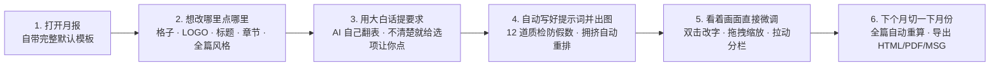

# AI 月报指南 (`/monthly`)

AI 月报（`frontend/pages/ai-report.html`）是平台默认且唯一的月报编写与交付工作台。它的目标很简单：**让你第一次编月报时，像跟同事聊天、摆桌面卡片一样把月报搭出来；等到了下个月，只要切换一下月份，整份月报自己把新数据算好、把总结写好。**

- **怎么进**：点击顶部导航栏「月报」或直接访问 `/monthly`（旧链接 `/ai-report`、`/monthly/legacy`、`/pages/monthly-designer.html`、`/pages/monthly.html` 都会自动跳转到这里）。
- **版本说明**：早期需要手工配置数据源与组件属性的三栏式「通用月报设计器」已退役并归档至 `tools-platform/backups/monthly-designer-classic-2026-10-21`。现在的 `/monthly` 采用全新的 **「五维 AI 对话 + 跨月配方 + 零网络沙箱 + 直接上手微调」** 体验。

---

## 1. 一眼看懂：你是怎么用它出月报的

1. **平时**：在数据导入（`/sla`）、报表看板（`/report`）和各专项工具里正常上传表格、沉淀数据。
2. **第一次做月报**：打开 `/monthly`，系统已经为你准备好了带报头、导览和章节的默认模板。**你想改哪里，就点哪里**——对格子说一句话，AI 自己去查表、算数据、画图表。
3. **觉得哪里不顺眼**：不用写代码，也不用翻复杂的设置菜单。看到哪个字不顺眼**双击直接改**，觉得格子太窄**直接拉边缘**，觉得整章配色不统一**点章节旁的 `✦` 一句话统一**。
4. **到了下个月**：在顶部把「报告月份」切到新月份，报头里的日期和目标、正文里的所有图表和总览全部自动拉取新数据重算，点一下导出就能发给团队。

---

## 2. 想改哪里点哪里：五个地方都能直接跟 AI 对话

在 AI 月报里，你几乎找不到复杂的配置表单。**画布上的每一处元素都可以直接点击，右侧面板会自动变成对应位置的专属顾问（`#airChat`）：**

| 你在画面上点哪里 | 右侧面板变成什么 | 你能直接感受到的体验 |
| --- | --- | --- |
| **① 点任意数据格子 / 空白格输入框** | **格子对话** | 直接说“按客户群看本月超期 SR 数量并画柱状图”，AI 自己去查表、算出结果并画进格子里。 |
| **② 点报头左上角的 LOGO** | **✦ 图片对话** | 弹出 4 个顺手按钮：**上传本地图片**、**从历史图片画廊里挑**、**调整大小**，或者直接对 AI 说“画一个深蓝色盾牌加网络节点的徽标”。 |
| **③ 点主标题、报告时间、报告目标、页脚旁的 `✦`** | **✦ 开头与页脚字段对话** | 让报头字段“活”起来：既可以设为固定文字，也可以定一条规则（比如“报告时间永远写报告月份的下一个月，格式 `YYYYMM`”或“结合本月未达标的格子写三段式报告目标”），以后每个月自动改写。 |
| **④ 点章节标题栏右侧的 `✦`** | **✦ 章节样式对话** | 对某一章说“把这一章所有格子的柱状图都改成横向、目标线用橙色虚线”，AI 会统一重排这一章的外观，但**死死锁住里面的数字绝不改动**。 |
| **⑤ 点顶部工具栏的「✦ 整体风格」** | **✦ 整体风格顾问** | 定下整份月报的规矩（配色、字体、边框、小数位数、总结字数、图表偏好），一键换肤并实时应用到全篇。 |

---

## 3. 做单个格子：从一句话提问到生成图表，体验有多顺

### 3.1 你只管说人话，AI 自己去翻真实的表
以前做报表，你得自己记得数据在哪张表、列名拼写是什么。现在你在空白格中央的输入框（或右侧对话框）里说一句需求，AI 会在后台用 **7 个只读探查工具**自己去翻：
- **当月导入的原始 Excel / CSV 工作表**（哪怕那张表刚在导入页上传完、还没来得及点开解析，AI 第一次读它时也会在后台自动解析入库，不会报“找不到表”）；
- **SLA 提取指标、考核指标与分月目标线**（哪怕不同月份指标的内部 ID 变了，它也会按指标名称稳定认出来）；
- **平台 11 类业务工具的数据集**（SLA、FRT、月报快照、专题分析、例会考勤、操作激励、值班表、部门奖惩、正向激励、问卷、自定义工具，且自动过滤掉含密码/Token 的敏感字段）；
- **当前月报自己的章节与格子大纲**（方便做顶部导览或全篇总结格）。

### 3.2 拿不准时给你现成选项点，想清楚了直接出图（不用多点一次确认）
跟 AI 聊需求时，它会根据情况给你三种最自然的回应：
1. **你只是随口问个数（`answer`）**：比如问“这张表里有哪几个代表处？”，它直接在对话框里回答你，**不会乱动你已经画好的格子**。
2. **需求有歧义，或者表太宽需要挑列（`ask`）**：如果一张详单有 20 多列，它不会自作主张全塞进格子里挤成一团，也不会让你手打列名，而是只问最关键的 1–2 个问题，并在气泡下面给出一排**可直接点击的胶囊按钮**（比如候选的列组合、按什么排序、画柱状图还是表格），你点一下就能继续。
3. **需求一清楚，立刻归纳并出图（`ready`）**：一旦问清楚了，AI 会把你们刚才聊好的所有细节自动汇总成右上角那段自包含的 **「最终提示词」**，并**立刻开始编译和画图**——不需要你再多点一次“确认生成”。

### 3.3 提示词明明白白摆在上面，改坏了一秒“沙粒消散”撤回
- **随时手改提示词**：AI 帮你归纳好的「最终提示词」就摆在右侧面板最上方。你想把“前 10 名”改成“前 5 名”，直接在框里改完按 `Ctrl/Cmd + Enter`（或点「重新生成」）就行。
- **`↶ 撤回` 粒子消散动画**：每次重跑前，系统都会自动把上一版的提示词、算法和画面存好。如果新改出来的图不如刚才那版好看，点一下提示词卡片上的 **`↶ 撤回`**——当前格子的画面会化作细腻的粒子消散，再瞬间聚合成上一版的画面。**整个撤回立刻完成，不用重新等 AI 算一遍。**
- **看到进度，而不是干等**：当格子正在被 AI 处理时，格子四周边框会亮起一圈流动的**彩色环形进度光效**，随着「排队 → 思考 → 整理提示词 → 生成代码 → 计算数据 → 写总结」一步步往前走，让你随时知道它进展到了哪一步。

---

## 4. 为什么你不用担心 AI 瞎编数字或把排版弄乱？

很多人不敢用 AI 出正式月报，是因为怕两件事：**一是怕 AI 算不出数时偷偷瞎编，二是怕画出来的图表缺字、乱码或者挤成一团。**

AI 月报的做法是：**AI 不直接填数字，而是写一套“取数 + 计算 + 渲染”的跨月配方（`recipe`），放进完全断网的安全沙箱里对真实数据跑出结果，并且要连过 12 道自动质检关卡，才允许端到你面前：**

| 你平时最怕遇到的坑 | AI 月报在背后怎么帮你挡掉（你在界面上的直接感受） |
| --- | --- |
| **怕 AI 编造不存在的表或假数字** | **断网沙箱 + 禁随机数**：代码运行在断网隔离沙箱里，一旦出现 `Math.random` 或“示例数据/模拟数据”字样，或者引用了真实数据库里没有的表名，当场拦截并把真实表清单塞回给 AI 重写。 |
| **怕指标名差一点，画出一张全 0 的假图** | **残缺名称与全 0 拦截**：比如真实指标叫 `TOPN 风险 / TE`，如果代码偷懒只按 `TE` 去取值并用 `\|\| 0` 兜底，普通程序会静默画出一张全是 0 的图；这里会当场抓住它没读到值，把完整名称告诉 AI 重新取数。同样，如果源表明明有数据，算出来却全是 0 或空列表，也会自动打回重算（除非数据真的就是 0）。 |
| **怕把“本月原值”当成“环比增量”** | **增量/差值核验**：只要指标名叫“XX增量”或“XX差值”，系统会自动检查它填进主数值里的到底是不是算出来的差值；如果错把本月总数填了进去，立刻打回修正。 |
| **怕并列第一时写出“某代表处最高、某代表处最低”的笑话** | **并列极值自相矛盾拦截**：当大家都是 100% 满分或有多个并列时，如果文字里同时把同一个名字说成“最高”和“最低”，会被当场拦下，强制改用专门的并列极值组件（自动标出 `并列（N 项）`）。 |
| **怕画面上出现 `undefined`、`NaN` 或源码标签** | **脏输出与字段失配拦截**：展示代码读了计算结果里没算出来的字段、画面上漏出了 `undefined%`、`<strong >` 源码、没转换的 `**加粗**` 符号，或者把带 `%` 的文字当数字喂给了图表导致画不出柱子，统统在后台自动修复，绝不漏到画面上。 |
| **怕顶栏有一段总结，下面图里又重复写一段总结** | **双总结去重**：只要格子顶部已经开了 AI 总结栏，就不允许下面正文里再拼一段长篇总结句，保持画面干净利落。 |
| **怕明确要求写的标题漏了，或者并排两块挤出横向滚动条** | **真实屏幕测量与拥挤自动重排**：画面渲染到页面上后，系统会用真实像素量一下：你点名要的 `标题为“XX”` 有没有显示出来？并排摆放的图表和表格有没有把格子撑破、把表头文字挤成一列竖排？一旦发现拥挤，**不用你动手，AI 自动在后台回炉改成上下布局再展现给你。** |

> [!TIP]
> 以上所有拦截和回炉重修（最多自动重试 3 次）全部在几秒钟内由系统后台自己完成。对使用者的感受就是：**哪怕第一次代码没写对，它自己改好再端出来，你直接看到的就是对得上原表、排版舒展的成品。**

---

## 5. 图表交互与排版组件：不仅是张死图，还能点进去看明细

生成出来的格子不是一张静态死图，而是由 `AiReportKit` 驱动的交互式画布：

- **点击图表最多下钻 3 层（`kit.chart`）**：
  - 图表采用高清矢量 SVG 渲染，放大多少倍都不模糊。
  - 你可以让 AI 做成**可点击下钻的图表**（比如第一层看「各大区超期单数」，点击某个大区的柱子，图表直接下钻展开该大区下「各代表处」的分布，再点一下继续下钻到第 3 层明细），图表上方自带面包屑导航，随时点一下退回上一层。
- **点击左边图表，右边表格自动跟着筛选（图表与 `kit.datatable` 联动）**：
  - 同一个格子里既有图表又有明细表时，点一下柱状图里的某个客户群，旁边的明细表会自动过滤出该客户群的单据，并在表头显示当前筛选标签（点 `×` 即可恢复全量）。表格还自带**关键字实时搜索、点击表头排序和翻页**。
- **KPI 环比标签自动说人话（`kit.kpi`）**：
  - KPI 卡片上的变化量不会只冷冰冰地写个 `+2` 或 `0`，而是自动显示为清晰易懂的 `较上月 +2`、`与上月持平`，并根据达标方向自动标上绿/黄/红状态色。
- **一句话跳到对应章节或格子（`kit.nav` / `kit.inlineLink`）**：
  - 顶部的「快速跳转」导览栏、或者「本月概述」文字里提到的短板指标名称和数字，都可以直接点击——页面会平滑滚动到对应的章节或格子，并用柔和的高亮框闪一下提醒你位置。

---

## 6. 看着画面直接上手改：双击改字、拖拽缩放与分栏拉扯

做好格子之后，很多微调根本不需要再跟 AI 打字聊天，直接在画布上动手就行：

### 6.1 看到哪个字不顺眼，双击直接改
无论是表头列名、表格里的某个单元格、子块小标题、KPI 名称，还是格子最上面的 AI 总结文字——**直接用鼠标双击它，就能原地打字修改**（按 `Enter` 完成，按 `Esc` 取消）：
- **AI 能分清你是“改名字”还是“改文风”**：
  - 如果你把表里的英文缩写 `Rep_A` 双击改成了 `北非代表处`，AI 知道这是**固定名称替换**，会自动把这条替换规则记进最终提示词并重跑，以后每个月出现 `Rep_A` 都会自动显示成 `北非代表处`。
  - 如果你双击修改了顶栏总结里的句子，AI 知道你在**润色口径与语气**，会顺着你的改法把中英文总结和提示词一起同步好。

### 6.2 像整理手机桌面一样拖拽格子与章节
- **拖格子换位**：按住格子右上角的 `⠿` 拖动，周围的格子会自动平滑让开位置，松手即落位；点一下 `⧉` 还能把当前格子（连同里面的图表、提示词和尺寸）原样复制一份在旁边。
- **拖章节换位（自动缩小看全篇）**：月报很长时，想把最后一章挪到前面怎么办？只要按住章节标题栏右侧的 `⠿` 往外一拖，**整篇月报会自动缩小成一屏总览视图**，所有章节尽收眼底；你轻松拖到目标位置松开鼠标，画面又会平滑放大并精准停在新位置上。两章之间鼠标悬停还会浮现 **`＋ 插入章节`**，随时在任意位置加新章节。

### 6.3 拉拽格子大小：贴心的 2.5 秒缓冲倒计时条与长名字缩写追问
- **拉边缘调宽高**：拖动格子右边线调列宽（`1/12` 到 `12/12`），拖下边线或右下角调高度（靠近旁边格子的高度时会自动磁吸对齐；**双击右下角手柄**可一键恢复自动高度）。
- **2.5 秒缓冲倒计时条（不用每拉一下就傻等 AI 重算）**：
  - 当你把一个已经生成好的格子拉窄或拉矮时，里面的图表和文字往往需要重新排版才不会出滚动条。但如果你正在连续试尺寸，每松一次手就调一次 AI 会非常慢。
  - 所以当你松开鼠标时，格子底部会浮现一条温和的 **2.5 秒倒计时条**：`即将按新尺寸重新生成，可以继续调整`，旁边带着 **「立即生成」** 和 **「撤销调整」** 两个按钮。如果你在 2.5 秒内继续拉拽，倒计时会自动暂停等你；等你彻底调满意了，它才一次性让 AI 按新尺寸重新排版（列宽缩到 `4/12` 及以下时，还会自动把左右分栏改成上下堆叠）。
- **横轴名字太长时主动问你怎么缩写**：
  - 当你把图表拉窄后，如果横轴上的分类名称超过 6 个字、容易挤在一起或变成竖排，AI 不会硬画，而是在右侧对话框主动问你：**“格子变窄了，这几个名字有点长，在图里怎么缩写？”**，并直接给出 **`自动缩写，悬停显示全称`、`只保留最后一级`、`去掉前缀`、`我自己定规则`** 四个按钮让你点。

### 6.4 格子内部的子块分栏，直接拉中间的缝隙就能调比例
如果一个格子里左右并排放了“图表 + 表格”（或上下分了块），把鼠标移到它们中间的分隔线上，光标会变成双向箭头——**直接按住左右拉宽、或者上下拉高就行**（双击横向分隔线可恢复子块自动高度）。调整过程实时生效，不用等 AI 重跑，而且你拉好的宽高比例会自动写回最终提示词里保存下来。

---

## 7. 报头 LOGO、动态报头字段、章节样式与全篇风格

除了正文里的数据格，整份月报的“门面”和“规矩”也能用对话轻松搞定，而且内置了**防冲突保护**：

### 7.1 左上角 LOGO：上传、挑历史、或者让 AI 当场画一个
点一下报头左上角的 LOGO，右侧打开 **「✦ 图片对话」**：
- 可以直接点 **「上传本地图片」**（支持 PNG/JPEG/WebP/GIF/SVG），或点 **「从历史图片中选择」** 展开画廊，一键换回以前传过或画过的任何图标。
- 点 **「用 AI 生成新图片」**（或直接打字描述）：
  - 如果平台配置了「丹青」等绘图模型，它会直接为你生成高清图标；你甚至可以说 **“在现在这张图的基础上，把颜色改成深蓝、加上部门缩写”**，它会拿着当前 LOGO 原图做局部修改。
  - 如果没配专用绘图模型，AI 会自动化身矢量设计师，配合当前月报的主题强调色，手绘一张干净利落的 `512×512` 矢量 SVG 徽标。
- 每次换图或改大小（比如直接说“大一点”“宽 160”）都会记入历史，随时可以点 **「撤回上一次更换」** 一步步退回。

### 7.2 报头与页脚字段：固定文字或每月自动改写
主标题、副标题、信息栏里的每一项（部门、报告时间、数据月份、审核人、报告目标）和页脚旁边都有一个 **`✦`** 按钮：
- 如果你在画布上直接点击文字打字修改，它会自动变成 **固定文字**，每个月原样保留。
- 如果你点开 `✦` 对话，给它定下生成规则（比如告诉「报告时间」：`永远写报告月份的下一个月，只写 6 位数字 YYYYMM`；或者告诉「报告目标」：`结合本月月报里未达标的格子，按三段式写出本月重点`），那颗 `✦` 就会点亮成紫色。
- **绝不算错跨年与月份**：服务端在调用 AI 前，会先把报告当月、上月、下月的所有日期格式（`2026-10`、`202610`、`2026年10月` 等）精确算好喂给 AI，彻底杜绝大模型算错月份加减法。以后只要切换报告月份，这些字段就会自动写出中英双语新内容。

### 7.3 章节样式（`✦`）与全篇整体风格（`✦ 整体风格`）
- **统一某一章的样式（绝对不改数字）**：点章节标题栏右侧的 `✦`，可以把这一章的排版规矩（如配色、图表朝向、总结位置）定下来。系统在批量重排这一章的格子时，**在后台强制锁死每个格子的取数来源和计算逻辑，只允许重写外层展示代码**，保证换完样式后所有数字 100% 原封不动。
- **统一整份月报的风格**：点顶部「✦ 整体风格」，全篇规则会自动按 **`【风格与配色】`、`【数据与计算】`、`【文字与结论】`、`【排版与图表】`** 四类整理好。
  - **平时在单格子里聊出的好规矩，一键升格为全篇规矩**：比如你在某个格子里说“所有百分比都保留一位小数”，AI 除了改好当前格，还会在回复下面弹出一个 **「✦ 加入整体风格提示词」** 按钮，点一下就自动写进全篇规则里。
  - **只改你说到的那一条，绝不乱改其他规则**：你在整体风格里说“把主色改成深青色”，它只会精准修改配色这一条，绝不会把你之前定好的其他十几条计算和文字规矩顺手改乱；改完后立即在对话框里展示新色板预览，并刷新整份月报的配色、字体与边框。

### 7.4 多层级规则冲突时：先问你听谁的，绝不偷偷覆盖
月报有了「全篇风格 → 章节样式 → 单个格子」三层规矩后，万一你前脚在全篇定过“目标线用红色虚线”，后脚在某个格子里说“目标线画成蓝色实线”怎么办？
- AI **绝不会一声不吭地把旧规矩覆盖掉**，而是会先停下来，把**原来的要求**和**这次的新要求**一起列给你看，并弹出 **`以这次为准，替换原要求`、`保留原来的要求`、`只在这个格子例外`** 几个按钮，由你点一下拍板。

---

## 8. 到了下个月：切一下月份自动重算，三种格式一键发出

### 8.1 平时改一个格子，总览格 0.4 秒内自己跟着变
月报顶部的「快速跳转」和「本月概述」格子引用了全篇其他格子的结果。你在下面改了某个格子的计算口径、改了章节名字、或者拖动了格子顺序，不用手动去点刷新——总览格在 **0.4 秒内就会自己静默重算完毕**，始终跟全篇最新状态保持一致。

### 8.2 切换报告月份：两阶段自动重跑全篇
到了下个月，在顶部工具栏把「报告月份」切到新月份（或点「⟳ 刷新全部格子」）：
1. **第一步**：所有普通数据格子同时去拉取新月份的源表和指标重算；没有独立总结栏的格子，AI 也会在后台为它提炼出一句话要点；所有设为动态规则的报头字段（报告时间、数据月份、报告目标等）同时更新。
2. **第二步**：等下面的数据格全算完了，最上面的导览和「本月概述」总览格再自动汇总全篇最新结果，生成本月的全局结论。
3. **按需更新总结**：如果有些格子的数字变了但顶栏文字总结还没重写，顶部工具栏会亮起 **「✦ 更新总结（N）」** 按钮，点一下就能只刷新这几个格子的文字总结，不用重编代码。

### 8.3 三种导出方式，照顾不同阅读场景
点击顶部「导出」菜单：
- **导出 HTML（发给同事交互看）**：生成一个**完全独立的单文件 HTML**。发到 WeLink 群或邮件里，同事不需要登录平台、哪怕断网双击打开，也能在浏览器里正常点击柱状图做 **3 级数据下钻**、在表格里搜索排序、切换标签页。
- **打印 / 导出 PDF（正式归档汇报）**：系统会自动把所有动态图表定格为高清矢量 SVG，并把带翻页的交互表格全部展开成完整静态长表，调起打印生成排版工整的 PDF。
- **导出 Outlook 邮件 (`.msg`)**：一键打包成标准 Outlook 邮件草稿文件，双击就能在 Outlook 里直接发送。

---

## 9. 想看 AI 到底是怎么算的？排查信息与「开发者」全屏追踪

不管你是想核对某个数字是怎么算出来的，还是遇到报错想查原因，AI 月报都把“底牌”准备好了：

1. **日常核对：点开「排查信息」看数据源与代码**
   - 在右侧面板「最终提示词」卡片下方，点开折叠的 **「排查信息」**，就能直接看到这个格子绑了哪几张源表/指标、有没有跨月取数（`monthOffset`），以及完整的 `compute`（计算代码）和 `render`（展示代码）。如果遇到内网断连或模型服务不可达，面板顶部还会直接弹出清晰的断网诊断提示。
2. **深度透视：开启右上角「开发者」开关（`trace.js`, `trace-viewer.js`）**
   - 点击右侧对话面板标题栏右上角的 **「开发者」** 按钮，底部会多出一个 **「开发者记录」** 抽屉，把每一次请求的每一步（发了什么系统提示词、AI 调了哪个查表工具、表里返回了什么、中间哪一步触发了质检重试、耗时多少毫秒）全部实时记录下来。
3. **全屏调试阅读器与“划词问 AI”**
   - 点记录右上角的 **`⛶ 全屏`**，会打开双栏式全屏追踪阅读器：
     - 点 **`✦ AI 总结全部内容`**：AI 会用大白话按顺序给你讲一遍“这次一共调了 3 次模型，先查了哪张表，第一次因为什么报错重来了，最后算出了什么”。
     - 点 **`🩺 分析错误原因`**：如果某个格子生成失败了，点一下它就会直接帮你定位病根（比如源表缺了哪一列、哪个筛选词没匹配上），并告诉你怎么跟格子说就能修好。
     - **哪里看不懂，直接用鼠标划选那段文字问 AI**：在全屏阅读器里，只要用鼠标**划选任意一段提示词、JSON 数据或报错文字**，光标旁就会立刻浮出 **`✦ AI 对话`** 按钮——点一下就能针对你选中的这几行字直接发问，回答会整整齐齐列在右手边的分析栏里。

---

## 10. 附录：存储表、完整 API 路由与源码结构

### 10.1 SQLite 数据表 (`tools.db`)
- **`ai_report_documents`**：按租户保存 AI 月报文档（`id`, `name`, `report_month`, `payload_json`, `created_at`, `updated_at`, `updated_by`）。
- **`ai_report_images`**：按租户保存报头 LOGO 与月报图片资产（`id`, `name`, `mime`, `bytes`, `source: 'upload'|'ai'`, `prompt`, `created_at`, `created_by`）。
- **`import_source_files` / `import_source_sheets`**：按租户与报告月份保存数据导入归档的源表文件及解析后的工作表结构。

### 10.2 完整 API 路由表（`/api/ai-report/*`）

| 方法与路径 | 用途说明 |
| --- | --- |
| `GET /api/ai-report/template` | 获取新建月报的默认模板结构（报头、字段默认提示词、章节与预设格子） |
| `GET /api/ai-report/documents` | 列出当前租户的全部 AI 月报文档摘要及可用月份列表 |
| `GET /api/ai-report/documents/:id` | 读取指定月报文档完整内容 |
| `POST /api/ai-report/documents` | 创建新月报文档（可传入自定义或默认模板） |
| `PUT /api/ai-report/documents/:id` | 保存/更新月报文档（报头、字段对话、图片历史、整体风格、章节样式、格子、配方与结果缓存） |
| `DELETE /api/ai-report/documents/:id` | 删除指定月报文档 |
| `GET /api/ai-report/sources` | 获取指定报告月份的数据来源目录 |
| `GET /api/ai-report/data/overview` | 获取指定月份的源表清单、SLA 指标与 11 类结构化数据集概览 |
| `POST /api/ai-report/data/resolve` | 按数据源声明批量解析跨月源表、指标、数据集、报告大纲或工具数据 |
| `POST /api/ai-report/run-data` | 为沙箱运行某格配方批量拉取各数据源在指定月份与偏移月份下的真实输入数据 |
| `POST /api/ai-report/cell/chat` | 单格 AI 对话（支持 7 个查数工具、多层冲突检测，返回 `answer` / `ask` / `ready` 及 `final_prompt`、`report_rule`） |
| `POST /api/ai-report/cell/prompt` | 手动将当前格子对话归纳为最终提示词 |
| `POST /api/ai-report/cell/compile` | 将最终提示词编译为跨月 `recipe`（含防编造数据源校验与沙箱错误自愈重编） |
| `POST /api/ai-report/cell/restyle` | 按章节样式重排单格展示代码（服务端强制锁死 `sources` 与 `compute`，仅重写 `render`） |
| `POST /api/ai-report/cell/narrative` | 根据格子 `compute` 输出生成中英双语顶栏总结 |
| `POST /api/ai-report/cell/gist` | 为无顶栏总结的格子生成一句话摘要，供全篇总览格引用 |
| `POST /api/ai-report/cell/text-edit` | 双击格子内文字就地修改，AI 判定名称替换（`replace`）或措辞润色（`refine`）并同步提示词与总结 |
| `POST /api/ai-report/template/field` | 按报告月份、日历预计算事实（`monthFacts`）与报告大纲生成报头/页脚动态字段的中英双语文本 |
| `POST /api/ai-report/template/field/chat` | 报头/页脚字段 `✦` 对话（支持冲突检测，返回 `answer` / `ask` / `ready`） |
| `POST /api/ai-report/template/field/prompt` | 将字段对话归纳为 `固定文字：…` 或按月动态生成提示词 |
| `POST /api/ai-report/chapter/chat` | 章节样式 `✦` 对话（支持与整体风格及章节内格子的冲突检测） |
| `POST /api/ai-report/chapter/prompt` | 将章节样式对话归纳为结构化的 `【本章节样式要求】` |
| `POST /api/ai-report/report/chat` | 「✦ 整体风格」顾问对话（支持按条增量修改 `applyStyleChanges` 与跨格子冲突检测） |
| `POST /api/ai-report/report/prompt` | 将整体风格对话整理为四分类全篇提示词 |
| `POST /api/ai-report/report/theme` | 将 `【风格与配色】` 编译为全篇 `theme` 配色与边框样式对象 |
| `GET /api/ai-report/images` | 列出平台品牌 Logo、历史上传/AI 生成图片及旧版月报 Logo 画廊 |
| `POST /api/ai-report/images` | 上传本地图片（PNG/JPEG/WebP/GIF/安全 SVG，最大 5MB）并存入 `ai_report_images` |
| `GET /api/ai-report/images/:id` | 按 ID 读取存储的图片二进制流（带安全 CSP 头） |
| `POST /api/ai-report/image/chat` | 图片对话路由（识别上传、历史、缩放或归纳画图提示词并检测冲突） |
| `POST /api/ai-report/image/generate` | 调用「丹青」等绘图模型（支持基于原图修改 `edit: true`）或 AI 矢量 SVG 引擎生成新图片 |
| `POST /api/ai-report/debug/explain` | 开发者模式全屏追踪器的 AI 诊断接口（支持 `summary` 全局总结、`diagnose` 错误根因诊断、`ask` 划词提问） |

### 10.3 源码与测试定位
- **前端页面与样式**：`frontend/pages/ai-report.html`、`frontend/css/ai-report.css`
- **前端核心模块**：`frontend/js/ai-report/{app.js,cell-chat.js,export.js,layout.js,light-theme.js,render-kit.js,report-model.js,runner.js,sandbox.js,sanitize.js,splash.js,trace.js,trace-viewer.js,view.js,widgets.js}`
- **后端路由与模型**：`backend/routes/ai-report.js`、`backend/models/{ai-report-repository.js,ai-report-data.js,ai-report-datasets.js,ai-report-images.js,source-sheet-parser.js}`
- **自动化测试**：`tests/ai-report.test.js`、`tests/ai-report-browser.cjs`
